# Apex Converter の独自型

`src/analyzer/types/apex/converter/` で定義・export される型の概要です。これらは Apex IR の `CommonTypeClass` 群そのものではなく、IR から変換して出力するオブジェクトの型です。公開エントリーポイントは `src/analyzer/types/apex/converter/index.ts` です。

## 読み方

- `?` の付いたプロパティは省略可能です。変換時に値が得られなかった場合、プロパティ自体を出力しないことがあります。
- `A | B` はどちらか一方の形を表します。`type` を持つUnionでは、その値で具体的な形を判別します。
- `TypeRef` はApexの型名・ジェネリック引数・配列次元を表します。
- `Expression` と `NormalStatement` は `type` 判別子を使う再帰的な構文木です。
- 下記のメンバー一覧は converter の型定義に基づきます。各変換関数が常に全フィールドへ値を設定することを意味するものではありません。

> **注意**: 下記の型ごとの一覧は旧仕様です。現在の converter の出力型は各ファイル内に定義されており、次の「出力型と型述語」「出力の共通ルール」を参照してください。

## 出力型と型述語

各 `makeXxxRule` は、そのファイルに定義する `XxxType` を返します。出力の構造を検証する `isXxxType = typia.createIs<XxxType>()` も同じファイルから export します。どちらも converter の `index.ts` 経由で利用できます。

```ts
export type SoqlLiteralType = {
    type: string;
    value: ValueRuleValue<unknown>;
};

export const isSoqlLiteralType = typia.createIs<SoqlLiteralType>();
```

- `type` は現段階では文字列型です。リテラル型によるノード種別の判別は行いません。
- 入れ子の出力は `ValueRuleValue<unknown>` を基本とし、文字列・数値・真偽値・配列など明確な属性は具体的に型付けしています。入れ子が `unknown` の属性については、型述語は内部の構造までは検証しません。
- `AssignForValueRule<IR型, XxxType>` によって、実際の変換結果と出力型の整合性をコンパイル時にも確認します。
- 同名の IR 型述語がある場合は、import 時に `isXxxTypeClass` という別名を付けて区別しています。rule の `isValid` は引き続き IR を判定し、出力用の `isXxxType` は構造を検証します。
- 型述語の実行には、既存の `ttsx` / `ttsc` による typia の変換が必要です。

## 出力の共通ルール

- すべての rule の出力は `{ type, ... }` のオブジェクトです。`type` は IR の `getType()`（例: `'classDeclaration'`, `'id'`）です。
    - 子の値・配列・文字列だけを持つノード（ラッパー、リスト、id、break など）は `{ type, value }` です。
    - 例外は 2 つです。IR 型を持たない if の分岐要素 `{ condition, block }` と、エラー `{ errorCode, index }` には `type` がありません。
    - `soqlId` の `value` は、`id` の出力オブジェクト（またはエラー・`null`）です。
- 属性名は次の規約で揃えています。

| 意味                                                                          | 属性名                                                                                                                                                                       |
| ----------------------------------------------------------------------------- | ---------------------------------------------------------------------------------------------------------------------------------------------------------------------------- |
| ノードの主な中身（宣言名、オペランド、リスト要素、ラッパーの子、id の文字列） | `value`                                                                                                                                                                      |
| 宣言・キャスト・パラメータ・メソッド戻り値の型                                | `valueType`                                                                                                                                                                  |
| メソッド/コンストラクタ引数、関数パラメータ                                   | `param`                                                                                                                                                                      |
| 二項式・ドット式・ペア                                                        | `left`, `operator`, `right`                                                                                                                                                  |
| 単項式・キャスト                                                              | `value`, `operator` / `value`, `valueType`                                                                                                                                   |
| 三項演算子                                                                    | `condition`, `trueValue`, `falseValue`                                                                                                                                       |
| 修飾子 / 本体                                                                 | `modifier`（配列） / `block`（クラス本体は `body`）                                                                                                                          |
| TypeRef / TypeName                                                            | `value`, `dimension` / `value`, `generic`                                                                                                                                    |
| SOQL/SOSL の句                                                                | `from`, `whereClause`, `orderByClause`, `limitClause`, `offsetClause`, `groupByClause`, `withClause`, `forClause`, `updateList`, `usingScope`, `allRowsClause`, `alias` など |

## 型・名前・値

### [type.ts](../src/analyzer/types/apex/converter/type.ts)

- `TypeRef`: `value: TypeName[]`, `dimension?: number`。型名と配列次元を表します。

### [name.ts](../src/analyzer/types/apex/converter/name.ts)

- `TypeName`: `value?: string`, `generic: TypeRef[]`。型名とジェネリック引数です。
- `DateFieldName`: `value: string[]`, `isConvertTimeZone: boolean`。SOQLの日付項目名とタイムゾーン変換指定です。

### [id.ts](../src/analyzer/types/apex/converter/id.ts)

このファイルにはIDをプリミティブな文字列へ変換する関数があります。独自のexport型エイリアスはありません。

### [literal.ts](../src/analyzer/types/apex/converter/literal.ts)

- `NormalLiteral`: `value?: string`, `valueType: string`。
- `WhenLiteral`: `value?: string | string[]`, `valueType: string`, `operator?: string`。
- `SoslLiteral`: `value?: string | Expression`, `soslClauses: SoslClauses`。
- `SoslLiteralAlt`: `value?: string`, `soslClauses: SoslClauses`。
- `SignedLiteral`: `value?: string`, `valueType: string`, `operator?: string`。符号付きリテラルです。

### [value.ts](../src/analyzer/types/apex/converter/value.ts)

- `NormalValue`: `value?: string | SignedLiteral | NormalValue[] | DateFormula | SubQuery | Expression`, `valueType: string`。リテラル値、式、日付式、サブクエリなどを包みます。
- `WhenValue`: `value?: string | WhenLiteral[]`, `valueType: TypeRef`。switchのwhen値です。

### [primary.ts](../src/analyzer/types/apex/converter/primary.ts)

- `Primary` は `type` 判別Unionです。
    - `normal`, `this`, `void`, `super`, `id`: `primary?: string`
    - `soql`: `primary: NormalQuery`
    - `typeRef`: `primary: TypeRef`
    - `literal`: `primary?: NormalLiteral`
    - `sosl`: `primary: SoslLiteral`

## 式・呼び出し・生成式

### [expression.ts](../src/analyzer/types/apex/converter/expression.ts)

- `Expression` は `type` 判別Unionです。
    - `normal`: `expression?: string`
    - `primary`: `expression?: Primary`
    - `dot`: `expression?: DotExpression`
    - `array`: `expression: Expression[]`
    - `methodCall`: `expression?: MethodCall`
    - `new`: `expression?: Creator`
    - `cast`: `expression?: CastExpression`
    - `sub`: `expression?: Expression`
    - `postOp`, `preOp`, `neg`: `expression?: SingleOperatorExpression`
    - `arth1`, `arth2`, `bit`, `cmp`, `equality`, `bitAnd`, `bitOr`, `bitNot`, `assign`, `logAnd`, `logOr`, `coal`: `expression?: ExpToExpOperatorExpression`
    - `instanceOf`: `expression?: InstanceOfExpression`
    - `cond`: `expression?: CondExpression`
- `DotExpression`: `left?: Expression`, `operator?: string`, `right?: string | DotMethodCall`。メンバー参照・メソッド呼び出しを表します。
- `CastExpression`: `value?: Expression`, `valueType: TypeRef`。
- `SingleOperatorExpression`: `value?: Expression`, `operator: string`, `location: 'prefix' | 'postfix'`。
- `ExpToExpOperatorExpression`: `left?: Expression`, `operator?: string`, `right?: Expression`。
- `InstanceOfExpression`: `left?: Expression`, `operator?: string`, `right: TypeRef`。
- `CondExpression`: `condition?: Expression`, `true?: Expression`, `false?: Expression`。三項演算子です。
- `FieldExpression`: `left?: string[] | SoqlFunction`, `operator?: string`, `right?: NormalValue`。SOQL条件項目です。
- `LogicalExpression`: `value: (LogicalExpression | FieldExpression)[]`, `operator?: string`。SOSL等の論理条件です。
- `WhereFieldExpression`: `left?: string | FieldExpression`, `operator?: string`, `right?: NormalValue`。SOQL WHERE項目です。
- `WhereLogicalExpression`: `value: (WhereLogicalExpression | WhereFieldExpression)[]`, `operator?: string`。SOQL WHEREの論理式です。

### [call.ts](../src/analyzer/types/apex/converter/call.ts)

- `MethodCall`: `value?: string`, `param: Expression[]`, `reference?: string`。
- `DotMethodCall`: `value?: string`, `param: Expression[]`。ドット式の右辺に置かれるメソッド呼び出しです。

### [rest.ts](../src/analyzer/types/apex/converter/rest.ts)

- `Creator` は `type` 判別Unionです。全ケースに `value: IdCreatedNamePair[]` があり、型名／生成対象を表します。
    - `array`: `content: ArrayCreatorRest`
    - `class`: `content: Expression[]`
    - `map`: `content: MapCreatorRestPair[]`
    - `no`: `content?: string`
    - `set`: `content: Expression[]`
- `ArrayCreatorRest`: `value: Expression[]`, `size?: Expression`。

### [pair.ts](../src/analyzer/types/apex/converter/pair.ts)

- `ElementValuePair`: `left?: string`, `right?: NormalLiteral`。アノテーション引数の名前・値です。
- `IdCreatedNamePair`: `left?: string`, `right: TypeRef[]`。生成式内の型名と追加の型情報です。
- `MapCreatorRestPair`: `left?: Expression`, `right?: Expression`。Map生成式のキー・値です。

### [arguments.ts](../src/analyzer/types/apex/converter/arguments.ts)

引数リストの変換関数を定義します。独自のexport型エイリアスはありません。メソッド引数は `Expression[]` として表します。

## 宣言・メンバー・修飾子

### [declaration.ts](../src/analyzer/types/apex/converter/declaration.ts)

- `TypeDeclaration` はトップレベル宣言の判別Unionです。各ケースは `type`、対応する `value`、`modifier: NormalModifier[]` を持ちます。
    - `class`: `value: ClassDeclaration`
    - `enum`: `value: EnumDeclaration`
    - `interface`: `value: InterfaceDeclaration`
- `MemberDeclaration` は `method`, `constructor`, `interface`, `class`, `enum`, `property`, `field` の判別Unionです。それぞれ対応する宣言を `member` に格納します。
- `AnonymousMemberDeclaration` は匿名ブロック内の宣言Unionで、`MemberDeclaration` から `constructor` を除いた形です。
- `TriggerMemberDeclaration` はトリガー内の宣言Unionで、`MemberDeclaration` から `constructor` を除いた形です。
- `ClassBodyDeclaration`: `value?: MemberDeclaration | NormalStatement[]`, `modifier: NormalModifier[]`, `isStatic?: boolean`。クラスのメンバーまたは初期化ブロックです。
- `ClassDeclaration`: `value?: string`, `body: ClassBodyDeclaration[]`, `extend: TypeRef`, `implement: TypeRef[]`。
- `ConstructorDeclaration`: `value: string[]`, `param: FormalParameter[]`, `block: NormalStatement[]`。
- `EnumDeclaration`: `value?: string`, `constant: string[]`。
- `FieldDeclaration`: `value: VariableDeclarator[]`, `valueType: TypeRef`。
- `InterfaceDeclaration`: `value?: string`, `body: InterfaceMethodDeclaration[]`, `extend: TypeRef[]`。
- `InterfaceMethodDeclaration`: `value?: string`, `valueType?: TypeRef | 'void'`, `param: FormalParameter[]`, `modifier: NormalModifier[]`。
- `LocalVariableDeclaration`: `value: VariableDeclarator[]`, `valueType: TypeRef`, `modifier: NormalModifier[]`。
- `MethodDeclaration`: `value?: string`, `valueType?: TypeRef | 'void'`, `param: FormalParameter[]`, `block: NormalStatement[]`。
- `PropertyDeclaration`: `value?: string`, `valueType: TypeRef`, `block: PropertyBlock[]`。

### [member.ts](../src/analyzer/types/apex/converter/member.ts)

- `AnonymousBlockMember`: `value?: AnonymousMemberDeclaration | NormalStatement`, `modifier: NormalModifier[]`。
- `TriggerBlockMember`: `value?: TriggerMemberDeclaration | NormalStatement`, `modifier: NormalModifier[]`。

### [block.ts](../src/analyzer/types/apex/converter/block.ts)

- `PropertyBlock`: `type?: 'getter' | 'setter'`, `value: NormalStatement[]`, `modifier: NormalModifier[]`。

### [modifier.ts](../src/analyzer/types/apex/converter/modifier.ts)

- `NormalModifier` は次の判別Unionです。
    - `modifier`: `value: string`。アクセス修飾子などです。
    - `annotation`: `value?: Annotation`
- `Annotation`: `value?: string`, `param?: NormalLiteral | ElementValuePair[]`。

### [parameter.ts](../src/analyzer/types/apex/converter/parameter.ts)

- `FormalParameter`: `value?: string`, `valueType: TypeRef`, `modifier: NormalModifier[]`。

### [variable.ts](../src/analyzer/types/apex/converter/variable.ts)

- `VariableDeclarator`: `value?: string`, `content?: Expression`。変数名と任意の初期化式です。

## 文・制御フロー

### [statement.ts](../src/analyzer/types/apex/converter/statement.ts)

- `NormalStatement` は文の `type` 判別Unionです。
    - `block`: `statement: NormalStatement[]`
    - `if`: `statement: IfStatement`
    - `switch`: `statement: SwitchStatement`
    - `for`: `statement: ForStatement`
    - `while`: `statement: WhileStatement`
    - `doWhile`: `statement: DoWhileStatement`
    - `try`: `statement: TryStatement`
    - `return`, `expression`, `throw`: `statement?: Expression`
    - `break`, `continue`: `statement?: string`
    - `insert`, `update`, `delete`, `undelete`: `statement: DmlStatement`
    - `upsert`: `statement: UpsertStatement`
    - `merge`: `statement: MergeStatement`
    - `runAs`: `statement: RunAsStatement`
    - `localVariable`: `statement: LocalVariableDeclaration`
- `IfStatement`: `{ value?: Expression | 'else'; block?: NormalStatement }[]`。if/else-if/elseの連なりです。
- `ForStatement`: `value: ForControl`, `block?: NormalStatement`。
- `WhileStatement`: `value?: Expression`, `block?: NormalStatement`。
- `DoWhileStatement`: `value?: Expression`, `block: NormalStatement[]`。
- `SwitchStatement`: `value?: Expression`, `block: WhenControl[]`。
- `TryStatement`: `value: NormalStatement[]`, `catchBlock: CatchClause[]`, `finallyBlock: NormalStatement[]`。
- `DmlStatement`: `value?: Expression`, `accessLevel?: string`。
- `UpsertStatement`: `value?: Expression`, `accessLevel?: string`, `key: string[]`。
- `MergeStatement`: `value: Expression[]`, `accessLevel?: string`。
- `RunAsStatement`: `value: Expression[]`, `block: NormalStatement[]`。

### [control.ts](../src/analyzer/types/apex/converter/control.ts)

- `ForControl`: `value?: EnhancedForControl | Expression`, `init?: LocalVariableDeclaration | Expression[]`, `update: Expression[]`。
- `EnhancedForControl`: `value?: string`, `valueType: TypeRef`, `fromVariant?: Expression`。拡張forの変数と反復元です。
- `WhenControl`: `value: WhenValue`, `block: NormalStatement[]`。

### [clause.ts](../src/analyzer/types/apex/converter/clause.ts)

- `CatchClause`: `value?: string`, `valueType: string[]`, `block: NormalStatement[]`, `modifier: NormalModifier[]`。
- `WhenClause`: `value: string[]`, `field: string[][]`。TYPEOF式のwhen分岐です。
- `TypeOf`: `value: string[]`, `whenClause: WhenClause[]`, `elseClause: string[][]`。
- `WithClause`: `value?: string | LogicalExpression`, `field: DataCategorySelection[]`。
- `DataCategorySelection`: `value?: string`, `selector?: string`, `category: string[]`。
- `FieldOrder`: `value?: string[] | SoqlFunction`, `direction?: string`, `nulls?: string`。
- `GroupByClause`: `value: (string[] | SoqlFunction)[]`, `mode?: string`, `having: LogicalExpression`。
- `SoslClauses`: `value?: string`, `fieldSpecList: FieldSpec[]`, `withList: SoslWithClause[]`, `limitClause?: string | Expression`, `updateList: string[]`。
- `SoslWithClause`: `value?: string`, `content?: string | string[] | Expression | DataCategorySelection[]`。

## SOQL・SOSL

### [query.ts](../src/analyzer/types/apex/converter/query.ts)

- `NormalQuery`: SELECT項目 `value: SelectEntry[]`、`from: FromName[]` と、`forClause: string[]`, `whereClause: WhereLogicalExpression`, `orderByClause: FieldOrder[]`, `limitClause?: string | Expression`, `updateList: string[]`, `usingScope?: string`, `withClause: WithClause`, `groupByClause: GroupByClause`, `offsetClause?: string | Expression`, `allRowsClause?: string` を持ちます。
- `SubQuery`: `value: SubFieldEntry[]`, `from: FromName[]`, `forClause: string[]`, `whereClause: WhereLogicalExpression`, `orderByClause: FieldOrder[]`, `limitClause?: string | Expression`, `updateList: string[]`。
- `FieldSpec`: `value: string[]`, `fieldList: SoslField[]`, `where: LogicalExpression`, `listView: string[]`, `orderBy: FieldOrder[]`, `limitClause?: string | Expression`, `offsetClause?: Expression`。SOSLのRETURNING指定です。
- `SoqlFunction`: `value?: string`, `param?: string[] | DateFieldName | string | SoqlFunction | (string | string[] | (SignedLiteral | Expression)[] | string[] | Expression)[]`。
- `DateFormula`: `value?: string`, `param?: SignedLiteral`。

### [entry.ts](../src/analyzer/types/apex/converter/entry.ts)

- `SelectEntry`: `value?: string[] | SoqlFunction | SubQuery | TypeOf`, `alias?: string`。
- `SubFieldEntry`: `value?: string[] | SoqlFunction | SubQuery | TypeOf`, `alias?: string`。サブクエリ内SELECT項目です。

### [list.ts](../src/analyzer/types/apex/converter/list.ts)

- `SoslField`: `value?: string[] | SoqlFunction`, `func?: string`。
- `FromName`: `value: string[]`, `alias?: string`。FROM対象と任意の別名です。

## ファイル単位の入力・出力

### [unit.ts](../src/analyzer/types/apex/converter/unit.ts)

- `TriggerCase`: `value?: string`, `triggerCaseType: string`。
- `TriggerUnit`: `value: string[]`, `triggerCase: TriggerCase[]`, `block: TriggerBlockMember[]`。
- コンパイル単位は `TypeDeclaration`、匿名実行単位は `AnonymousBlockMember[]` を返します。これらの型はこのファイルでは別名として再定義せず、宣言・メンバーの型を利用しています。

## 変換関数と補助ファイル

次のファイルは変換関数を提供します。追加の公開型エイリアスは定義していません。

- [body.ts](../src/analyzer/types/apex/converter/body.ts): クラス／インターフェース本体
- [commons.ts](../src/analyzer/types/apex/converter/commons.ts): IR値の型チェック、エラー記録、共通型 `CommonType` とソース位置情報（`SourceInfo`）
- [id.ts](../src/analyzer/types/apex/converter/id.ts): ID値
- [arguments.ts](../src/analyzer/types/apex/converter/arguments.ts): 引数リスト
- [index.ts](../src/analyzer/types/apex/converter/index.ts): converter型・関数の再export

## ソース位置情報（CommonType / SourceInfo）

すべての converter 出力型は `CommonType` を拡張し、変換中は各ノードがソース位置を直接持ちます。保存時には `extractSourceInfo()` がノード・配列・通常オブジェクトを再帰走査し、SourceInfo を別マップに移します。

```ts
type SourceInfo = {
    context: string; // IR の ctx.getText()（空白・コメントを含まない）
    start: SourcePosition;
    end: SourcePosition;
};

type CommonType = {
    type: string; // IR の型名
    sourceInfo: SourceInfo;
};

type IdType = CommonType & { value: string };
```

- rule は `makeSourceInfo(typeClass)` で IR の span から `sourceInfo` を作り、戻り値に含めます。span は `CommonVisitor.visit()` が必ず設定します。
- JSON 出力では `sourceInfo` を除き、各 CommonType ノードに `sourceInfoKey` を追加します。`sourceInfoByKey[sourceInfoKey]` から対応する位置を取得します。
- key は `$` をルートとして、子プロパティ・配列 index を `/` で連結した構造パスです（例: `$/value/0`）。プロパティ名の `~` と `/` は JSON Pointer と同様にエスケープします。
- `sourceInfoKey` は同じ出力内での位置情報参照用です。配列の挿入などでパスが変わるため、解析をまたいだノード同一性は保証しません。
- if の分岐 `{ condition, block }` のように IR 型を持たない中間要素は `type` / `sourceInfo` を持ちません。
- 文字列などのプリミティブ値は位置を持たないため、最も近い CommonType ノードの `sourceInfoKey` を参照します。
- 変換エラーは `{ errorCode, index }` で置き換わり、`index` は **1 始まり** でエラー一覧の `index - 1` 番目を指します。
- `makeHashKey()` はノード内容の fingerprint 用です。`sourceInfo` と `sourceInfoKey` を子孫まで除外して計算するため、位置の違いでは hash は変化しません。同内容ノードが重複する場合や編集前後の同一性には使わず、位置参照 key とは役割を分けます。

### サンプル出力

`generate-converter-output.ts` は 1 回の parse / convert から `docs/examples/apex-ir/converter-output/*.converted.json` を保存します。内容は入力ファイル名、構文エラー、変換エラー詳細、`converted`、`sourceInfoByKey` です。

実行コマンド（リポジトリルート、PowerShell）:

```powershell
npx ttsx --noCheck --project docs\examples\apex-ir\tsconfig.converter.json docs\examples\apex-ir\generate-converter-output.ts
```

## 型ごとの利用関数

以下は、各型名が converter 関数の引数型または戻り値型に現れる箇所の一覧です。間接的に利用する関数ではなく、関数シグネチャで型を明示しているものを記載しています。Union のメンバー型は、その Union 型の行にまとめています。補助関数などで型名が直接シグネチャに現れない場合は、上記の型定義と各ファイルを参照してください。

| 型                           | 利用関数                                                                                                                                                                                                                                                                                                                                                                                                                                                                  |
| ---------------------------- | ------------------------------------------------------------------------------------------------------------------------------------------------------------------------------------------------------------------------------------------------------------------------------------------------------------------------------------------------------------------------------------------------------------------------------------------------------------------------- |
| `PropertyBlock`              | `propertyBlockConvert` (`block.ts`)                                                                                                                                                                                                                                                                                                                                                                                                                                       |
| `MethodCall`                 | `methodCallConvert` (`call.ts`), `methodCallExpressionConvert` (`expression.ts`)                                                                                                                                                                                                                                                                                                                                                                                          |
| `DotMethodCall`              | `dotMethodCallConvert` (`call.ts`)                                                                                                                                                                                                                                                                                                                                                                                                                                        |
| `CatchClause`                | `catchClauseConvert` (`clause.ts`)                                                                                                                                                                                                                                                                                                                                                                                                                                        |
| `DataCategorySelection`      | `dataCategorySelectionConvert` (`clause.ts`), `filteringExpressionConvert` (`expression.ts`)                                                                                                                                                                                                                                                                                                                                                                              |
| `FieldOrder`                 | `fieldOrderConvert` (`clause.ts`), `orderByClauseConvert` (`clause.ts`), `fieldOrderListConvert` (`list.ts`)                                                                                                                                                                                                                                                                                                                                                              |
| `GroupByClause`              | `groupByClauseConvert` (`clause.ts`)                                                                                                                                                                                                                                                                                                                                                                                                                                      |
| `SoslClauses`                | `soslClausesConvert` (`clause.ts`)                                                                                                                                                                                                                                                                                                                                                                                                                                        |
| `SoslWithClause`             | `soslWithClauseConvert` (`clause.ts`)                                                                                                                                                                                                                                                                                                                                                                                                                                     |
| `TypeOf`                     | `typeOfConvert` (`clause.ts`)                                                                                                                                                                                                                                                                                                                                                                                                                                             |
| `WhenClause`                 | `whenClauseConvert` (`clause.ts`)                                                                                                                                                                                                                                                                                                                                                                                                                                         |
| `WithClause`                 | `withClauseConvert` (`clause.ts`)                                                                                                                                                                                                                                                                                                                                                                                                                                         |
| `EnhancedForControl`         | `enhancedForControlConvert` (`control.ts`)                                                                                                                                                                                                                                                                                                                                                                                                                                |
| `ForControl`                 | `forControlConvert` (`control.ts`)                                                                                                                                                                                                                                                                                                                                                                                                                                        |
| `WhenControl`                | `whenControlConvert` (`control.ts`)                                                                                                                                                                                                                                                                                                                                                                                                                                       |
| `MemberDeclaration`          | `memberDeclarationConvert` (`declaration.ts`)                                                                                                                                                                                                                                                                                                                                                                                                                             |
| `AnonymousMemberDeclaration` | `anonymousMemberDeclarationConvert` (`declaration.ts`)                                                                                                                                                                                                                                                                                                                                                                                                                    |
| `TriggerMemberDeclaration`   | `triggerMemberDeclarationConvert` (`declaration.ts`)                                                                                                                                                                                                                                                                                                                                                                                                                      |
| `ClassBodyDeclaration`       | `classBodyConvert` (`body.ts`), `classBodyDeclarationConvert` (`declaration.ts`)                                                                                                                                                                                                                                                                                                                                                                                          |
| `ClassDeclaration`           | `classDeclarationConvert` (`declaration.ts`)                                                                                                                                                                                                                                                                                                                                                                                                                              |
| `ConstructorDeclaration`     | `constructorDeclarationConvert` (`declaration.ts`)                                                                                                                                                                                                                                                                                                                                                                                                                        |
| `EnumDeclaration`            | `enumDeclarationConvert` (`declaration.ts`)                                                                                                                                                                                                                                                                                                                                                                                                                               |
| `FieldDeclaration`           | `fieldDeclarationConvert` (`declaration.ts`)                                                                                                                                                                                                                                                                                                                                                                                                                              |
| `InterfaceDeclaration`       | `interfaceDeclarationConvert` (`declaration.ts`)                                                                                                                                                                                                                                                                                                                                                                                                                          |
| `InterfaceMethodDeclaration` | `interfaceBodyConvert` (`body.ts`), `interfaceMethodDeclarationConvert` (`declaration.ts`)                                                                                                                                                                                                                                                                                                                                                                                |
| `LocalVariableDeclaration`   | `forInitConvert` (`control.ts`), `localVariableDeclarationConvert` (`declaration.ts`), `localVariableDeclarationStatementConvert` (`statement.ts`)                                                                                                                                                                                                                                                                                                                        |
| `MethodDeclaration`          | `methodDeclarationConvert` (`declaration.ts`)                                                                                                                                                                                                                                                                                                                                                                                                                             |
| `PropertyDeclaration`        | `propertyDeclarationConvert` (`declaration.ts`)                                                                                                                                                                                                                                                                                                                                                                                                                           |
| `TypeDeclaration`            | `typeDeclarationConvert` (`declaration.ts`), `compilationUnitConvert` (`unit.ts`)                                                                                                                                                                                                                                                                                                                                                                                         |
| `SelectEntry`                | `selectEntryConvert` (`entry.ts`), `selectListConvert` (`list.ts`)                                                                                                                                                                                                                                                                                                                                                                                                        |
| `SubFieldEntry`              | `subFieldEntryConvert` (`entry.ts`), `subFieldListConvert` (`list.ts`)                                                                                                                                                                                                                                                                                                                                                                                                    |
| `DotExpression`              | `dotExpressionConvert` (`expression.ts`)                                                                                                                                                                                                                                                                                                                                                                                                                                  |
| `CastExpression`             | `castExpressionConvert` (`expression.ts`)                                                                                                                                                                                                                                                                                                                                                                                                                                 |
| `SingleOperatorExpression`   | `postOpExpressionConvert`, `preOpExpressionConvert`, `negExpressionConvert` (`expression.ts`)                                                                                                                                                                                                                                                                                                                                                                             |
| `ExpToExpOperatorExpression` | `arth1ExpressionConvert`, `arth2ExpressionConvert`, `bitExpressionConvert`, `cmpExpressionConvert`, `equalityExpressionConvert`, `bitAndExpressionConvert`, `bitNotExpressionConvert`, `bitOrExpressionConvert`, `logAndExpressionConvert`, `logOrExpressionConvert`, `coalExpressionConvert`, `assignExpressionConvert` (`expression.ts`)                                                                                                                                |
| `InstanceOfExpression`       | `instanceOfExpressionConvert` (`expression.ts`)                                                                                                                                                                                                                                                                                                                                                                                                                           |
| `CondExpression`             | `condExpressionConvert` (`expression.ts`)                                                                                                                                                                                                                                                                                                                                                                                                                                 |
| `FieldExpression`            | `fieldExpressionConvert` (`expression.ts`)                                                                                                                                                                                                                                                                                                                                                                                                                                |
| `LogicalExpression`          | `conditionalExpressionConvert`, `logicalExpressionConvert` (`expression.ts`)                                                                                                                                                                                                                                                                                                                                                                                              |
| `WhereFieldExpression`       | `whereFieldExpressionConvert` (`expression.ts`)                                                                                                                                                                                                                                                                                                                                                                                                                           |
| `WhereLogicalExpression`     | `whereClauseConvert` (`clause.ts`), `whereConditionalExpressionConvert`, `whereLogicalExpressionConvert` (`expression.ts`)                                                                                                                                                                                                                                                                                                                                                |
| `Expression`                 | `normalArgumentsConvert` (`arguments.ts`), `forUpdateConvert` (`control.ts`), `arrayExpressionConvert`, `subExpressionConvert`, `parExpressionConvert`, `boundExpressionConvert`, `expressionConvert` (`expression.ts`), `expressionListConvert` (`list.ts`), `classCreatorRestConvert`, `setCreatorRestConvert` (`rest.ts`), `expressionStatementConvert`, `returnStatementConvert`, `throwStatementConvert` (`statement.ts`), `arrayInitializerConvert` (`variable.ts`) |
| `SoslField`                  | `soslFieldConvert`, `fieldListConvert` (`list.ts`)                                                                                                                                                                                                                                                                                                                                                                                                                        |
| `FromName`                   | `fromNameConvert`, `fromNameListConvert` (`list.ts`)                                                                                                                                                                                                                                                                                                                                                                                                                      |
| `NormalLiteral`              | `normalLiteralConvert` (`literal.ts`), `literalPrimaryConvert` (`primary.ts`), `elementValueConvert` (`value.ts`)                                                                                                                                                                                                                                                                                                                                                         |
| `WhenLiteral`                | `whenLiteralConvert` (`literal.ts`)                                                                                                                                                                                                                                                                                                                                                                                                                                       |
| `SoslLiteral`                | `soslLiteralConvert` (`literal.ts`), `soslPrimaryConvert` (`primary.ts`)                                                                                                                                                                                                                                                                                                                                                                                                  |
| `SoslLiteralAlt`             | `soslLiteralAltConvert` (`literal.ts`)                                                                                                                                                                                                                                                                                                                                                                                                                                    |
| `SignedLiteral`              | `signedIntegerConvert`, `signedNumberConvert` (`literal.ts`), `coordinateValueConvert`, `locationValueConvert` (`value.ts`)                                                                                                                                                                                                                                                                                                                                               |
| `AnonymousBlockMember`       | `anonymousBlockConvert` (`block.ts`), `anonymousBlockMemberConvert` (`member.ts`), `anonymousUnitConvert` (`unit.ts`)                                                                                                                                                                                                                                                                                                                                                     |
| `TriggerBlockMember`         | `triggerBlockConvert` (`block.ts`), `triggerBlockMemberConvert` (`member.ts`)                                                                                                                                                                                                                                                                                                                                                                                             |
| `NormalModifier`             | `normalModifierConvert` (`modifier.ts`)                                                                                                                                                                                                                                                                                                                                                                                                                                   |
| `Annotation`                 | `annotationConvert` (`modifier.ts`)                                                                                                                                                                                                                                                                                                                                                                                                                                       |
| `TypeName`                   | `typeNameConvert` (`name.ts`)                                                                                                                                                                                                                                                                                                                                                                                                                                             |
| `DateFieldName`              | `dateFieldNameConvert` (`name.ts`)                                                                                                                                                                                                                                                                                                                                                                                                                                        |
| `ElementValuePair`           | `elementValuePairConvert`, `elementValuePairsConvert` (`pair.ts`)                                                                                                                                                                                                                                                                                                                                                                                                         |
| `IdCreatedNamePair`          | `createdNameConvert` (`name.ts`), `idCreatedNamePairConvert` (`pair.ts`)                                                                                                                                                                                                                                                                                                                                                                                                  |
| `MapCreatorRestPair`         | `mapCreatorRestPairConvert` (`pair.ts`), `mapCreatorRestConvert` (`rest.ts`)                                                                                                                                                                                                                                                                                                                                                                                              |
| `FormalParameter`            | `formalParameterListConvert` (`list.ts`), `formalParameterConvert`, `formalParametersConvert` (`parameter.ts`)                                                                                                                                                                                                                                                                                                                                                            |
| `Primary`                    | `primaryExpressionConvert` (`expression.ts`), `primaryConvert` (`primary.ts`)                                                                                                                                                                                                                                                                                                                                                                                             |
| `DateFormula`                | `dateFormulaConvert` (`query.ts`)                                                                                                                                                                                                                                                                                                                                                                                                                                         |
| `FieldSpec`                  | `fieldSpecListConvert` (`list.ts`), `fieldSpecConvert` (`query.ts`)                                                                                                                                                                                                                                                                                                                                                                                                       |
| `NormalQuery`                | `soqlLiteralConvert` (`literal.ts`), `soqlPrimaryConvert` (`primary.ts`), `normalQueryConvert` (`query.ts`)                                                                                                                                                                                                                                                                                                                                                               |
| `SoqlFunction`               | `soqlFunctionConvert` (`query.ts`)                                                                                                                                                                                                                                                                                                                                                                                                                                        |
| `SubQuery`                   | `subQueryConvert` (`query.ts`)                                                                                                                                                                                                                                                                                                                                                                                                                                            |
| `ArrayCreatorRest`           | `arrayCreatorRestConvert` (`rest.ts`)                                                                                                                                                                                                                                                                                                                                                                                                                                     |
| `Creator`                    | `newExpressionConvert` (`expression.ts`), `creatorConvert` (`rest.ts`)                                                                                                                                                                                                                                                                                                                                                                                                    |
| `DmlStatement`               | `insertStatementConvert`, `updatetatementConvert`, `deletetatementConvert`, `undeletetatementConvert` (`statement.ts`)                                                                                                                                                                                                                                                                                                                                                    |
| `UpsertStatement`            | `upsertStatementConvert` (`statement.ts`)                                                                                                                                                                                                                                                                                                                                                                                                                                 |
| `MergeStatement`             | `mergeStatementConvert` (`statement.ts`)                                                                                                                                                                                                                                                                                                                                                                                                                                  |
| `DoWhileStatement`           | `doWhileStatementConvert` (`statement.ts`)                                                                                                                                                                                                                                                                                                                                                                                                                                |
| `ForStatement`               | `forStatementConvert` (`statement.ts`)                                                                                                                                                                                                                                                                                                                                                                                                                                    |
| `IfStatement`                | `ifStatementConvert` (`statement.ts`)                                                                                                                                                                                                                                                                                                                                                                                                                                     |
| `RunAsStatement`             | `runAsStatementConvert` (`statement.ts`)                                                                                                                                                                                                                                                                                                                                                                                                                                  |
| `SwitchStatement`            | `switchStatementConvert` (`statement.ts`)                                                                                                                                                                                                                                                                                                                                                                                                                                 |
| `TryStatement`               | `tryStatementConvert` (`statement.ts`)                                                                                                                                                                                                                                                                                                                                                                                                                                    |
| `WhileStatement`             | `whileStatementConvert` (`statement.ts`)                                                                                                                                                                                                                                                                                                                                                                                                                                  |
| `NormalStatement`            | `normalBlockConvert`, `finallyBlockConvert`, `getterConvert`, `setterConvert` (`block.ts`), `normalStatementConvert` (`statement.ts`)                                                                                                                                                                                                                                                                                                                                     |
| `TypeRef`                    | `typeArgumentsConvert` (`arguments.ts`), `typeListConvert` (`list.ts`), `typeRefPrimaryConvert` (`primary.ts`), `typeRefConvert` (`type.ts`)                                                                                                                                                                                                                                                                                                                              |
| `TriggerCase`                | `triggerCaseConvert` (`unit.ts`)                                                                                                                                                                                                                                                                                                                                                                                                                                          |
| `TriggerUnit`                | `triggerUnitConvert` (`unit.ts`)                                                                                                                                                                                                                                                                                                                                                                                                                                          |
| `NormalValue`                | `valueListConvert` (`list.ts`), `normalValueConvert` (`value.ts`)                                                                                                                                                                                                                                                                                                                                                                                                         |
| `WhenValue`                  | `whenValueConvert` (`value.ts`)                                                                                                                                                                                                                                                                                                                                                                                                                                           |
| `VariableDeclarator`         | `variableDeclaratorConvert`, `variableDeclaratorsConvert` (`variable.ts`)                                                                                                                                                                                                                                                                                                                                                                                                 |

## 型の依存関係

図の矢印 `A --> B` は、型 `A` の定義が型 `B` をプロパティまたはUnionメンバーとして参照することを表します。標準型 (`string`, `Expression[]` の配列そのものなど) と Apex IR の入力型は省略しています。

```mermaid
classDiagram
    PropertyBlock --> NormalModifier
    PropertyBlock --> NormalStatement
    MethodCall --> Expression
    DotMethodCall --> Expression
    CatchClause --> NormalModifier
    CatchClause --> NormalStatement
    FieldOrder --> SoqlFunction
    GroupByClause --> LogicalExpression
    GroupByClause --> SoqlFunction
    SoslClauses --> Expression
    SoslClauses --> FieldSpec
    SoslClauses --> SoslWithClause
    SoslWithClause --> DataCategorySelection
    SoslWithClause --> Expression
    TypeOf --> WhenClause
    WithClause --> DataCategorySelection
    WithClause --> LogicalExpression
    EnhancedForControl --> Expression
    EnhancedForControl --> TypeRef
    ForControl --> EnhancedForControl
    ForControl --> Expression
    ForControl --> LocalVariableDeclaration
    WhenControl --> NormalStatement
    WhenControl --> WhenValue
    MemberDeclaration --> ClassDeclaration
    MemberDeclaration --> ConstructorDeclaration
    MemberDeclaration --> EnumDeclaration
    MemberDeclaration --> FieldDeclaration
    MemberDeclaration --> InterfaceDeclaration
    MemberDeclaration --> MethodDeclaration
    MemberDeclaration --> PropertyDeclaration
    AnonymousMemberDeclaration --> ClassDeclaration
    AnonymousMemberDeclaration --> EnumDeclaration
    AnonymousMemberDeclaration --> FieldDeclaration
    AnonymousMemberDeclaration --> InterfaceDeclaration
    AnonymousMemberDeclaration --> MethodDeclaration
    AnonymousMemberDeclaration --> PropertyDeclaration
    TriggerMemberDeclaration --> ClassDeclaration
    TriggerMemberDeclaration --> EnumDeclaration
    TriggerMemberDeclaration --> FieldDeclaration
    TriggerMemberDeclaration --> InterfaceDeclaration
    TriggerMemberDeclaration --> MethodDeclaration
    TriggerMemberDeclaration --> PropertyDeclaration
    ClassBodyDeclaration --> MemberDeclaration
    ClassBodyDeclaration --> NormalModifier
    ClassBodyDeclaration --> NormalStatement
    ClassDeclaration --> ClassBodyDeclaration
    ClassDeclaration --> TypeRef
    ConstructorDeclaration --> FormalParameter
    ConstructorDeclaration --> NormalStatement
    FieldDeclaration --> TypeRef
    FieldDeclaration --> VariableDeclarator
    InterfaceDeclaration --> InterfaceMethodDeclaration
    InterfaceDeclaration --> TypeRef
    InterfaceMethodDeclaration --> FormalParameter
    InterfaceMethodDeclaration --> NormalModifier
    InterfaceMethodDeclaration --> TypeRef
    LocalVariableDeclaration --> NormalModifier
    LocalVariableDeclaration --> TypeRef
    LocalVariableDeclaration --> VariableDeclarator
    MethodDeclaration --> FormalParameter
    MethodDeclaration --> NormalStatement
    MethodDeclaration --> TypeRef
    PropertyDeclaration --> PropertyBlock
    PropertyDeclaration --> TypeRef
    TypeDeclaration --> ClassDeclaration
    TypeDeclaration --> EnumDeclaration
    TypeDeclaration --> InterfaceDeclaration
    TypeDeclaration --> NormalModifier
    SelectEntry --> SoqlFunction
    SelectEntry --> SubQuery
    SelectEntry --> TypeOf
    SubFieldEntry --> SoqlFunction
    SubFieldEntry --> SubQuery
    SubFieldEntry --> TypeOf
    DotExpression --> DotMethodCall
    DotExpression --> Expression
    CastExpression --> Expression
    CastExpression --> TypeRef
    SingleOperatorExpression --> Expression
    ExpToExpOperatorExpression --> Expression
    InstanceOfExpression --> Expression
    InstanceOfExpression --> TypeRef
    CondExpression --> Expression
    FieldExpression --> NormalValue
    FieldExpression --> SoqlFunction
    LogicalExpression --> FieldExpression
    WhereFieldExpression --> FieldExpression
    WhereFieldExpression --> NormalValue
    WhereLogicalExpression --> WhereFieldExpression
    Expression --> CastExpression
    Expression --> CondExpression
    Expression --> Creator
    Expression --> DotExpression
    Expression --> ExpToExpOperatorExpression
    Expression --> InstanceOfExpression
    Expression --> MethodCall
    Expression --> Primary
    Expression --> SingleOperatorExpression
    SoslField --> SoqlFunction
    Annotation --> ElementValuePair
    Annotation --> NormalLiteral
    TypeName --> TypeRef
    ElementValuePair --> NormalLiteral
    IdCreatedNamePair --> TypeRef
    MapCreatorRestPair --> Expression
    FormalParameter --> NormalModifier
    FormalParameter --> TypeRef
    Primary --> NormalLiteral
    Primary --> NormalQuery
    Primary --> SoslLiteral
    Primary --> TypeRef
    DateFormula --> SignedLiteral
    FieldSpec --> Expression
    FieldSpec --> FieldOrder
    FieldSpec --> LogicalExpression
    FieldSpec --> SoslField
    NormalQuery --> Expression
    NormalQuery --> FieldOrder
    NormalQuery --> FromName
    NormalQuery --> GroupByClause
    NormalQuery --> SelectEntry
    NormalQuery --> WhereLogicalExpression
    NormalQuery --> WithClause
    SoqlFunction --> DateFieldName
    SoqlFunction --> Expression
    SoqlFunction --> SignedLiteral
    SubQuery --> Expression
    SubQuery --> FieldOrder
    SubQuery --> FromName
    SubQuery --> SubFieldEntry
    SubQuery --> WhereLogicalExpression
    ArrayCreatorRest --> Expression
    Creator --> ArrayCreatorRest
    Creator --> Expression
    Creator --> IdCreatedNamePair
    Creator --> MapCreatorRestPair
    DmlStatement --> Expression
    UpsertStatement --> Expression
    MergeStatement --> Expression
    DoWhileStatement --> Expression
    DoWhileStatement --> NormalStatement
    ForStatement --> ForControl
    ForStatement --> NormalStatement
    IfStatement --> Expression
    IfStatement --> NormalStatement
    RunAsStatement --> Expression
    RunAsStatement --> NormalStatement
    SwitchStatement --> Expression
    SwitchStatement --> WhenControl
    TryStatement --> CatchClause
    TryStatement --> NormalStatement
    WhileStatement --> Expression
    WhileStatement --> NormalStatement
    NormalStatement --> DmlStatement
    NormalStatement --> DoWhileStatement
    NormalStatement --> Expression
    NormalStatement --> ForStatement
    NormalStatement --> IfStatement
    NormalStatement --> LocalVariableDeclaration
    NormalStatement --> MergeStatement
    NormalStatement --> RunAsStatement
    NormalStatement --> SwitchStatement
    NormalStatement --> TryStatement
    NormalStatement --> UpsertStatement
    NormalStatement --> WhileStatement
    TypeRef --> TypeName
    TriggerUnit --> TriggerBlockMember
    TriggerUnit --> TriggerCase
    NormalValue --> DateFormula
    NormalValue --> Expression
    NormalValue --> SignedLiteral
    NormalValue --> SubQuery
    WhenValue --> TypeRef
    WhenValue --> WhenLiteral
    VariableDeclarator --> Expression
    SoslLiteral --> Expression
    SoslLiteral --> SoslClauses
    SoslLiteralAlt --> SoslClauses
    AnonymousBlockMember --> AnonymousMemberDeclaration
    AnonymousBlockMember --> NormalModifier
    AnonymousBlockMember --> NormalStatement
    TriggerBlockMember --> NormalModifier
    TriggerBlockMember --> NormalStatement
    TriggerBlockMember --> TriggerMemberDeclaration
```


