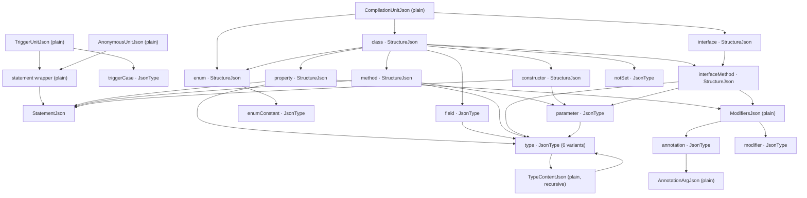
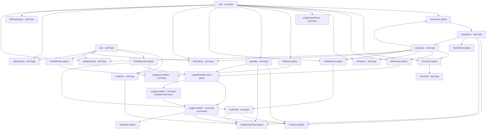

# Apex JSON Type / StructureJson Inventory

対象は `src/analyzer/types/apex/` 配下の JSON 生成層です。`converter/` は IR から CommonType への変換層であり、`JsonType` / `StructureJson` の宣言はありません。

この文書は既存の [Statement JSON リファレンス](./apex-statement-json-reference.md)とは別に、Apex 全体のタグ付き JSON 型と相互参照を一覧化します。ファイルと行番号は一覧作成時点のものです。

## 集計

- 共通定義: `JsonType<TKind>`、`StructureJson<TKind, TRecord>`、`ErrorJson`
- 具象 `JsonType` 型: 58
- 具象 `StructureJson` 型: 8
- タグ付きノードの kind: 59種類。`type`、`memberAccess`、`singleCondition` は複数の形状で使われるため型数と kind 数は一致しません。

`notSet` は型名付き alias ではなく、クラス本文の union 内で直接 `JsonType<'notSet'>` を使います。`selectEntry` と SOQL WHERE の `singleCondition` にも、型の union arm として直接 `JsonType<...>` が現れます。

## 共通基底型

| 型                              | 宣言                                                     | 形状・用途                                                                                                           |
| ------------------------------- | -------------------------------------------------------- | -------------------------------------------------------------------------------------------------------------------- |
| `JsonType<TKind>`               | [commons/json.ts](../src/analyzer/types/commons/json.ts) | `{ kind: TKind; sourceKeys: ConvertKeys }`。通常のソース範囲付きノード。                                             |
| `StructureJson<TKind, TRecord>` | [commons/json.ts](../src/analyzer/types/commons/json.ts) | `{ kind: TKind; sourceKeys: { base: ConvertKeys } & TRecord }`。ノード全体の `base` と、選択した子要素のキーも保持。 |
| `ErrorJson`                     | [commons/json.ts](../src/analyzer/types/commons/json.ts) | `JsonType<'error'> & { kindType: string }`。変換エラーを表す。                                                       |

`ConvertKeys` は `{ objectKey: string; sourceKey: string }`。各具象ノードに記載したフィールドは、基底型の `kind` / `sourceKeys` に追加されるプロパティです。

## Apex 宣言・ユニット・修飾子・型

| JSON 型 / inline node        | kind              | 基底                                   | 追加フィールド・関係                                                                        | 定義                                                             |
| ---------------------------- | ----------------- | -------------------------------------- | ------------------------------------------------------------------------------------------- | ---------------------------------------------------------------- |
| `TriggerCaseJson`            | `triggerCase`     | `JsonType`                             | `actionType: INSERT \| UPDATE \| DELETE \| UNDELETE`; `timing: BEFORE \| AFTER`             | [unit.ts](../src/analyzer/types/apex/unit.ts#L99)                |
| `notSet` (inline)            | `notSet`          | `JsonType`                             | 追加フィールドなし。クラス本文の未設定メンバーを示す。                                      | [declaration.ts](../src/analyzer/types/apex/declaration.ts#L208) |
| `EnumConstantJson`           | `enumConstant`    | `JsonType`                             | `name: string`                                                                              | [declaration.ts](../src/analyzer/types/apex/declaration.ts#L309) |
| `FieldDeclarationJson`       | `field`           | `JsonType`                             | `variants: (VariantJson \| ErrorJson)[] \| ErrorJson`; `variantType: TypeJson \| ErrorJson` | [declaration.ts](../src/analyzer/types/apex/declaration.ts#L430) |
| `MethodDeclarationJson`      | `method`          | `StructureJson<{ name: ConvertKeys }>` | `name`; `returnType`; `param?`; `block?`。本体は `StatementJson[]`。                        | [declaration.ts](../src/analyzer/types/apex/declaration.ts#L103) |
| `InterfaceMethodJson`        | `interfaceMethod` | `StructureJson<{ name: ConvertKeys }>` | `name`; `returnType`; `param?`; `modifier`                                                  | [declaration.ts](../src/analyzer/types/apex/declaration.ts#L137) |
| `InterfaceDeclarationJson`   | `interface`       | `StructureJson<{ name: ConvertKeys }>` | `name`; `block?` (interface methods); `extend?` (`TypeJson[]`)                              | [declaration.ts](../src/analyzer/types/apex/declaration.ts#L169) |
| `ClassDeclarationJson`       | `class`           | `StructureJson<{ name: ConvertKeys }>` | `name`; `block` (members); `extend?`; `implement?` (`TypeJson[]`)                           | [declaration.ts](../src/analyzer/types/apex/declaration.ts#L208) |
| `EnumDeclarationJson`        | `enum`            | `StructureJson<{ name: ConvertKeys }>` | `name`; `members?` (`EnumConstantJson[]`)                                                   | [declaration.ts](../src/analyzer/types/apex/declaration.ts#L323) |
| `PropertyDeclarationJson`    | `property`        | `StructureJson<{ name: ConvertKeys }>` | `name`; `variantType`; getter/setter flags and content; `error?`                            | [declaration.ts](../src/analyzer/types/apex/declaration.ts#L363) |
| `ConstructorDeclarationJson` | `constructor`     | `StructureJson<{ name: ConvertKeys }>` | `name`; `param?`; `block`; `modifier`                                                       | [declaration.ts](../src/analyzer/types/apex/declaration.ts#L452) |
| `DotMethodCallJson`          | `memberAccess`    | `JsonType`                             | `type: object \| method`; `object`; `operator: . \| ?.`; `member`; `memberArg?`             | [expression.ts](../src/analyzer/types/apex/expression.ts#L66)    |
| `MethodCallJson`             | `memberAccess`    | `JsonType`                             | `type: method`; `member`; `memberArg?`; `ref?`                                              | [expression.ts](../src/analyzer/types/apex/expression.ts#L109)   |
| `AnnotationJson`             | `annotation`      | `JsonType`                             | `name`; `arg?: AnnotationArgJson \| AnnotationArgJson[]`                                    | [modifier.ts](../src/analyzer/types/apex/modifier.ts#L22)        |
| `ModifierJson`               | `modifier`        | `JsonType`                             | `name` (modifier literal union)                                                             | [modifier.ts](../src/analyzer/types/apex/modifier.ts#L29)        |
| `ParameterJson`              | `parameter`       | `JsonType`                             | `variant`; `variantType: TypeJson \| ErrorJson`; `modifier: ModifiersJson`                  | [param.ts](../src/analyzer/types/apex/param.ts#L8)               |
| `PrimitiveTypeJson`          | `type`            | `JsonType`                             | `type: primitive`; `primitiveType`                                                          | [type.ts](../src/analyzer/types/apex/type.ts#L78)                |
| `CustomTypeJson`             | `type`            | `JsonType`                             | `type: custom`; `customType`; `generic?` (`TypeContentJson[]`)                              | [type.ts](../src/analyzer/types/apex/type.ts#L81)                |
| `ArrayTypeJson`              | `type`            | `JsonType`                             | `collectionType: array`; `elementType`; `dimension`                                         | [type.ts](../src/analyzer/types/apex/type.ts#L84)                |
| `ListTypeJson`               | `type`            | `JsonType`                             | `collectionType: list`; `elementType`                                                       | [type.ts](../src/analyzer/types/apex/type.ts#L87)                |
| `SetTypeJson`                | `type`            | `JsonType`                             | `collectionType: set`; `elementType`                                                        | [type.ts](../src/analyzer/types/apex/type.ts#L90)                |
| `MapTypeJson`                | `type`            | `JsonType`                             | `collectionType: map`; `keyType`; `valueType`                                               | [type.ts](../src/analyzer/types/apex/type.ts#L93)                |

`TypeJson` は上記6つの union です。最上位の型だけ `JsonType<'type'>` としてソースキーを持ち、generic 引数や要素型はタグを持たない `TypeContentJson` です。

## Statement ノード

`StatementJson` は下記25種の `JsonType` と、`catchCondition` の `StructureJson`、再帰的な文配列から成ります。フィールド詳細は [Statement JSON リファレンス](./apex-statement-json-reference.md)を参照してください。

| JSON 型                      | kind               | 基底                                                                    | 主な子ノード                                           |
| ---------------------------- | ------------------ | ----------------------------------------------------------------------- | ------------------------------------------------------ |
| `BreakStatementJson`         | `break`            | `JsonType`                                                              | なし                                                   |
| `ContinueStatementJson`      | `continue`         | `JsonType`                                                              | なし                                                   |
| `DeleteStatementJson`        | `delete`           | `JsonType`                                                              | 式                                                     |
| `DoWhileConditionJson`       | `doWhileCondition` | `JsonType`                                                              | 式                                                     |
| `DoWhileStatementJson`       | `doWhile`          | `JsonType`                                                              | do-while 条件、文配列                                  |
| `ExpressionStatementJson`    | `expression`       | `JsonType`                                                              | 式                                                     |
| `ForConditionJson`           | `forCondition`     | `JsonType`                                                              | 通常 for の初期化・条件・更新、または拡張 for の型・式 |
| `ForStatementJson`           | `for`              | `JsonType`                                                              | for 条件、文または文配列                               |
| `IfConditionJson`            | `ifCondition`      | `JsonType`                                                              | 式                                                     |
| `IfStatementJson`            | `if`               | `JsonType`                                                              | 条件節配列、文                                         |
| `InsertStatementJson`        | `insert`           | `JsonType`                                                              | 式                                                     |
| `LocalVariableStatementJson` | `localVariable`    | `JsonType`                                                              | `LocalVariableDeclarationJson`                         |
| `MergeStatementJson`         | `merge`            | `JsonType`                                                              | 式配列                                                 |
| `ReturnStatementJson`        | `return`           | `JsonType`                                                              | 任意の式                                               |
| `RunAsConditionJson`         | `runAsCondition`   | `JsonType`                                                              | 式配列                                                 |
| `RunAsStatementJson`         | `runAs`            | `JsonType`                                                              | 対象式、文配列                                         |
| `WhenVariantJson`            | `switchVariant`    | `JsonType`                                                              | 式                                                     |
| `WhenConditionJson`          | `switchCondition`  | `JsonType`                                                              | when 値 (通常値または型条件)                           |
| `SwitchStatementJson`        | `switch`           | `JsonType`                                                              | 対象式、when 節と文配列                                |
| `ThrowStatementJson`         | `throw`            | `JsonType`                                                              | 式                                                     |
| `CatchConditionJson`         | `catchCondition`   | `StructureJson<{ exception: ConvertKeys; exceptionType: ConvertKeys }>` | 例外名・型のキーを別途記録                             |
| `TryStatementJson`           | `try`              | `JsonType`                                                              | try/catch/finally 節と文配列                           |
| `UndeleteStatementJson`      | `undelete`         | `JsonType`                                                              | 式                                                     |
| `UpdateStatementJson`        | `update`           | `JsonType`                                                              | 式                                                     |
| `UpsertStatementJson`        | `upsert`           | `JsonType`                                                              | 式                                                     |
| `WhileConditionJson`         | `whileCondition`   | `JsonType`                                                              | 式                                                     |
| `WhileStatementJson`         | `while`            | `JsonType`                                                              | 条件、文または文配列                                   |

## SOQL / SOSL ノード

| JSON 型                                        | kind                | 基底       | 主なフィールド・参照先                                                                                                             |
| ---------------------------------------------- | ------------------- | ---------- | ---------------------------------------------------------------------------------------------------------------------------------- |
| `SoqlJson`                                     | `soql`              | `JsonType` | 必須 `select`, `from`; 任意 `where`, `for`, `usingScope`, `with`, `groupBy`, `orderBy`, `limit`, `offset`, `allRows`, `updateList` |
| `SubQueryJson`                                 | `subQuery`          | `JsonType` | `select`, `from`; 任意 `where`, `for`, `orderBy`, `limit`, `updateList`                                                            |
| `SelectEntryJson` (inline tagged arm)          | `selectEntry`       | `JsonType` | field / SOQL function / typeof のいずれかと `alias?`; subquery arm は `SubQueryJson` 自身                                          |
| `FromFieldJson`                                | `fromField`         | `JsonType` | `field: string[]`; `alias?`                                                                                                        |
| `SingleConditionJson`                          | `singleCondition`   | `JsonType` | field または function、比較演算子、`ValueJson`                                                                                     |
| `WhereSingleConditionJson` (inline tagged arm) | `singleCondition`   | `JsonType` | WHERE 用の `field: string`、比較演算子、`ValueJson`。または `SingleConditionJson`                                                  |
| `ForJson`                                      | `forClause`         | `JsonType` | `value: string[]`                                                                                                                  |
| `UsingScopeJson`                               | `usingScopeClause`  | `JsonType` | `value: string`                                                                                                                    |
| `DataCategorySelectionJson`                    | `categoryCondition` | `JsonType` | `group`, `selector`, `category: string[]`                                                                                          |
| `GroupByJson`                                  | `groupBy`           | `JsonType` | field/function 配列、`mode?`, `having?`                                                                                            |
| `FieldOrderJson`                               | `orderField`        | `JsonType` | field/function、`direction?`, `nulls?`                                                                                             |
| `LimitJson`                                    | `limitClause`       | `JsonType` | `type: literal \| bind`; `value`                                                                                                   |
| `OffsetJson`                                   | `offsetClause`      | `JsonType` | `type: literal \| bind`; `value`                                                                                                   |
| `AllRowsJson`                                  | `allRowsClause`     | `JsonType` | `value: string`                                                                                                                    |
| `UpdateListJson`                               | `updateClause`      | `JsonType` | `value: ('TRACKING' \| 'VIEWSTAT')[]`                                                                                              |
| `SoslFieldJson`                                | `soslField`         | `JsonType` | `field: string[] \| SoqlFunctionJson`; `func?`                                                                                     |
| `SoslJson`                                     | `sosl`              | `JsonType` | `find`; 任意 `group`, `fieldSpec`, `with`, `limit`, `update`                                                                       |

`WhereJson`, `FromJson`, `SelectJson`, `OrderByJson`, `WithJson`, `LogicalConditionJson` などは通常のオブジェクト型であり、自身は `JsonType` / `StructureJson` ではありません。`FieldJson`、`SoqlFunctionJson`、`TypeOfJson` も tagged JSON の基底型を持たない値オブジェクトです。

## 関連図

実線はフィールドが参照する型、点線はエラーを許容する境界・union 参照を表します。図中の `Expr`, `TypeJson`, `Stmt`, `ErrorJson` はそれぞれ `BaseExpressionJson`, `TypeJson`, `StatementJson`, `ErrorJson` を指します。

### ファイル・宣言・型・修飾子

### 式と statement

```mermaid
flowchart TD
    Stmt["StatementJson (recursive array or statement node)"] --> Break["break · JsonType"]
    Stmt --> Continue["continue · JsonType"]
    Stmt --> Delete["delete · JsonType"]
    Stmt --> DoWhile["doWhile · JsonType"]
    Stmt --> Expression["expression · JsonType"]
    Stmt --> For["for · JsonType"]
    Stmt --> If["if · JsonType"]
    Stmt --> Insert["insert · JsonType"]
    Stmt --> LocalVariable["localVariable · JsonType"]
    Stmt --> Merge["merge · JsonType"]
    Stmt --> Return["return · JsonType"]
    Stmt --> RunAs["runAs · JsonType"]
    Stmt --> Switch["switch · JsonType"]
    Stmt --> Throw["throw · JsonType"]
    Stmt --> Try["try · JsonType"]
    Stmt --> Undelete["undelete · JsonType"]
    Stmt --> Update["update · JsonType"]
    Stmt --> Upsert["upsert · JsonType"]
    Stmt --> While["while · JsonType"]
    Stmt -.-> Error["error · ErrorJson"]

    Delete --> Expr["BaseExpressionJson"]
    Expression --> Expr
    Insert --> Expr
    Merge --> Expr
    Return --> Expr
    Throw --> Expr
    Undelete --> Expr
    Update --> Expr
    Upsert --> Expr
    DoWhile --> DoWhileCondition["doWhileCondition · JsonType"]
    DoWhileCondition --> Expr
    DoWhile --> Stmt
    For --> ForCondition["forCondition · JsonType"]
    ForCondition --> Expr
    ForCondition --> TypeJson["TypeJson"]
    For --> Stmt
    If --> IfCondition["ifCondition · JsonType"]
    IfCondition --> Expr
    If --> Stmt
    LocalVariable --> LocalDeclaration["LocalVariableDeclarationJson (plain)"]
    RunAs --> RunAsCondition["runAsCondition · JsonType"]
    RunAsCondition --> Expr
    RunAs --> Stmt
    Switch --> SwitchVariant["switchVariant · JsonType"]
    SwitchVariant --> Expr
    Switch --> SwitchCondition["switchCondition · JsonType"]
    Switch --> Stmt
    Try --> CatchCondition["catchCondition · StructureJson"]
    Try --> Stmt
    While --> WhileCondition["whileCondition · JsonType"]
    WhileCondition --> Expr
    While --> Stmt
    Expr --> TypeJson
    Expr --> Soql["soql · JsonType"]
    Expr --> Sosl["sosl · JsonType"]
    Expr --> MemberAccess["memberAccess · JsonType (2 variants)"]
```

### クエリ

## 対象外の通常 JSON 型

Apex JSON 生成層には、次のような `JsonType` / `StructureJson` を継承しない型もあります。これらは関連図で `(plain)` と明記しましたが、上の具象 tagged 型数には含めていません。

- 宣言・ユニット: `CompilationUnitJson`, `AnonymousUnitJson`, `TriggerUnitJson`, `MemberStatementJson`, `InitializerBlockJson`, `VariantJson`, `LocalVariableDeclarationJson`
- 式: `BaseExpressionJson` の演算子ノード、`PrimaryJson`、式中間ノード
- 型: `TypeContentJson` とその6内容 variant
- 修飾子: `ModifiersJson`, `AnnotationArgJson`
- クエリ: `SelectJson`, `FromJson`, `WhereJson`, `OrderByJson`, `WithJson`, `LogicalConditionJson`, `FieldJson`, `SoqlFunctionJson`, `ValueJson` など

この区別は `kind` というプロパティを持つかどうかだけではなく、共通の `JsonType` / `StructureJson` 契約 (`sourceKeys` を含む) を実装しているかどうかに基づきます。
