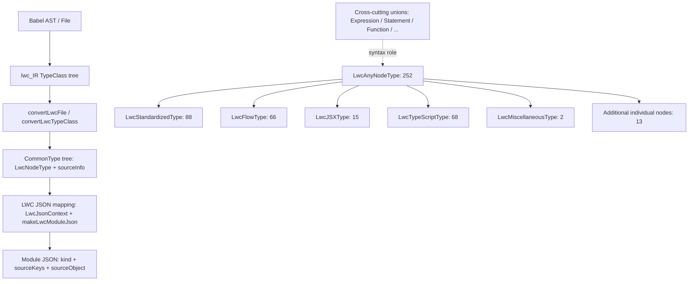

# LWC converter type inventory and relationships

This document inventories converter types from [src/analyzer/types/lwc/converter/nodes.ts](../src/analyzer/types/lwc/converter/nodes.ts). Per-node types and fields are generated from Babel <code>@babel/types</code>; this inventory lists the exported types and their runtime <code>type</code> discriminators.

## Scope and common shape

The converter exports:

- **252 individual node types**, one for each Babel AST/IR node.
- **51 union types** for Babel aliases and syntax categories.
- The generic base <code>LwcNodeType&lt;TName&gt;</code> and the alias <code>LwcAccessorType</code>.
- <code>LwcErrorType</code> is separate from the Babel node inventory and represents a failed IR conversion.

The common shape of every individual node type is <code>LwcNodeType&lt;TName&gt; = CommonType&lt;TName&gt; &amp; { sourceInfo: LwcSourceInfo }</code>. Thus every node has at least <code>type</code> and <code>sourceInfo</code>.

- <code>type</code> is the Babel node discriminator, e.g. <code>classProperty</code>.
- <code>sourceInfo</code> contains source <code>context</code>, <code>start/end</code> positions, and <code>filePath</code>.
- Node-specific fields correspond to Babel <code>NODE_FIELDS</code>. Child nodes are typed as other <code>Lwc...Type</code>s, often wrapped in <code>ValueRuleValue</code> to include <code>ErrorType</code>. Optional values may include <code>null</code>.
- A dash in the field column means the type adds no properties beyond <code>type/sourceInfo</code>.

## Type relationship diagram

<code>LwcAnyNodeType</code> is the union of all 252 individual node types. The five primary families plus 13 additional individual types partition this inventory. Other aliases such as <code>LwcExpressionType</code>, <code>LwcStatementType</code>, and <code>LwcFunctionType</code> are cross-cutting syntactic roles and overlap the families.



The upper path shows runtime conversion; the lower half shows the primary family partition. Cross-cutting unions are a separate classification and can span families.

## Runtime conversion

1. <code>convertLwcTypeClass</code> recursively walks the fields returned by <code>LwcCommonTypeClass.getFields()</code>.
2. Each IR node becomes a plain CommonType object, <code>{ type, sourceInfo, ...fields }</code>; child nodes in arrays and plain objects are converted recursively.
3. The LWC JSON layer turns CommonTypes into purpose-specific module/component/type JSON. It separates source location into each node&apos;s <code>sourceKeys</code> and the bundle-level <code>sourceObject</code>.
4. A failed IR node is converted from <code>LwcErrorTypeClass</code> to <code>LwcErrorType</code> (<code>type: "error"</code>), then can become <code>ErrorJson</code> at the JSON boundary.

## Individual node types

The additional fields below reproduce the declared property names and types. <code>ValueRuleValue&lt;T&gt;</code> means <code>T | ErrorType</code>; <code>null</code> represents absent or optional fields.

### Standardized (88)

| Converter type | Babel <code>type</code> | Additional fields |
| --- | --- | --- |
| `LwcArrayExpressionType` | `arrayExpression` | `elements: (ValueRuleValue<LwcExpressionType &#124; LwcSpreadElementType> &#124; null)[]` |
| `LwcAssignmentExpressionType` | `assignmentExpression` | `operator: AssignmentExpression['operator']`<br>`left: ValueRuleValue< &#124; LwcIdentifierType &#124; LwcMemberExpressionType &#124; LwcOptionalMemberExpressionType &#124; LwcArrayPatternType &#124; LwcObjectPatternType &#124; LwcTSAsExpressionType &#124; LwcTSSatisfiesExpressionType &#124; LwcTSTypeAssertionType &#124; LwcTSNonNullExpressionType >`<br>`right: ValueRuleValue<LwcExpressionType>` |
| `LwcBinaryExpressionType` | `binaryExpression` | `operator: BinaryExpression['operator']`<br>`left: ValueRuleValue<LwcExpressionType &#124; LwcPrivateNameType>`<br>`right: ValueRuleValue<LwcExpressionType>` |
| `LwcInterpreterDirectiveType` | `interpreterDirective` | `value: InterpreterDirective['value']` |
| `LwcDirectiveType` | `directive` | `value: ValueRuleValue<LwcDirectiveLiteralType>` |
| `LwcDirectiveLiteralType` | `directiveLiteral` | `value: DirectiveLiteral['value']` |
| `LwcBlockStatementType` | `blockStatement` | `directives: ValueRuleValue<LwcDirectiveType>[]`<br>`body: ValueRuleValue<LwcStatementType>[]` |
| `LwcBreakStatementType` | `breakStatement` | `label: ValueRuleValue<LwcIdentifierType> &#124; null` |
| `LwcCallExpressionType` | `callExpression` | `callee: ValueRuleValue< LwcExpressionType &#124; LwcSuperType &#124; LwcImportType &#124; LwcV8IntrinsicIdentifierType >`<br>`arguments: ValueRuleValue< LwcExpressionType &#124; LwcSpreadElementType &#124; LwcArgumentPlaceholderType >[]`<br>`typeArguments: ValueRuleValue< LwcTypeParameterInstantiationType &#124; LwcTSTypeParameterInstantiationType > &#124; null` |
| `LwcCatchClauseType` | `catchClause` | `param: ValueRuleValue<LwcIdentifierType &#124; LwcArrayPatternType &#124; LwcObjectPatternType> &#124; null`<br>`body: ValueRuleValue<LwcBlockStatementType>` |
| `LwcConditionalExpressionType` | `conditionalExpression` | `test: ValueRuleValue<LwcExpressionType>`<br>`consequent: ValueRuleValue<LwcExpressionType>`<br>`alternate: ValueRuleValue<LwcExpressionType>` |
| `LwcContinueStatementType` | `continueStatement` | `label: ValueRuleValue<LwcIdentifierType> &#124; null` |
| `LwcDebuggerStatementType` | `debuggerStatement` | - |
| `LwcDoWhileStatementType` | `doWhileStatement` | `test: ValueRuleValue<LwcExpressionType>`<br>`body: ValueRuleValue<LwcStatementType>` |
| `LwcEmptyStatementType` | `emptyStatement` | - |
| `LwcExpressionStatementType` | `expressionStatement` | `expression: ValueRuleValue<LwcExpressionType>` |
| `LwcFileType` | `file` | `program: ValueRuleValue<LwcProgramType>` |
| `LwcForInStatementType` | `forInStatement` | `left: ValueRuleValue< &#124; LwcVariableDeclarationType &#124; LwcIdentifierType &#124; LwcMemberExpressionType &#124; LwcArrayPatternType &#124; LwcObjectPatternType &#124; LwcTSAsExpressionType &#124; LwcTSSatisfiesExpressionType &#124; LwcTSTypeAssertionType &#124; LwcTSNonNullExpressionType >`<br>`right: ValueRuleValue<LwcExpressionType>`<br>`body: ValueRuleValue<LwcStatementType>` |
| `LwcForStatementType` | `forStatement` | `init: ValueRuleValue<LwcVariableDeclarationType &#124; LwcExpressionType> &#124; null`<br>`test: ValueRuleValue<LwcExpressionType> &#124; null`<br>`update: ValueRuleValue<LwcExpressionType> &#124; null`<br>`body: ValueRuleValue<LwcStatementType>` |
| `LwcFunctionDeclarationType` | `functionDeclaration` | `params: ValueRuleValue<LwcFunctionParameterType>[]`<br>`generator: FunctionDeclaration['generator']`<br>`async: FunctionDeclaration['async']`<br>`declare: NonNullable<FunctionDeclaration['declare']> &#124; null`<br>`id: ValueRuleValue<LwcIdentifierType> &#124; null`<br>`returnType: ValueRuleValue<LwcTypeAnnotationType &#124; LwcTSTypeAnnotationType> &#124; null`<br>`typeParameters: ValueRuleValue< LwcTypeParameterDeclarationType &#124; LwcTSTypeParameterDeclarationType > &#124; null`<br>`body: ValueRuleValue<LwcBlockStatementType>`<br>`predicate: ValueRuleValue<LwcFlowPredicateType> &#124; null` |
| `LwcFunctionExpressionType` | `functionExpression` | `params: ValueRuleValue<LwcFunctionParameterType>[]`<br>`generator: FunctionExpression['generator']`<br>`async: FunctionExpression['async']`<br>`returnType: ValueRuleValue<LwcTypeAnnotationType &#124; LwcTSTypeAnnotationType> &#124; null`<br>`typeParameters: ValueRuleValue< LwcTypeParameterDeclarationType &#124; LwcTSTypeParameterDeclarationType > &#124; null`<br>`id: ValueRuleValue<LwcIdentifierType> &#124; null`<br>`body: ValueRuleValue<LwcBlockStatementType>`<br>`predicate: ValueRuleValue<LwcFlowPredicateType> &#124; null` |
| `LwcIdentifierType` | `identifier` | `typeAnnotation: ValueRuleValue<LwcTypeAnnotationType &#124; LwcTSTypeAnnotationType> &#124; null`<br>`optional: NonNullable<Identifier['optional']> &#124; null`<br>`decorators: ValueRuleValue<LwcDecoratorType>[] &#124; null`<br>`name: Identifier['name']` |
| `LwcIfStatementType` | `ifStatement` | `test: ValueRuleValue<LwcExpressionType>`<br>`consequent: ValueRuleValue<LwcStatementType>`<br>`alternate: ValueRuleValue<LwcStatementType> &#124; null` |
| `LwcLabeledStatementType` | `labeledStatement` | `label: ValueRuleValue<LwcIdentifierType>`<br>`body: ValueRuleValue<LwcStatementType>` |
| `LwcStringLiteralType` | `stringLiteral` | `value: StringLiteral['value']` |
| `LwcNumericLiteralType` | `numericLiteral` | `value: NumericLiteral['value']` |
| `LwcNullLiteralType` | `nullLiteral` | - |
| `LwcBooleanLiteralType` | `booleanLiteral` | `value: BooleanLiteral['value']` |
| `LwcRegExpLiteralType` | `regExpLiteral` | `pattern: RegExpLiteral['pattern']`<br>`flags: RegExpLiteral['flags']` |
| `LwcLogicalExpressionType` | `logicalExpression` | `operator: LogicalExpression['operator']`<br>`left: ValueRuleValue<LwcExpressionType>`<br>`right: ValueRuleValue<LwcExpressionType>` |
| `LwcMemberExpressionType` | `memberExpression` | `object: ValueRuleValue<LwcExpressionType &#124; LwcSuperType>`<br>`property: ValueRuleValue<LwcExpressionType &#124; LwcPrivateNameType>`<br>`computed: MemberExpression['computed']` |
| `LwcNewExpressionType` | `newExpression` | `callee: ValueRuleValue<LwcExpressionType &#124; LwcV8IntrinsicIdentifierType>`<br>`arguments: ValueRuleValue< LwcExpressionType &#124; LwcSpreadElementType &#124; LwcArgumentPlaceholderType >[]`<br>`typeArguments: ValueRuleValue< LwcTypeParameterInstantiationType &#124; LwcTSTypeParameterInstantiationType > &#124; null` |
| `LwcProgramType` | `program` | `sourceType: Program['sourceType']`<br>`interpreter: ValueRuleValue<LwcInterpreterDirectiveType> &#124; null`<br>`directives: ValueRuleValue<LwcDirectiveType>[]`<br>`body: ValueRuleValue<LwcStatementType>[]` |
| `LwcObjectExpressionType` | `objectExpression` | `properties: ValueRuleValue< LwcObjectMethodType &#124; LwcObjectPropertyType &#124; LwcSpreadElementType >[]` |
| `LwcObjectMethodType` | `objectMethod` | `params: ValueRuleValue<LwcFunctionParameterType>[]`<br>`generator: ObjectMethod['generator']`<br>`async: ObjectMethod['async']`<br>`returnType: ValueRuleValue<LwcTypeAnnotationType &#124; LwcTSTypeAnnotationType> &#124; null`<br>`typeParameters: ValueRuleValue< LwcTypeParameterDeclarationType &#124; LwcTSTypeParameterDeclarationType > &#124; null`<br>`kind: ObjectMethod['kind']`<br>`computed: ObjectMethod['computed']`<br>`key: ValueRuleValue<LwcExpressionType>`<br>`decorators: ValueRuleValue<LwcDecoratorType>[] &#124; null`<br>`body: ValueRuleValue<LwcBlockStatementType>` |
| `LwcObjectPropertyType` | `objectProperty` | `computed: ObjectProperty['computed']`<br>`key: ValueRuleValue<LwcExpressionType &#124; LwcPrivateNameType>`<br>`value: ValueRuleValue<LwcExpressionType &#124; LwcPatternLikeType>`<br>`shorthand: ObjectProperty['shorthand']`<br>`decorators: ValueRuleValue<LwcDecoratorType>[] &#124; null` |
| `LwcRestElementType` | `restElement` | `typeAnnotation: ValueRuleValue<LwcTypeAnnotationType &#124; LwcTSTypeAnnotationType> &#124; null`<br>`optional: NonNullable<RestElement['optional']> &#124; null`<br>`decorators: ValueRuleValue<LwcDecoratorType>[] &#124; null`<br>`argument: ValueRuleValue< &#124; LwcIdentifierType &#124; LwcArrayPatternType &#124; LwcObjectPatternType &#124; LwcMemberExpressionType &#124; LwcTSAsExpressionType &#124; LwcTSSatisfiesExpressionType &#124; LwcTSTypeAssertionType &#124; LwcTSNonNullExpressionType >` |
| `LwcReturnStatementType` | `returnStatement` | `argument: ValueRuleValue<LwcExpressionType> &#124; null` |
| `LwcSequenceExpressionType` | `sequenceExpression` | `expressions: ValueRuleValue<LwcExpressionType>[]` |
| `LwcParenthesizedExpressionType` | `parenthesizedExpression` | `expression: ValueRuleValue<LwcExpressionType>` |
| `LwcSwitchCaseType` | `switchCase` | `test: ValueRuleValue<LwcExpressionType> &#124; null`<br>`consequent: ValueRuleValue<LwcStatementType>[]` |
| `LwcSwitchStatementType` | `switchStatement` | `discriminant: ValueRuleValue<LwcExpressionType>`<br>`cases: ValueRuleValue<LwcSwitchCaseType>[]` |
| `LwcThisExpressionType` | `thisExpression` | - |
| `LwcThrowStatementType` | `throwStatement` | `argument: ValueRuleValue<LwcExpressionType>` |
| `LwcTryStatementType` | `tryStatement` | `block: ValueRuleValue<LwcBlockStatementType>`<br>`handler: ValueRuleValue<LwcCatchClauseType> &#124; null`<br>`finalizer: ValueRuleValue<LwcBlockStatementType> &#124; null` |
| `LwcUnaryExpressionType` | `unaryExpression` | `prefix: UnaryExpression['prefix']`<br>`argument: ValueRuleValue<LwcExpressionType>`<br>`operator: UnaryExpression['operator']` |
| `LwcUpdateExpressionType` | `updateExpression` | `prefix: UpdateExpression['prefix']`<br>`argument: ValueRuleValue<LwcIdentifierType &#124; LwcMemberExpressionType>`<br>`operator: UpdateExpression['operator']` |
| `LwcVariableDeclarationType` | `variableDeclaration` | `declare: NonNullable<VariableDeclaration['declare']> &#124; null`<br>`kind: VariableDeclaration['kind']`<br>`declarations: ValueRuleValue<LwcVariableDeclaratorType>[]` |
| `LwcVariableDeclaratorType` | `variableDeclarator` | `id: ValueRuleValue< LwcIdentifierType &#124; LwcArrayPatternType &#124; LwcObjectPatternType &#124; LwcVoidPatternType >`<br>`definite: NonNullable<VariableDeclarator['definite']> &#124; null`<br>`init: ValueRuleValue<LwcExpressionType> &#124; null` |
| `LwcWhileStatementType` | `whileStatement` | `test: ValueRuleValue<LwcExpressionType>`<br>`body: ValueRuleValue<LwcStatementType>` |
| `LwcWithStatementType` | `withStatement` | `object: ValueRuleValue<LwcExpressionType>`<br>`body: ValueRuleValue<LwcStatementType>` |
| `LwcAssignmentPatternType` | `assignmentPattern` | `typeAnnotation: ValueRuleValue<LwcTypeAnnotationType &#124; LwcTSTypeAnnotationType> &#124; null`<br>`optional: NonNullable<AssignmentPattern['optional']> &#124; null`<br>`decorators: ValueRuleValue<LwcDecoratorType>[] &#124; null`<br>`left: ValueRuleValue< &#124; LwcIdentifierType &#124; LwcObjectPatternType &#124; LwcArrayPatternType &#124; LwcMemberExpressionType &#124; LwcTSAsExpressionType &#124; LwcTSSatisfiesExpressionType &#124; LwcTSTypeAssertionType &#124; LwcTSNonNullExpressionType >`<br>`right: ValueRuleValue<LwcExpressionType>` |
| `LwcArrayPatternType` | `arrayPattern` | `typeAnnotation: ValueRuleValue<LwcTypeAnnotationType &#124; LwcTSTypeAnnotationType> &#124; null`<br>`optional: NonNullable<ArrayPattern['optional']> &#124; null`<br>`decorators: ValueRuleValue<LwcDecoratorType>[] &#124; null`<br>`elements: (ValueRuleValue<LwcPatternLikeType> &#124; null)[]` |
| `LwcArrowFunctionExpressionType` | `arrowFunctionExpression` | `params: ValueRuleValue<LwcFunctionParameterType>[]`<br>`generator: NonNullable<ArrowFunctionExpression['generator']> &#124; null`<br>`async: ArrowFunctionExpression['async']`<br>`returnType: ValueRuleValue<LwcTypeAnnotationType &#124; LwcTSTypeAnnotationType> &#124; null`<br>`typeParameters: ValueRuleValue< LwcTypeParameterDeclarationType &#124; LwcTSTypeParameterDeclarationType > &#124; null`<br>`expression: NonNullable<ArrowFunctionExpression['expression']> &#124; null`<br>`body: ValueRuleValue<LwcBlockStatementType &#124; LwcExpressionType>`<br>`predicate: ValueRuleValue<LwcFlowPredicateType> &#124; null` |
| `LwcClassBodyType` | `classBody` | `body: ValueRuleValue< &#124; LwcClassMethodType &#124; LwcClassPrivateMethodType &#124; LwcClassPropertyType &#124; LwcClassPrivatePropertyType &#124; LwcClassAccessorPropertyType &#124; LwcTSDeclareMethodType &#124; LwcTSIndexSignatureType &#124; LwcStaticBlockType >[]` |
| `LwcClassExpressionType` | `classExpression` | `id: ValueRuleValue<LwcIdentifierType> &#124; null`<br>`typeParameters: ValueRuleValue< LwcTypeParameterDeclarationType &#124; LwcTSTypeParameterDeclarationType > &#124; null`<br>`body: ValueRuleValue<LwcClassBodyType>`<br>`superClass: ValueRuleValue<LwcExpressionType> &#124; null`<br>`superTypeArguments: ValueRuleValue< LwcTypeParameterInstantiationType &#124; LwcTSTypeParameterInstantiationType > &#124; null`<br>`implements: ValueRuleValue<LwcTSClassImplementsType &#124; LwcClassImplementsType>[] &#124; null`<br>`decorators: ValueRuleValue<LwcDecoratorType>[] &#124; null`<br>`mixins: ValueRuleValue<LwcInterfaceExtendsType> &#124; null` |
| `LwcClassDeclarationType` | `classDeclaration` | `id: ValueRuleValue<LwcIdentifierType> &#124; null`<br>`typeParameters: ValueRuleValue< LwcTypeParameterDeclarationType &#124; LwcTSTypeParameterDeclarationType > &#124; null`<br>`body: ValueRuleValue<LwcClassBodyType>`<br>`superClass: ValueRuleValue<LwcExpressionType> &#124; null`<br>`superTypeArguments: ValueRuleValue< LwcTypeParameterInstantiationType &#124; LwcTSTypeParameterInstantiationType > &#124; null`<br>`implements: ValueRuleValue<LwcTSClassImplementsType &#124; LwcClassImplementsType>[] &#124; null`<br>`decorators: ValueRuleValue<LwcDecoratorType>[] &#124; null`<br>`mixins: ValueRuleValue<LwcInterfaceExtendsType> &#124; null`<br>`declare: NonNullable<ClassDeclaration['declare']> &#124; null`<br>`abstract: NonNullable<ClassDeclaration['abstract']> &#124; null` |
| `LwcExportAllDeclarationType` | `exportAllDeclaration` | `source: ValueRuleValue<LwcStringLiteralType>`<br>`exportKind: NonNullable<ExportAllDeclaration['exportKind']> &#124; null`<br>`attributes: ValueRuleValue<LwcImportAttributeType>[] &#124; null` |
| `LwcExportDefaultDeclarationType` | `exportDefaultDeclaration` | `declaration: ValueRuleValue< &#124; LwcFunctionDeclarationType &#124; LwcClassDeclarationType &#124; LwcExpressionType &#124; LwcTSDeclareFunctionType &#124; LwcTSInterfaceDeclarationType &#124; LwcEnumDeclarationType >`<br>`exportKind: NonNullable<ExportDefaultDeclaration['exportKind']> &#124; null` |
| `LwcExportNamedDeclarationType` | `exportNamedDeclaration` | `declaration: ValueRuleValue<LwcDeclarationType> &#124; null`<br>`attributes: ValueRuleValue<LwcImportAttributeType>[] &#124; null`<br>`specifiers: ValueRuleValue< LwcExportSpecifierType &#124; LwcExportDefaultSpecifierType &#124; LwcExportNamespaceSpecifierType >[]`<br>`source: ValueRuleValue<LwcStringLiteralType> &#124; null`<br>`exportKind: NonNullable<ExportNamedDeclaration['exportKind']> &#124; null` |
| `LwcExportSpecifierType` | `exportSpecifier` | `local: ValueRuleValue<LwcIdentifierType &#124; LwcStringLiteralType>`<br>`exported: ValueRuleValue<LwcIdentifierType &#124; LwcStringLiteralType>`<br>`exportKind: NonNullable<ExportSpecifier['exportKind']> &#124; null` |
| `LwcForOfStatementType` | `forOfStatement` | `left: ValueRuleValue< &#124; LwcVariableDeclarationType &#124; LwcIdentifierType &#124; LwcMemberExpressionType &#124; LwcArrayPatternType &#124; LwcObjectPatternType &#124; LwcTSAsExpressionType &#124; LwcTSSatisfiesExpressionType &#124; LwcTSTypeAssertionType &#124; LwcTSNonNullExpressionType >`<br>`right: ValueRuleValue<LwcExpressionType>`<br>`body: ValueRuleValue<LwcStatementType>`<br>`await: ForOfStatement['await']` |
| `LwcImportDeclarationType` | `importDeclaration` | `attributes: ValueRuleValue<LwcImportAttributeType>[] &#124; null`<br>`module: NonNullable<ImportDeclaration['module']> &#124; null`<br>`phase: NonNullable<ImportDeclaration['phase']> &#124; null`<br>`specifiers: ValueRuleValue< LwcImportSpecifierType &#124; LwcImportDefaultSpecifierType &#124; LwcImportNamespaceSpecifierType >[]`<br>`source: ValueRuleValue<LwcStringLiteralType>`<br>`importKind: NonNullable<ImportDeclaration['importKind']> &#124; null` |
| `LwcImportDefaultSpecifierType` | `importDefaultSpecifier` | `local: ValueRuleValue<LwcIdentifierType>` |
| `LwcImportNamespaceSpecifierType` | `importNamespaceSpecifier` | `local: ValueRuleValue<LwcIdentifierType>` |
| `LwcImportSpecifierType` | `importSpecifier` | `local: ValueRuleValue<LwcIdentifierType>`<br>`imported: ValueRuleValue<LwcIdentifierType &#124; LwcStringLiteralType>`<br>`importKind: NonNullable<ImportSpecifier['importKind']> &#124; null` |
| `LwcMetaPropertyType` | `metaProperty` | `meta: ValueRuleValue<LwcIdentifierType>`<br>`property: ValueRuleValue<LwcIdentifierType>` |
| `LwcClassMethodType` | `classMethod` | `params: ValueRuleValue<LwcFunctionParameterType &#124; LwcTSParameterPropertyType>[]`<br>`generator: ClassMethod['generator']`<br>`async: ClassMethod['async']`<br>`abstract: NonNullable<ClassMethod['abstract']> &#124; null`<br>`accessibility: NonNullable<ClassMethod['accessibility']> &#124; null`<br>`static: ClassMethod['static']`<br>`override: NonNullable<ClassMethod['override']> &#124; null`<br>`computed: ClassMethod['computed']`<br>`optional: NonNullable<ClassMethod['optional']> &#124; null`<br>`key: ValueRuleValue<LwcExpressionType &#124; LwcPrivateNameType>`<br>`kind: ClassMethod['kind']`<br>`access: NonNullable<ClassMethod['access']> &#124; null`<br>`decorators: ValueRuleValue<LwcDecoratorType>[] &#124; null`<br>`returnType: ValueRuleValue<LwcTypeAnnotationType &#124; LwcTSTypeAnnotationType> &#124; null`<br>`typeParameters: ValueRuleValue< LwcTypeParameterDeclarationType &#124; LwcTSTypeParameterDeclarationType > &#124; null`<br>`body: ValueRuleValue<LwcBlockStatementType>` |
| `LwcObjectPatternType` | `objectPattern` | `typeAnnotation: ValueRuleValue<LwcTypeAnnotationType &#124; LwcTSTypeAnnotationType> &#124; null`<br>`optional: NonNullable<ObjectPattern['optional']> &#124; null`<br>`decorators: ValueRuleValue<LwcDecoratorType>[] &#124; null`<br>`properties: ValueRuleValue<LwcRestElementType &#124; LwcObjectPropertyType>[]` |
| `LwcSpreadElementType` | `spreadElement` | `argument: ValueRuleValue<LwcExpressionType>` |
| `LwcSuperType` | `super` | - |
| `LwcTaggedTemplateExpressionType` | `taggedTemplateExpression` | `tag: ValueRuleValue<LwcExpressionType>`<br>`quasi: ValueRuleValue<LwcTemplateLiteralType>`<br>`typeArguments: ValueRuleValue< LwcTypeParameterInstantiationType &#124; LwcTSTypeParameterInstantiationType > &#124; null` |
| `LwcTemplateElementType` | `templateElement` | `value: TemplateElement['value']`<br>`tail: TemplateElement['tail']` |
| `LwcTemplateLiteralType` | `templateLiteral` | `quasis: ValueRuleValue<LwcTemplateElementType>[]`<br>`expressions: ValueRuleValue<LwcExpressionType &#124; LwcTSTypeType>[]` |
| `LwcYieldExpressionType` | `yieldExpression` | `delegate: YieldExpression['delegate']`<br>`argument: ValueRuleValue<LwcExpressionType> &#124; null` |
| `LwcAwaitExpressionType` | `awaitExpression` | `argument: ValueRuleValue<LwcExpressionType>` |
| `LwcImportExpressionType` | `importExpression` | `phase: NonNullable<ImportExpression['phase']> &#124; null`<br>`source: ValueRuleValue<LwcExpressionType>`<br>`options: ValueRuleValue<LwcExpressionType> &#124; null` |
| `LwcImportType` | `import` | - |
| `LwcBigIntLiteralType` | `bigIntLiteral` | `value: BigIntLiteral['value']` |
| `LwcExportNamespaceSpecifierType` | `exportNamespaceSpecifier` | `exported: ValueRuleValue<LwcIdentifierType &#124; LwcStringLiteralType>` |
| `LwcOptionalMemberExpressionType` | `optionalMemberExpression` | `object: ValueRuleValue<LwcExpressionType>`<br>`property: ValueRuleValue<LwcExpressionType &#124; LwcPrivateNameType>`<br>`computed: OptionalMemberExpression['computed']`<br>`optional: OptionalMemberExpression['optional']` |
| `LwcOptionalCallExpressionType` | `optionalCallExpression` | `callee: ValueRuleValue<LwcExpressionType>`<br>`arguments: ValueRuleValue< LwcExpressionType &#124; LwcSpreadElementType &#124; LwcArgumentPlaceholderType >[]`<br>`optional: OptionalCallExpression['optional']`<br>`typeArguments: ValueRuleValue< LwcTypeParameterInstantiationType &#124; LwcTSTypeParameterInstantiationType > &#124; null` |
| `LwcClassPropertyType` | `classProperty` | `abstract: NonNullable<ClassProperty['abstract']> &#124; null`<br>`accessibility: NonNullable<ClassProperty['accessibility']> &#124; null`<br>`static: ClassProperty['static']`<br>`override: NonNullable<ClassProperty['override']> &#124; null`<br>`computed: ClassProperty['computed']`<br>`optional: NonNullable<ClassProperty['optional']> &#124; null`<br>`key: ValueRuleValue<LwcExpressionType &#124; LwcPrivateNameType>`<br>`value: ValueRuleValue<LwcExpressionType> &#124; null`<br>`definite: NonNullable<ClassProperty['definite']> &#124; null`<br>`typeAnnotation: ValueRuleValue<LwcTypeAnnotationType &#124; LwcTSTypeAnnotationType> &#124; null`<br>`decorators: ValueRuleValue<LwcDecoratorType>[] &#124; null`<br>`readonly: NonNullable<ClassProperty['readonly']> &#124; null`<br>`declare: NonNullable<ClassProperty['declare']> &#124; null`<br>`variance: ValueRuleValue<LwcVarianceType> &#124; null` |
| `LwcClassPrivatePropertyType` | `classPrivateProperty` | `key: ValueRuleValue<LwcPrivateNameType>`<br>`value: ValueRuleValue<LwcExpressionType> &#124; null`<br>`typeAnnotation: ValueRuleValue<LwcTypeAnnotationType &#124; LwcTSTypeAnnotationType> &#124; null`<br>`decorators: ValueRuleValue<LwcDecoratorType>[] &#124; null`<br>`static: ClassPrivateProperty['static']`<br>`readonly: NonNullable<ClassPrivateProperty['readonly']> &#124; null`<br>`optional: NonNullable<ClassPrivateProperty['optional']> &#124; null`<br>`definite: NonNullable<ClassPrivateProperty['definite']> &#124; null`<br>`variance: ValueRuleValue<LwcVarianceType> &#124; null` |
| `LwcClassPrivateMethodType` | `classPrivateMethod` | `params: ValueRuleValue<LwcFunctionParameterType &#124; LwcTSParameterPropertyType>[]`<br>`generator: ClassPrivateMethod['generator']`<br>`async: ClassPrivateMethod['async']`<br>`abstract: NonNullable<ClassPrivateMethod['abstract']> &#124; null`<br>`accessibility: NonNullable<ClassPrivateMethod['accessibility']> &#124; null`<br>`static: ClassPrivateMethod['static']`<br>`override: NonNullable<ClassPrivateMethod['override']> &#124; null`<br>`computed: ClassPrivateMethod['computed']`<br>`optional: NonNullable<ClassPrivateMethod['optional']> &#124; null`<br>`key: ValueRuleValue<LwcPrivateNameType>`<br>`kind: ClassPrivateMethod['kind']`<br>`access: NonNullable<ClassPrivateMethod['access']> &#124; null`<br>`decorators: ValueRuleValue<LwcDecoratorType>[] &#124; null`<br>`returnType: ValueRuleValue<LwcTypeAnnotationType &#124; LwcTSTypeAnnotationType> &#124; null`<br>`typeParameters: ValueRuleValue< LwcTypeParameterDeclarationType &#124; LwcTSTypeParameterDeclarationType > &#124; null`<br>`body: ValueRuleValue<LwcBlockStatementType>` |
| `LwcPrivateNameType` | `privateName` | `id: ValueRuleValue<LwcIdentifierType>` |
| `LwcStaticBlockType` | `staticBlock` | `body: ValueRuleValue<LwcStatementType>[]` |
| `LwcImportAttributeType` | `importAttribute` | `key: ValueRuleValue<LwcIdentifierType &#124; LwcStringLiteralType>`<br>`value: ValueRuleValue<LwcStringLiteralType>` |

### Flow (66)

| Converter type | Babel <code>type</code> | Additional fields |
| --- | --- | --- |
| `LwcAnyTypeAnnotationType` | `anyTypeAnnotation` | - |
| `LwcArrayTypeAnnotationType` | `arrayTypeAnnotation` | `elementType: ValueRuleValue<LwcFlowTypeType>` |
| `LwcBooleanTypeAnnotationType` | `booleanTypeAnnotation` | - |
| `LwcBooleanLiteralTypeAnnotationType` | `booleanLiteralTypeAnnotation` | `value: BooleanLiteralTypeAnnotation['value']` |
| `LwcNullLiteralTypeAnnotationType` | `nullLiteralTypeAnnotation` | - |
| `LwcClassImplementsType` | `classImplements` | `id: ValueRuleValue<LwcIdentifierType>`<br>`typeParameters: ValueRuleValue<LwcTypeParameterInstantiationType> &#124; null` |
| `LwcDeclareClassType` | `declareClass` | `id: ValueRuleValue<LwcIdentifierType>`<br>`typeParameters: ValueRuleValue<LwcTypeParameterDeclarationType> &#124; null`<br>`extends: ValueRuleValue<LwcInterfaceExtendsType>[] &#124; null`<br>`mixins: ValueRuleValue<LwcInterfaceExtendsType>[] &#124; null`<br>`implements: ValueRuleValue<LwcClassImplementsType>[] &#124; null`<br>`body: ValueRuleValue<LwcObjectTypeAnnotationType>` |
| `LwcDeclareFunctionType` | `declareFunction` | `id: ValueRuleValue<LwcIdentifierType>`<br>`predicate: ValueRuleValue<LwcFlowPredicateType> &#124; null` |
| `LwcDeclareInterfaceType` | `declareInterface` | `id: ValueRuleValue<LwcIdentifierType>`<br>`typeParameters: ValueRuleValue<LwcTypeParameterDeclarationType> &#124; null`<br>`extends: ValueRuleValue<LwcInterfaceExtendsType>[] &#124; null`<br>`body: ValueRuleValue<LwcObjectTypeAnnotationType>` |
| `LwcDeclareModuleType` | `declareModule` | `id: ValueRuleValue<LwcIdentifierType &#124; LwcStringLiteralType>`<br>`body: ValueRuleValue<LwcBlockStatementType>`<br>`kind: NonNullable<DeclareModule['kind']> &#124; null` |
| `LwcDeclareModuleExportsType` | `declareModuleExports` | `typeAnnotation: ValueRuleValue<LwcTypeAnnotationType>` |
| `LwcDeclareTypeAliasType` | `declareTypeAlias` | `id: ValueRuleValue<LwcIdentifierType>`<br>`typeParameters: ValueRuleValue<LwcTypeParameterDeclarationType> &#124; null`<br>`right: ValueRuleValue<LwcFlowTypeType>` |
| `LwcDeclareOpaqueTypeType` | `declareOpaqueType` | `id: ValueRuleValue<LwcIdentifierType>`<br>`typeParameters: ValueRuleValue<LwcTypeParameterDeclarationType> &#124; null`<br>`supertype: ValueRuleValue<LwcFlowTypeType> &#124; null`<br>`impltype: ValueRuleValue<LwcFlowTypeType> &#124; null` |
| `LwcDeclareVariableType` | `declareVariable` | `id: ValueRuleValue<LwcIdentifierType>` |
| `LwcDeclareExportDeclarationType` | `declareExportDeclaration` | `declaration: ValueRuleValue<LwcFlowType> &#124; null`<br>`specifiers: ValueRuleValue<LwcExportSpecifierType &#124; LwcExportNamespaceSpecifierType>[] &#124; null`<br>`source: ValueRuleValue<LwcStringLiteralType> &#124; null`<br>`default: NonNullable<DeclareExportDeclaration['default']> &#124; null`<br>`attributes: ValueRuleValue<LwcImportAttributeType>[] &#124; null` |
| `LwcDeclareExportAllDeclarationType` | `declareExportAllDeclaration` | `source: ValueRuleValue<LwcStringLiteralType>`<br>`exportKind: NonNullable<DeclareExportAllDeclaration['exportKind']> &#124; null`<br>`attributes: ValueRuleValue<LwcImportAttributeType>[] &#124; null` |
| `LwcDeclaredPredicateType` | `declaredPredicate` | `value: ValueRuleValue<LwcExpressionType>` |
| `LwcExistsTypeAnnotationType` | `existsTypeAnnotation` | - |
| `LwcFunctionTypeAnnotationType` | `functionTypeAnnotation` | `typeParameters: ValueRuleValue<LwcTypeParameterDeclarationType> &#124; null`<br>`params: ValueRuleValue<LwcFunctionTypeParamType>[]`<br>`rest: ValueRuleValue<LwcFunctionTypeParamType> &#124; null`<br>`this: ValueRuleValue<LwcFunctionTypeParamType> &#124; null`<br>`returnType: ValueRuleValue<LwcFlowTypeType>` |
| `LwcFunctionTypeParamType` | `functionTypeParam` | `name: ValueRuleValue<LwcIdentifierType> &#124; null`<br>`typeAnnotation: ValueRuleValue<LwcFlowTypeType>`<br>`optional: NonNullable<FunctionTypeParam['optional']> &#124; null` |
| `LwcGenericTypeAnnotationType` | `genericTypeAnnotation` | `id: ValueRuleValue<LwcIdentifierType &#124; LwcQualifiedTypeIdentifierType>`<br>`typeParameters: ValueRuleValue<LwcTypeParameterInstantiationType> &#124; null` |
| `LwcInferredPredicateType` | `inferredPredicate` | - |
| `LwcInterfaceExtendsType` | `interfaceExtends` | `id: ValueRuleValue<LwcIdentifierType &#124; LwcQualifiedTypeIdentifierType>`<br>`typeParameters: ValueRuleValue<LwcTypeParameterInstantiationType> &#124; null` |
| `LwcInterfaceDeclarationType` | `interfaceDeclaration` | `id: ValueRuleValue<LwcIdentifierType>`<br>`typeParameters: ValueRuleValue<LwcTypeParameterDeclarationType> &#124; null`<br>`extends: ValueRuleValue<LwcInterfaceExtendsType>[] &#124; null`<br>`body: ValueRuleValue<LwcObjectTypeAnnotationType>` |
| `LwcInterfaceTypeAnnotationType` | `interfaceTypeAnnotation` | `extends: ValueRuleValue<LwcInterfaceExtendsType>[] &#124; null`<br>`body: ValueRuleValue<LwcObjectTypeAnnotationType>` |
| `LwcIntersectionTypeAnnotationType` | `intersectionTypeAnnotation` | `types: ValueRuleValue<LwcFlowTypeType>[]` |
| `LwcMixedTypeAnnotationType` | `mixedTypeAnnotation` | - |
| `LwcEmptyTypeAnnotationType` | `emptyTypeAnnotation` | - |
| `LwcNullableTypeAnnotationType` | `nullableTypeAnnotation` | `typeAnnotation: ValueRuleValue<LwcFlowTypeType>` |
| `LwcNumberLiteralTypeAnnotationType` | `numberLiteralTypeAnnotation` | `value: NumberLiteralTypeAnnotation['value']` |
| `LwcBigIntLiteralTypeAnnotationType` | `bigIntLiteralTypeAnnotation` | `value: BigIntLiteralTypeAnnotation['value']` |
| `LwcNumberTypeAnnotationType` | `numberTypeAnnotation` | - |
| `LwcObjectTypeAnnotationType` | `objectTypeAnnotation` | `properties: ValueRuleValue<LwcObjectTypePropertyType &#124; LwcObjectTypeSpreadPropertyType>[]`<br>`indexers: ValueRuleValue<LwcObjectTypeIndexerType>[]`<br>`callProperties: ValueRuleValue<LwcObjectTypeCallPropertyType>[]`<br>`internalSlots: ValueRuleValue<LwcObjectTypeInternalSlotType>[]`<br>`exact: ObjectTypeAnnotation['exact']`<br>`inexact: NonNullable<ObjectTypeAnnotation['inexact']> &#124; null` |
| `LwcObjectTypeInternalSlotType` | `objectTypeInternalSlot` | `id: ValueRuleValue<LwcIdentifierType>`<br>`value: ValueRuleValue<LwcFlowTypeType>`<br>`optional: ObjectTypeInternalSlot['optional']`<br>`static: ObjectTypeInternalSlot['static']`<br>`method: ObjectTypeInternalSlot['method']` |
| `LwcObjectTypeCallPropertyType` | `objectTypeCallProperty` | `value: ValueRuleValue<LwcFlowTypeType>`<br>`static: ObjectTypeCallProperty['static']` |
| `LwcObjectTypeIndexerType` | `objectTypeIndexer` | `id: ValueRuleValue<LwcIdentifierType> &#124; null`<br>`key: ValueRuleValue<LwcFlowTypeType>`<br>`value: ValueRuleValue<LwcFlowTypeType>`<br>`static: ObjectTypeIndexer['static']`<br>`variance: ValueRuleValue<LwcVarianceType> &#124; null` |
| `LwcObjectTypePropertyType` | `objectTypeProperty` | `key: ValueRuleValue<LwcIdentifierType &#124; LwcStringLiteralType &#124; LwcNumericLiteralType>`<br>`value: ValueRuleValue<LwcFlowTypeType>`<br>`kind: ObjectTypeProperty['kind']`<br>`static: ObjectTypeProperty['static']`<br>`proto: ObjectTypeProperty['proto']`<br>`optional: ObjectTypeProperty['optional']`<br>`variance: ValueRuleValue<LwcVarianceType> &#124; null`<br>`method: ObjectTypeProperty['method']` |
| `LwcObjectTypeSpreadPropertyType` | `objectTypeSpreadProperty` | `argument: ValueRuleValue<LwcFlowTypeType>` |
| `LwcOpaqueTypeType` | `opaqueType` | `id: ValueRuleValue<LwcIdentifierType>`<br>`typeParameters: ValueRuleValue<LwcTypeParameterDeclarationType> &#124; null`<br>`supertype: ValueRuleValue<LwcFlowTypeType> &#124; null`<br>`impltype: ValueRuleValue<LwcFlowTypeType>` |
| `LwcQualifiedTypeIdentifierType` | `qualifiedTypeIdentifier` | `id: ValueRuleValue<LwcIdentifierType>`<br>`qualification: ValueRuleValue<LwcIdentifierType &#124; LwcQualifiedTypeIdentifierType>` |
| `LwcStringLiteralTypeAnnotationType` | `stringLiteralTypeAnnotation` | `value: StringLiteralTypeAnnotation['value']` |
| `LwcStringTypeAnnotationType` | `stringTypeAnnotation` | - |
| `LwcSymbolTypeAnnotationType` | `symbolTypeAnnotation` | - |
| `LwcThisTypeAnnotationType` | `thisTypeAnnotation` | - |
| `LwcTupleTypeAnnotationType` | `tupleTypeAnnotation` | `types: ValueRuleValue<LwcFlowTypeType>[]` |
| `LwcTypeofTypeAnnotationType` | `typeofTypeAnnotation` | `argument: ValueRuleValue<LwcFlowTypeType &#124; LwcIdentifierType>` |
| `LwcTypeAliasType` | `typeAlias` | `id: ValueRuleValue<LwcIdentifierType>`<br>`typeParameters: ValueRuleValue<LwcTypeParameterDeclarationType> &#124; null`<br>`right: ValueRuleValue<LwcFlowTypeType>` |
| `LwcTypeAnnotationType` | `typeAnnotation` | `typeAnnotation: ValueRuleValue<LwcFlowTypeType &#124; LwcIdentifierType>` |
| `LwcTypeCastExpressionType` | `typeCastExpression` | `expression: ValueRuleValue<LwcExpressionType>`<br>`typeAnnotation: ValueRuleValue<LwcTypeAnnotationType>` |
| `LwcTypeParameterType` | `typeParameter` | `name: TypeParameter['name']`<br>`bound: ValueRuleValue<LwcTypeAnnotationType> &#124; null`<br>`default: ValueRuleValue<LwcFlowTypeType> &#124; null`<br>`variance: ValueRuleValue<LwcVarianceType> &#124; null` |
| `LwcTypeParameterDeclarationType` | `typeParameterDeclaration` | `params: ValueRuleValue<LwcTypeParameterType>[]` |
| `LwcTypeParameterInstantiationType` | `typeParameterInstantiation` | `params: ValueRuleValue<LwcFlowTypeType>[]` |
| `LwcUnionTypeAnnotationType` | `unionTypeAnnotation` | `types: ValueRuleValue<LwcFlowTypeType>[]` |
| `LwcVarianceType` | `variance` | `kind: Variance['kind']` |
| `LwcVoidTypeAnnotationType` | `voidTypeAnnotation` | - |
| `LwcEnumDeclarationType` | `enumDeclaration` | `id: ValueRuleValue<LwcIdentifierType>`<br>`body: ValueRuleValue< &#124; LwcEnumBooleanBodyType &#124; LwcEnumNumberBodyType &#124; LwcEnumStringBodyType &#124; LwcEnumSymbolBodyType >` |
| `LwcEnumBooleanBodyType` | `enumBooleanBody` | `explicitType: EnumBooleanBody['explicitType']`<br>`hasUnknownMembers: EnumBooleanBody['hasUnknownMembers']`<br>`members: ValueRuleValue<LwcEnumBooleanMemberType>[]` |
| `LwcEnumNumberBodyType` | `enumNumberBody` | `explicitType: EnumNumberBody['explicitType']`<br>`hasUnknownMembers: EnumNumberBody['hasUnknownMembers']`<br>`members: ValueRuleValue<LwcEnumNumberMemberType>[]` |
| `LwcEnumStringBodyType` | `enumStringBody` | `explicitType: EnumStringBody['explicitType']`<br>`hasUnknownMembers: EnumStringBody['hasUnknownMembers']`<br>`members: ValueRuleValue<LwcEnumStringMemberType &#124; LwcEnumDefaultedMemberType>[]` |
| `LwcEnumSymbolBodyType` | `enumSymbolBody` | `members: ValueRuleValue<LwcEnumDefaultedMemberType>[]`<br>`hasUnknownMembers: EnumSymbolBody['hasUnknownMembers']` |
| `LwcEnumBooleanMemberType` | `enumBooleanMember` | `id: ValueRuleValue<LwcIdentifierType>`<br>`init: ValueRuleValue<LwcBooleanLiteralType>` |
| `LwcEnumNumberMemberType` | `enumNumberMember` | `id: ValueRuleValue<LwcIdentifierType>`<br>`init: ValueRuleValue<LwcNumericLiteralType>` |
| `LwcEnumStringMemberType` | `enumStringMember` | `id: ValueRuleValue<LwcIdentifierType>`<br>`init: ValueRuleValue<LwcStringLiteralType>` |
| `LwcEnumDefaultedMemberType` | `enumDefaultedMember` | `id: ValueRuleValue<LwcIdentifierType>` |
| `LwcIndexedAccessTypeType` | `indexedAccessType` | `objectType: ValueRuleValue<LwcFlowTypeType>`<br>`indexType: ValueRuleValue<LwcFlowTypeType>` |
| `LwcOptionalIndexedAccessTypeType` | `optionalIndexedAccessType` | `objectType: ValueRuleValue<LwcFlowTypeType>`<br>`indexType: ValueRuleValue<LwcFlowTypeType>`<br>`optional: OptionalIndexedAccessType['optional']` |

### JSX (15)

| Converter type | Babel <code>type</code> | Additional fields |
| --- | --- | --- |
| `LwcJSXAttributeType` | `jSXAttribute` | `name: ValueRuleValue<LwcJSXIdentifierType &#124; LwcJSXNamespacedNameType>`<br>`value: ValueRuleValue< &#124; LwcJSXElementType &#124; LwcJSXFragmentType &#124; LwcStringLiteralType &#124; LwcJSXExpressionContainerType > &#124; null` |
| `LwcJSXClosingElementType` | `jSXClosingElement` | `name: ValueRuleValue< LwcJSXIdentifierType &#124; LwcJSXMemberExpressionType &#124; LwcJSXNamespacedNameType >` |
| `LwcJSXElementType` | `jSXElement` | `openingElement: ValueRuleValue<LwcJSXOpeningElementType>`<br>`closingElement: ValueRuleValue<LwcJSXClosingElementType> &#124; null`<br>`children: ValueRuleValue< &#124; LwcJSXTextType &#124; LwcJSXExpressionContainerType &#124; LwcJSXSpreadChildType &#124; LwcJSXElementType &#124; LwcJSXFragmentType >[]` |
| `LwcJSXEmptyExpressionType` | `jSXEmptyExpression` | - |
| `LwcJSXExpressionContainerType` | `jSXExpressionContainer` | `expression: ValueRuleValue<LwcExpressionType &#124; LwcJSXEmptyExpressionType>` |
| `LwcJSXSpreadChildType` | `jSXSpreadChild` | `expression: ValueRuleValue<LwcExpressionType>` |
| `LwcJSXIdentifierType` | `jSXIdentifier` | `name: JSXIdentifier['name']` |
| `LwcJSXMemberExpressionType` | `jSXMemberExpression` | `object: ValueRuleValue<LwcJSXMemberExpressionType &#124; LwcJSXIdentifierType>`<br>`property: ValueRuleValue<LwcJSXIdentifierType>` |
| `LwcJSXNamespacedNameType` | `jSXNamespacedName` | `namespace: ValueRuleValue<LwcJSXIdentifierType>`<br>`name: ValueRuleValue<LwcJSXIdentifierType>` |
| `LwcJSXOpeningElementType` | `jSXOpeningElement` | `name: ValueRuleValue< LwcJSXIdentifierType &#124; LwcJSXMemberExpressionType &#124; LwcJSXNamespacedNameType >`<br>`selfClosing: JSXOpeningElement['selfClosing']`<br>`attributes: ValueRuleValue<LwcJSXAttributeType &#124; LwcJSXSpreadAttributeType>[]`<br>`typeArguments: ValueRuleValue< LwcTypeParameterInstantiationType &#124; LwcTSTypeParameterInstantiationType > &#124; null` |
| `LwcJSXSpreadAttributeType` | `jSXSpreadAttribute` | `argument: ValueRuleValue<LwcExpressionType>` |
| `LwcJSXTextType` | `jSXText` | `value: JSXText['value']` |
| `LwcJSXFragmentType` | `jSXFragment` | `openingFragment: ValueRuleValue<LwcJSXOpeningFragmentType>`<br>`closingFragment: ValueRuleValue<LwcJSXClosingFragmentType>`<br>`children: ValueRuleValue< &#124; LwcJSXTextType &#124; LwcJSXExpressionContainerType &#124; LwcJSXSpreadChildType &#124; LwcJSXElementType &#124; LwcJSXFragmentType >[]` |
| `LwcJSXOpeningFragmentType` | `jSXOpeningFragment` | - |
| `LwcJSXClosingFragmentType` | `jSXClosingFragment` | - |

### TypeScript (68)

| Converter type | Babel <code>type</code> | Additional fields |
| --- | --- | --- |
| `LwcTSParameterPropertyType` | `tSParameterProperty` | `accessibility: NonNullable<TSParameterProperty['accessibility']> &#124; null`<br>`readonly: NonNullable<TSParameterProperty['readonly']> &#124; null`<br>`parameter: ValueRuleValue<LwcIdentifierType &#124; LwcAssignmentPatternType>`<br>`override: NonNullable<TSParameterProperty['override']> &#124; null`<br>`decorators: ValueRuleValue<LwcDecoratorType>[] &#124; null` |
| `LwcTSDeclareFunctionType` | `tSDeclareFunction` | `params: ValueRuleValue<LwcFunctionParameterType>[]`<br>`generator: TSDeclareFunction['generator']`<br>`async: TSDeclareFunction['async']`<br>`declare: NonNullable<TSDeclareFunction['declare']> &#124; null`<br>`id: ValueRuleValue<LwcIdentifierType> &#124; null`<br>`returnType: ValueRuleValue<LwcTSTypeAnnotationType> &#124; null`<br>`typeParameters: ValueRuleValue<LwcTSTypeParameterDeclarationType> &#124; null` |
| `LwcTSDeclareMethodType` | `tSDeclareMethod` | `params: ValueRuleValue<LwcFunctionParameterType &#124; LwcTSParameterPropertyType>[]`<br>`generator: TSDeclareMethod['generator']`<br>`async: TSDeclareMethod['async']`<br>`abstract: NonNullable<TSDeclareMethod['abstract']> &#124; null`<br>`accessibility: NonNullable<TSDeclareMethod['accessibility']> &#124; null`<br>`static: TSDeclareMethod['static']`<br>`override: NonNullable<TSDeclareMethod['override']> &#124; null`<br>`computed: TSDeclareMethod['computed']`<br>`optional: NonNullable<TSDeclareMethod['optional']> &#124; null`<br>`key: ValueRuleValue<LwcExpressionType &#124; LwcPrivateNameType>`<br>`kind: TSDeclareMethod['kind']`<br>`access: NonNullable<TSDeclareMethod['access']> &#124; null`<br>`returnType: ValueRuleValue<LwcTSTypeAnnotationType> &#124; null`<br>`typeParameters: ValueRuleValue<LwcTSTypeParameterDeclarationType> &#124; null` |
| `LwcTSQualifiedNameType` | `tSQualifiedName` | `left: ValueRuleValue<LwcTSEntityNameType>`<br>`right: ValueRuleValue<LwcIdentifierType>` |
| `LwcTSCallSignatureDeclarationType` | `tSCallSignatureDeclaration` | `typeParameters: ValueRuleValue<LwcTSTypeParameterDeclarationType> &#124; null`<br>`params: ValueRuleValue< LwcArrayPatternType &#124; LwcIdentifierType &#124; LwcObjectPatternType &#124; LwcRestElementType >[]`<br>`returnType: ValueRuleValue<LwcTSTypeAnnotationType> &#124; null` |
| `LwcTSConstructSignatureDeclarationType` | `tSConstructSignatureDeclaration` | `typeParameters: ValueRuleValue<LwcTSTypeParameterDeclarationType> &#124; null`<br>`params: ValueRuleValue< LwcArrayPatternType &#124; LwcIdentifierType &#124; LwcObjectPatternType &#124; LwcRestElementType >[]`<br>`returnType: ValueRuleValue<LwcTSTypeAnnotationType> &#124; null` |
| `LwcTSPropertySignatureType` | `tSPropertySignature` | `key: ValueRuleValue<LwcExpressionType>`<br>`computed: TSPropertySignature['computed']`<br>`optional: NonNullable<TSPropertySignature['optional']> &#124; null`<br>`readonly: NonNullable<TSPropertySignature['readonly']> &#124; null`<br>`typeAnnotation: ValueRuleValue<LwcTSTypeAnnotationType> &#124; null`<br>`kind: NonNullable<TSPropertySignature['kind']> &#124; null` |
| `LwcTSMethodSignatureType` | `tSMethodSignature` | `typeParameters: ValueRuleValue<LwcTSTypeParameterDeclarationType> &#124; null`<br>`params: ValueRuleValue< LwcArrayPatternType &#124; LwcIdentifierType &#124; LwcObjectPatternType &#124; LwcRestElementType >[]`<br>`returnType: ValueRuleValue<LwcTSTypeAnnotationType> &#124; null`<br>`key: ValueRuleValue<LwcExpressionType>`<br>`computed: TSMethodSignature['computed']`<br>`optional: NonNullable<TSMethodSignature['optional']> &#124; null`<br>`kind: TSMethodSignature['kind']` |
| `LwcTSIndexSignatureType` | `tSIndexSignature` | `readonly: NonNullable<TSIndexSignature['readonly']> &#124; null`<br>`static: NonNullable<TSIndexSignature['static']> &#124; null`<br>`parameters: ValueRuleValue<LwcIdentifierType>[]`<br>`typeAnnotation: ValueRuleValue<LwcTSTypeAnnotationType> &#124; null` |
| `LwcTSAnyKeywordType` | `tSAnyKeyword` | - |
| `LwcTSBooleanKeywordType` | `tSBooleanKeyword` | - |
| `LwcTSBigIntKeywordType` | `tSBigIntKeyword` | - |
| `LwcTSIntrinsicKeywordType` | `tSIntrinsicKeyword` | - |
| `LwcTSNeverKeywordType` | `tSNeverKeyword` | - |
| `LwcTSNullKeywordType` | `tSNullKeyword` | - |
| `LwcTSNumberKeywordType` | `tSNumberKeyword` | - |
| `LwcTSObjectKeywordType` | `tSObjectKeyword` | - |
| `LwcTSStringKeywordType` | `tSStringKeyword` | - |
| `LwcTSSymbolKeywordType` | `tSSymbolKeyword` | - |
| `LwcTSUndefinedKeywordType` | `tSUndefinedKeyword` | - |
| `LwcTSUnknownKeywordType` | `tSUnknownKeyword` | - |
| `LwcTSVoidKeywordType` | `tSVoidKeyword` | - |
| `LwcTSThisTypeType` | `tSThisType` | - |
| `LwcTSFunctionTypeType` | `tSFunctionType` | `typeParameters: ValueRuleValue<LwcTSTypeParameterDeclarationType> &#124; null`<br>`params: ValueRuleValue< LwcArrayPatternType &#124; LwcIdentifierType &#124; LwcObjectPatternType &#124; LwcRestElementType >[]`<br>`returnType: ValueRuleValue<LwcTSTypeAnnotationType> &#124; null` |
| `LwcTSConstructorTypeType` | `tSConstructorType` | `typeParameters: ValueRuleValue<LwcTSTypeParameterDeclarationType> &#124; null`<br>`params: ValueRuleValue< LwcArrayPatternType &#124; LwcIdentifierType &#124; LwcObjectPatternType &#124; LwcRestElementType >[]`<br>`returnType: ValueRuleValue<LwcTSTypeAnnotationType> &#124; null`<br>`abstract: NonNullable<TSConstructorType['abstract']> &#124; null` |
| `LwcTSTypeReferenceType` | `tSTypeReference` | `typeName: ValueRuleValue<LwcTSEntityNameType>`<br>`typeArguments: ValueRuleValue<LwcTSTypeParameterInstantiationType> &#124; null` |
| `LwcTSTypePredicateType` | `tSTypePredicate` | `parameterName: ValueRuleValue<LwcIdentifierType &#124; LwcTSThisTypeType>`<br>`typeAnnotation: ValueRuleValue<LwcTSTypeAnnotationType> &#124; null`<br>`asserts: NonNullable<TSTypePredicate['asserts']> &#124; null` |
| `LwcTSTypeQueryType` | `tSTypeQuery` | `exprName: ValueRuleValue<LwcTSEntityNameType &#124; LwcTSImportTypeType>`<br>`typeArguments: ValueRuleValue<LwcTSTypeParameterInstantiationType> &#124; null` |
| `LwcTSTypeLiteralType` | `tSTypeLiteral` | `members: ValueRuleValue<LwcTSTypeElementType>[]` |
| `LwcTSArrayTypeType` | `tSArrayType` | `elementType: ValueRuleValue<LwcTSTypeType>` |
| `LwcTSTupleTypeType` | `tSTupleType` | `elementTypes: ValueRuleValue<LwcTSTypeType>[]` |
| `LwcTSOptionalTypeType` | `tSOptionalType` | `typeAnnotation: ValueRuleValue<LwcTSTypeType>` |
| `LwcTSRestTypeType` | `tSRestType` | `typeAnnotation: ValueRuleValue<LwcTSTypeType>` |
| `LwcTSNamedTupleMemberType` | `tSNamedTupleMember` | `label: ValueRuleValue<LwcIdentifierType>`<br>`optional: TSNamedTupleMember['optional']`<br>`elementType: ValueRuleValue<LwcTSTypeType>` |
| `LwcTSUnionTypeType` | `tSUnionType` | `types: ValueRuleValue<LwcTSTypeType>[]` |
| `LwcTSIntersectionTypeType` | `tSIntersectionType` | `types: ValueRuleValue<LwcTSTypeType>[]` |
| `LwcTSConditionalTypeType` | `tSConditionalType` | `checkType: ValueRuleValue<LwcTSTypeType>`<br>`extendsType: ValueRuleValue<LwcTSTypeType>`<br>`trueType: ValueRuleValue<LwcTSTypeType>`<br>`falseType: ValueRuleValue<LwcTSTypeType>` |
| `LwcTSInferTypeType` | `tSInferType` | `typeParameter: ValueRuleValue<LwcTSTypeParameterType>` |
| `LwcTSParenthesizedTypeType` | `tSParenthesizedType` | `typeAnnotation: ValueRuleValue<LwcTSTypeType>` |
| `LwcTSTypeOperatorType` | `tSTypeOperator` | `operator: TSTypeOperator['operator']`<br>`typeAnnotation: ValueRuleValue<LwcTSTypeType>` |
| `LwcTSIndexedAccessTypeType` | `tSIndexedAccessType` | `objectType: ValueRuleValue<LwcTSTypeType>`<br>`indexType: ValueRuleValue<LwcTSTypeType>` |
| `LwcTSMappedTypeType` | `tSMappedType` | `key: ValueRuleValue<LwcIdentifierType>`<br>`constraint: ValueRuleValue<LwcTSTypeType>`<br>`readonly: NonNullable<TSMappedType['readonly']> &#124; null`<br>`optional: NonNullable<TSMappedType['optional']> &#124; null`<br>`typeAnnotation: ValueRuleValue<LwcTSTypeType> &#124; null`<br>`nameType: ValueRuleValue<LwcTSTypeType> &#124; null` |
| `LwcTSTemplateLiteralTypeType` | `tSTemplateLiteralType` | `quasis: ValueRuleValue<LwcTemplateElementType>[]`<br>`types: ValueRuleValue<LwcTSTypeType>[]` |
| `LwcTSLiteralTypeType` | `tSLiteralType` | `literal: ValueRuleValue< &#124; LwcNumericLiteralType &#124; LwcStringLiteralType &#124; LwcBooleanLiteralType &#124; LwcBigIntLiteralType &#124; LwcTemplateLiteralType &#124; LwcUnaryExpressionType >` |
| `LwcTSClassImplementsType` | `tSClassImplements` | `expression: ValueRuleValue<LwcExpressionType>`<br>`typeArguments: ValueRuleValue<LwcTSTypeParameterInstantiationType> &#124; null` |
| `LwcTSInterfaceHeritageType` | `tSInterfaceHeritage` | `expression: ValueRuleValue<LwcExpressionType>`<br>`typeArguments: ValueRuleValue<LwcTSTypeParameterInstantiationType> &#124; null` |
| `LwcTSInterfaceDeclarationType` | `tSInterfaceDeclaration` | `declare: NonNullable<TSInterfaceDeclaration['declare']> &#124; null`<br>`id: ValueRuleValue<LwcIdentifierType>`<br>`typeParameters: ValueRuleValue<LwcTSTypeParameterDeclarationType> &#124; null`<br>`extends: ValueRuleValue<LwcTSInterfaceHeritageType>[] &#124; null`<br>`body: ValueRuleValue<LwcTSInterfaceBodyType>` |
| `LwcTSInterfaceBodyType` | `tSInterfaceBody` | `body: ValueRuleValue<LwcTSTypeElementType>[]` |
| `LwcTSTypeAliasDeclarationType` | `tSTypeAliasDeclaration` | `declare: NonNullable<TSTypeAliasDeclaration['declare']> &#124; null`<br>`id: ValueRuleValue<LwcIdentifierType>`<br>`typeParameters: ValueRuleValue<LwcTSTypeParameterDeclarationType> &#124; null`<br>`typeAnnotation: ValueRuleValue<LwcTSTypeType>` |
| `LwcTSInstantiationExpressionType` | `tSInstantiationExpression` | `expression: ValueRuleValue<LwcExpressionType>`<br>`typeArguments: ValueRuleValue<LwcTSTypeParameterInstantiationType> &#124; null` |
| `LwcTSAsExpressionType` | `tSAsExpression` | `expression: ValueRuleValue<LwcExpressionType>`<br>`typeAnnotation: ValueRuleValue<LwcTSTypeType>` |
| `LwcTSSatisfiesExpressionType` | `tSSatisfiesExpression` | `expression: ValueRuleValue<LwcExpressionType>`<br>`typeAnnotation: ValueRuleValue<LwcTSTypeType>` |
| `LwcTSTypeAssertionType` | `tSTypeAssertion` | `typeAnnotation: ValueRuleValue<LwcTSTypeType>`<br>`expression: ValueRuleValue<LwcExpressionType>` |
| `LwcTSEnumBodyType` | `tSEnumBody` | `members: ValueRuleValue<LwcTSEnumMemberType>[]` |
| `LwcTSEnumDeclarationType` | `tSEnumDeclaration` | `declare: NonNullable<TSEnumDeclaration['declare']> &#124; null`<br>`const: NonNullable<TSEnumDeclaration['const']> &#124; null`<br>`id: ValueRuleValue<LwcIdentifierType>`<br>`body: ValueRuleValue<LwcTSEnumBodyType>` |
| `LwcTSEnumMemberType` | `tSEnumMember` | `id: ValueRuleValue<LwcIdentifierType &#124; LwcStringLiteralType>`<br>`initializer: ValueRuleValue<LwcExpressionType> &#124; null` |
| `LwcTSModuleDeclarationType` | `tSModuleDeclaration` | `kind: TSModuleDeclaration['kind']`<br>`declare: NonNullable<TSModuleDeclaration['declare']> &#124; null`<br>`id: ValueRuleValue<LwcTSEntityNameType &#124; LwcStringLiteralType>`<br>`body: ValueRuleValue<LwcTSModuleBlockType>` |
| `LwcTSModuleBlockType` | `tSModuleBlock` | `body: ValueRuleValue<LwcStatementType>[]` |
| `LwcTSImportTypeType` | `tSImportType` | `source: ValueRuleValue<LwcStringLiteralType>`<br>`qualifier: ValueRuleValue<LwcTSEntityNameType> &#124; null`<br>`typeArguments: ValueRuleValue<LwcTSTypeParameterInstantiationType> &#124; null`<br>`options: ValueRuleValue<LwcObjectExpressionType> &#124; null` |
| `LwcTSImportEqualsDeclarationType` | `tSImportEqualsDeclaration` | `id: ValueRuleValue<LwcIdentifierType>`<br>`moduleReference: ValueRuleValue<LwcTSEntityNameType &#124; LwcTSExternalModuleReferenceType>`<br>`importKind: NonNullable<TSImportEqualsDeclaration['importKind']> &#124; null` |
| `LwcTSExternalModuleReferenceType` | `tSExternalModuleReference` | `expression: ValueRuleValue<LwcStringLiteralType>` |
| `LwcTSNonNullExpressionType` | `tSNonNullExpression` | `expression: ValueRuleValue<LwcExpressionType>` |
| `LwcTSExportAssignmentType` | `tSExportAssignment` | `expression: ValueRuleValue<LwcExpressionType>` |
| `LwcTSNamespaceExportDeclarationType` | `tSNamespaceExportDeclaration` | `id: ValueRuleValue<LwcIdentifierType>` |
| `LwcTSTypeAnnotationType` | `tSTypeAnnotation` | `typeAnnotation: ValueRuleValue<LwcTSTypeType>` |
| `LwcTSTypeParameterInstantiationType` | `tSTypeParameterInstantiation` | `params: ValueRuleValue<LwcTSTypeType>[]` |
| `LwcTSTypeParameterDeclarationType` | `tSTypeParameterDeclaration` | `params: ValueRuleValue<LwcTSTypeParameterType>[]` |
| `LwcTSTypeParameterType` | `tSTypeParameter` | `name: ValueRuleValue<LwcIdentifierType>`<br>`in: NonNullable<TSTypeParameter['in']> &#124; null`<br>`out: NonNullable<TSTypeParameter['out']> &#124; null`<br>`const: NonNullable<TSTypeParameter['const']> &#124; null`<br>`constraint: ValueRuleValue<LwcTSTypeType> &#124; null`<br>`default: ValueRuleValue<LwcTSTypeType> &#124; null` |

### Miscellaneous (2)

| Converter type | Babel <code>type</code> | Additional fields |
| --- | --- | --- |
| `LwcPlaceholderType` | `placeholder` | `name: ValueRuleValue<LwcIdentifierType>`<br>`expectedNode: Placeholder['expectedNode']`<br>`typeAnnotation: ValueRuleValue<LwcTypeAnnotationType &#124; LwcTSTypeAnnotationType> &#124; null`<br>`optional: NonNullable<Placeholder['optional']> &#124; null`<br>`decorators: ValueRuleValue<LwcDecoratorType>[] &#124; null` |
| `LwcV8IntrinsicIdentifierType` | `v8IntrinsicIdentifier` | `name: V8IntrinsicIdentifier['name']` |

### Additional / individual nodes (13)

These nodes are not in the five primary unions above, but are included directly in <code>LwcAnyNodeType</code>.

| Converter type | Babel <code>type</code> | Additional fields |
| --- | --- | --- |
| `LwcArgumentPlaceholderType` | `argumentPlaceholder` | - |
| `LwcClassAccessorPropertyType` | `classAccessorProperty` | `abstract: NonNullable<ClassAccessorProperty['abstract']> &#124; null`<br>`accessibility: NonNullable<ClassAccessorProperty['accessibility']> &#124; null`<br>`static: ClassAccessorProperty['static']`<br>`override: NonNullable<ClassAccessorProperty['override']> &#124; null`<br>`computed: ClassAccessorProperty['computed']`<br>`optional: NonNullable<ClassAccessorProperty['optional']> &#124; null`<br>`key: ValueRuleValue<LwcExpressionType &#124; LwcPrivateNameType>`<br>`value: ValueRuleValue<LwcExpressionType> &#124; null`<br>`definite: NonNullable<ClassAccessorProperty['definite']> &#124; null`<br>`typeAnnotation: ValueRuleValue<LwcTypeAnnotationType &#124; LwcTSTypeAnnotationType> &#124; null`<br>`decorators: ValueRuleValue<LwcDecoratorType>[] &#124; null`<br>`readonly: NonNullable<ClassAccessorProperty['readonly']> &#124; null`<br>`declare: NonNullable<ClassAccessorProperty['declare']> &#124; null`<br>`variance: ValueRuleValue<LwcVarianceType> &#124; null` |
| `LwcDecoratorType` | `decorator` | `expression: ValueRuleValue<LwcExpressionType>` |
| `LwcNumberLiteralType` | `numberLiteral` | `value: NumberLiteral['value']` |
| `LwcRegexLiteralType` | `regexLiteral` | `pattern: RegexLiteral['pattern']`<br>`flags: RegexLiteral['flags']` |
| `LwcRestPropertyType` | `restProperty` | `argument: ValueRuleValue< &#124; LwcIdentifierType &#124; LwcArrayPatternType &#124; LwcObjectPatternType &#124; LwcMemberExpressionType &#124; LwcTSAsExpressionType &#124; LwcTSSatisfiesExpressionType &#124; LwcTSTypeAssertionType &#124; LwcTSNonNullExpressionType >`<br>`decorators: ValueRuleValue<LwcDecoratorType>[] &#124; null`<br>`optional: NonNullable<RestProperty['optional']> &#124; null`<br>`typeAnnotation: ValueRuleValue<LwcTypeAnnotationType &#124; LwcTSTypeAnnotationType> &#124; null` |
| `LwcSpreadPropertyType` | `spreadProperty` | `argument: ValueRuleValue<LwcExpressionType>` |
| `LwcVoidPatternType` | `voidPattern` | - |
| `LwcBindExpressionType` | `bindExpression` | `object: ValueRuleValue<LwcExpressionType> &#124; null`<br>`callee: ValueRuleValue<LwcExpressionType>` |
| `LwcDoExpressionType` | `doExpression` | `body: ValueRuleValue<LwcBlockStatementType>`<br>`async: DoExpression['async']` |
| `LwcModuleExpressionType` | `moduleExpression` | `body: ValueRuleValue<LwcProgramType>` |
| `LwcTopicReferenceType` | `topicReference` | - |
| `LwcExportDefaultSpecifierType` | `exportDefaultSpecifier` | `exported: ValueRuleValue<LwcIdentifierType>` |

## Union types

Union definitions group individual types for visitor inputs, fields, and syntax roles. The table lists direct constituents as declared in <code>nodes.ts</code>; see the individual node inventory above for their discriminators and fields.

| Union type | Member count | Constituents |
| --- | ---: | --- |
| `LwcStandardizedType` | 88 | `LwcArrayExpressionType`, `LwcAssignmentExpressionType`, `LwcBinaryExpressionType`, `LwcInterpreterDirectiveType`, `LwcDirectiveType`, `LwcDirectiveLiteralType`, `LwcBlockStatementType`, `LwcBreakStatementType`, `LwcCallExpressionType`, `LwcCatchClauseType`, `LwcConditionalExpressionType`, `LwcContinueStatementType`, `LwcDebuggerStatementType`, `LwcDoWhileStatementType`, `LwcEmptyStatementType`, `LwcExpressionStatementType`, `LwcFileType`, `LwcForInStatementType`, `LwcForStatementType`, `LwcFunctionDeclarationType`, `LwcFunctionExpressionType`, `LwcIdentifierType`, `LwcIfStatementType`, `LwcLabeledStatementType`, `LwcStringLiteralType`, `LwcNumericLiteralType`, `LwcNullLiteralType`, `LwcBooleanLiteralType`, `LwcRegExpLiteralType`, `LwcLogicalExpressionType`, `LwcMemberExpressionType`, `LwcNewExpressionType`, `LwcProgramType`, `LwcObjectExpressionType`, `LwcObjectMethodType`, `LwcObjectPropertyType`, `LwcRestElementType`, `LwcReturnStatementType`, `LwcSequenceExpressionType`, `LwcParenthesizedExpressionType`, `LwcSwitchCaseType`, `LwcSwitchStatementType`, `LwcThisExpressionType`, `LwcThrowStatementType`, `LwcTryStatementType`, `LwcUnaryExpressionType`, `LwcUpdateExpressionType`, `LwcVariableDeclarationType`, `LwcVariableDeclaratorType`, `LwcWhileStatementType`, `LwcWithStatementType`, `LwcAssignmentPatternType`, `LwcArrayPatternType`, `LwcArrowFunctionExpressionType`, `LwcClassBodyType`, `LwcClassExpressionType`, `LwcClassDeclarationType`, `LwcExportAllDeclarationType`, `LwcExportDefaultDeclarationType`, `LwcExportNamedDeclarationType`, `LwcExportSpecifierType`, `LwcForOfStatementType`, `LwcImportDeclarationType`, `LwcImportDefaultSpecifierType`, `LwcImportNamespaceSpecifierType`, `LwcImportSpecifierType`, `LwcMetaPropertyType`, `LwcClassMethodType`, `LwcObjectPatternType`, `LwcSpreadElementType`, `LwcSuperType`, `LwcTaggedTemplateExpressionType`, `LwcTemplateElementType`, `LwcTemplateLiteralType`, `LwcYieldExpressionType`, `LwcAwaitExpressionType`, `LwcImportExpressionType`, `LwcImportType`, `LwcBigIntLiteralType`, `LwcExportNamespaceSpecifierType`, `LwcOptionalMemberExpressionType`, `LwcOptionalCallExpressionType`, `LwcClassPropertyType`, `LwcClassPrivatePropertyType`, `LwcClassPrivateMethodType`, `LwcPrivateNameType`, `LwcStaticBlockType`, `LwcImportAttributeType` |
| `LwcExpressionType` | 44 | `LwcArrayExpressionType`, `LwcAssignmentExpressionType`, `LwcBinaryExpressionType`, `LwcCallExpressionType`, `LwcConditionalExpressionType`, `LwcFunctionExpressionType`, `LwcIdentifierType`, `LwcStringLiteralType`, `LwcNumericLiteralType`, `LwcNullLiteralType`, `LwcBooleanLiteralType`, `LwcRegExpLiteralType`, `LwcLogicalExpressionType`, `LwcMemberExpressionType`, `LwcNewExpressionType`, `LwcObjectExpressionType`, `LwcSequenceExpressionType`, `LwcParenthesizedExpressionType`, `LwcThisExpressionType`, `LwcUnaryExpressionType`, `LwcUpdateExpressionType`, `LwcArrowFunctionExpressionType`, `LwcClassExpressionType`, `LwcMetaPropertyType`, `LwcTaggedTemplateExpressionType`, `LwcTemplateLiteralType`, `LwcYieldExpressionType`, `LwcAwaitExpressionType`, `LwcImportExpressionType`, `LwcBigIntLiteralType`, `LwcOptionalMemberExpressionType`, `LwcOptionalCallExpressionType`, `LwcTypeCastExpressionType`, `LwcJSXElementType`, `LwcJSXFragmentType`, `LwcBindExpressionType`, `LwcDoExpressionType`, `LwcModuleExpressionType`, `LwcTopicReferenceType`, `LwcTSInstantiationExpressionType`, `LwcTSAsExpressionType`, `LwcTSSatisfiesExpressionType`, `LwcTSTypeAssertionType`, `LwcTSNonNullExpressionType` |
| `LwcBinaryType` | 2 | `LwcBinaryExpressionType`, `LwcLogicalExpressionType` |
| `LwcScopableType` | 19 | `LwcBlockStatementType`, `LwcCatchClauseType`, `LwcDoWhileStatementType`, `LwcForInStatementType`, `LwcForStatementType`, `LwcFunctionDeclarationType`, `LwcFunctionExpressionType`, `LwcProgramType`, `LwcObjectMethodType`, `LwcSwitchStatementType`, `LwcWhileStatementType`, `LwcArrowFunctionExpressionType`, `LwcClassExpressionType`, `LwcClassDeclarationType`, `LwcForOfStatementType`, `LwcClassMethodType`, `LwcClassPrivateMethodType`, `LwcStaticBlockType`, `LwcTSModuleBlockType` |
| `LwcBlockParentType` | 17 | `LwcBlockStatementType`, `LwcCatchClauseType`, `LwcDoWhileStatementType`, `LwcForInStatementType`, `LwcForStatementType`, `LwcFunctionDeclarationType`, `LwcFunctionExpressionType`, `LwcProgramType`, `LwcObjectMethodType`, `LwcSwitchStatementType`, `LwcWhileStatementType`, `LwcArrowFunctionExpressionType`, `LwcForOfStatementType`, `LwcClassMethodType`, `LwcClassPrivateMethodType`, `LwcStaticBlockType`, `LwcTSModuleBlockType` |
| `LwcBlockType` | 3 | `LwcBlockStatementType`, `LwcProgramType`, `LwcTSModuleBlockType` |
| `LwcStatementType` | 47 | `LwcBlockStatementType`, `LwcBreakStatementType`, `LwcContinueStatementType`, `LwcDebuggerStatementType`, `LwcDoWhileStatementType`, `LwcEmptyStatementType`, `LwcExpressionStatementType`, `LwcForInStatementType`, `LwcForStatementType`, `LwcFunctionDeclarationType`, `LwcIfStatementType`, `LwcLabeledStatementType`, `LwcReturnStatementType`, `LwcSwitchStatementType`, `LwcThrowStatementType`, `LwcTryStatementType`, `LwcVariableDeclarationType`, `LwcWhileStatementType`, `LwcWithStatementType`, `LwcClassDeclarationType`, `LwcExportAllDeclarationType`, `LwcExportDefaultDeclarationType`, `LwcExportNamedDeclarationType`, `LwcForOfStatementType`, `LwcImportDeclarationType`, `LwcDeclareClassType`, `LwcDeclareFunctionType`, `LwcDeclareInterfaceType`, `LwcDeclareModuleType`, `LwcDeclareModuleExportsType`, `LwcDeclareTypeAliasType`, `LwcDeclareOpaqueTypeType`, `LwcDeclareVariableType`, `LwcDeclareExportDeclarationType`, `LwcDeclareExportAllDeclarationType`, `LwcInterfaceDeclarationType`, `LwcOpaqueTypeType`, `LwcTypeAliasType`, `LwcEnumDeclarationType`, `LwcTSDeclareFunctionType`, `LwcTSInterfaceDeclarationType`, `LwcTSTypeAliasDeclarationType`, `LwcTSEnumDeclarationType`, `LwcTSModuleDeclarationType`, `LwcTSImportEqualsDeclarationType`, `LwcTSExportAssignmentType`, `LwcTSNamespaceExportDeclarationType` |
| `LwcTerminatorlessType` | 6 | `LwcBreakStatementType`, `LwcContinueStatementType`, `LwcReturnStatementType`, `LwcThrowStatementType`, `LwcYieldExpressionType`, `LwcAwaitExpressionType` |
| `LwcCompletionStatementType` | 4 | `LwcBreakStatementType`, `LwcContinueStatementType`, `LwcReturnStatementType`, `LwcThrowStatementType` |
| `LwcConditionalType` | 2 | `LwcConditionalExpressionType`, `LwcIfStatementType` |
| `LwcLoopType` | 5 | `LwcDoWhileStatementType`, `LwcForInStatementType`, `LwcForStatementType`, `LwcWhileStatementType`, `LwcForOfStatementType` |
| `LwcWhileType` | 2 | `LwcDoWhileStatementType`, `LwcWhileStatementType` |
| `LwcExpressionWrapperType` | 3 | `LwcExpressionStatementType`, `LwcParenthesizedExpressionType`, `LwcTypeCastExpressionType` |
| `LwcForType` | 3 | `LwcForInStatementType`, `LwcForStatementType`, `LwcForOfStatementType` |
| `LwcForXStatementType` | 2 | `LwcForInStatementType`, `LwcForOfStatementType` |
| `LwcFunctionType` | 6 | `LwcFunctionDeclarationType`, `LwcFunctionExpressionType`, `LwcObjectMethodType`, `LwcArrowFunctionExpressionType`, `LwcClassMethodType`, `LwcClassPrivateMethodType` |
| `LwcFunctionParentType` | 8 | `LwcFunctionDeclarationType`, `LwcFunctionExpressionType`, `LwcObjectMethodType`, `LwcArrowFunctionExpressionType`, `LwcClassMethodType`, `LwcClassPrivateMethodType`, `LwcStaticBlockType`, `LwcTSModuleBlockType` |
| `LwcPureishType` | 9 | `LwcFunctionDeclarationType`, `LwcFunctionExpressionType`, `LwcStringLiteralType`, `LwcNumericLiteralType`, `LwcNullLiteralType`, `LwcBooleanLiteralType`, `LwcRegExpLiteralType`, `LwcArrowFunctionExpressionType`, `LwcBigIntLiteralType` |
| `LwcDeclarationType` | 27 | `LwcFunctionDeclarationType`, `LwcVariableDeclarationType`, `LwcClassDeclarationType`, `LwcExportAllDeclarationType`, `LwcExportDefaultDeclarationType`, `LwcExportNamedDeclarationType`, `LwcImportDeclarationType`, `LwcDeclareClassType`, `LwcDeclareFunctionType`, `LwcDeclareInterfaceType`, `LwcDeclareModuleType`, `LwcDeclareModuleExportsType`, `LwcDeclareTypeAliasType`, `LwcDeclareOpaqueTypeType`, `LwcDeclareVariableType`, `LwcDeclareExportDeclarationType`, `LwcDeclareExportAllDeclarationType`, `LwcInterfaceDeclarationType`, `LwcOpaqueTypeType`, `LwcTypeAliasType`, `LwcEnumDeclarationType`, `LwcTSDeclareFunctionType`, `LwcTSInterfaceDeclarationType`, `LwcTSTypeAliasDeclarationType`, `LwcTSEnumDeclarationType`, `LwcTSModuleDeclarationType`, `LwcTSImportEqualsDeclarationType` |
| `LwcFunctionParameterType` | 6 | `LwcIdentifierType`, `LwcRestElementType`, `LwcAssignmentPatternType`, `LwcArrayPatternType`, `LwcObjectPatternType`, `LwcVoidPatternType` |
| `LwcPatternLikeType` | 11 | `LwcIdentifierType`, `LwcMemberExpressionType`, `LwcRestElementType`, `LwcAssignmentPatternType`, `LwcArrayPatternType`, `LwcObjectPatternType`, `LwcVoidPatternType`, `LwcTSAsExpressionType`, `LwcTSSatisfiesExpressionType`, `LwcTSTypeAssertionType`, `LwcTSNonNullExpressionType` |
| `LwcLValType` | 8 | `LwcIdentifierType`, `LwcMemberExpressionType`, `LwcArrayPatternType`, `LwcObjectPatternType`, `LwcTSAsExpressionType`, `LwcTSSatisfiesExpressionType`, `LwcTSTypeAssertionType`, `LwcTSNonNullExpressionType` |
| `LwcTSEntityNameType` | 3 | `LwcIdentifierType`, `LwcThisExpressionType`, `LwcTSQualifiedNameType` |
| `LwcLiteralType` | 7 | `LwcStringLiteralType`, `LwcNumericLiteralType`, `LwcNullLiteralType`, `LwcBooleanLiteralType`, `LwcRegExpLiteralType`, `LwcTemplateLiteralType`, `LwcBigIntLiteralType` |
| `LwcImmutableType` | 15 | `LwcStringLiteralType`, `LwcNumericLiteralType`, `LwcNullLiteralType`, `LwcBooleanLiteralType`, `LwcBigIntLiteralType`, `LwcJSXAttributeType`, `LwcJSXClosingElementType`, `LwcJSXElementType`, `LwcJSXExpressionContainerType`, `LwcJSXSpreadChildType`, `LwcJSXOpeningElementType`, `LwcJSXTextType`, `LwcJSXFragmentType`, `LwcJSXOpeningFragmentType`, `LwcJSXClosingFragmentType` |
| `LwcUserWhitespacableType` | 7 | `LwcObjectMethodType`, `LwcObjectPropertyType`, `LwcObjectTypeInternalSlotType`, `LwcObjectTypeCallPropertyType`, `LwcObjectTypeIndexerType`, `LwcObjectTypePropertyType`, `LwcObjectTypeSpreadPropertyType` |
| `LwcMethodType` | 3 | `LwcObjectMethodType`, `LwcClassMethodType`, `LwcClassPrivateMethodType` |
| `LwcObjectMemberType` | 2 | `LwcObjectMethodType`, `LwcObjectPropertyType` |
| `LwcPropertyType` | 4 | `LwcObjectPropertyType`, `LwcClassPropertyType`, `LwcClassPrivatePropertyType`, `LwcClassAccessorPropertyType` |
| `LwcUnaryLikeType` | 2 | `LwcUnaryExpressionType`, `LwcSpreadElementType` |
| `LwcPatternType` | 4 | `LwcAssignmentPatternType`, `LwcArrayPatternType`, `LwcObjectPatternType`, `LwcVoidPatternType` |
| `LwcClassType` | 2 | `LwcClassExpressionType`, `LwcClassDeclarationType` |
| `LwcImportOrExportDeclarationType` | 4 | `LwcExportAllDeclarationType`, `LwcExportDefaultDeclarationType`, `LwcExportNamedDeclarationType`, `LwcImportDeclarationType` |
| `LwcExportDeclarationType` | 3 | `LwcExportAllDeclarationType`, `LwcExportDefaultDeclarationType`, `LwcExportNamedDeclarationType` |
| `LwcModuleSpecifierType` | 6 | `LwcExportSpecifierType`, `LwcImportDefaultSpecifierType`, `LwcImportNamespaceSpecifierType`, `LwcImportSpecifierType`, `LwcExportNamespaceSpecifierType`, `LwcExportDefaultSpecifierType` |
| `LwcPrivateType` | 3 | `LwcClassPrivatePropertyType`, `LwcClassPrivateMethodType`, `LwcPrivateNameType` |
| `LwcFlowType` | 66 | `LwcAnyTypeAnnotationType`, `LwcArrayTypeAnnotationType`, `LwcBooleanTypeAnnotationType`, `LwcBooleanLiteralTypeAnnotationType`, `LwcNullLiteralTypeAnnotationType`, `LwcClassImplementsType`, `LwcDeclareClassType`, `LwcDeclareFunctionType`, `LwcDeclareInterfaceType`, `LwcDeclareModuleType`, `LwcDeclareModuleExportsType`, `LwcDeclareTypeAliasType`, `LwcDeclareOpaqueTypeType`, `LwcDeclareVariableType`, `LwcDeclareExportDeclarationType`, `LwcDeclareExportAllDeclarationType`, `LwcDeclaredPredicateType`, `LwcExistsTypeAnnotationType`, `LwcFunctionTypeAnnotationType`, `LwcFunctionTypeParamType`, `LwcGenericTypeAnnotationType`, `LwcInferredPredicateType`, `LwcInterfaceExtendsType`, `LwcInterfaceDeclarationType`, `LwcInterfaceTypeAnnotationType`, `LwcIntersectionTypeAnnotationType`, `LwcMixedTypeAnnotationType`, `LwcEmptyTypeAnnotationType`, `LwcNullableTypeAnnotationType`, `LwcNumberLiteralTypeAnnotationType`, `LwcBigIntLiteralTypeAnnotationType`, `LwcNumberTypeAnnotationType`, `LwcObjectTypeAnnotationType`, `LwcObjectTypeInternalSlotType`, `LwcObjectTypeCallPropertyType`, `LwcObjectTypeIndexerType`, `LwcObjectTypePropertyType`, `LwcObjectTypeSpreadPropertyType`, `LwcOpaqueTypeType`, `LwcQualifiedTypeIdentifierType`, `LwcStringLiteralTypeAnnotationType`, `LwcStringTypeAnnotationType`, `LwcSymbolTypeAnnotationType`, `LwcThisTypeAnnotationType`, `LwcTupleTypeAnnotationType`, `LwcTypeofTypeAnnotationType`, `LwcTypeAliasType`, `LwcTypeAnnotationType`, `LwcTypeCastExpressionType`, `LwcTypeParameterType`, `LwcTypeParameterDeclarationType`, `LwcTypeParameterInstantiationType`, `LwcUnionTypeAnnotationType`, `LwcVarianceType`, `LwcVoidTypeAnnotationType`, `LwcEnumDeclarationType`, `LwcEnumBooleanBodyType`, `LwcEnumNumberBodyType`, `LwcEnumStringBodyType`, `LwcEnumSymbolBodyType`, `LwcEnumBooleanMemberType`, `LwcEnumNumberMemberType`, `LwcEnumStringMemberType`, `LwcEnumDefaultedMemberType`, `LwcIndexedAccessTypeType`, `LwcOptionalIndexedAccessTypeType` |
| `LwcFlowTypeType` | 27 | `LwcAnyTypeAnnotationType`, `LwcArrayTypeAnnotationType`, `LwcBooleanTypeAnnotationType`, `LwcBooleanLiteralTypeAnnotationType`, `LwcNullLiteralTypeAnnotationType`, `LwcExistsTypeAnnotationType`, `LwcFunctionTypeAnnotationType`, `LwcGenericTypeAnnotationType`, `LwcInterfaceTypeAnnotationType`, `LwcIntersectionTypeAnnotationType`, `LwcMixedTypeAnnotationType`, `LwcEmptyTypeAnnotationType`, `LwcNullableTypeAnnotationType`, `LwcNumberLiteralTypeAnnotationType`, `LwcBigIntLiteralTypeAnnotationType`, `LwcNumberTypeAnnotationType`, `LwcObjectTypeAnnotationType`, `LwcStringLiteralTypeAnnotationType`, `LwcStringTypeAnnotationType`, `LwcSymbolTypeAnnotationType`, `LwcThisTypeAnnotationType`, `LwcTupleTypeAnnotationType`, `LwcTypeofTypeAnnotationType`, `LwcUnionTypeAnnotationType`, `LwcVoidTypeAnnotationType`, `LwcIndexedAccessTypeType`, `LwcOptionalIndexedAccessTypeType` |
| `LwcFlowBaseAnnotationType` | 10 | `LwcAnyTypeAnnotationType`, `LwcBooleanTypeAnnotationType`, `LwcNullLiteralTypeAnnotationType`, `LwcMixedTypeAnnotationType`, `LwcEmptyTypeAnnotationType`, `LwcNumberTypeAnnotationType`, `LwcStringTypeAnnotationType`, `LwcSymbolTypeAnnotationType`, `LwcThisTypeAnnotationType`, `LwcVoidTypeAnnotationType` |
| `LwcFlowDeclarationType` | 13 | `LwcDeclareClassType`, `LwcDeclareFunctionType`, `LwcDeclareInterfaceType`, `LwcDeclareModuleType`, `LwcDeclareModuleExportsType`, `LwcDeclareTypeAliasType`, `LwcDeclareOpaqueTypeType`, `LwcDeclareVariableType`, `LwcDeclareExportDeclarationType`, `LwcDeclareExportAllDeclarationType`, `LwcInterfaceDeclarationType`, `LwcOpaqueTypeType`, `LwcTypeAliasType` |
| `LwcFlowPredicateType` | 2 | `LwcDeclaredPredicateType`, `LwcInferredPredicateType` |
| `LwcEnumBodyType` | 4 | `LwcEnumBooleanBodyType`, `LwcEnumNumberBodyType`, `LwcEnumStringBodyType`, `LwcEnumSymbolBodyType` |
| `LwcEnumMemberType` | 4 | `LwcEnumBooleanMemberType`, `LwcEnumNumberMemberType`, `LwcEnumStringMemberType`, `LwcEnumDefaultedMemberType` |
| `LwcJSXType` | 15 | `LwcJSXAttributeType`, `LwcJSXClosingElementType`, `LwcJSXElementType`, `LwcJSXEmptyExpressionType`, `LwcJSXExpressionContainerType`, `LwcJSXSpreadChildType`, `LwcJSXIdentifierType`, `LwcJSXMemberExpressionType`, `LwcJSXNamespacedNameType`, `LwcJSXOpeningElementType`, `LwcJSXSpreadAttributeType`, `LwcJSXTextType`, `LwcJSXFragmentType`, `LwcJSXOpeningFragmentType`, `LwcJSXClosingFragmentType` |
| `LwcMiscellaneousType` | 2 | `LwcPlaceholderType`, `LwcV8IntrinsicIdentifierType` |
| `LwcTypeScriptType` | 68 | `LwcTSParameterPropertyType`, `LwcTSDeclareFunctionType`, `LwcTSDeclareMethodType`, `LwcTSQualifiedNameType`, `LwcTSCallSignatureDeclarationType`, `LwcTSConstructSignatureDeclarationType`, `LwcTSPropertySignatureType`, `LwcTSMethodSignatureType`, `LwcTSIndexSignatureType`, `LwcTSAnyKeywordType`, `LwcTSBooleanKeywordType`, `LwcTSBigIntKeywordType`, `LwcTSIntrinsicKeywordType`, `LwcTSNeverKeywordType`, `LwcTSNullKeywordType`, `LwcTSNumberKeywordType`, `LwcTSObjectKeywordType`, `LwcTSStringKeywordType`, `LwcTSSymbolKeywordType`, `LwcTSUndefinedKeywordType`, `LwcTSUnknownKeywordType`, `LwcTSVoidKeywordType`, `LwcTSThisTypeType`, `LwcTSFunctionTypeType`, `LwcTSConstructorTypeType`, `LwcTSTypeReferenceType`, `LwcTSTypePredicateType`, `LwcTSTypeQueryType`, `LwcTSTypeLiteralType`, `LwcTSArrayTypeType`, `LwcTSTupleTypeType`, `LwcTSOptionalTypeType`, `LwcTSRestTypeType`, `LwcTSNamedTupleMemberType`, `LwcTSUnionTypeType`, `LwcTSIntersectionTypeType`, `LwcTSConditionalTypeType`, `LwcTSInferTypeType`, `LwcTSParenthesizedTypeType`, `LwcTSTypeOperatorType`, `LwcTSIndexedAccessTypeType`, `LwcTSMappedTypeType`, `LwcTSTemplateLiteralTypeType`, `LwcTSLiteralTypeType`, `LwcTSClassImplementsType`, `LwcTSInterfaceHeritageType`, `LwcTSInterfaceDeclarationType`, `LwcTSInterfaceBodyType`, `LwcTSTypeAliasDeclarationType`, `LwcTSInstantiationExpressionType`, `LwcTSAsExpressionType`, `LwcTSSatisfiesExpressionType`, `LwcTSTypeAssertionType`, `LwcTSEnumBodyType`, `LwcTSEnumDeclarationType`, `LwcTSEnumMemberType`, `LwcTSModuleDeclarationType`, `LwcTSModuleBlockType`, `LwcTSImportTypeType`, `LwcTSImportEqualsDeclarationType`, `LwcTSExternalModuleReferenceType`, `LwcTSNonNullExpressionType`, `LwcTSExportAssignmentType`, `LwcTSNamespaceExportDeclarationType`, `LwcTSTypeAnnotationType`, `LwcTSTypeParameterInstantiationType`, `LwcTSTypeParameterDeclarationType`, `LwcTSTypeParameterType` |
| `LwcTSTypeElementType` | 5 | `LwcTSCallSignatureDeclarationType`, `LwcTSConstructSignatureDeclarationType`, `LwcTSPropertySignatureType`, `LwcTSMethodSignatureType`, `LwcTSIndexSignatureType` |
| `LwcTSTypeType` | 38 | `LwcTSAnyKeywordType`, `LwcTSBooleanKeywordType`, `LwcTSBigIntKeywordType`, `LwcTSIntrinsicKeywordType`, `LwcTSNeverKeywordType`, `LwcTSNullKeywordType`, `LwcTSNumberKeywordType`, `LwcTSObjectKeywordType`, `LwcTSStringKeywordType`, `LwcTSSymbolKeywordType`, `LwcTSUndefinedKeywordType`, `LwcTSUnknownKeywordType`, `LwcTSVoidKeywordType`, `LwcTSThisTypeType`, `LwcTSFunctionTypeType`, `LwcTSConstructorTypeType`, `LwcTSTypeReferenceType`, `LwcTSTypePredicateType`, `LwcTSTypeQueryType`, `LwcTSTypeLiteralType`, `LwcTSArrayTypeType`, `LwcTSTupleTypeType`, `LwcTSOptionalTypeType`, `LwcTSRestTypeType`, `LwcTSNamedTupleMemberType`, `LwcTSUnionTypeType`, `LwcTSIntersectionTypeType`, `LwcTSConditionalTypeType`, `LwcTSInferTypeType`, `LwcTSParenthesizedTypeType`, `LwcTSTypeOperatorType`, `LwcTSIndexedAccessTypeType`, `LwcTSMappedTypeType`, `LwcTSTemplateLiteralTypeType`, `LwcTSLiteralTypeType`, `LwcTSClassImplementsType`, `LwcTSInterfaceHeritageType`, `LwcTSImportTypeType` |
| `LwcTSBaseTypeType` | 16 | `LwcTSAnyKeywordType`, `LwcTSBooleanKeywordType`, `LwcTSBigIntKeywordType`, `LwcTSIntrinsicKeywordType`, `LwcTSNeverKeywordType`, `LwcTSNullKeywordType`, `LwcTSNumberKeywordType`, `LwcTSObjectKeywordType`, `LwcTSStringKeywordType`, `LwcTSSymbolKeywordType`, `LwcTSUndefinedKeywordType`, `LwcTSUnknownKeywordType`, `LwcTSVoidKeywordType`, `LwcTSThisTypeType`, `LwcTSTemplateLiteralTypeType`, `LwcTSLiteralTypeType` |
| `LwcModuleDeclarationType` | 4 | `LwcExportAllDeclarationType`, `LwcExportDefaultDeclarationType`, `LwcExportNamedDeclarationType`, `LwcImportDeclarationType` |
| `LwcAnyNodeType` | 252 | All 252 individual node types (listed above). Primary groups: `LwcStandardizedType`, `LwcFlowType`, `LwcJSXType`, `LwcTypeScriptType`, `LwcMiscellaneousType`, plus 13 additional types |

## Example field relationships

A class property references expression/private-name nodes, type annotations, and decorators. Its field types can be unions, nullable values, and error values.

```text
LwcClassPropertyType
  ?? key: LwcExpressionType | LwcPrivateNameType | ErrorType
  ?? value: LwcExpressionType | ErrorType | null
  ?? typeAnnotation: LwcTypeAnnotationType | LwcTSTypeAnnotationType | ErrorType | null
  ?? decorators: (LwcDecoratorType | ErrorType)[] | null
  ?? variance: LwcVarianceType | ErrorType | null
```

## Related files

- [converter/index.ts](../src/analyzer/types/lwc/converter/index.ts): exports <code>nodes.ts</code> and converter common types.
- [converter/commons.ts](../src/analyzer/types/lwc/converter/commons.ts): defines <code>LwcSourceInfo</code>, <code>LwcCommonType</code>, <code>LwcErrorType</code>, and recursive IR conversion.
- [commons.ts](../src/analyzer/types/lwc/commons.ts): converts CommonTypes into purpose-specific LWC JSON.
- [lwc-implementation.md](./lwc-implementation.md): end-to-end LWC parser, converter, JSON, and diff design.

Source of truth: <code>src/analyzer/types/lwc/converter/nodes.ts</code>. This inventory is a snapshot; update it if the Babel type definitions or generator change.
