# LWC IR のノード型の一覧と関連図

LWC の IR（[src/analyzer/types/lwc_IR](../src/analyzer/types/lwc_IR/)）のノードの型を、すべて（250）フィールドつきで並べ、関連を図にしたもの。IR の作り方の決まりは [ir.md](./ir.md)、型を決めた理由は [ir-types.md](./ir-types.md)（3 章・6 章）。

## 1. 目的と読み方

- 目的: LWC の JS / TS を読む処理（JSON 層・解析）を書くとき、どのノードにどのフィールドがあり、子にどの種類が来るかを引けるようにする。
- 表と図は、TypeScript の型チェッカーで `getFields()` の型を解いて作った（6 章）。手で書いたのは 1・2・5・6 章の文と、ファミリーの分け方だけ。
- フィールドの型の書き方
    - ノードのクラスは `XxxTypeClass`。alias の和（4 章）に一致する部分は和の名前（`ExpressionTypeClass` など）にまとめた。
    - 配列は `T[]`、1 個以上の配列は `NonEmptyArray<T>`（`[T, ...T[]]`、[buildFailure.ts](../src/analyzer/types/lwc_IR/buildFailure.ts)）。省略できる子は `| null`。省略可能なプロパティ（`?`）はない。
    - `ClassHeritage`・`StaticMemberKeyTypeClass` など、ノードでも和でもない型の名前は [3.15 補助の型](#315-補助の型) に中身を書いた。
    - 判別 union のノードは、すべての選択肢で同じフィールドを「フィールド」の列に、選択肢ごとに違うものを「備考」の列（①②…）に書いた。判別のフィールドは Babel の名前（`computed`・`operator`・`kind`・`phase` など）か `kind`（[ir-types.md](./ir-types.md) 3 章）。
- 図の見方: 四角はノード（kind）、角丸は alias の和、二重の四角はほかのファミリー（TS・Flow・JSX など）のノードをまとめたもの、点線はほかのファミリーのノード。矢印のラベルはフィールドの名前。

### 1.1 ノードの共通の形

基底クラスは `CommonTypeClass`（[commons/ir.ts](../src/analyzer/types/commons/ir.ts)）と、その LWC 版の `LwcCommonTypeClass`（[lwc_IR/commonVisitor.ts](../src/analyzer/types/lwc_IR/commonVisitor.ts)）。ノードのファイルは、どれも次の形をしている。

```ts
export type MemberExpressionFields = TypeField<'memberExpression'> & ( { computed: false; ... } | { computed: true; ... } );
export class MemberExpressionTypeClass extends LwcCommonTypeClass<'memberExpression', MemberExpressionFields> { ... }
export const memberExpressionTypePair = makeEvaluatePair(isMemberExpression, ...); // Babel のノード → クラス
```

| メンバー                  | 中身                                                                                                                                                                                                              |
| ------------------------- | ----------------------------------------------------------------------------------------------------------------------------------------------------------------------------------------------------------------- |
| `readonly kind`           | ノードの種類（Babel の `type` の先頭を小文字にしたもの。`tSAsExpression`・`jSXElement` など）。和を `node.kind === 'xxx'` で絞り込める。クラス名は kind の先頭を大文字にして `TypeClass` を付けたもの（例外なし） |
| `getFields()`             | `{ type: kind, ...フィールド }`。下の表のフィールドはここから `type` を除いたもの                                                                                                                                 |
| `getType()` / `getSpan()` | `type` / ソースの位置（`context`・`start`・`end`）                                                                                                                                                                |
| `getSourceKeys()`         | `objectKey`（中身のハッシュ。子は子の objectKey に置きかえる）と `sourceKey`（位置のハッシュ）。形は `kind_ハッシュ`                                                                                              |
| `getChildNodes()`         | フィールドの中（配列・入れ子のオブジェクトも）にある `LwcCommonTypeClass` を集めたもの                                                                                                                            |
| `getXxx()`                | フィールドごとの読み出し（`getObject()`・`getComputed()` など）                                                                                                                                                   |

- エラーのノードはない。子を作れないと `IrBuildError` を投げ、省略できる子（`visitOptionalNode`）は `null`、配列の要素（`visitNodeList`）は除き、`IrError` を集める（[ir.md](./ir.md) 4 章）。フィールドの型にエラーのクラスは入らない。
- 入口は [standardizedVisitor/file.ts](../src/analyzer/types/lwc_IR/standardizedVisitor/file.ts) の `fileTypePair`。`buildLwcIr(ast, source, [fileTypePair], ...)`（commonVisitor.ts）が `{ result, errors }` を返す。[parser/Lwc/module.ts](../src/analyzer/parser/Lwc/module.ts) の `parseLwcModule` がこれを呼び、JSON 層（[types/lwc/](../src/analyzer/types/lwc/)）が木を読む（[ir-integration.md](./ir-integration.md)）。
- 子の種類の振り分けは、alias ごとの pair の一覧（`xxxVisitorEvaluatePairs`）で行う（`visitWithPairs`）。合う pair がないと `UNSUPPORTED_CONTEXT`。

### 1.2 件数

| 項目                                  | 件数                                                                                                                                                                                        |
| ------------------------------------- | ------------------------------------------------------------------------------------------------------------------------------------------------------------------------------------------- |
| lwc_IR のファイル                     | 304（ノードのファイル 248、alias の index.ts 51、ほか 5: index.ts・commons/index.ts・commonVisitor.ts・buildFailure.ts・commons/memberKey.ts）                                              |
| ノードのクラス（= kind）              | **250**（kind の重なりなし）。1 ファイルに 2 クラス: exportSpecifier.ts（`exportSpecifier`・`localExportSpecifier`）、variableDeclaration.ts（`variableDeclaration`・`forHeadDeclaration`） |
| 置き場所                              | commons 208、standardizedVisitor 11、typeScriptVisitor 10、flowVisitor 9、jsxVisitor 5、expressionVisitor 4、miscellaneousVisitor 2、moduleSpecifierVisitor 1                               |
| Babel の大分類（4 章の和）            | Standardized 88、TypeScript 68、Flow 66、JSX 15、Miscellaneous 2、どれにも入らないもの 11（下）                                                                                             |
| 判別 union のノード                   | 32                                                                                                                                                                                          |
| 型引数を持つクラス                    | 5（`classDeclaration`・`functionDeclaration`・`tSDeclareFunction`・`forHeadDeclaration`・`variableDeclarator`）                                                                             |
| フィールドのないノード（`type` だけ） | 38（キーワードの型 `tSAnyKeyword`・`stringTypeAnnotation`、`thisExpression`・`super`・`emptyStatement` など）                                                                               |
| 子ノードを持たないノード              | 55（上の 38 と、文字列・数などの値だけを持つ 17: `stringLiteral`・`jSXText`・`metaProperty`・`templateElement` など）                                                                       |
| alias の Visitor（ディレクトリ）      | 51。和の型は 53（tsTypeVisitor だけ `TSTypeTypeClass` のほかに `TSReturnTypeTypeClass`・`TSTupleElementTypeClass` を持つ）                                                                  |
| 補助の型（3.15）                      | 22                                                                                                                                                                                          |

Babel の大分類のどれにも入らない 11: `argumentPlaceholder`・`bindExpression`・`classAccessorProperty`・`decorator`・`doExpression`・`exportDefaultSpecifier`・`moduleExpression`・`topicReference`・`voidPattern`（IR の Standardized などの和に入れていないもの）と、IR だけのノード `localExportSpecifier`（`export { a }` のソースなしの specifier）・`forHeadDeclaration`（for-in・for-of の左辺の宣言）。

`file` からたどれないノードは `placeholder` だけ（`MiscellaneousTypeClass` の和にしか入らず、ほかのノードのフィールドに出てこない。Babel の placeholders プラグイン用）。

ファミリー（3 章）の件数: ファイル・モジュール 17、クラス 12、関数 3、文・変数の宣言 23、式 30、パターン 5、識別子・リテラル・テンプレート 9、TypeScript の型 37、TypeScript の式・型注釈・型引数 9、TypeScript の宣言・型のメンバー 22、Flow の型 43、Flow の宣言・enum 23、JSX 15、その他 2（合わせて 250）。

## 2. 全体の関連図

ファミリーの単位の、主な参照だけの図。`ExpressionTypeClass` の和には TS の式（`tSAsExpression` など）・JSX（`jSXElement`・`jSXFragment`）・Flow の `typeCastExpression` も入るので、式を受けるフィールドからは、ほぼすべてのファミリーに参照がある（図では「式」にまとめた）。

```mermaid
flowchart TB
    file["file"] -->|program| program["program"]
    program -->|body| stmt(["Statement の和"])
    program -->|directives, interpreter| directive["directive など"]
    stmt --> module["ファイル・モジュール<br>import / export"]
    stmt --> statement["文・変数の宣言<br>if / for / try / variableDeclaration"]
    stmt --> decl["宣言<br>class / function"]
    stmt --> tsdecl["TS の宣言<br>interface / type / enum / namespace"]
    stmt --> flowdecl["Flow の宣言<br>declare / typeAlias / enum"]
    module -->|declaration| decl
    module -->|source| literal["識別子・リテラル"]
    decl --> class["クラス<br>classBody / メンバー / decorator"]
    decl --> func["関数<br>params / body"]
    class -->|key, value, superClass| expr(["式<br>Expression の和"])
    func -->|params| pattern["パターン<br>array / object / rest / assignment"]
    func -->|body| statement
    statement -->|test, init, argument| expr
    statement -->|id, left| pattern
    pattern -->|right, elements| expr
    expr --> literal
    expr --> jsx["JSX"]
    expr -->|body| func
    expr --> class
    class -->|typeAnnotation, returnType| tsexpr["TS の型注釈・型引数<br>tSTypeAnnotation など"]
    func -->|returnType, typeParameters| tsexpr
    expr -->|typeArguments, as| tsexpr
    tsexpr -->|typeAnnotation, params| tstype["TS の型<br>tSTypeReference など"]
    tsdecl --> tstype
    class -->|typeAnnotation| flowtype["Flow の型"]
    flowdecl --> flowtype
```

## 3. ファミリーごとの一覧

ファミリーは、Babel の大分類（Standardized・TypeScript・Flow・JSX・Miscellaneous）を、読む人の単位に分けたもの（alias の和とは別。和は 4 章）。図には、子ノードを持つノードだけを入れた（子のないものは図の下に書いた）。

### 3.1 ファイル・モジュール（import / export）（17）

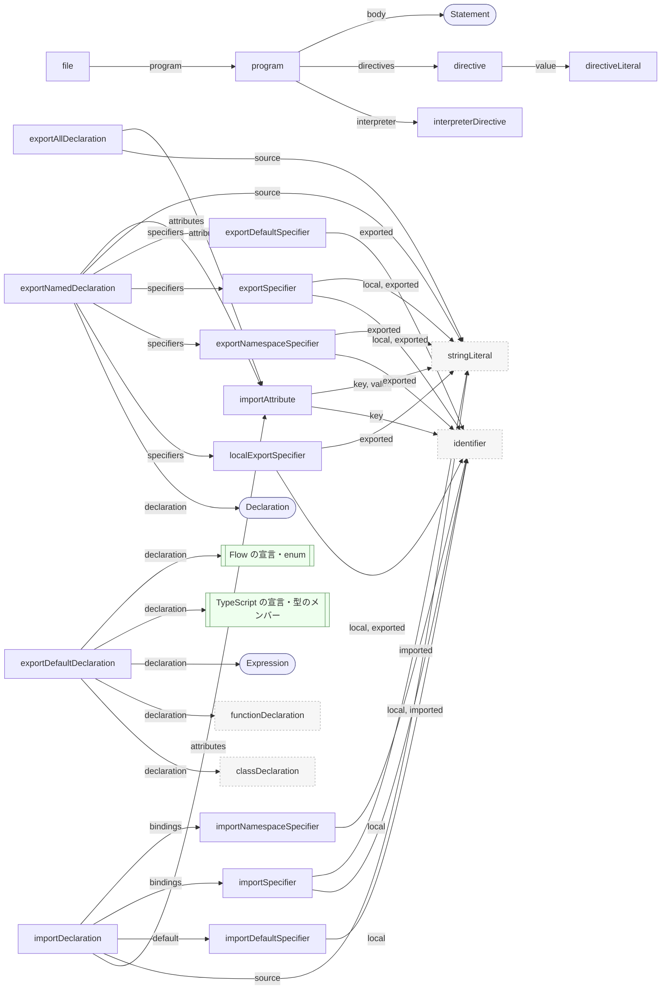

子ノードを持たないもの: `interpreterDirective`・`directiveLiteral`

| kind                       | クラス                              | ファイル                                                                                                                          | フィールド（型）                                                                                                                                                                                                    | 備考                                                                                                                                                                                                                                                                                                                                                                                                                                                                             |
| -------------------------- | ----------------------------------- | --------------------------------------------------------------------------------------------------------------------------------- | ------------------------------------------------------------------------------------------------------------------------------------------------------------------------------------------------------------------- | -------------------------------------------------------------------------------------------------------------------------------------------------------------------------------------------------------------------------------------------------------------------------------------------------------------------------------------------------------------------------------------------------------------------------------------------------------------------------------- |
| `file`                     | `FileTypeClass`                     | [standardizedVisitor/file.ts](../src/analyzer/types/lwc_IR/standardizedVisitor/file.ts)                                           | `program: ProgramTypeClass`                                                                                                                                                                                         |                                                                                                                                                                                                                                                                                                                                                                                                                                                                                  |
| `program`                  | `ProgramTypeClass`                  | [commons/program.ts](../src/analyzer/types/lwc_IR/commons/program.ts)                                                             | `sourceType: "script" \| "module"`<br>`interpreter: InterpreterDirectiveTypeClass \| null`<br>`directives: DirectiveTypeClass[]`<br>`body: StatementTypeClass[]`                                                    |                                                                                                                                                                                                                                                                                                                                                                                                                                                                                  |
| `interpreterDirective`     | `InterpreterDirectiveTypeClass`     | [standardizedVisitor/interpreterDirective.ts](../src/analyzer/types/lwc_IR/standardizedVisitor/interpreterDirective.ts)           | `value: string`                                                                                                                                                                                                     |                                                                                                                                                                                                                                                                                                                                                                                                                                                                                  |
| `directive`                | `DirectiveTypeClass`                | [standardizedVisitor/directive.ts](../src/analyzer/types/lwc_IR/standardizedVisitor/directive.ts)                                 | `value: DirectiveLiteralTypeClass`                                                                                                                                                                                  |                                                                                                                                                                                                                                                                                                                                                                                                                                                                                  |
| `directiveLiteral`         | `DirectiveLiteralTypeClass`         | [standardizedVisitor/directiveLiteral.ts](../src/analyzer/types/lwc_IR/standardizedVisitor/directiveLiteral.ts)                   | `value: string`                                                                                                                                                                                                     |                                                                                                                                                                                                                                                                                                                                                                                                                                                                                  |
| `importDeclaration`        | `ImportDeclarationTypeClass`        | [commons/importDeclaration.ts](../src/analyzer/types/lwc_IR/commons/importDeclaration.ts)                                         | `attributes: ImportAttributeTypeClass[] \| null`<br>`source: StringLiteralTypeClass`<br>`importKind: "type" \| "value" \| "typeof"`<br>`phase`（選択肢ごと）<br>`default`（選択肢ごと）<br>`bindings`（選択肢ごと） | 判別 union（`phase`）3 通り<br>① `phase: null`・`default: ImportDefaultSpecifierTypeClass \| null`・`bindings: { kind: "named"; specifiers: ImportSpecifierTypeClass[] } \| { kind: "namespace"; specifier: ImportNamespaceSpecifierTypeClass } \| null`<br>② `phase: "source"`・`default: ImportDefaultSpecifierTypeClass`・`bindings: null`<br>③ `phase: "defer"`・`default: null`・`bindings: { kind: "namespace"; specifier: ImportNamespaceSpecifierTypeClass }`            |
| `importDefaultSpecifier`   | `ImportDefaultSpecifierTypeClass`   | [commons/importDefaultSpecifier.ts](../src/analyzer/types/lwc_IR/commons/importDefaultSpecifier.ts)                               | `local: IdentifierTypeClass`                                                                                                                                                                                        |                                                                                                                                                                                                                                                                                                                                                                                                                                                                                  |
| `importNamespaceSpecifier` | `ImportNamespaceSpecifierTypeClass` | [commons/importNamespaceSpecifier.ts](../src/analyzer/types/lwc_IR/commons/importNamespaceSpecifier.ts)                           | `local: IdentifierTypeClass`                                                                                                                                                                                        |                                                                                                                                                                                                                                                                                                                                                                                                                                                                                  |
| `importSpecifier`          | `ImportSpecifierTypeClass`          | [commons/importSpecifier.ts](../src/analyzer/types/lwc_IR/commons/importSpecifier.ts)                                             | `local: IdentifierTypeClass`<br>`imported: IdentifierTypeClass \| StringLiteralTypeClass`<br>`importKind: "type" \| "value" \| "typeof"`                                                                            |                                                                                                                                                                                                                                                                                                                                                                                                                                                                                  |
| `importAttribute`          | `ImportAttributeTypeClass`          | [standardizedVisitor/importAttribute.ts](../src/analyzer/types/lwc_IR/standardizedVisitor/importAttribute.ts)                     | `key: IdentifierTypeClass \| StringLiteralTypeClass`<br>`value: StringLiteralTypeClass`                                                                                                                             |                                                                                                                                                                                                                                                                                                                                                                                                                                                                                  |
| `exportAllDeclaration`     | `ExportAllDeclarationTypeClass`     | [commons/exportAllDeclaration.ts](../src/analyzer/types/lwc_IR/commons/exportAllDeclaration.ts)                                   | `source: StringLiteralTypeClass`<br>`exportKind: "type" \| "value"`<br>`attributes: ImportAttributeTypeClass[] \| null`                                                                                             |                                                                                                                                                                                                                                                                                                                                                                                                                                                                                  |
| `exportDefaultDeclaration` | `ExportDefaultDeclarationTypeClass` | [commons/exportDefaultDeclaration.ts](../src/analyzer/types/lwc_IR/commons/exportDefaultDeclaration.ts)                           | `kind`（選択肢ごと）<br>`declaration`（選択肢ごと）                                                                                                                                                                 | 判別 union（`kind`）5 通り<br>① `kind: "class"`・`declaration: ClassDeclarationTypeClass<IdentifierTypeClass \| null>`<br>② `kind: "function"`・`declaration: FunctionDeclarationTypeClass<IdentifierTypeClass \| null>`<br>③ `kind: "expression"`・`declaration: ExpressionTypeClass`<br>④ `kind: "ts"`・`declaration: TSInterfaceDeclarationTypeClass \| TSDeclareFunctionTypeClass<IdentifierTypeClass \| null>`<br>⑤ `kind: "flow"`・`declaration: EnumDeclarationTypeClass` |
| `exportNamedDeclaration`   | `ExportNamedDeclarationTypeClass`   | [commons/exportNamedDeclaration.ts](../src/analyzer/types/lwc_IR/commons/exportNamedDeclaration.ts)                               | `exportKind: "type" \| "value"`<br>`kind`（選択肢ごと）<br>`declaration`（選択肢ごと）<br>`specifiers`（選択肢ごと）<br>`source`（選択肢ごと）<br>`attributes`（選択肢ごと）                                        | 判別 union（`kind`）3 通り<br>① `kind: "declaration"`・`declaration: DeclarationTypeClass`<br>② `kind: "local"`・`specifiers: LocalExportSpecifierTypeClass[]`<br>③ `kind: "reexport"`・`specifiers: (ExportNamespaceSpecifierTypeClass \| ExportSpecifierTypeClass \| ExportDefaultSpecifierTypeClass)[]`・`source: StringLiteralTypeClass`・`attributes: ImportAttributeTypeClass[] \| null`                                                                                   |
| `exportNamespaceSpecifier` | `ExportNamespaceSpecifierTypeClass` | [commons/exportNamespaceSpecifier.ts](../src/analyzer/types/lwc_IR/commons/exportNamespaceSpecifier.ts)                           | `exported: IdentifierTypeClass \| StringLiteralTypeClass`                                                                                                                                                           |                                                                                                                                                                                                                                                                                                                                                                                                                                                                                  |
| `exportSpecifier`          | `ExportSpecifierTypeClass`          | [commons/exportSpecifier.ts](../src/analyzer/types/lwc_IR/commons/exportSpecifier.ts)                                             | `local: IdentifierTypeClass \| StringLiteralTypeClass`<br>`exported: IdentifierTypeClass \| StringLiteralTypeClass`<br>`exportKind: "type" \| "value"`                                                              |                                                                                                                                                                                                                                                                                                                                                                                                                                                                                  |
| `localExportSpecifier`     | `LocalExportSpecifierTypeClass`     | [commons/exportSpecifier.ts](../src/analyzer/types/lwc_IR/commons/exportSpecifier.ts)                                             | `local: IdentifierTypeClass`<br>`exported: IdentifierTypeClass \| StringLiteralTypeClass`<br>`exportKind: "type" \| "value"`                                                                                        |                                                                                                                                                                                                                                                                                                                                                                                                                                                                                  |
| `exportDefaultSpecifier`   | `ExportDefaultSpecifierTypeClass`   | [moduleSpecifierVisitor/exportDefaultSpecifier.ts](../src/analyzer/types/lwc_IR/moduleSpecifierVisitor/exportDefaultSpecifier.ts) | `exported: IdentifierTypeClass`                                                                                                                                                                                     |                                                                                                                                                                                                                                                                                                                                                                                                                                                                                  |

### 3.2 クラス（12）

図 1/2

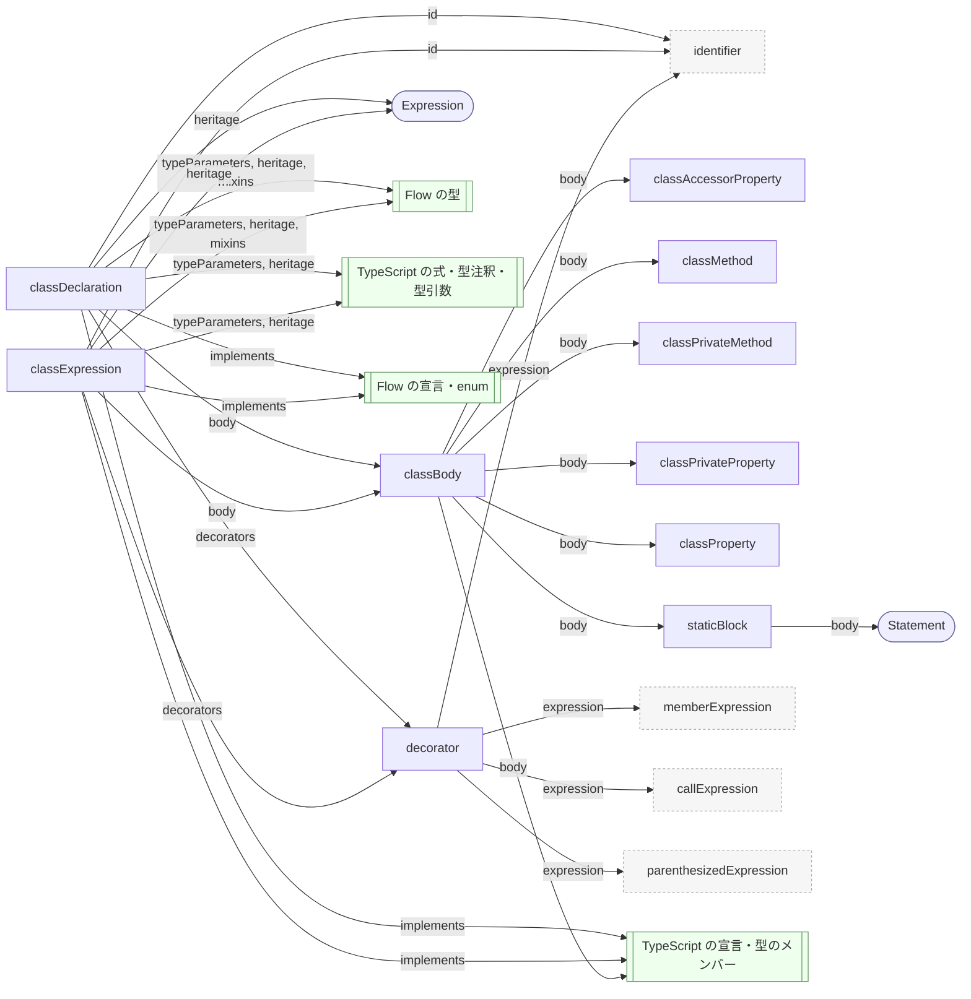

図 2/2

```mermaid
flowchart LR
    n_classMethod["classMethod"]
    n_blockStatement["blockStatement"]:::ext
    n_decorator["decorator"]
    n_identifier["identifier"]:::ext
    n_arrayPattern["arrayPattern"]:::ext
    n_assignmentPattern["assignmentPattern"]:::ext
    n_objectPattern["objectPattern"]:::ext
    n_voidPattern["voidPattern"]:::ext
    n_bigIntLiteral["bigIntLiteral"]:::ext
    n_stringLiteral["stringLiteral"]:::ext
    n_numericLiteral["numericLiteral"]:::ext
    n_classPrivateMethod["classPrivateMethod"]
    n_privateName["privateName"]
    n_classProperty["classProperty"]
    n_classPrivateProperty["classPrivateProperty"]
    n_classAccessorProperty["classAccessorProperty"]
    a_Expression(["Expression"]):::alias
    a_FunctionParameter(["FunctionParameter"]):::alias
    f_tsDecl[["TypeScript の宣言・型のメンバー"]]:::fam
    f_flowType[["Flow の型"]]:::fam
    f_tsExpr[["TypeScript の式・型注釈・型引数"]]:::fam
    n_classMethod -->|key| a_Expression
    n_classMethod -->|body| n_blockStatement
    n_classMethod -->|params| a_FunctionParameter
    n_classMethod -->|params| f_tsDecl
    n_classMethod -->|returnType, typeParameters| f_flowType
    n_classMethod -->|returnType, typeParameters| f_tsExpr
    n_classMethod -->|decorators| n_decorator
    n_classMethod -->|params, key| n_identifier
    n_classMethod -->|params| n_arrayPattern
    n_classMethod -->|params| n_assignmentPattern
    n_classMethod -->|params| n_objectPattern
    n_classMethod -->|params| n_voidPattern
    n_classMethod -->|key| n_bigIntLiteral
    n_classMethod -->|key| n_stringLiteral
    n_classMethod -->|key| n_numericLiteral
    n_classPrivateMethod -->|key| n_privateName
    n_classPrivateMethod -->|decorators| n_decorator
    n_classPrivateMethod -->|body| n_blockStatement
    n_classPrivateMethod -->|params| a_FunctionParameter
    n_classPrivateMethod -->|returnType, typeParameters| f_flowType
    n_classPrivateMethod -->|returnType, typeParameters| f_tsExpr
    n_classPrivateMethod -->|params| n_identifier
    n_classPrivateMethod -->|params| n_arrayPattern
    n_classPrivateMethod -->|params| n_assignmentPattern
    n_classPrivateMethod -->|params| n_objectPattern
    n_classPrivateMethod -->|params| n_voidPattern
    n_classProperty -->|key, init| a_Expression
    n_classProperty -->|decorators| n_decorator
    n_classProperty -->|annotation| f_tsExpr
    n_classProperty -->|annotation| f_flowType
    n_classProperty -->|key| n_bigIntLiteral
    n_classProperty -->|key| n_identifier
    n_classProperty -->|key| n_stringLiteral
    n_classProperty -->|key| n_numericLiteral
    n_classPrivateProperty -->|key| n_privateName
    n_classPrivateProperty -->|decorators| n_decorator
    n_classPrivateProperty -->|init| a_Expression
    n_classPrivateProperty -->|annotation| f_tsExpr
    n_classPrivateProperty -->|annotation| f_flowType
    n_classAccessorProperty -->|key, init| a_Expression
    n_classAccessorProperty -->|decorators| n_decorator
    n_classAccessorProperty -->|annotation| f_tsExpr
    n_classAccessorProperty -->|annotation| f_flowType
    n_classAccessorProperty -->|key| n_bigIntLiteral
    n_classAccessorProperty -->|key| n_identifier
    n_classAccessorProperty -->|key| n_stringLiteral
    n_classAccessorProperty -->|key| n_numericLiteral
    n_classAccessorProperty -->|key| n_privateName
    classDef alias fill:#eef,stroke:#669
    classDef fam fill:#efe,stroke:#696
    classDef ext fill:#f6f6f6,stroke:#aaa,stroke-dasharray:3 3
```

子ノードを持たないもの: `privateName`・`super`

| kind                    | クラス                           | ファイル                                                                                          | フィールド（型）                                                                                                                                                                                                                                                                                                                                                                                                                                                        | 備考                                                                                                                                                                                                                                                                                                                                                                                                                                                                                                                                                                                                                                                                                                                                                                                                                                                                                                                                                                                                                                                                                                                                                                                                                                                                                                                                                                                                                                                                                                                                                                                                                                                                                                                                                                                                                                                                                                                                                                                                                                                                                                                                                                                                                                                                                                         |
| ----------------------- | -------------------------------- | ------------------------------------------------------------------------------------------------- | ----------------------------------------------------------------------------------------------------------------------------------------------------------------------------------------------------------------------------------------------------------------------------------------------------------------------------------------------------------------------------------------------------------------------------------------------------------------------- | ------------------------------------------------------------------------------------------------------------------------------------------------------------------------------------------------------------------------------------------------------------------------------------------------------------------------------------------------------------------------------------------------------------------------------------------------------------------------------------------------------------------------------------------------------------------------------------------------------------------------------------------------------------------------------------------------------------------------------------------------------------------------------------------------------------------------------------------------------------------------------------------------------------------------------------------------------------------------------------------------------------------------------------------------------------------------------------------------------------------------------------------------------------------------------------------------------------------------------------------------------------------------------------------------------------------------------------------------------------------------------------------------------------------------------------------------------------------------------------------------------------------------------------------------------------------------------------------------------------------------------------------------------------------------------------------------------------------------------------------------------------------------------------------------------------------------------------------------------------------------------------------------------------------------------------------------------------------------------------------------------------------------------------------------------------------------------------------------------------------------------------------------------------------------------------------------------------------------------------------------------------------------------------------------------------ |
| `classDeclaration`      | `ClassDeclarationTypeClass`      | [commons/classDeclaration.ts](../src/analyzer/types/lwc_IR/commons/classDeclaration.ts)           | `id: IdentifierTypeClass`<br>`typeParameters: TypeParameterDeclarationTypeClass \| TSTypeParameterDeclarationTypeClass \| null`<br>`body: ClassBodyTypeClass`<br>`heritage: ClassHeritage \| null`<br>`implements: (TSClassImplementsTypeClass \| ClassImplementsTypeClass)[] \| null`<br>`decorators: DecoratorTypeClass[] \| null`<br>`mixins: InterfaceExtendsTypeClass \| null`<br>`declare: boolean`<br>`abstract: boolean`                                        | 型引数 `TId extends IdentifierTypeClass \| null = IdentifierTypeClass`                                                                                                                                                                                                                                                                                                                                                                                                                                                                                                                                                                                                                                                                                                                                                                                                                                                                                                                                                                                                                                                                                                                                                                                                                                                                                                                                                                                                                                                                                                                                                                                                                                                                                                                                                                                                                                                                                                                                                                                                                                                                                                                                                                                                                                       |
| `classExpression`       | `ClassExpressionTypeClass`       | [commons/classExpression.ts](../src/analyzer/types/lwc_IR/commons/classExpression.ts)             | `id: IdentifierTypeClass \| null`<br>`typeParameters: TypeParameterDeclarationTypeClass \| TSTypeParameterDeclarationTypeClass \| null`<br>`body: ClassBodyTypeClass`<br>`heritage: ClassHeritage \| null`<br>`implements: (TSClassImplementsTypeClass \| ClassImplementsTypeClass)[] \| null`<br>`decorators: DecoratorTypeClass[] \| null`<br>`mixins: InterfaceExtendsTypeClass \| null`                                                                             |                                                                                                                                                                                                                                                                                                                                                                                                                                                                                                                                                                                                                                                                                                                                                                                                                                                                                                                                                                                                                                                                                                                                                                                                                                                                                                                                                                                                                                                                                                                                                                                                                                                                                                                                                                                                                                                                                                                                                                                                                                                                                                                                                                                                                                                                                                              |
| `classBody`             | `ClassBodyTypeClass`             | [standardizedVisitor/classBody.ts](../src/analyzer/types/lwc_IR/standardizedVisitor/classBody.ts) | `body: (ClassAccessorPropertyTypeClass \| ClassMethodTypeClass \| ClassPrivateMethodTypeClass \| ClassPrivatePropertyTypeClass \| ClassPropertyTypeClass \| StaticBlockTypeClass \| TSIndexSignatureTypeClass \| TSDeclareMethodTypeClass)[]`                                                                                                                                                                                                                           |                                                                                                                                                                                                                                                                                                                                                                                                                                                                                                                                                                                                                                                                                                                                                                                                                                                                                                                                                                                                                                                                                                                                                                                                                                                                                                                                                                                                                                                                                                                                                                                                                                                                                                                                                                                                                                                                                                                                                                                                                                                                                                                                                                                                                                                                                                              |
| `classMethod`           | `ClassMethodTypeClass`           | [commons/classMethod.ts](../src/analyzer/types/lwc_IR/commons/classMethod.ts)                     | `accessibility: "public" \| "private" \| "protected" \| null`<br>`body: BlockStatementTypeClass`<br>`computed`（選択肢ごと）<br>`key`（選択肢ごと）<br>`kind`（選択肢ごと）<br>`params`（選択肢ごと）<br>`generator`（選択肢ごと）<br>`async`（選択肢ごと）<br>`returnType`（選択肢ごと）<br>`typeParameters`（選択肢ごと）<br>`static`（選択肢ごと）<br>`abstract`（選択肢ごと）<br>`override`（選択肢ごと）<br>`optional`（選択肢ごと）<br>`decorators`（選択肢ごと） | 判別 union（`computed`・`kind`）8 通り<br>① `computed: true`・`kind: "constructor"`・`key: ExpressionTypeClass`・`params: (FunctionParameterTypeClass \| TSParameterPropertyTypeClass)[]`<br>② `computed: true`・`kind: "method"`・`key: ExpressionTypeClass`・`generator: boolean`・`async: boolean`・`params: FunctionParameterTypeClass[]`・`returnType: TypeAnnotationTypeClass \| TSTypeAnnotationTypeClass \| null`・`typeParameters: TypeParameterDeclarationTypeClass \| TSTypeParameterDeclarationTypeClass \| null`・`static: boolean`・`abstract: boolean`・`override: boolean`・`optional: boolean`・`decorators: DecoratorTypeClass[]`<br>③ `computed: true`・`kind: "get"`・`key: ExpressionTypeClass`・`params: GetterParams`・`returnType: TypeAnnotationTypeClass \| TSTypeAnnotationTypeClass \| null`・`static: boolean`・`abstract: boolean`・`override: boolean`・`optional: boolean`・`decorators: DecoratorTypeClass[]`<br>④ `computed: true`・`kind: "set"`・`key: ExpressionTypeClass`・`params: SetterParams`・`static: boolean`・`abstract: boolean`・`override: boolean`・`optional: boolean`・`decorators: DecoratorTypeClass[]`<br>⑤ `computed: false`・`kind: "constructor"`・`key: StaticMemberKeyTypeClass`・`params: (FunctionParameterTypeClass \| TSParameterPropertyTypeClass)[]`<br>⑥ `computed: false`・`kind: "method"`・`key: StaticMemberKeyTypeClass`・`generator: boolean`・`async: boolean`・`params: FunctionParameterTypeClass[]`・`returnType: TypeAnnotationTypeClass \| TSTypeAnnotationTypeClass \| null`・`typeParameters: TypeParameterDeclarationTypeClass \| TSTypeParameterDeclarationTypeClass \| null`・`static: boolean`・`abstract: boolean`・`override: boolean`・`optional: boolean`・`decorators: DecoratorTypeClass[]`<br>⑦ `computed: false`・`kind: "get"`・`key: StaticMemberKeyTypeClass`・`params: GetterParams`・`returnType: TypeAnnotationTypeClass \| TSTypeAnnotationTypeClass \| null`・`static: boolean`・`abstract: boolean`・`override: boolean`・`optional: boolean`・`decorators: DecoratorTypeClass[]`<br>⑧ `computed: false`・`kind: "set"`・`key: StaticMemberKeyTypeClass`・`params: SetterParams`・`static: boolean`・`abstract: boolean`・`override: boolean`・`optional: boolean`・`decorators: DecoratorTypeClass[]` |
| `classPrivateMethod`    | `ClassPrivateMethodTypeClass`    | [commons/classPrivateMethod.ts](../src/analyzer/types/lwc_IR/commons/classPrivateMethod.ts)       | `key: PrivateNameTypeClass`<br>`static: boolean`<br>`override: boolean`<br>`decorators: DecoratorTypeClass[]`<br>`body: BlockStatementTypeClass`<br>`kind`（選択肢ごと）<br>`generator`（選択肢ごと）<br>`async`（選択肢ごと）<br>`params`（選択肢ごと）<br>`returnType`（選択肢ごと）<br>`typeParameters`（選択肢ごと）                                                                                                                                                | 判別 union（`kind`）3 通り<br>① `kind: "method"`・`generator: boolean`・`async: boolean`・`params: FunctionParameterTypeClass[]`・`returnType: TypeAnnotationTypeClass \| TSTypeAnnotationTypeClass \| null`・`typeParameters: TypeParameterDeclarationTypeClass \| TSTypeParameterDeclarationTypeClass \| null`<br>② `kind: "get"`・`params: GetterParams`・`returnType: TypeAnnotationTypeClass \| TSTypeAnnotationTypeClass \| null`<br>③ `kind: "set"`・`params: SetterParams`                                                                                                                                                                                                                                                                                                                                                                                                                                                                                                                                                                                                                                                                                                                                                                                                                                                                                                                                                                                                                                                                                                                                                                                                                                                                                                                                                                                                                                                                                                                                                                                                                                                                                                                                                                                                                           |
| `classProperty`         | `ClassPropertyTypeClass`         | [commons/classProperty.ts](../src/analyzer/types/lwc_IR/commons/classProperty.ts)                 | `static: boolean`<br>`decorators: DecoratorTypeClass[]`<br>`init: ClassPropertyInit`<br>`annotation: ClassMemberAnnotation<ClassPropertyTsModifiers>`<br>`computed`（選択肢ごと）<br>`key`（選択肢ごと）                                                                                                                                                                                                                                                                | 判別 union（`computed`）2 通り<br>① `computed: true`・`key: ExpressionTypeClass`<br>② `computed: false`・`key: StaticMemberKeyTypeClass`                                                                                                                                                                                                                                                                                                                                                                                                                                                                                                                                                                                                                                                                                                                                                                                                                                                                                                                                                                                                                                                                                                                                                                                                                                                                                                                                                                                                                                                                                                                                                                                                                                                                                                                                                                                                                                                                                                                                                                                                                                                                                                                                                                     |
| `classPrivateProperty`  | `ClassPrivatePropertyTypeClass`  | [commons/classPrivateProperty.ts](../src/analyzer/types/lwc_IR/commons/classPrivateProperty.ts)   | `key: PrivateNameTypeClass`<br>`static: boolean`<br>`decorators: DecoratorTypeClass[]`<br>`init: ClassPrivatePropertyInit`<br>`annotation: ClassMemberAnnotation<ClassPrivatePropertyTsModifiers>`                                                                                                                                                                                                                                                                      |                                                                                                                                                                                                                                                                                                                                                                                                                                                                                                                                                                                                                                                                                                                                                                                                                                                                                                                                                                                                                                                                                                                                                                                                                                                                                                                                                                                                                                                                                                                                                                                                                                                                                                                                                                                                                                                                                                                                                                                                                                                                                                                                                                                                                                                                                                              |
| `classAccessorProperty` | `ClassAccessorPropertyTypeClass` | [commons/classAccessorProperty.ts](../src/analyzer/types/lwc_IR/commons/classAccessorProperty.ts) | `static: boolean`<br>`decorators: DecoratorTypeClass[]`<br>`init: ClassPropertyInit`<br>`annotation: ClassMemberAnnotation<ClassPropertyTsModifiers>`<br>`computed`（選択肢ごと）<br>`key`（選択肢ごと）                                                                                                                                                                                                                                                                | 判別 union（`computed`）2 通り<br>① `computed: true`・`key: ExpressionTypeClass`<br>② `computed: false`・`key: BigIntLiteralTypeClass \| IdentifierTypeClass \| StringLiteralTypeClass \| NumericLiteralTypeClass \| PrivateNameTypeClass`                                                                                                                                                                                                                                                                                                                                                                                                                                                                                                                                                                                                                                                                                                                                                                                                                                                                                                                                                                                                                                                                                                                                                                                                                                                                                                                                                                                                                                                                                                                                                                                                                                                                                                                                                                                                                                                                                                                                                                                                                                                                   |
| `staticBlock`           | `StaticBlockTypeClass`           | [commons/staticBlock.ts](../src/analyzer/types/lwc_IR/commons/staticBlock.ts)                     | `body: StatementTypeClass[]`                                                                                                                                                                                                                                                                                                                                                                                                                                            |                                                                                                                                                                                                                                                                                                                                                                                                                                                                                                                                                                                                                                                                                                                                                                                                                                                                                                                                                                                                                                                                                                                                                                                                                                                                                                                                                                                                                                                                                                                                                                                                                                                                                                                                                                                                                                                                                                                                                                                                                                                                                                                                                                                                                                                                                                              |
| `decorator`             | `DecoratorTypeClass`             | [commons/decorator.ts](../src/analyzer/types/lwc_IR/commons/decorator.ts)                         | `kind`（選択肢ごと）<br>`expression`（選択肢ごと）                                                                                                                                                                                                                                                                                                                                                                                                                      | 判別 union（`kind`）4 通り<br>① `kind: "identifier"`・`expression: IdentifierTypeClass`<br>② `kind: "member"`・`expression: MemberExpressionTypeClass`<br>③ `kind: "call"`・`expression: CallExpressionTypeClass`<br>④ `kind: "parenthesized"`・`expression: ParenthesizedExpressionTypeClass`                                                                                                                                                                                                                                                                                                                                                                                                                                                                                                                                                                                                                                                                                                                                                                                                                                                                                                                                                                                                                                                                                                                                                                                                                                                                                                                                                                                                                                                                                                                                                                                                                                                                                                                                                                                                                                                                                                                                                                                                               |
| `privateName`           | `PrivateNameTypeClass`           | [commons/privateName.ts](../src/analyzer/types/lwc_IR/commons/privateName.ts)                     | `id: IdentifierTypeClass`                                                                                                                                                                                                                                                                                                                                                                                                                                               |                                                                                                                                                                                                                                                                                                                                                                                                                                                                                                                                                                                                                                                                                                                                                                                                                                                                                                                                                                                                                                                                                                                                                                                                                                                                                                                                                                                                                                                                                                                                                                                                                                                                                                                                                                                                                                                                                                                                                                                                                                                                                                                                                                                                                                                                                                              |
| `super`                 | `SuperTypeClass`                 | [standardizedVisitor/super.ts](../src/analyzer/types/lwc_IR/standardizedVisitor/super.ts)         | —                                                                                                                                                                                                                                                                                                                                                                                                                                                                       |                                                                                                                                                                                                                                                                                                                                                                                                                                                                                                                                                                                                                                                                                                                                                                                                                                                                                                                                                                                                                                                                                                                                                                                                                                                                                                                                                                                                                                                                                                                                                                                                                                                                                                                                                                                                                                                                                                                                                                                                                                                                                                                                                                                                                                                                                                              |

### 3.3 関数（3）

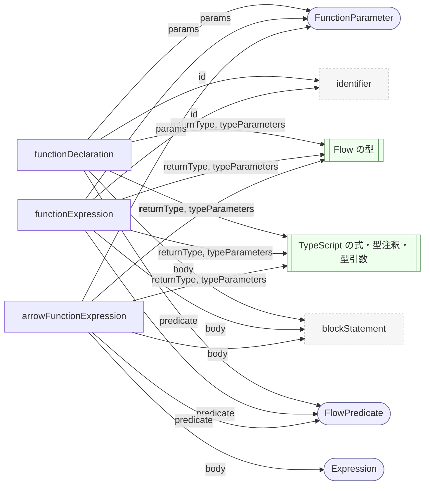

| kind                      | クラス                             | ファイル                                                                                              | フィールド（型）                                                                                                                                                                                                                                                                                                                                                                              | 備考                                                                   |
| ------------------------- | ---------------------------------- | ----------------------------------------------------------------------------------------------------- | --------------------------------------------------------------------------------------------------------------------------------------------------------------------------------------------------------------------------------------------------------------------------------------------------------------------------------------------------------------------------------------------- | ---------------------------------------------------------------------- |
| `functionDeclaration`     | `FunctionDeclarationTypeClass`     | [commons/functionDeclaration.ts](../src/analyzer/types/lwc_IR/commons/functionDeclaration.ts)         | `params: FunctionParameterTypeClass[]`<br>`generator: boolean`<br>`async: boolean`<br>`id: IdentifierTypeClass`<br>`returnType: TypeAnnotationTypeClass \| TSTypeAnnotationTypeClass \| null`<br>`typeParameters: TypeParameterDeclarationTypeClass \| TSTypeParameterDeclarationTypeClass \| null`<br>`body: BlockStatementTypeClass`<br>`predicate: FlowPredicateTypeClass \| null`         | 型引数 `TId extends IdentifierTypeClass \| null = IdentifierTypeClass` |
| `functionExpression`      | `FunctionExpressionTypeClass`      | [commons/functionExpression.ts](../src/analyzer/types/lwc_IR/commons/functionExpression.ts)           | `params: FunctionParameterTypeClass[]`<br>`generator: boolean`<br>`async: boolean`<br>`returnType: TypeAnnotationTypeClass \| TSTypeAnnotationTypeClass \| null`<br>`typeParameters: TypeParameterDeclarationTypeClass \| TSTypeParameterDeclarationTypeClass \| null`<br>`id: IdentifierTypeClass \| null`<br>`body: BlockStatementTypeClass`<br>`predicate: FlowPredicateTypeClass \| null` |                                                                        |
| `arrowFunctionExpression` | `ArrowFunctionExpressionTypeClass` | [commons/arrowFunctionExpression.ts](../src/analyzer/types/lwc_IR/commons/arrowFunctionExpression.ts) | `params: FunctionParameterTypeClass[]`<br>`async: boolean`<br>`returnType: TypeAnnotationTypeClass \| TSTypeAnnotationTypeClass \| null`<br>`typeParameters: TypeParameterDeclarationTypeClass \| TSTypeParameterDeclarationTypeClass \| null`<br>`body: ArrowFunctionBody`<br>`predicate: FlowPredicateTypeClass \| null`                                                                    |                                                                        |

### 3.4 文・変数の宣言（23）

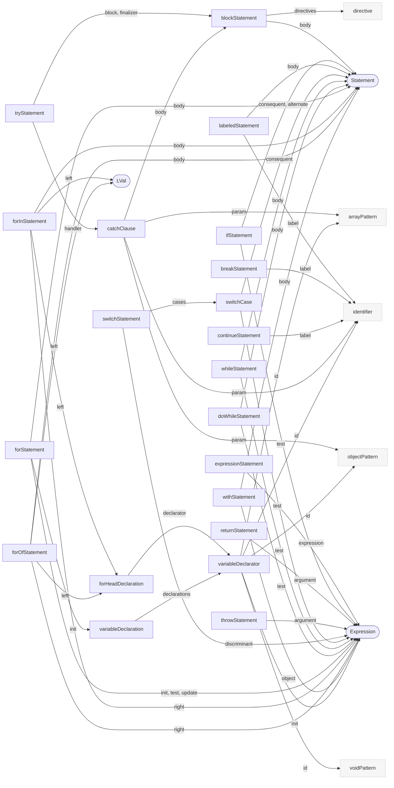

子ノードを持たないもの: `emptyStatement`・`debuggerStatement`

| kind                  | クラス                         | ファイル                                                                                                            | フィールド（型）                                                                                                                                                                              | 備考                                                                                                                                                                                                                                                                                                                                                                                                                                                                                                                                                                                                                                      |
| --------------------- | ------------------------------ | ------------------------------------------------------------------------------------------------------------------- | --------------------------------------------------------------------------------------------------------------------------------------------------------------------------------------------- | ----------------------------------------------------------------------------------------------------------------------------------------------------------------------------------------------------------------------------------------------------------------------------------------------------------------------------------------------------------------------------------------------------------------------------------------------------------------------------------------------------------------------------------------------------------------------------------------------------------------------------------------- |
| `blockStatement`      | `BlockStatementTypeClass`      | [commons/blockStatement.ts](../src/analyzer/types/lwc_IR/commons/blockStatement.ts)                                 | `directives: DirectiveTypeClass[]`<br>`body: StatementTypeClass[]`                                                                                                                            |                                                                                                                                                                                                                                                                                                                                                                                                                                                                                                                                                                                                                                           |
| `emptyStatement`      | `EmptyStatementTypeClass`      | [commons/emptyStatement.ts](../src/analyzer/types/lwc_IR/commons/emptyStatement.ts)                                 | —                                                                                                                                                                                             |                                                                                                                                                                                                                                                                                                                                                                                                                                                                                                                                                                                                                                           |
| `debuggerStatement`   | `DebuggerStatementTypeClass`   | [commons/debuggerStatement.ts](../src/analyzer/types/lwc_IR/commons/debuggerStatement.ts)                           | —                                                                                                                                                                                             |                                                                                                                                                                                                                                                                                                                                                                                                                                                                                                                                                                                                                                           |
| `expressionStatement` | `ExpressionStatementTypeClass` | [commons/expressionStatement.ts](../src/analyzer/types/lwc_IR/commons/expressionStatement.ts)                       | `expression: ExpressionTypeClass`                                                                                                                                                             |                                                                                                                                                                                                                                                                                                                                                                                                                                                                                                                                                                                                                                           |
| `ifStatement`         | `IfStatementTypeClass`         | [commons/ifStatement.ts](../src/analyzer/types/lwc_IR/commons/ifStatement.ts)                                       | `test: ExpressionTypeClass`<br>`consequent: StatementTypeClass`<br>`alternate: StatementTypeClass \| null`                                                                                    |                                                                                                                                                                                                                                                                                                                                                                                                                                                                                                                                                                                                                                           |
| `labeledStatement`    | `LabeledStatementTypeClass`    | [commons/labeledStatement.ts](../src/analyzer/types/lwc_IR/commons/labeledStatement.ts)                             | `label: IdentifierTypeClass`<br>`body: StatementTypeClass`                                                                                                                                    |                                                                                                                                                                                                                                                                                                                                                                                                                                                                                                                                                                                                                                           |
| `breakStatement`      | `BreakStatementTypeClass`      | [commons/breakStatement.ts](../src/analyzer/types/lwc_IR/commons/breakStatement.ts)                                 | `label: IdentifierTypeClass \| null`                                                                                                                                                          |                                                                                                                                                                                                                                                                                                                                                                                                                                                                                                                                                                                                                                           |
| `continueStatement`   | `ContinueStatementTypeClass`   | [commons/continueStatement.ts](../src/analyzer/types/lwc_IR/commons/continueStatement.ts)                           | `label: IdentifierTypeClass \| null`                                                                                                                                                          |                                                                                                                                                                                                                                                                                                                                                                                                                                                                                                                                                                                                                                           |
| `returnStatement`     | `ReturnStatementTypeClass`     | [commons/returnStatement.ts](../src/analyzer/types/lwc_IR/commons/returnStatement.ts)                               | `argument: ExpressionTypeClass \| null`                                                                                                                                                       |                                                                                                                                                                                                                                                                                                                                                                                                                                                                                                                                                                                                                                           |
| `throwStatement`      | `ThrowStatementTypeClass`      | [commons/throwStatement.ts](../src/analyzer/types/lwc_IR/commons/throwStatement.ts)                                 | `argument: ExpressionTypeClass`                                                                                                                                                               |                                                                                                                                                                                                                                                                                                                                                                                                                                                                                                                                                                                                                                           |
| `tryStatement`        | `TryStatementTypeClass`        | [commons/tryStatement.ts](../src/analyzer/types/lwc_IR/commons/tryStatement.ts)                                     | `block: BlockStatementTypeClass`<br>`handler`（選択肢ごと）<br>`finalizer`（選択肢ごと）                                                                                                      | 判別 union（判別のフィールドなし。フィールドの有無と型で分かれる）2 通り<br>① `handler: CatchClauseTypeClass`・`finalizer: BlockStatementTypeClass \| null`<br>② `handler: null`・`finalizer: BlockStatementTypeClass`                                                                                                                                                                                                                                                                                                                                                                                                                    |
| `catchClause`         | `CatchClauseTypeClass`         | [commons/catchClause.ts](../src/analyzer/types/lwc_IR/commons/catchClause.ts)                                       | `param: ArrayPatternTypeClass \| IdentifierTypeClass \| ObjectPatternTypeClass \| null`<br>`body: BlockStatementTypeClass`                                                                    |                                                                                                                                                                                                                                                                                                                                                                                                                                                                                                                                                                                                                                           |
| `switchStatement`     | `SwitchStatementTypeClass`     | [commons/switchStatement.ts](../src/analyzer/types/lwc_IR/commons/switchStatement.ts)                               | `discriminant: ExpressionTypeClass`<br>`cases: SwitchCaseTypeClass[]`                                                                                                                         |                                                                                                                                                                                                                                                                                                                                                                                                                                                                                                                                                                                                                                           |
| `switchCase`          | `SwitchCaseTypeClass`          | [standardizedVisitor/switchCase.ts](../src/analyzer/types/lwc_IR/standardizedVisitor/switchCase.ts)                 | `test: ExpressionTypeClass \| null`<br>`consequent: StatementTypeClass[]`                                                                                                                     |                                                                                                                                                                                                                                                                                                                                                                                                                                                                                                                                                                                                                                           |
| `whileStatement`      | `WhileStatementTypeClass`      | [commons/whileStatement.ts](../src/analyzer/types/lwc_IR/commons/whileStatement.ts)                                 | `test: ExpressionTypeClass`<br>`body: StatementTypeClass`                                                                                                                                     |                                                                                                                                                                                                                                                                                                                                                                                                                                                                                                                                                                                                                                           |
| `doWhileStatement`    | `DoWhileStatementTypeClass`    | [commons/doWhileStatement.ts](../src/analyzer/types/lwc_IR/commons/doWhileStatement.ts)                             | `test: ExpressionTypeClass`<br>`body: StatementTypeClass`                                                                                                                                     |                                                                                                                                                                                                                                                                                                                                                                                                                                                                                                                                                                                                                                           |
| `forStatement`        | `ForStatementTypeClass`        | [commons/forStatement.ts](../src/analyzer/types/lwc_IR/commons/forStatement.ts)                                     | `init: ExpressionTypeClass \| VariableDeclarationTypeClass \| null`<br>`test: ExpressionTypeClass \| null`<br>`update: ExpressionTypeClass \| null`<br>`body: StatementTypeClass`             |                                                                                                                                                                                                                                                                                                                                                                                                                                                                                                                                                                                                                                           |
| `forInStatement`      | `ForInStatementTypeClass`      | [commons/forInStatement.ts](../src/analyzer/types/lwc_IR/commons/forInStatement.ts)                                 | `left: LValTypeClass \| ForHeadDeclarationTypeClass<ForInHeadKind>`<br>`right: ExpressionTypeClass`<br>`body: StatementTypeClass`                                                             |                                                                                                                                                                                                                                                                                                                                                                                                                                                                                                                                                                                                                                           |
| `forOfStatement`      | `ForOfStatementTypeClass`      | [commons/forOfStatement.ts](../src/analyzer/types/lwc_IR/commons/forOfStatement.ts)                                 | `left: LValTypeClass \| ForHeadDeclarationTypeClass<"var" \| "let" \| "const" \| "using" \| "await using">`<br>`right: ExpressionTypeClass`<br>`body: StatementTypeClass`<br>`await: boolean` |                                                                                                                                                                                                                                                                                                                                                                                                                                                                                                                                                                                                                                           |
| `forHeadDeclaration`  | `ForHeadDeclarationTypeClass`  | [commons/variableDeclaration.ts](../src/analyzer/types/lwc_IR/commons/variableDeclaration.ts)                       | `kind`（選択肢ごと）<br>`declarator`（選択肢ごと）                                                                                                                                            | 型引数 `TKind extends VariableDeclaration['kind'] = VariableDeclaration['kind']`<br>判別 union（`kind`）5 通り<br>① `kind: "var"`・`declarator: VariableDeclaratorTypeClass<ForHeadVariableDeclaratorFields>`<br>② `kind: "let"`・`declarator: VariableDeclaratorTypeClass<ForHeadVariableDeclaratorFields>`<br>③ `kind: "const"`・`declarator: VariableDeclaratorTypeClass<ForHeadVariableDeclaratorFields>`<br>④ `kind: "using"`・`declarator: VariableDeclaratorTypeClass<ForHeadIdentifierVariableDeclaratorFields>`<br>⑤ `kind: "await using"`・`declarator: VariableDeclaratorTypeClass<ForHeadIdentifierVariableDeclaratorFields>` |
| `withStatement`       | `WithStatementTypeClass`       | [commons/withStatement.ts](../src/analyzer/types/lwc_IR/commons/withStatement.ts)                                   | `object: ExpressionTypeClass`<br>`body: StatementTypeClass`                                                                                                                                   |                                                                                                                                                                                                                                                                                                                                                                                                                                                                                                                                                                                                                                           |
| `variableDeclaration` | `VariableDeclarationTypeClass` | [commons/variableDeclaration.ts](../src/analyzer/types/lwc_IR/commons/variableDeclaration.ts)                       | `declare`（選択肢ごと）<br>`kind`（選択肢ごと）<br>`declarations`（選択肢ごと）                                                                                                               | 判別 union（`declare`・`kind`）4 通り<br>① `declare: false`・`kind: "var" \| "let"`・`declarations: NonEmptyArray<VariableDeclaratorTypeClass<VariableDeclaratorFields>>`<br>② `declare: boolean`・`kind: "const"`・`declarations: NonEmptyArray<VariableDeclaratorTypeClass<ConstVariableDeclaratorFields>>`<br>③ `declare: false`・`kind: "using" \| "await using"`・`declarations: NonEmptyArray<VariableDeclaratorTypeClass<InitializedIdentifierVariableDeclaratorFields>>`<br>④ `declare: true`・`kind: "var" \| "let"`・`declarations: NonEmptyArray<VariableDeclaratorTypeClass<UninitializedVariableDeclaratorFields>>`          |
| `variableDeclarator`  | `VariableDeclaratorTypeClass`  | [standardizedVisitor/variableDeclarator.ts](../src/analyzer/types/lwc_IR/standardizedVisitor/variableDeclarator.ts) | `definite`（選択肢ごと）<br>`id`（選択肢ごと）<br>`init`（選択肢ごと）                                                                                                                        | 型引数 `TFields extends VariableDeclaratorFields = VariableDeclaratorFields`<br>判別 union（`definite`）2 通り<br>① `definite: true`・`id: IdentifierTypeClass`・`init: null`<br>② `definite: false`・`id: VariableDeclaratorId`・`init: ExpressionTypeClass \| null`                                                                                                                                                                                                                                                                                                                                                                     |

### 3.5 式（30）

図 1/2

```mermaid
flowchart LR
    n_arrayExpression["arrayExpression"]
    n_spreadElement["spreadElement"]
    n_objectExpression["objectExpression"]
    n_objectProperty["objectProperty"]
    n_restElement["restElement"]:::ext
    n_bigIntLiteral["bigIntLiteral"]:::ext
    n_identifier["identifier"]:::ext
    n_stringLiteral["stringLiteral"]:::ext
    n_numericLiteral["numericLiteral"]:::ext
    n_privateName["privateName"]:::ext
    n_assignmentPattern["assignmentPattern"]:::ext
    n_objectMethod["objectMethod"]
    n_blockStatement["blockStatement"]:::ext
    n_arrayPattern["arrayPattern"]:::ext
    n_objectPattern["objectPattern"]:::ext
    n_voidPattern["voidPattern"]:::ext
    n_assignmentExpression["assignmentExpression"]
    n_memberExpression["memberExpression"]
    n_binaryExpression["binaryExpression"]
    n_logicalExpression["logicalExpression"]
    n_unaryExpression["unaryExpression"]
    n_optionalMemberExpression["optionalMemberExpression"]
    n_updateExpression["updateExpression"]
    n_parenthesizedExpression["parenthesizedExpression"]
    n_conditionalExpression["conditionalExpression"]
    n_sequenceExpression["sequenceExpression"]
    n_awaitExpression["awaitExpression"]
    n_yieldExpression["yieldExpression"]
    a_Expression(["Expression"]):::alias
    a_ObjectMember(["ObjectMember"]):::alias
    a_Pattern(["Pattern"]):::alias
    a_FunctionParameter(["FunctionParameter"]):::alias
    a_LVal(["LVal"]):::alias
    f_flowType[["Flow の型"]]:::fam
    f_tsExpr[["TypeScript の式・型注釈・型引数"]]:::fam
    n_arrayExpression -->|elements| a_Expression
    n_arrayExpression -->|elements| n_spreadElement
    n_objectExpression -->|properties| a_ObjectMember
    n_objectExpression -->|properties| n_spreadElement
    n_objectProperty -->|key, value| a_Expression
    n_objectProperty -->|value| a_Pattern
    n_objectProperty -->|value| n_restElement
    n_objectProperty -->|key| n_bigIntLiteral
    n_objectProperty -->|key, value| n_identifier
    n_objectProperty -->|key| n_stringLiteral
    n_objectProperty -->|key| n_numericLiteral
    n_objectProperty -->|key| n_privateName
    n_objectProperty -->|value| n_assignmentPattern
    n_objectMethod -->|key| a_Expression
    n_objectMethod -->|body| n_blockStatement
    n_objectMethod -->|params| a_FunctionParameter
    n_objectMethod -->|returnType, typeParameters| f_flowType
    n_objectMethod -->|returnType, typeParameters| f_tsExpr
    n_objectMethod -->|params, key| n_identifier
    n_objectMethod -->|params| n_arrayPattern
    n_objectMethod -->|params| n_assignmentPattern
    n_objectMethod -->|params| n_objectPattern
    n_objectMethod -->|params| n_voidPattern
    n_objectMethod -->|key| n_bigIntLiteral
    n_objectMethod -->|key| n_stringLiteral
    n_objectMethod -->|key| n_numericLiteral
    n_spreadElement -->|argument| a_Expression
    n_assignmentExpression -->|right| a_Expression
    n_assignmentExpression -->|left| a_LVal
    n_assignmentExpression -->|left| n_identifier
    n_assignmentExpression -->|left| n_memberExpression
    n_assignmentExpression -->|left| f_tsExpr
    n_binaryExpression -->|right, left| a_Expression
    n_binaryExpression -->|left| n_privateName
    n_logicalExpression -->|left, right| a_Expression
    n_unaryExpression -->|argument| n_memberExpression
    n_unaryExpression -->|argument| n_optionalMemberExpression
    n_unaryExpression -->|argument| a_Expression
    n_updateExpression -->|argument| n_identifier
    n_updateExpression -->|argument| n_memberExpression
    n_updateExpression -->|argument| n_parenthesizedExpression
    n_updateExpression -->|argument| f_tsExpr
    n_conditionalExpression -->|test, consequent, alternate| a_Expression
    n_sequenceExpression -->|expressions| a_Expression
    n_parenthesizedExpression -->|expression| a_Expression
    n_awaitExpression -->|argument| a_Expression
    n_yieldExpression -->|argument| a_Expression
    classDef alias fill:#eef,stroke:#669
    classDef fam fill:#efe,stroke:#696
    classDef ext fill:#f6f6f6,stroke:#aaa,stroke-dasharray:3 3
```

図 2/2

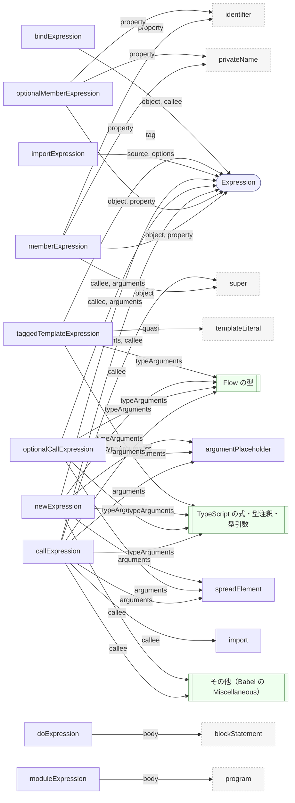

| kind                       | クラス                              | ファイル                                                                                                    | フィールド（型）                                                                                                                                                                                                                                                           | 備考                                                                                                                                                                                                                                                                                                                                                                                                                                                                                                                                                                                                                                                                                                                                                                                                                                                                                                                                                                                                                                                                                                                                                                                                                                                         |
| -------------------------- | ----------------------------------- | ----------------------------------------------------------------------------------------------------------- | -------------------------------------------------------------------------------------------------------------------------------------------------------------------------------------------------------------------------------------------------------------------------- | ------------------------------------------------------------------------------------------------------------------------------------------------------------------------------------------------------------------------------------------------------------------------------------------------------------------------------------------------------------------------------------------------------------------------------------------------------------------------------------------------------------------------------------------------------------------------------------------------------------------------------------------------------------------------------------------------------------------------------------------------------------------------------------------------------------------------------------------------------------------------------------------------------------------------------------------------------------------------------------------------------------------------------------------------------------------------------------------------------------------------------------------------------------------------------------------------------------------------------------------------------------ |
| `thisExpression`           | `ThisExpressionTypeClass`           | [commons/thisExpression.ts](../src/analyzer/types/lwc_IR/commons/thisExpression.ts)                         | —                                                                                                                                                                                                                                                                          |                                                                                                                                                                                                                                                                                                                                                                                                                                                                                                                                                                                                                                                                                                                                                                                                                                                                                                                                                                                                                                                                                                                                                                                                                                                              |
| `arrayExpression`          | `ArrayExpressionTypeClass`          | [commons/arrayExpression.ts](../src/analyzer/types/lwc_IR/commons/arrayExpression.ts)                       | `elements: (ExpressionTypeClass \| SpreadElementTypeClass \| null)[]`                                                                                                                                                                                                      |                                                                                                                                                                                                                                                                                                                                                                                                                                                                                                                                                                                                                                                                                                                                                                                                                                                                                                                                                                                                                                                                                                                                                                                                                                                              |
| `objectExpression`         | `ObjectExpressionTypeClass`         | [commons/objectExpression.ts](../src/analyzer/types/lwc_IR/commons/objectExpression.ts)                     | `properties: (ObjectMemberTypeClass \| SpreadElementTypeClass)[]`                                                                                                                                                                                                          |                                                                                                                                                                                                                                                                                                                                                                                                                                                                                                                                                                                                                                                                                                                                                                                                                                                                                                                                                                                                                                                                                                                                                                                                                                                              |
| `objectProperty`           | `ObjectPropertyTypeClass`           | [commons/objectProperty.ts](../src/analyzer/types/lwc_IR/commons/objectProperty.ts)                         | `computed`（選択肢ごと）<br>`key`（選択肢ごと）<br>`shorthand`（選択肢ごと）<br>`value`（選択肢ごと）                                                                                                                                                                      | 判別 union（`computed`・`shorthand`）3 通り<br>① `computed: true`・`shorthand: false`・`key: ExpressionTypeClass`・`value: ExpressionTypeClass \| PatternTypeClass \| RestElementTypeClass`<br>② `computed: false`・`shorthand: false`・`key: BigIntLiteralTypeClass \| IdentifierTypeClass \| StringLiteralTypeClass \| NumericLiteralTypeClass \| PrivateNameTypeClass`・`value: ExpressionTypeClass \| PatternTypeClass \| RestElementTypeClass`<br>③ `shorthand: true`・`computed: false`・`key: IdentifierTypeClass`・`value: AssignmentPatternTypeClass \| IdentifierTypeClass`                                                                                                                                                                                                                                                                                                                                                                                                                                                                                                                                                                                                                                                                        |
| `objectMethod`             | `ObjectMethodTypeClass`             | [commons/objectMethod.ts](../src/analyzer/types/lwc_IR/commons/objectMethod.ts)                             | `body: BlockStatementTypeClass`<br>`computed`（選択肢ごと）<br>`key`（選択肢ごと）<br>`kind`（選択肢ごと）<br>`generator`（選択肢ごと）<br>`async`（選択肢ごと）<br>`params`（選択肢ごと）<br>`returnType`（選択肢ごと）<br>`typeParameters`（選択肢ごと）                 | 判別 union（`computed`・`kind`）6 通り<br>① `computed: true`・`kind: "method"`・`key: ExpressionTypeClass`・`generator: boolean`・`async: boolean`・`params: FunctionParameterTypeClass[]`・`returnType: TypeAnnotationTypeClass \| TSTypeAnnotationTypeClass \| null`・`typeParameters: TypeParameterDeclarationTypeClass \| TSTypeParameterDeclarationTypeClass \| null`<br>② `computed: true`・`kind: "get"`・`key: ExpressionTypeClass`・`params: GetterParams`・`returnType: TypeAnnotationTypeClass \| TSTypeAnnotationTypeClass \| null`<br>③ `computed: true`・`kind: "set"`・`key: ExpressionTypeClass`・`params: SetterParams`<br>④ `computed: false`・`kind: "method"`・`key: StaticMemberKeyTypeClass`・`generator: boolean`・`async: boolean`・`params: FunctionParameterTypeClass[]`・`returnType: TypeAnnotationTypeClass \| TSTypeAnnotationTypeClass \| null`・`typeParameters: TypeParameterDeclarationTypeClass \| TSTypeParameterDeclarationTypeClass \| null`<br>⑤ `computed: false`・`kind: "get"`・`key: StaticMemberKeyTypeClass`・`params: GetterParams`・`returnType: TypeAnnotationTypeClass \| TSTypeAnnotationTypeClass \| null`<br>⑥ `computed: false`・`kind: "set"`・`key: StaticMemberKeyTypeClass`・`params: SetterParams` |
| `spreadElement`            | `SpreadElementTypeClass`            | [commons/spreadElement.ts](../src/analyzer/types/lwc_IR/commons/spreadElement.ts)                           | `argument: ExpressionTypeClass`                                                                                                                                                                                                                                            |                                                                                                                                                                                                                                                                                                                                                                                                                                                                                                                                                                                                                                                                                                                                                                                                                                                                                                                                                                                                                                                                                                                                                                                                                                                              |
| `assignmentExpression`     | `AssignmentExpressionTypeClass`     | [commons/assignmentExpression.ts](../src/analyzer/types/lwc_IR/commons/assignmentExpression.ts)             | `right: ExpressionTypeClass`<br>`operator`（選択肢ごと）<br>`left`（選択肢ごと）                                                                                                                                                                                           | 判別 union（`operator`）2 通り<br>① `operator: "="`・`left: LValTypeClass`<br>② `operator: CompoundAssignmentOperator`・`left: SimpleAssignmentTargetTypeClass`                                                                                                                                                                                                                                                                                                                                                                                                                                                                                                                                                                                                                                                                                                                                                                                                                                                                                                                                                                                                                                                                                              |
| `binaryExpression`         | `BinaryExpressionTypeClass`         | [commons/binaryExpression.ts](../src/analyzer/types/lwc_IR/commons/binaryExpression.ts)                     | `right: ExpressionTypeClass`<br>`operator`（選択肢ごと）<br>`left`（選択肢ごと）                                                                                                                                                                                           | 判別 union（`operator`）2 通り<br>① `operator: "in"`・`left: ExpressionTypeClass \| PrivateNameTypeClass`<br>② `operator: "+" \| "-" \| "/" \| "%" \| "*" \| "**" \| "&" \| "\|" \| ">>" \| ">>>" \| "<<" \| "^" \| "==" \| "===" \| "!=" \| "!==" \| "instanceof" \| ">" \| "<" \| ">=" \| "<=" \| "\|>"`・`left: ExpressionTypeClass`                                                                                                                                                                                                                                                                                                                                                                                                                                                                                                                                                                                                                                                                                                                                                                                                                                                                                                                      |
| `logicalExpression`        | `LogicalExpressionTypeClass`        | [commons/logicalExpression.ts](../src/analyzer/types/lwc_IR/commons/logicalExpression.ts)                   | `operator: "\|\|" \| "&&" \| "??"`<br>`left: ExpressionTypeClass`<br>`right: ExpressionTypeClass`                                                                                                                                                                          |                                                                                                                                                                                                                                                                                                                                                                                                                                                                                                                                                                                                                                                                                                                                                                                                                                                                                                                                                                                                                                                                                                                                                                                                                                                              |
| `unaryExpression`          | `UnaryExpressionTypeClass`          | [commons/unaryExpression.ts](../src/analyzer/types/lwc_IR/commons/unaryExpression.ts)                       | `operator`（選択肢ごと）<br>`argument`（選択肢ごと）                                                                                                                                                                                                                       | 判別 union（`operator`）2 通り<br>① `operator: "delete"`・`argument: MemberExpressionTypeClass \| OptionalMemberExpressionTypeClass`<br>② `operator: "+" \| "-" \| "typeof" \| "void" \| "throw" \| "!" \| "~"`・`argument: ExpressionTypeClass`                                                                                                                                                                                                                                                                                                                                                                                                                                                                                                                                                                                                                                                                                                                                                                                                                                                                                                                                                                                                             |
| `updateExpression`         | `UpdateExpressionTypeClass`         | [commons/updateExpression.ts](../src/analyzer/types/lwc_IR/commons/updateExpression.ts)                     | `prefix: boolean`<br>`argument: IdentifierTypeClass \| MemberExpressionTypeClass \| ParenthesizedExpressionTypeClass \| TSAsExpressionTypeClass \| TSSatisfiesExpressionTypeClass \| TSTypeAssertionTypeClass \| TSNonNullExpressionTypeClass`<br>`operator: "++" \| "--"` |                                                                                                                                                                                                                                                                                                                                                                                                                                                                                                                                                                                                                                                                                                                                                                                                                                                                                                                                                                                                                                                                                                                                                                                                                                                              |
| `conditionalExpression`    | `ConditionalExpressionTypeClass`    | [commons/conditionalExpression.ts](../src/analyzer/types/lwc_IR/commons/conditionalExpression.ts)           | `test: ExpressionTypeClass`<br>`consequent: ExpressionTypeClass`<br>`alternate: ExpressionTypeClass`                                                                                                                                                                       |                                                                                                                                                                                                                                                                                                                                                                                                                                                                                                                                                                                                                                                                                                                                                                                                                                                                                                                                                                                                                                                                                                                                                                                                                                                              |
| `sequenceExpression`       | `SequenceExpressionTypeClass`       | [commons/sequenceExpression.ts](../src/analyzer/types/lwc_IR/commons/sequenceExpression.ts)                 | `expressions: ExpressionTypeClass[]`                                                                                                                                                                                                                                       |                                                                                                                                                                                                                                                                                                                                                                                                                                                                                                                                                                                                                                                                                                                                                                                                                                                                                                                                                                                                                                                                                                                                                                                                                                                              |
| `parenthesizedExpression`  | `ParenthesizedExpressionTypeClass`  | [commons/parenthesizedExpression.ts](../src/analyzer/types/lwc_IR/commons/parenthesizedExpression.ts)       | `expression: ExpressionTypeClass`                                                                                                                                                                                                                                          |                                                                                                                                                                                                                                                                                                                                                                                                                                                                                                                                                                                                                                                                                                                                                                                                                                                                                                                                                                                                                                                                                                                                                                                                                                                              |
| `memberExpression`         | `MemberExpressionTypeClass`         | [commons/memberExpression.ts](../src/analyzer/types/lwc_IR/commons/memberExpression.ts)                     | `computed`（選択肢ごと）<br>`object`（選択肢ごと）<br>`property`（選択肢ごと）                                                                                                                                                                                             | 判別 union（`computed`）3 通り<br>① `computed: false`・`object: ExpressionTypeClass`・`property: IdentifierTypeClass \| PrivateNameTypeClass`<br>② `computed: false`・`object: SuperTypeClass`・`property: IdentifierTypeClass`<br>③ `computed: true`・`object: ExpressionTypeClass \| SuperTypeClass`・`property: ExpressionTypeClass`                                                                                                                                                                                                                                                                                                                                                                                                                                                                                                                                                                                                                                                                                                                                                                                                                                                                                                                      |
| `optionalMemberExpression` | `OptionalMemberExpressionTypeClass` | [commons/optionalMemberExpression.ts](../src/analyzer/types/lwc_IR/commons/optionalMemberExpression.ts)     | `object: ExpressionTypeClass`<br>`optional: boolean`<br>`computed`（選択肢ごと）<br>`property`（選択肢ごと）                                                                                                                                                               | 判別 union（`computed`）2 通り<br>① `computed: false`・`property: IdentifierTypeClass \| PrivateNameTypeClass`<br>② `computed: true`・`property: ExpressionTypeClass`                                                                                                                                                                                                                                                                                                                                                                                                                                                                                                                                                                                                                                                                                                                                                                                                                                                                                                                                                                                                                                                                                        |
| `callExpression`           | `CallExpressionTypeClass`           | [commons/callExpression.ts](../src/analyzer/types/lwc_IR/commons/callExpression.ts)                         | `typeArguments: TypeParameterInstantiationTypeClass \| TSTypeParameterInstantiationTypeClass \| null`<br>`kind`（選択肢ごと）<br>`callee`（選択肢ごと）<br>`arguments`（選択肢ごと）                                                                                       | 判別 union（`kind`）3 通り<br>① `kind: "super"`・`callee: SuperTypeClass`・`arguments: CallArgumentTypeClass[]`<br>② `kind: "import"`・`callee: ImportTypeClass`・`arguments: [ExpressionTypeClass] \| [ExpressionTypeClass, ExpressionTypeClass]`<br>③ `kind: "normal"`・`callee: ExpressionTypeClass \| V8IntrinsicIdentifierTypeClass`・`arguments: CallArgumentTypeClass[]`                                                                                                                                                                                                                                                                                                                                                                                                                                                                                                                                                                                                                                                                                                                                                                                                                                                                              |
| `optionalCallExpression`   | `OptionalCallExpressionTypeClass`   | [commons/optionalCallExpression.ts](../src/analyzer/types/lwc_IR/commons/optionalCallExpression.ts)         | `callee: ExpressionTypeClass`<br>`arguments: (ExpressionTypeClass \| ArgumentPlaceholderTypeClass \| SpreadElementTypeClass)[]`<br>`optional: boolean`<br>`typeArguments: TypeParameterInstantiationTypeClass \| TSTypeParameterInstantiationTypeClass \| null`            |                                                                                                                                                                                                                                                                                                                                                                                                                                                                                                                                                                                                                                                                                                                                                                                                                                                                                                                                                                                                                                                                                                                                                                                                                                                              |
| `newExpression`            | `NewExpressionTypeClass`            | [commons/newExpression.ts](../src/analyzer/types/lwc_IR/commons/newExpression.ts)                           | `callee: ExpressionTypeClass \| V8IntrinsicIdentifierTypeClass`<br>`arguments: (ExpressionTypeClass \| ArgumentPlaceholderTypeClass \| SpreadElementTypeClass)[]`<br>`typeArguments: TypeParameterInstantiationTypeClass \| TSTypeParameterInstantiationTypeClass \| null` |                                                                                                                                                                                                                                                                                                                                                                                                                                                                                                                                                                                                                                                                                                                                                                                                                                                                                                                                                                                                                                                                                                                                                                                                                                                              |
| `argumentPlaceholder`      | `ArgumentPlaceholderTypeClass`      | [commons/argumentPlaceholder.ts](../src/analyzer/types/lwc_IR/commons/argumentPlaceholder.ts)               | —                                                                                                                                                                                                                                                                          |                                                                                                                                                                                                                                                                                                                                                                                                                                                                                                                                                                                                                                                                                                                                                                                                                                                                                                                                                                                                                                                                                                                                                                                                                                                              |
| `import`                   | `ImportTypeClass`                   | [standardizedVisitor/import.ts](../src/analyzer/types/lwc_IR/standardizedVisitor/import.ts)                 | —                                                                                                                                                                                                                                                                          |                                                                                                                                                                                                                                                                                                                                                                                                                                                                                                                                                                                                                                                                                                                                                                                                                                                                                                                                                                                                                                                                                                                                                                                                                                                              |
| `importExpression`         | `ImportExpressionTypeClass`         | [commons/importExpression.ts](../src/analyzer/types/lwc_IR/commons/importExpression.ts)                     | `phase: "source" \| "defer" \| null`<br>`source: ExpressionTypeClass`<br>`options: ExpressionTypeClass \| null`                                                                                                                                                            |                                                                                                                                                                                                                                                                                                                                                                                                                                                                                                                                                                                                                                                                                                                                                                                                                                                                                                                                                                                                                                                                                                                                                                                                                                                              |
| `metaProperty`             | `MetaPropertyTypeClass`             | [commons/metaProperty.ts](../src/analyzer/types/lwc_IR/commons/metaProperty.ts)                             | `kind: "new.target" \| "import.meta"`                                                                                                                                                                                                                                      |                                                                                                                                                                                                                                                                                                                                                                                                                                                                                                                                                                                                                                                                                                                                                                                                                                                                                                                                                                                                                                                                                                                                                                                                                                                              |
| `taggedTemplateExpression` | `TaggedTemplateExpressionTypeClass` | [commons/taggedTemplateExpression.ts](../src/analyzer/types/lwc_IR/commons/taggedTemplateExpression.ts)     | `tag: ExpressionTypeClass`<br>`quasi: TemplateLiteralTypeClass`<br>`typeArguments: TypeParameterInstantiationTypeClass \| TSTypeParameterInstantiationTypeClass \| null`                                                                                                   |                                                                                                                                                                                                                                                                                                                                                                                                                                                                                                                                                                                                                                                                                                                                                                                                                                                                                                                                                                                                                                                                                                                                                                                                                                                              |
| `awaitExpression`          | `AwaitExpressionTypeClass`          | [commons/awaitExpression.ts](../src/analyzer/types/lwc_IR/commons/awaitExpression.ts)                       | `argument: ExpressionTypeClass`                                                                                                                                                                                                                                            |                                                                                                                                                                                                                                                                                                                                                                                                                                                                                                                                                                                                                                                                                                                                                                                                                                                                                                                                                                                                                                                                                                                                                                                                                                                              |
| `yieldExpression`          | `YieldExpressionTypeClass`          | [commons/yieldExpression.ts](../src/analyzer/types/lwc_IR/commons/yieldExpression.ts)                       | `delegate`（選択肢ごと）<br>`argument`（選択肢ごと）                                                                                                                                                                                                                       | 判別 union（`delegate`）2 通り<br>① `delegate: true`・`argument: ExpressionTypeClass`<br>② `delegate: false`・`argument: ExpressionTypeClass \| null`                                                                                                                                                                                                                                                                                                                                                                                                                                                                                                                                                                                                                                                                                                                                                                                                                                                                                                                                                                                                                                                                                                        |
| `bindExpression`           | `BindExpressionTypeClass`           | [expressionVisitor/bindExpression.ts](../src/analyzer/types/lwc_IR/expressionVisitor/bindExpression.ts)     | `object: ExpressionTypeClass \| null`<br>`callee: ExpressionTypeClass`                                                                                                                                                                                                     |                                                                                                                                                                                                                                                                                                                                                                                                                                                                                                                                                                                                                                                                                                                                                                                                                                                                                                                                                                                                                                                                                                                                                                                                                                                              |
| `doExpression`             | `DoExpressionTypeClass`             | [expressionVisitor/doExpression.ts](../src/analyzer/types/lwc_IR/expressionVisitor/doExpression.ts)         | `body: BlockStatementTypeClass`<br>`async: boolean`                                                                                                                                                                                                                        |                                                                                                                                                                                                                                                                                                                                                                                                                                                                                                                                                                                                                                                                                                                                                                                                                                                                                                                                                                                                                                                                                                                                                                                                                                                              |
| `moduleExpression`         | `ModuleExpressionTypeClass`         | [expressionVisitor/moduleExpression.ts](../src/analyzer/types/lwc_IR/expressionVisitor/moduleExpression.ts) | `body: ProgramTypeClass`                                                                                                                                                                                                                                                   |                                                                                                                                                                                                                                                                                                                                                                                                                                                                                                                                                                                                                                                                                                                                                                                                                                                                                                                                                                                                                                                                                                                                                                                                                                                              |
| `topicReference`           | `TopicReferenceTypeClass`           | [expressionVisitor/topicReference.ts](../src/analyzer/types/lwc_IR/expressionVisitor/topicReference.ts)     | —                                                                                                                                                                                                                                                                          |                                                                                                                                                                                                                                                                                                                                                                                                                                                                                                                                                                                                                                                                                                                                                                                                                                                                                                                                                                                                                                                                                                                                                                                                                                                              |

### 3.6 パターン（分割代入・引数・LVal）（5）

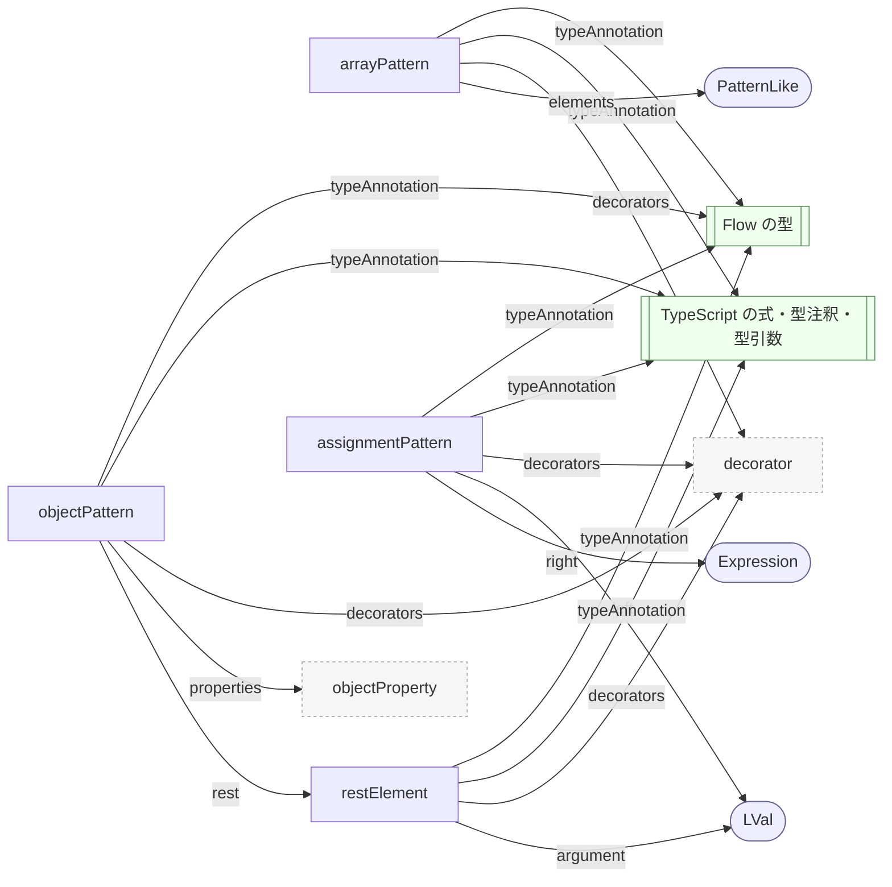

子ノードを持たないもの: `voidPattern`

| kind                | クラス                       | ファイル                                                                                  | フィールド（型）                                                                                                                                                                                                                       | 備考 |
| ------------------- | ---------------------------- | ----------------------------------------------------------------------------------------- | -------------------------------------------------------------------------------------------------------------------------------------------------------------------------------------------------------------------------------------- | ---- |
| `arrayPattern`      | `ArrayPatternTypeClass`      | [commons/arrayPattern.ts](../src/analyzer/types/lwc_IR/commons/arrayPattern.ts)           | `typeAnnotation: TypeAnnotationTypeClass \| TSTypeAnnotationTypeClass \| null`<br>`optional: boolean`<br>`decorators: DecoratorTypeClass[] \| null`<br>`elements: (PatternLikeTypeClass \| null)[]`                                    |      |
| `objectPattern`     | `ObjectPatternTypeClass`     | [commons/objectPattern.ts](../src/analyzer/types/lwc_IR/commons/objectPattern.ts)         | `typeAnnotation: TypeAnnotationTypeClass \| TSTypeAnnotationTypeClass \| null`<br>`optional: boolean`<br>`decorators: DecoratorTypeClass[] \| null`<br>`properties: ObjectPropertyTypeClass[]`<br>`rest: RestElementTypeClass \| null` |      |
| `assignmentPattern` | `AssignmentPatternTypeClass` | [commons/assignmentPattern.ts](../src/analyzer/types/lwc_IR/commons/assignmentPattern.ts) | `typeAnnotation: TypeAnnotationTypeClass \| TSTypeAnnotationTypeClass \| null`<br>`optional: boolean`<br>`decorators: DecoratorTypeClass[] \| null`<br>`left: LValTypeClass`<br>`right: ExpressionTypeClass`                           |      |
| `restElement`       | `RestElementTypeClass`       | [commons/restElement.ts](../src/analyzer/types/lwc_IR/commons/restElement.ts)             | `typeAnnotation: TypeAnnotationTypeClass \| TSTypeAnnotationTypeClass \| null`<br>`optional: boolean`<br>`decorators: DecoratorTypeClass[] \| null`<br>`argument: LValTypeClass`                                                       |      |
| `voidPattern`       | `VoidPatternTypeClass`       | [commons/voidPattern.ts](../src/analyzer/types/lwc_IR/commons/voidPattern.ts)             | —                                                                                                                                                                                                                                      |      |

### 3.7 識別子・リテラル・テンプレート（9）

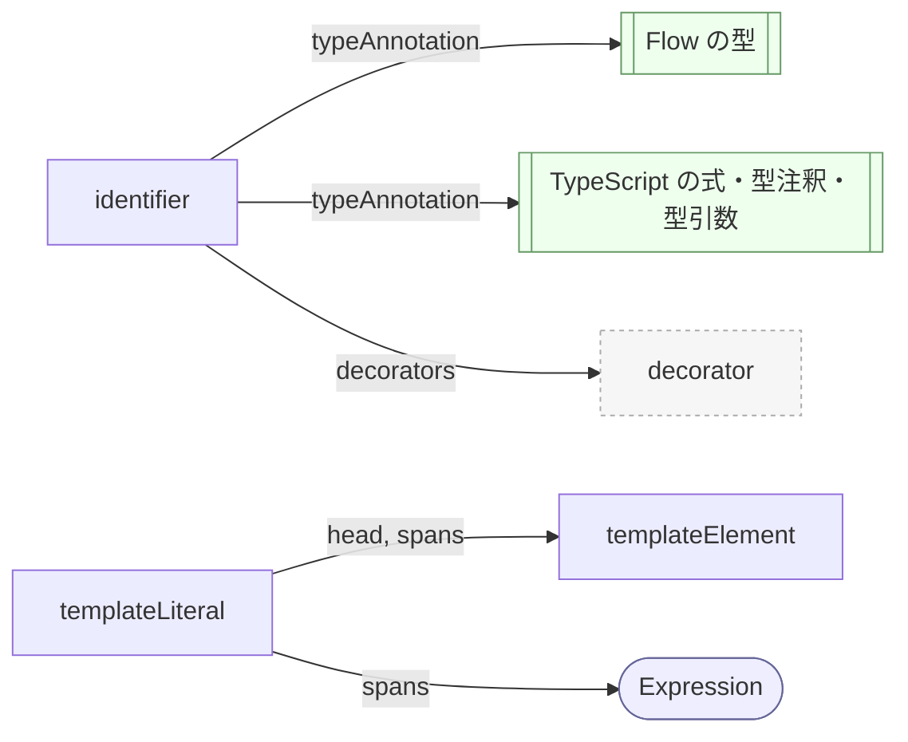

子ノードを持たないもの: `stringLiteral`・`numericLiteral`・`bigIntLiteral`・`booleanLiteral`・`nullLiteral`・`regExpLiteral`・`templateElement`

| kind              | クラス                     | ファイル                                                                                                      | フィールド（型）                                                                                                                                                      | 備考 |
| ----------------- | -------------------------- | ------------------------------------------------------------------------------------------------------------- | --------------------------------------------------------------------------------------------------------------------------------------------------------------------- | ---- |
| `identifier`      | `IdentifierTypeClass`      | [commons/identifier.ts](../src/analyzer/types/lwc_IR/commons/identifier.ts)                                   | `typeAnnotation: TypeAnnotationTypeClass \| TSTypeAnnotationTypeClass \| null`<br>`optional: boolean`<br>`decorators: DecoratorTypeClass[] \| null`<br>`name: string` |      |
| `stringLiteral`   | `StringLiteralTypeClass`   | [commons/stringLiteral.ts](../src/analyzer/types/lwc_IR/commons/stringLiteral.ts)                             | `value: string`                                                                                                                                                       |      |
| `numericLiteral`  | `NumericLiteralTypeClass`  | [commons/numericLiteral.ts](../src/analyzer/types/lwc_IR/commons/numericLiteral.ts)                           | `value: number`                                                                                                                                                       |      |
| `bigIntLiteral`   | `BigIntLiteralTypeClass`   | [commons/bigIntLiteral.ts](../src/analyzer/types/lwc_IR/commons/bigIntLiteral.ts)                             | `value: bigint`                                                                                                                                                       |      |
| `booleanLiteral`  | `BooleanLiteralTypeClass`  | [commons/booleanLiteral.ts](../src/analyzer/types/lwc_IR/commons/booleanLiteral.ts)                           | `value: boolean`                                                                                                                                                      |      |
| `nullLiteral`     | `NullLiteralTypeClass`     | [commons/nullLiteral.ts](../src/analyzer/types/lwc_IR/commons/nullLiteral.ts)                                 | —                                                                                                                                                                     |      |
| `regExpLiteral`   | `RegExpLiteralTypeClass`   | [commons/regExpLiteral.ts](../src/analyzer/types/lwc_IR/commons/regExpLiteral.ts)                             | `pattern: string`<br>`flags: RegExpFlags`                                                                                                                             |      |
| `templateLiteral` | `TemplateLiteralTypeClass` | [commons/templateLiteral.ts](../src/analyzer/types/lwc_IR/commons/templateLiteral.ts)                         | `head: TemplateElementTypeClass`<br>`spans: TemplateLiteralSpan[]`                                                                                                    |      |
| `templateElement` | `TemplateElementTypeClass` | [standardizedVisitor/templateElement.ts](../src/analyzer/types/lwc_IR/standardizedVisitor/templateElement.ts) | `value: { raw: string; cooked?: string \| undefined \| null }`<br>`tail: boolean`                                                                                     |      |

### 3.8 TypeScript の型（37）

図 1/2

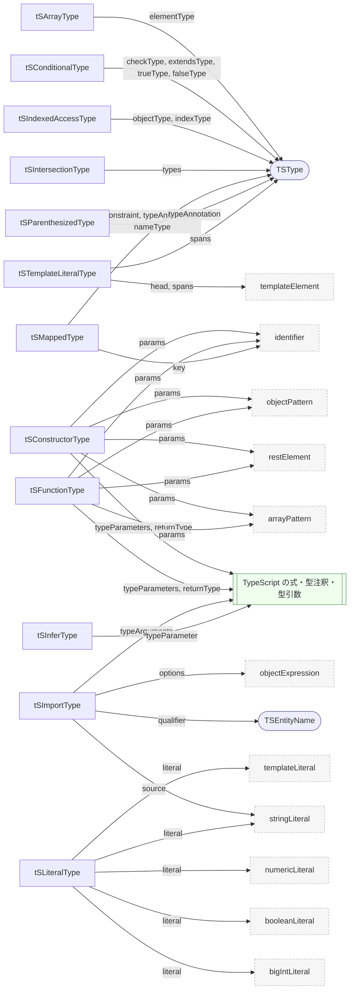

図 2/2

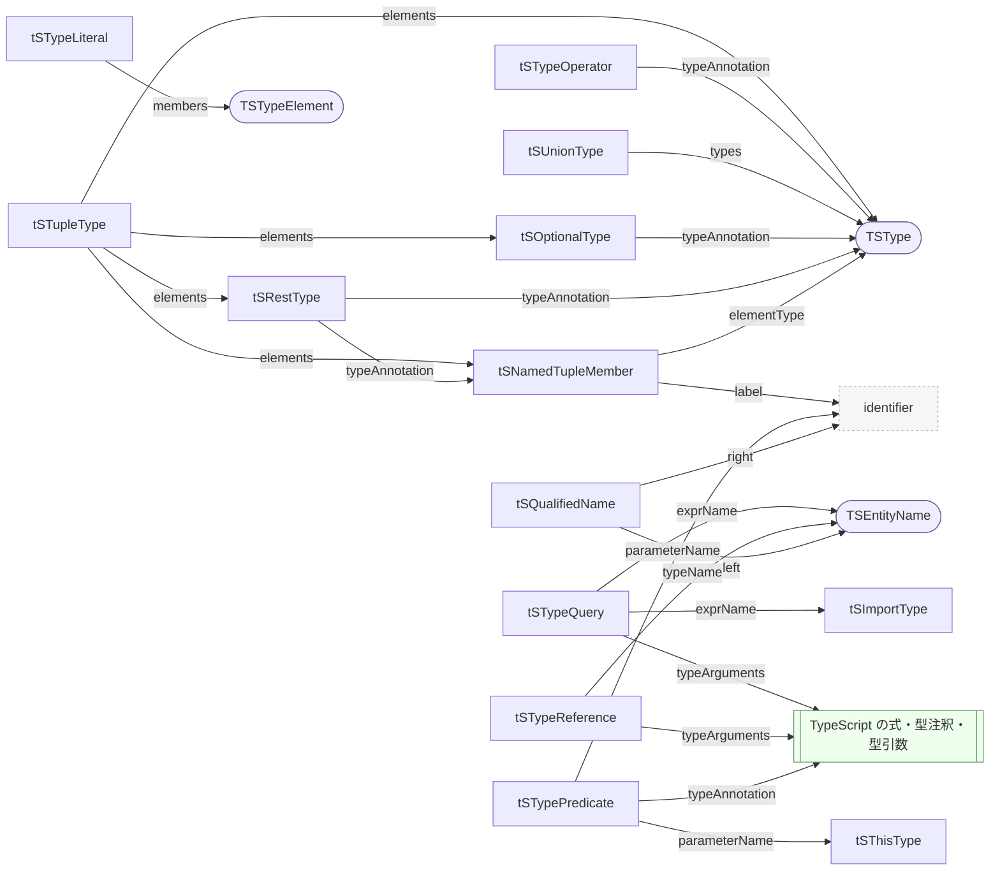

子ノードを持たないもの: `tSAnyKeyword`・`tSBigIntKeyword`・`tSBooleanKeyword`・`tSIntrinsicKeyword`・`tSNeverKeyword`・`tSNullKeyword`・`tSNumberKeyword`・`tSObjectKeyword`・`tSStringKeyword`・`tSSymbolKeyword`・`tSThisType`・`tSUndefinedKeyword`・`tSUnknownKeyword`・`tSVoidKeyword`

| kind                    | クラス                           | ファイル                                                                                          | フィールド（型）                                                                                                                                                                                                                                        | 備考                                                                                                                                                                                                                          |
| ----------------------- | -------------------------------- | ------------------------------------------------------------------------------------------------- | ------------------------------------------------------------------------------------------------------------------------------------------------------------------------------------------------------------------------------------------------------- | ----------------------------------------------------------------------------------------------------------------------------------------------------------------------------------------------------------------------------- |
| `tSAnyKeyword`          | `TSAnyKeywordTypeClass`          | [commons/tSAnyKeyword.ts](../src/analyzer/types/lwc_IR/commons/tSAnyKeyword.ts)                   | —                                                                                                                                                                                                                                                       |                                                                                                                                                                                                                               |
| `tSArrayType`           | `TSArrayTypeTypeClass`           | [commons/tSArrayType.ts](../src/analyzer/types/lwc_IR/commons/tSArrayType.ts)                     | `elementType: TSTypeTypeClass`                                                                                                                                                                                                                          |                                                                                                                                                                                                                               |
| `tSBigIntKeyword`       | `TSBigIntKeywordTypeClass`       | [commons/tSBigIntKeyword.ts](../src/analyzer/types/lwc_IR/commons/tSBigIntKeyword.ts)             | —                                                                                                                                                                                                                                                       |                                                                                                                                                                                                                               |
| `tSBooleanKeyword`      | `TSBooleanKeywordTypeClass`      | [commons/tSBooleanKeyword.ts](../src/analyzer/types/lwc_IR/commons/tSBooleanKeyword.ts)           | —                                                                                                                                                                                                                                                       |                                                                                                                                                                                                                               |
| `tSConditionalType`     | `TSConditionalTypeTypeClass`     | [commons/tSConditionalType.ts](../src/analyzer/types/lwc_IR/commons/tSConditionalType.ts)         | `checkType: TSTypeTypeClass`<br>`extendsType: TSTypeTypeClass`<br>`trueType: TSTypeTypeClass`<br>`falseType: TSTypeTypeClass`                                                                                                                           |                                                                                                                                                                                                                               |
| `tSConstructorType`     | `TSConstructorTypeTypeClass`     | [commons/tSConstructorType.ts](../src/analyzer/types/lwc_IR/commons/tSConstructorType.ts)         | `typeParameters: TSTypeParameterDeclarationTypeClass \| null`<br>`params: (ArrayPatternTypeClass \| IdentifierTypeClass \| RestElementTypeClass \| ObjectPatternTypeClass)[]`<br>`returnType: TSTypeAnnotationTypeClass \| null`<br>`abstract: boolean` |                                                                                                                                                                                                                               |
| `tSFunctionType`        | `TSFunctionTypeTypeClass`        | [commons/tSFunctionType.ts](../src/analyzer/types/lwc_IR/commons/tSFunctionType.ts)               | `typeParameters: TSTypeParameterDeclarationTypeClass \| null`<br>`params: (ArrayPatternTypeClass \| IdentifierTypeClass \| RestElementTypeClass \| ObjectPatternTypeClass)[]`<br>`returnType: TSTypeAnnotationTypeClass \| null`                        |                                                                                                                                                                                                                               |
| `tSImportType`          | `TSImportTypeTypeClass`          | [commons/tSImportType.ts](../src/analyzer/types/lwc_IR/commons/tSImportType.ts)                   | `source: StringLiteralTypeClass`<br>`qualifier: TSEntityNameTypeClass \| null`<br>`typeArguments: TSTypeParameterInstantiationTypeClass \| null`<br>`options: ObjectExpressionTypeClass \| null`                                                        |                                                                                                                                                                                                                               |
| `tSIndexedAccessType`   | `TSIndexedAccessTypeTypeClass`   | [commons/tSIndexedAccessType.ts](../src/analyzer/types/lwc_IR/commons/tSIndexedAccessType.ts)     | `objectType: TSTypeTypeClass`<br>`indexType: TSTypeTypeClass`                                                                                                                                                                                           |                                                                                                                                                                                                                               |
| `tSInferType`           | `TSInferTypeTypeClass`           | [commons/tSInferType.ts](../src/analyzer/types/lwc_IR/commons/tSInferType.ts)                     | `typeParameter: TSTypeParameterTypeClass`                                                                                                                                                                                                               |                                                                                                                                                                                                                               |
| `tSIntersectionType`    | `TSIntersectionTypeTypeClass`    | [commons/tSIntersectionType.ts](../src/analyzer/types/lwc_IR/commons/tSIntersectionType.ts)       | `types: TSTypeTypeClass[]`                                                                                                                                                                                                                              |                                                                                                                                                                                                                               |
| `tSIntrinsicKeyword`    | `TSIntrinsicKeywordTypeClass`    | [commons/tSIntrinsicKeyword.ts](../src/analyzer/types/lwc_IR/commons/tSIntrinsicKeyword.ts)       | —                                                                                                                                                                                                                                                       |                                                                                                                                                                                                                               |
| `tSLiteralType`         | `TSLiteralTypeTypeClass`         | [commons/tSLiteralType.ts](../src/analyzer/types/lwc_IR/commons/tSLiteralType.ts)                 | `literal: BigIntLiteralTypeClass \| BooleanLiteralTypeClass \| StringLiteralTypeClass \| NumericLiteralTypeClass \| TemplateLiteralTypeClass \| TSNegativeLiteral`                                                                                      |                                                                                                                                                                                                                               |
| `tSMappedType`          | `TSMappedTypeTypeClass`          | [commons/tSMappedType.ts](../src/analyzer/types/lwc_IR/commons/tSMappedType.ts)                   | `key: IdentifierTypeClass`<br>`constraint: TSTypeTypeClass`<br>`readonly: TSMappedTypeModifier`<br>`optional: TSMappedTypeModifier`<br>`typeAnnotation: TSTypeTypeClass \| null`<br>`nameType: TSTypeTypeClass \| null`                                 |                                                                                                                                                                                                                               |
| `tSNeverKeyword`        | `TSNeverKeywordTypeClass`        | [commons/tSNeverKeyword.ts](../src/analyzer/types/lwc_IR/commons/tSNeverKeyword.ts)               | —                                                                                                                                                                                                                                                       |                                                                                                                                                                                                                               |
| `tSNullKeyword`         | `TSNullKeywordTypeClass`         | [commons/tSNullKeyword.ts](../src/analyzer/types/lwc_IR/commons/tSNullKeyword.ts)                 | —                                                                                                                                                                                                                                                       |                                                                                                                                                                                                                               |
| `tSNumberKeyword`       | `TSNumberKeywordTypeClass`       | [commons/tSNumberKeyword.ts](../src/analyzer/types/lwc_IR/commons/tSNumberKeyword.ts)             | —                                                                                                                                                                                                                                                       |                                                                                                                                                                                                                               |
| `tSObjectKeyword`       | `TSObjectKeywordTypeClass`       | [commons/tSObjectKeyword.ts](../src/analyzer/types/lwc_IR/commons/tSObjectKeyword.ts)             | —                                                                                                                                                                                                                                                       |                                                                                                                                                                                                                               |
| `tSParenthesizedType`   | `TSParenthesizedTypeTypeClass`   | [commons/tSParenthesizedType.ts](../src/analyzer/types/lwc_IR/commons/tSParenthesizedType.ts)     | `typeAnnotation: TSTypeTypeClass`                                                                                                                                                                                                                       |                                                                                                                                                                                                                               |
| `tSStringKeyword`       | `TSStringKeywordTypeClass`       | [commons/tSStringKeyword.ts](../src/analyzer/types/lwc_IR/commons/tSStringKeyword.ts)             | —                                                                                                                                                                                                                                                       |                                                                                                                                                                                                                               |
| `tSSymbolKeyword`       | `TSSymbolKeywordTypeClass`       | [commons/tSSymbolKeyword.ts](../src/analyzer/types/lwc_IR/commons/tSSymbolKeyword.ts)             | —                                                                                                                                                                                                                                                       |                                                                                                                                                                                                                               |
| `tSTemplateLiteralType` | `TSTemplateLiteralTypeTypeClass` | [commons/tSTemplateLiteralType.ts](../src/analyzer/types/lwc_IR/commons/tSTemplateLiteralType.ts) | `head: TemplateElementTypeClass`<br>`spans: TSTemplateLiteralTypeSpan[]`                                                                                                                                                                                |                                                                                                                                                                                                                               |
| `tSThisType`            | `TSThisTypeTypeClass`            | [commons/tSThisType.ts](../src/analyzer/types/lwc_IR/commons/tSThisType.ts)                       | —                                                                                                                                                                                                                                                       |                                                                                                                                                                                                                               |
| `tSTupleType`           | `TSTupleTypeTypeClass`           | [commons/tSTupleType.ts](../src/analyzer/types/lwc_IR/commons/tSTupleType.ts)                     | `kind`（選択肢ごと）<br>`elements`（選択肢ごと）                                                                                                                                                                                                        | 判別 union（`kind`）2 通り<br>① `kind: "unnamed"`・`elements: (TSTypeTypeClass \| TSOptionalTypeTypeClass \| TSRestTypeTypeClass)[]`<br>② `kind: "named"`・`elements: (TSNamedTupleMemberTypeClass \| TSRestTypeTypeClass)[]` |
| `tSTypeLiteral`         | `TSTypeLiteralTypeClass`         | [commons/tSTypeLiteral.ts](../src/analyzer/types/lwc_IR/commons/tSTypeLiteral.ts)                 | `members: TSTypeElementTypeClass[]`                                                                                                                                                                                                                     |                                                                                                                                                                                                                               |
| `tSTypeOperator`        | `TSTypeOperatorTypeClass`        | [commons/tSTypeOperator.ts](../src/analyzer/types/lwc_IR/commons/tSTypeOperator.ts)               | `operator: "readonly" \| "keyof" \| "unique"`<br>`typeAnnotation: TSTypeTypeClass`                                                                                                                                                                      |                                                                                                                                                                                                                               |
| `tSTypeQuery`           | `TSTypeQueryTypeClass`           | [commons/tSTypeQuery.ts](../src/analyzer/types/lwc_IR/commons/tSTypeQuery.ts)                     | `exprName: TSEntityNameTypeClass \| TSImportTypeTypeClass`<br>`typeArguments: TSTypeParameterInstantiationTypeClass \| null`                                                                                                                            |                                                                                                                                                                                                                               |
| `tSTypeReference`       | `TSTypeReferenceTypeClass`       | [commons/tSTypeReference.ts](../src/analyzer/types/lwc_IR/commons/tSTypeReference.ts)             | `typeName: TSEntityNameTypeClass`<br>`typeArguments: TSTypeParameterInstantiationTypeClass \| null`                                                                                                                                                     |                                                                                                                                                                                                                               |
| `tSUndefinedKeyword`    | `TSUndefinedKeywordTypeClass`    | [commons/tSUndefinedKeyword.ts](../src/analyzer/types/lwc_IR/commons/tSUndefinedKeyword.ts)       | —                                                                                                                                                                                                                                                       |                                                                                                                                                                                                                               |
| `tSUnionType`           | `TSUnionTypeTypeClass`           | [commons/tSUnionType.ts](../src/analyzer/types/lwc_IR/commons/tSUnionType.ts)                     | `types: TSTypeTypeClass[]`                                                                                                                                                                                                                              |                                                                                                                                                                                                                               |
| `tSUnknownKeyword`      | `TSUnknownKeywordTypeClass`      | [commons/tSUnknownKeyword.ts](../src/analyzer/types/lwc_IR/commons/tSUnknownKeyword.ts)           | —                                                                                                                                                                                                                                                       |                                                                                                                                                                                                                               |
| `tSVoidKeyword`         | `TSVoidKeywordTypeClass`         | [commons/tSVoidKeyword.ts](../src/analyzer/types/lwc_IR/commons/tSVoidKeyword.ts)                 | —                                                                                                                                                                                                                                                       |                                                                                                                                                                                                                               |
| `tSOptionalType`        | `TSOptionalTypeTypeClass`        | [commons/tSOptionalType.ts](../src/analyzer/types/lwc_IR/commons/tSOptionalType.ts)               | `typeAnnotation: TSTypeTypeClass`                                                                                                                                                                                                                       |                                                                                                                                                                                                                               |
| `tSRestType`            | `TSRestTypeTypeClass`            | [commons/tSRestType.ts](../src/analyzer/types/lwc_IR/commons/tSRestType.ts)                       | `typeAnnotation: TSTypeTypeClass \| TSNamedTupleMemberTypeClass`                                                                                                                                                                                        |                                                                                                                                                                                                                               |
| `tSNamedTupleMember`    | `TSNamedTupleMemberTypeClass`    | [commons/tSNamedTupleMember.ts](../src/analyzer/types/lwc_IR/commons/tSNamedTupleMember.ts)       | `label: IdentifierTypeClass`<br>`optional: boolean`<br>`elementType: TSTypeTypeClass`                                                                                                                                                                   |                                                                                                                                                                                                                               |
| `tSTypePredicate`       | `TSTypePredicateTypeClass`       | [commons/tSTypePredicate.ts](../src/analyzer/types/lwc_IR/commons/tSTypePredicate.ts)             | `parameterName: IdentifierTypeClass \| TSThisTypeTypeClass`<br>`asserts`（選択肢ごと）<br>`typeAnnotation`（選択肢ごと）                                                                                                                                | 判別 union（`asserts`）2 通り<br>① `asserts: false`・`typeAnnotation: TSTypeAnnotationTypeClass`<br>② `asserts: true`・`typeAnnotation: TSTypeAnnotationTypeClass \| null`                                                    |
| `tSQualifiedName`       | `TSQualifiedNameTypeClass`       | [commons/tSQualifiedName.ts](../src/analyzer/types/lwc_IR/commons/tSQualifiedName.ts)             | `left: TSEntityNameTypeClass`<br>`right: IdentifierTypeClass`                                                                                                                                                                                           |                                                                                                                                                                                                                               |

### 3.9 TypeScript の式・型注釈・型引数（9）

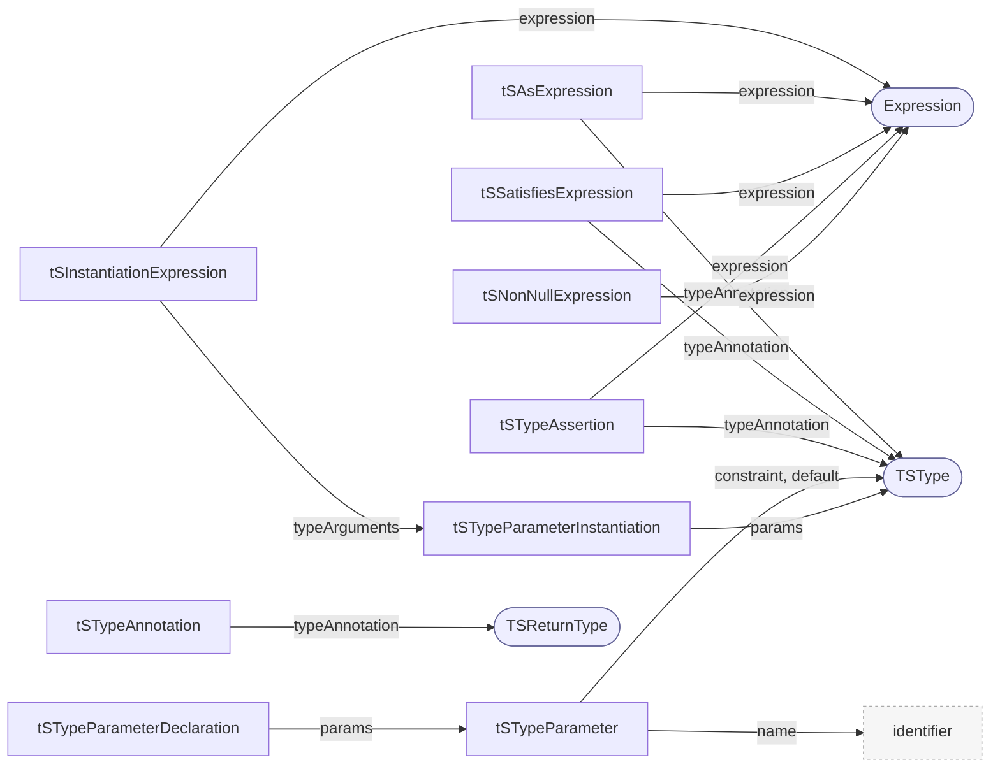

| kind                           | クラス                                  | ファイル                                                                                                                            | フィールド（型）                                                                                                                                                      | 備考 |
| ------------------------------ | --------------------------------------- | ----------------------------------------------------------------------------------------------------------------------------------- | --------------------------------------------------------------------------------------------------------------------------------------------------------------------- | ---- |
| `tSInstantiationExpression`    | `TSInstantiationExpressionTypeClass`    | [commons/tSInstantiationExpression.ts](../src/analyzer/types/lwc_IR/commons/tSInstantiationExpression.ts)                           | `expression: ExpressionTypeClass`<br>`typeArguments: TSTypeParameterInstantiationTypeClass \| null`                                                                   |      |
| `tSAsExpression`               | `TSAsExpressionTypeClass`               | [commons/tSAsExpression.ts](../src/analyzer/types/lwc_IR/commons/tSAsExpression.ts)                                                 | `expression: ExpressionTypeClass`<br>`typeAnnotation: TSTypeTypeClass`                                                                                                |      |
| `tSSatisfiesExpression`        | `TSSatisfiesExpressionTypeClass`        | [commons/tSSatisfiesExpression.ts](../src/analyzer/types/lwc_IR/commons/tSSatisfiesExpression.ts)                                   | `expression: ExpressionTypeClass`<br>`typeAnnotation: TSTypeTypeClass`                                                                                                |      |
| `tSTypeAssertion`              | `TSTypeAssertionTypeClass`              | [commons/tSTypeAssertion.ts](../src/analyzer/types/lwc_IR/commons/tSTypeAssertion.ts)                                               | `typeAnnotation: TSTypeTypeClass`<br>`expression: ExpressionTypeClass`                                                                                                |      |
| `tSNonNullExpression`          | `TSNonNullExpressionTypeClass`          | [commons/tSNonNullExpression.ts](../src/analyzer/types/lwc_IR/commons/tSNonNullExpression.ts)                                       | `expression: ExpressionTypeClass`                                                                                                                                     |      |
| `tSTypeAnnotation`             | `TSTypeAnnotationTypeClass`             | [typeScriptVisitor/tSTypeAnnotation.ts](../src/analyzer/types/lwc_IR/typeScriptVisitor/tSTypeAnnotation.ts)                         | `typeAnnotation: TSReturnTypeTypeClass`                                                                                                                               |      |
| `tSTypeParameter`              | `TSTypeParameterTypeClass`              | [typeScriptVisitor/tSTypeParameter.ts](../src/analyzer/types/lwc_IR/typeScriptVisitor/tSTypeParameter.ts)                           | `name: IdentifierTypeClass`<br>`variance: TSTypeParameterVariance`<br>`const: boolean`<br>`constraint: TSTypeTypeClass \| null`<br>`default: TSTypeTypeClass \| null` |      |
| `tSTypeParameterDeclaration`   | `TSTypeParameterDeclarationTypeClass`   | [typeScriptVisitor/tSTypeParameterDeclaration.ts](../src/analyzer/types/lwc_IR/typeScriptVisitor/tSTypeParameterDeclaration.ts)     | `params: TSTypeParameterTypeClass[]`                                                                                                                                  |      |
| `tSTypeParameterInstantiation` | `TSTypeParameterInstantiationTypeClass` | [typeScriptVisitor/tSTypeParameterInstantiation.ts](../src/analyzer/types/lwc_IR/typeScriptVisitor/tSTypeParameterInstantiation.ts) | `params: TSTypeTypeClass[]`                                                                                                                                           |      |

### 3.10 TypeScript の宣言・型のメンバー（22）

図 1/2

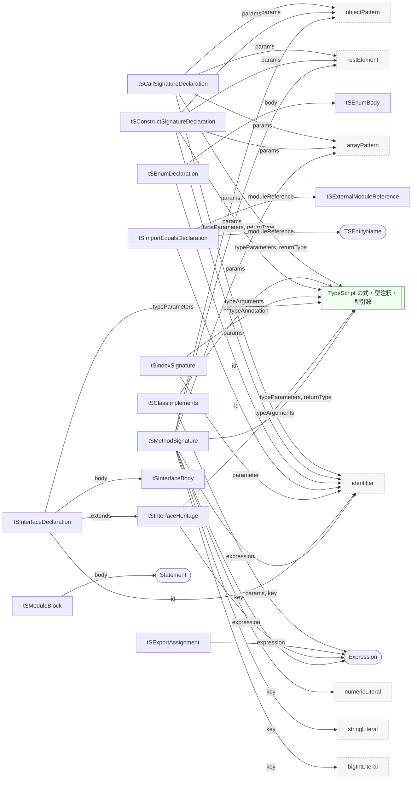

図 2/2

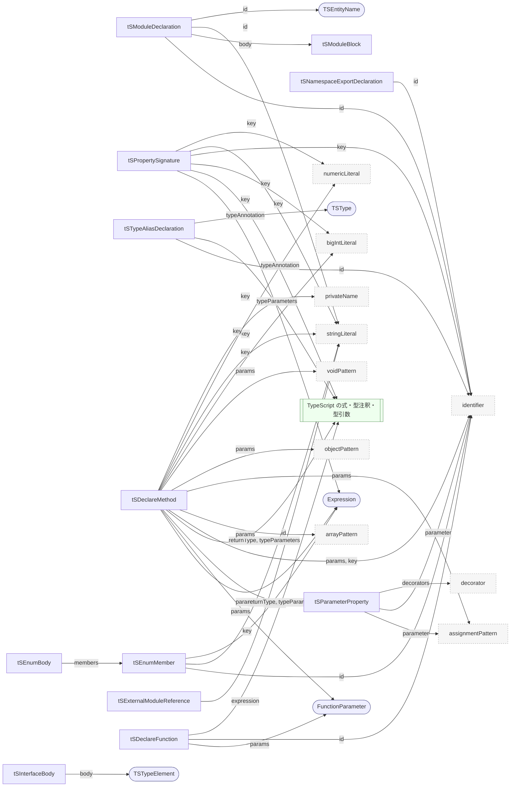

| kind                              | クラス                                     | ファイル                                                                                                                      | フィールド（型）                                                                                                                                                                                                                                                                                                                                                                                       | 備考                                                                                                                                                                                                                                                                                                                                                                                                                                                                                                                                                                                                                                                                                                                                                                                                                                                                                                                                                                                                                                                                                                                                                                                                                                                                                                                                                                                                                                                                                                                                                                                                                                                                                                                                                                                                                                                                                                                                                                                                                                                                                                                                                                                                                                                                                                   |
| --------------------------------- | ------------------------------------------ | ----------------------------------------------------------------------------------------------------------------------------- | ------------------------------------------------------------------------------------------------------------------------------------------------------------------------------------------------------------------------------------------------------------------------------------------------------------------------------------------------------------------------------------------------------ | ------------------------------------------------------------------------------------------------------------------------------------------------------------------------------------------------------------------------------------------------------------------------------------------------------------------------------------------------------------------------------------------------------------------------------------------------------------------------------------------------------------------------------------------------------------------------------------------------------------------------------------------------------------------------------------------------------------------------------------------------------------------------------------------------------------------------------------------------------------------------------------------------------------------------------------------------------------------------------------------------------------------------------------------------------------------------------------------------------------------------------------------------------------------------------------------------------------------------------------------------------------------------------------------------------------------------------------------------------------------------------------------------------------------------------------------------------------------------------------------------------------------------------------------------------------------------------------------------------------------------------------------------------------------------------------------------------------------------------------------------------------------------------------------------------------------------------------------------------------------------------------------------------------------------------------------------------------------------------------------------------------------------------------------------------------------------------------------------------------------------------------------------------------------------------------------------------------------------------------------------------------------------------------------------------ |
| `tSCallSignatureDeclaration`      | `TSCallSignatureDeclarationTypeClass`      | [commons/tSCallSignatureDeclaration.ts](../src/analyzer/types/lwc_IR/commons/tSCallSignatureDeclaration.ts)                   | `typeParameters: TSTypeParameterDeclarationTypeClass \| null`<br>`params: (ArrayPatternTypeClass \| IdentifierTypeClass \| RestElementTypeClass \| ObjectPatternTypeClass)[]`<br>`returnType: TSTypeAnnotationTypeClass \| null`                                                                                                                                                                       |                                                                                                                                                                                                                                                                                                                                                                                                                                                                                                                                                                                                                                                                                                                                                                                                                                                                                                                                                                                                                                                                                                                                                                                                                                                                                                                                                                                                                                                                                                                                                                                                                                                                                                                                                                                                                                                                                                                                                                                                                                                                                                                                                                                                                                                                                                        |
| `tSClassImplements`               | `TSClassImplementsTypeClass`               | [commons/tSClassImplements.ts](../src/analyzer/types/lwc_IR/commons/tSClassImplements.ts)                                     | `expression: ExpressionTypeClass`<br>`typeArguments: TSTypeParameterInstantiationTypeClass \| null`                                                                                                                                                                                                                                                                                                    |                                                                                                                                                                                                                                                                                                                                                                                                                                                                                                                                                                                                                                                                                                                                                                                                                                                                                                                                                                                                                                                                                                                                                                                                                                                                                                                                                                                                                                                                                                                                                                                                                                                                                                                                                                                                                                                                                                                                                                                                                                                                                                                                                                                                                                                                                                        |
| `tSConstructSignatureDeclaration` | `TSConstructSignatureDeclarationTypeClass` | [commons/tSConstructSignatureDeclaration.ts](../src/analyzer/types/lwc_IR/commons/tSConstructSignatureDeclaration.ts)         | `typeParameters: TSTypeParameterDeclarationTypeClass \| null`<br>`params: (ArrayPatternTypeClass \| IdentifierTypeClass \| RestElementTypeClass \| ObjectPatternTypeClass)[]`<br>`returnType: TSTypeAnnotationTypeClass \| null`                                                                                                                                                                       |                                                                                                                                                                                                                                                                                                                                                                                                                                                                                                                                                                                                                                                                                                                                                                                                                                                                                                                                                                                                                                                                                                                                                                                                                                                                                                                                                                                                                                                                                                                                                                                                                                                                                                                                                                                                                                                                                                                                                                                                                                                                                                                                                                                                                                                                                                        |
| `tSEnumDeclaration`               | `TSEnumDeclarationTypeClass`               | [commons/tSEnumDeclaration.ts](../src/analyzer/types/lwc_IR/commons/tSEnumDeclaration.ts)                                     | `declare: boolean`<br>`const: boolean`<br>`id: IdentifierTypeClass`<br>`body: TSEnumBodyTypeClass`                                                                                                                                                                                                                                                                                                     |                                                                                                                                                                                                                                                                                                                                                                                                                                                                                                                                                                                                                                                                                                                                                                                                                                                                                                                                                                                                                                                                                                                                                                                                                                                                                                                                                                                                                                                                                                                                                                                                                                                                                                                                                                                                                                                                                                                                                                                                                                                                                                                                                                                                                                                                                                        |
| `tSExportAssignment`              | `TSExportAssignmentTypeClass`              | [commons/tSExportAssignment.ts](../src/analyzer/types/lwc_IR/commons/tSExportAssignment.ts)                                   | `expression: ExpressionTypeClass`                                                                                                                                                                                                                                                                                                                                                                      |                                                                                                                                                                                                                                                                                                                                                                                                                                                                                                                                                                                                                                                                                                                                                                                                                                                                                                                                                                                                                                                                                                                                                                                                                                                                                                                                                                                                                                                                                                                                                                                                                                                                                                                                                                                                                                                                                                                                                                                                                                                                                                                                                                                                                                                                                                        |
| `tSImportEqualsDeclaration`       | `TSImportEqualsDeclarationTypeClass`       | [commons/tSImportEqualsDeclaration.ts](../src/analyzer/types/lwc_IR/commons/tSImportEqualsDeclaration.ts)                     | `id: IdentifierTypeClass`<br>`moduleReference: TSEntityNameTypeClass \| TSExternalModuleReferenceTypeClass`<br>`importKind: "type" \| "value"`                                                                                                                                                                                                                                                         |                                                                                                                                                                                                                                                                                                                                                                                                                                                                                                                                                                                                                                                                                                                                                                                                                                                                                                                                                                                                                                                                                                                                                                                                                                                                                                                                                                                                                                                                                                                                                                                                                                                                                                                                                                                                                                                                                                                                                                                                                                                                                                                                                                                                                                                                                                        |
| `tSIndexSignature`                | `TSIndexSignatureTypeClass`                | [commons/tSIndexSignature.ts](../src/analyzer/types/lwc_IR/commons/tSIndexSignature.ts)                                       | `readonly: boolean`<br>`static: boolean`<br>`parameter: IdentifierTypeClass`<br>`typeAnnotation: TSTypeAnnotationTypeClass \| null`                                                                                                                                                                                                                                                                    |                                                                                                                                                                                                                                                                                                                                                                                                                                                                                                                                                                                                                                                                                                                                                                                                                                                                                                                                                                                                                                                                                                                                                                                                                                                                                                                                                                                                                                                                                                                                                                                                                                                                                                                                                                                                                                                                                                                                                                                                                                                                                                                                                                                                                                                                                                        |
| `tSInterfaceDeclaration`          | `TSInterfaceDeclarationTypeClass`          | [commons/tSInterfaceDeclaration.ts](../src/analyzer/types/lwc_IR/commons/tSInterfaceDeclaration.ts)                           | `declare: boolean`<br>`id: IdentifierTypeClass`<br>`typeParameters: TSTypeParameterDeclarationTypeClass \| null`<br>`extends: TSInterfaceHeritageTypeClass[] \| null`<br>`body: TSInterfaceBodyTypeClass`                                                                                                                                                                                              |                                                                                                                                                                                                                                                                                                                                                                                                                                                                                                                                                                                                                                                                                                                                                                                                                                                                                                                                                                                                                                                                                                                                                                                                                                                                                                                                                                                                                                                                                                                                                                                                                                                                                                                                                                                                                                                                                                                                                                                                                                                                                                                                                                                                                                                                                                        |
| `tSInterfaceHeritage`             | `TSInterfaceHeritageTypeClass`             | [commons/tSInterfaceHeritage.ts](../src/analyzer/types/lwc_IR/commons/tSInterfaceHeritage.ts)                                 | `expression: ExpressionTypeClass`<br>`typeArguments: TSTypeParameterInstantiationTypeClass \| null`                                                                                                                                                                                                                                                                                                    |                                                                                                                                                                                                                                                                                                                                                                                                                                                                                                                                                                                                                                                                                                                                                                                                                                                                                                                                                                                                                                                                                                                                                                                                                                                                                                                                                                                                                                                                                                                                                                                                                                                                                                                                                                                                                                                                                                                                                                                                                                                                                                                                                                                                                                                                                                        |
| `tSMethodSignature`               | `TSMethodSignatureTypeClass`               | [commons/tSMethodSignature.ts](../src/analyzer/types/lwc_IR/commons/tSMethodSignature.ts)                                     | `optional: boolean`<br>`computed`（選択肢ごと）<br>`key`（選択肢ごと）<br>`kind`（選択肢ごと）<br>`typeParameters`（選択肢ごと）<br>`params`（選択肢ごと）<br>`returnType`（選択肢ごと）                                                                                                                                                                                                               | 判別 union（`computed`・`kind`）6 通り<br>① `computed: true`・`kind: "method"`・`key: ExpressionTypeClass`・`typeParameters: TSTypeParameterDeclarationTypeClass \| null`・`params: (ArrayPatternTypeClass \| IdentifierTypeClass \| RestElementTypeClass \| ObjectPatternTypeClass)[]`・`returnType: TSTypeAnnotationTypeClass \| null`<br>② `computed: true`・`kind: "get"`・`key: ExpressionTypeClass`・`params: []`・`returnType: TSTypeAnnotationTypeClass \| null`<br>③ `computed: true`・`kind: "set"`・`key: ExpressionTypeClass`・`params: [TSMethodSignatureSetterParam]`<br>④ `computed: false`・`kind: "method"`・`key: StaticMemberKeyTypeClass`・`typeParameters: TSTypeParameterDeclarationTypeClass \| null`・`params: (ArrayPatternTypeClass \| IdentifierTypeClass \| RestElementTypeClass \| ObjectPatternTypeClass)[]`・`returnType: TSTypeAnnotationTypeClass \| null`<br>⑤ `computed: false`・`kind: "get"`・`key: StaticMemberKeyTypeClass`・`params: []`・`returnType: TSTypeAnnotationTypeClass \| null`<br>⑥ `computed: false`・`kind: "set"`・`key: StaticMemberKeyTypeClass`・`params: [TSMethodSignatureSetterParam]`                                                                                                                                                                                                                                                                                                                                                                                                                                                                                                                                                                                                                                                                                                                                                                                                                                                                                                                                                                                                                                                                                                                                                     |
| `tSModuleBlock`                   | `TSModuleBlockTypeClass`                   | [commons/tSModuleBlock.ts](../src/analyzer/types/lwc_IR/commons/tSModuleBlock.ts)                                             | `body: StatementTypeClass[]`                                                                                                                                                                                                                                                                                                                                                                           |                                                                                                                                                                                                                                                                                                                                                                                                                                                                                                                                                                                                                                                                                                                                                                                                                                                                                                                                                                                                                                                                                                                                                                                                                                                                                                                                                                                                                                                                                                                                                                                                                                                                                                                                                                                                                                                                                                                                                                                                                                                                                                                                                                                                                                                                                                        |
| `tSModuleDeclaration`             | `TSModuleDeclarationTypeClass`             | [commons/tSModuleDeclaration.ts](../src/analyzer/types/lwc_IR/commons/tSModuleDeclaration.ts)                                 | `declare: boolean`<br>`kind`（選択肢ごと）<br>`id`（選択肢ごと）<br>`body`（選択肢ごと）                                                                                                                                                                                                                                                                                                               | 判別 union（`kind`）3 通り<br>① `kind: "global"`・`id: IdentifierTypeClass`・`body: TSModuleBlockTypeClass`<br>② `kind: "module"`・`id: StringLiteralTypeClass`・`body: TSModuleBlockTypeClass \| null`<br>③ `kind: "namespace"`・`id: TSEntityNameTypeClass`・`body: TSModuleBlockTypeClass`                                                                                                                                                                                                                                                                                                                                                                                                                                                                                                                                                                                                                                                                                                                                                                                                                                                                                                                                                                                                                                                                                                                                                                                                                                                                                                                                                                                                                                                                                                                                                                                                                                                                                                                                                                                                                                                                                                                                                                                                          |
| `tSNamespaceExportDeclaration`    | `TSNamespaceExportDeclarationTypeClass`    | [commons/tSNamespaceExportDeclaration.ts](../src/analyzer/types/lwc_IR/commons/tSNamespaceExportDeclaration.ts)               | `id: IdentifierTypeClass`                                                                                                                                                                                                                                                                                                                                                                              |                                                                                                                                                                                                                                                                                                                                                                                                                                                                                                                                                                                                                                                                                                                                                                                                                                                                                                                                                                                                                                                                                                                                                                                                                                                                                                                                                                                                                                                                                                                                                                                                                                                                                                                                                                                                                                                                                                                                                                                                                                                                                                                                                                                                                                                                                                        |
| `tSPropertySignature`             | `TSPropertySignatureTypeClass`             | [commons/tSPropertySignature.ts](../src/analyzer/types/lwc_IR/commons/tSPropertySignature.ts)                                 | `optional: boolean`<br>`readonly: boolean`<br>`typeAnnotation: TSTypeAnnotationTypeClass \| null`<br>`computed`（選択肢ごと）<br>`key`（選択肢ごと）                                                                                                                                                                                                                                                   | 判別 union（`computed`）2 通り<br>① `computed: true`・`key: ExpressionTypeClass`<br>② `computed: false`・`key: StaticMemberKeyTypeClass`                                                                                                                                                                                                                                                                                                                                                                                                                                                                                                                                                                                                                                                                                                                                                                                                                                                                                                                                                                                                                                                                                                                                                                                                                                                                                                                                                                                                                                                                                                                                                                                                                                                                                                                                                                                                                                                                                                                                                                                                                                                                                                                                                               |
| `tSTypeAliasDeclaration`          | `TSTypeAliasDeclarationTypeClass`          | [commons/tSTypeAliasDeclaration.ts](../src/analyzer/types/lwc_IR/commons/tSTypeAliasDeclaration.ts)                           | `declare: boolean`<br>`id: IdentifierTypeClass`<br>`typeParameters: TSTypeParameterDeclarationTypeClass \| null`<br>`typeAnnotation: TSTypeTypeClass`                                                                                                                                                                                                                                                  |                                                                                                                                                                                                                                                                                                                                                                                                                                                                                                                                                                                                                                                                                                                                                                                                                                                                                                                                                                                                                                                                                                                                                                                                                                                                                                                                                                                                                                                                                                                                                                                                                                                                                                                                                                                                                                                                                                                                                                                                                                                                                                                                                                                                                                                                                                        |
| `tSDeclareMethod`                 | `TSDeclareMethodTypeClass`                 | [typeScriptVisitor/tSDeclareMethod.ts](../src/analyzer/types/lwc_IR/typeScriptVisitor/tSDeclareMethod.ts)                     | `accessibility: "public" \| "private" \| "protected" \| null`<br>`computed`（選択肢ごと）<br>`key`（選択肢ごと）<br>`kind`（選択肢ごと）<br>`params`（選択肢ごと）<br>`generator`（選択肢ごと）<br>`async`（選択肢ごと）<br>`returnType`（選択肢ごと）<br>`typeParameters`（選択肢ごと）<br>`static`（選択肢ごと）<br>`abstract`（選択肢ごと）<br>`override`（選択肢ごと）<br>`optional`（選択肢ごと） | 判別 union（`computed`・`kind`）8 通り<br>① `computed: true`・`kind: "constructor"`・`key: ExpressionTypeClass`・`params: (FunctionParameterTypeClass \| TSParameterPropertyTypeClass)[]`<br>② `computed: true`・`kind: "method"`・`key: ExpressionTypeClass`・`generator: boolean`・`async: boolean`・`params: FunctionParameterTypeClass[]`・`returnType: TSTypeAnnotationTypeClass \| null`・`typeParameters: TSTypeParameterDeclarationTypeClass \| null`・`static: boolean`・`abstract: boolean`・`override: boolean`・`optional: boolean`<br>③ `computed: true`・`kind: "get"`・`key: ExpressionTypeClass`・`params: GetterParams`・`returnType: TSTypeAnnotationTypeClass \| null`・`static: boolean`・`abstract: boolean`・`override: boolean`・`optional: boolean`<br>④ `computed: true`・`kind: "set"`・`key: ExpressionTypeClass`・`params: SetterParams`・`static: boolean`・`abstract: boolean`・`override: boolean`・`optional: boolean`<br>⑤ `computed: false`・`kind: "constructor"`・`key: BigIntLiteralTypeClass \| IdentifierTypeClass \| StringLiteralTypeClass \| NumericLiteralTypeClass \| PrivateNameTypeClass`・`params: (FunctionParameterTypeClass \| TSParameterPropertyTypeClass)[]`<br>⑥ `computed: false`・`kind: "method"`・`key: BigIntLiteralTypeClass \| IdentifierTypeClass \| StringLiteralTypeClass \| NumericLiteralTypeClass \| PrivateNameTypeClass`・`generator: boolean`・`async: boolean`・`params: FunctionParameterTypeClass[]`・`returnType: TSTypeAnnotationTypeClass \| null`・`typeParameters: TSTypeParameterDeclarationTypeClass \| null`・`static: boolean`・`abstract: boolean`・`override: boolean`・`optional: boolean`<br>⑦ `computed: false`・`kind: "get"`・`key: BigIntLiteralTypeClass \| IdentifierTypeClass \| StringLiteralTypeClass \| NumericLiteralTypeClass \| PrivateNameTypeClass`・`params: GetterParams`・`returnType: TSTypeAnnotationTypeClass \| null`・`static: boolean`・`abstract: boolean`・`override: boolean`・`optional: boolean`<br>⑧ `computed: false`・`kind: "set"`・`key: BigIntLiteralTypeClass \| IdentifierTypeClass \| StringLiteralTypeClass \| NumericLiteralTypeClass \| PrivateNameTypeClass`・`params: SetterParams`・`static: boolean`・`abstract: boolean`・`override: boolean`・`optional: boolean` |
| `tSEnumBody`                      | `TSEnumBodyTypeClass`                      | [typeScriptVisitor/tSEnumBody.ts](../src/analyzer/types/lwc_IR/typeScriptVisitor/tSEnumBody.ts)                               | `members: TSEnumMemberTypeClass[]`                                                                                                                                                                                                                                                                                                                                                                     |                                                                                                                                                                                                                                                                                                                                                                                                                                                                                                                                                                                                                                                                                                                                                                                                                                                                                                                                                                                                                                                                                                                                                                                                                                                                                                                                                                                                                                                                                                                                                                                                                                                                                                                                                                                                                                                                                                                                                                                                                                                                                                                                                                                                                                                                                                        |
| `tSEnumMember`                    | `TSEnumMemberTypeClass`                    | [typeScriptVisitor/tSEnumMember.ts](../src/analyzer/types/lwc_IR/typeScriptVisitor/tSEnumMember.ts)                           | `id: IdentifierTypeClass \| StringLiteralTypeClass`<br>`initializer: ExpressionTypeClass \| null`                                                                                                                                                                                                                                                                                                      |                                                                                                                                                                                                                                                                                                                                                                                                                                                                                                                                                                                                                                                                                                                                                                                                                                                                                                                                                                                                                                                                                                                                                                                                                                                                                                                                                                                                                                                                                                                                                                                                                                                                                                                                                                                                                                                                                                                                                                                                                                                                                                                                                                                                                                                                                                        |
| `tSExternalModuleReference`       | `TSExternalModuleReferenceTypeClass`       | [typeScriptVisitor/tSExternalModuleReference.ts](../src/analyzer/types/lwc_IR/typeScriptVisitor/tSExternalModuleReference.ts) | `expression: StringLiteralTypeClass`                                                                                                                                                                                                                                                                                                                                                                   |                                                                                                                                                                                                                                                                                                                                                                                                                                                                                                                                                                                                                                                                                                                                                                                                                                                                                                                                                                                                                                                                                                                                                                                                                                                                                                                                                                                                                                                                                                                                                                                                                                                                                                                                                                                                                                                                                                                                                                                                                                                                                                                                                                                                                                                                                                        |
| `tSInterfaceBody`                 | `TSInterfaceBodyTypeClass`                 | [typeScriptVisitor/tSInterfaceBody.ts](../src/analyzer/types/lwc_IR/typeScriptVisitor/tSInterfaceBody.ts)                     | `body: TSTypeElementTypeClass[]`                                                                                                                                                                                                                                                                                                                                                                       |                                                                                                                                                                                                                                                                                                                                                                                                                                                                                                                                                                                                                                                                                                                                                                                                                                                                                                                                                                                                                                                                                                                                                                                                                                                                                                                                                                                                                                                                                                                                                                                                                                                                                                                                                                                                                                                                                                                                                                                                                                                                                                                                                                                                                                                                                                        |
| `tSParameterProperty`             | `TSParameterPropertyTypeClass`             | [typeScriptVisitor/tSParameterProperty.ts](../src/analyzer/types/lwc_IR/typeScriptVisitor/tSParameterProperty.ts)             | `parameter: AssignmentPatternTypeClass \| IdentifierTypeClass`<br>`decorators: DecoratorTypeClass[] \| null`<br>`accessibility`（選択肢ごと）<br>`readonly`（選択肢ごと）<br>`override`（選択肢ごと）                                                                                                                                                                                                  | 判別 union（`accessibility`・`readonly`・`override`）3 通り<br>① `accessibility: "public" \| "private" \| "protected"`・`readonly: boolean`・`override: boolean`<br>② `accessibility: null`・`readonly: true`・`override: boolean`<br>③ `accessibility: null`・`readonly: false`・`override: true`                                                                                                                                                                                                                                                                                                                                                                                                                                                                                                                                                                                                                                                                                                                                                                                                                                                                                                                                                                                                                                                                                                                                                                                                                                                                                                                                                                                                                                                                                                                                                                                                                                                                                                                                                                                                                                                                                                                                                                                                     |
| `tSDeclareFunction`               | `TSDeclareFunctionTypeClass`               | [commons/tSDeclareFunction.ts](../src/analyzer/types/lwc_IR/commons/tSDeclareFunction.ts)                                     | `params: FunctionParameterTypeClass[]`<br>`generator: boolean`<br>`async: boolean`<br>`declare: boolean`<br>`id: IdentifierTypeClass`<br>`returnType: TSTypeAnnotationTypeClass \| null`<br>`typeParameters: TSTypeParameterDeclarationTypeClass \| null`                                                                                                                                              | 型引数 `TId extends IdentifierTypeClass \| null = IdentifierTypeClass`                                                                                                                                                                                                                                                                                                                                                                                                                                                                                                                                                                                                                                                                                                                                                                                                                                                                                                                                                                                                                                                                                                                                                                                                                                                                                                                                                                                                                                                                                                                                                                                                                                                                                                                                                                                                                                                                                                                                                                                                                                                                                                                                                                                                                                 |

### 3.11 Flow の型（43）

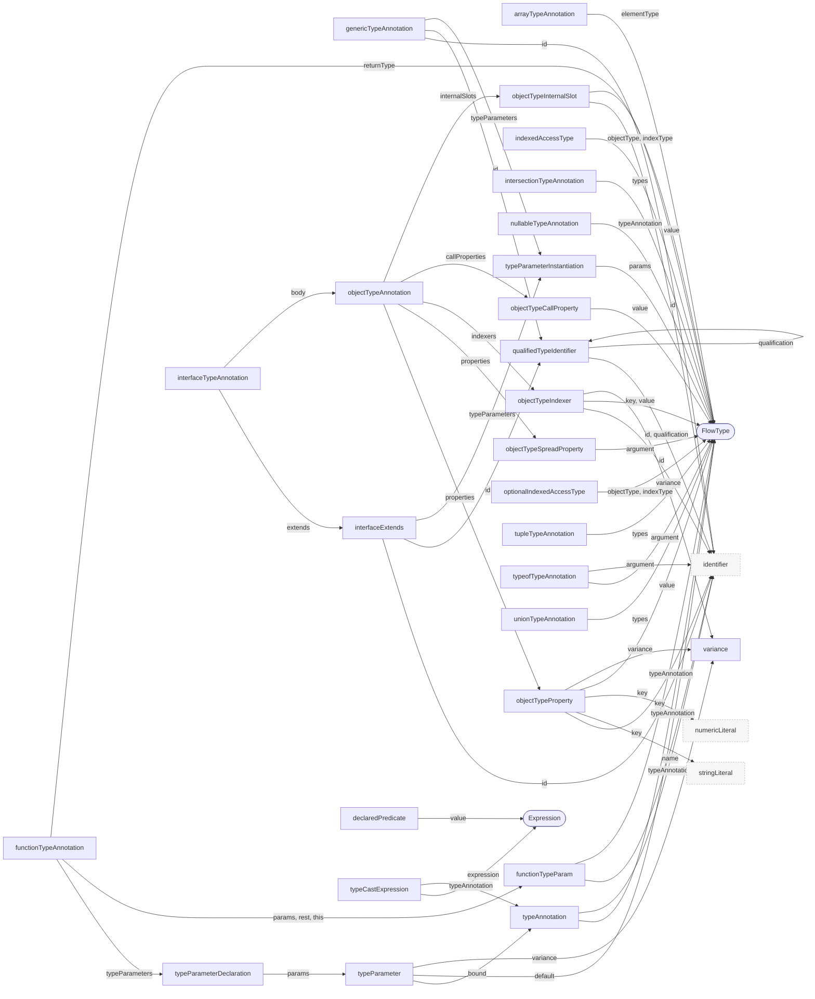

子ノードを持たないもの: `anyTypeAnnotation`・`bigIntLiteralTypeAnnotation`・`booleanLiteralTypeAnnotation`・`booleanTypeAnnotation`・`emptyTypeAnnotation`・`existsTypeAnnotation`・`mixedTypeAnnotation`・`nullLiteralTypeAnnotation`・`numberLiteralTypeAnnotation`・`numberTypeAnnotation`・`stringLiteralTypeAnnotation`・`stringTypeAnnotation`・`symbolTypeAnnotation`・`thisTypeAnnotation`・`voidTypeAnnotation`・`variance`・`inferredPredicate`

| kind                           | クラス                                  | ファイル                                                                                                            | フィールド（型）                                                                                                                                                                                                                                                                              | 備考                                                                                                                                                                                                                                                                                                                                                                                                                                                                   |
| ------------------------------ | --------------------------------------- | ------------------------------------------------------------------------------------------------------------------- | --------------------------------------------------------------------------------------------------------------------------------------------------------------------------------------------------------------------------------------------------------------------------------------------- | ---------------------------------------------------------------------------------------------------------------------------------------------------------------------------------------------------------------------------------------------------------------------------------------------------------------------------------------------------------------------------------------------------------------------------------------------------------------------- |
| `anyTypeAnnotation`            | `AnyTypeAnnotationTypeClass`            | [commons/anyTypeAnnotation.ts](../src/analyzer/types/lwc_IR/commons/anyTypeAnnotation.ts)                           | —                                                                                                                                                                                                                                                                                             |                                                                                                                                                                                                                                                                                                                                                                                                                                                                        |
| `arrayTypeAnnotation`          | `ArrayTypeAnnotationTypeClass`          | [commons/arrayTypeAnnotation.ts](../src/analyzer/types/lwc_IR/commons/arrayTypeAnnotation.ts)                       | `elementType: FlowTypeTypeClass`                                                                                                                                                                                                                                                              |                                                                                                                                                                                                                                                                                                                                                                                                                                                                        |
| `bigIntLiteralTypeAnnotation`  | `BigIntLiteralTypeAnnotationTypeClass`  | [commons/bigIntLiteralTypeAnnotation.ts](../src/analyzer/types/lwc_IR/commons/bigIntLiteralTypeAnnotation.ts)       | `value: bigint`                                                                                                                                                                                                                                                                               |                                                                                                                                                                                                                                                                                                                                                                                                                                                                        |
| `booleanLiteralTypeAnnotation` | `BooleanLiteralTypeAnnotationTypeClass` | [commons/booleanLiteralTypeAnnotation.ts](../src/analyzer/types/lwc_IR/commons/booleanLiteralTypeAnnotation.ts)     | `value: boolean`                                                                                                                                                                                                                                                                              |                                                                                                                                                                                                                                                                                                                                                                                                                                                                        |
| `booleanTypeAnnotation`        | `BooleanTypeAnnotationTypeClass`        | [commons/booleanTypeAnnotation.ts](../src/analyzer/types/lwc_IR/commons/booleanTypeAnnotation.ts)                   | —                                                                                                                                                                                                                                                                                             |                                                                                                                                                                                                                                                                                                                                                                                                                                                                        |
| `emptyTypeAnnotation`          | `EmptyTypeAnnotationTypeClass`          | [commons/emptyTypeAnnotation.ts](../src/analyzer/types/lwc_IR/commons/emptyTypeAnnotation.ts)                       | —                                                                                                                                                                                                                                                                                             |                                                                                                                                                                                                                                                                                                                                                                                                                                                                        |
| `existsTypeAnnotation`         | `ExistsTypeAnnotationTypeClass`         | [commons/existsTypeAnnotation.ts](../src/analyzer/types/lwc_IR/commons/existsTypeAnnotation.ts)                     | —                                                                                                                                                                                                                                                                                             |                                                                                                                                                                                                                                                                                                                                                                                                                                                                        |
| `functionTypeAnnotation`       | `FunctionTypeAnnotationTypeClass`       | [commons/functionTypeAnnotation.ts](../src/analyzer/types/lwc_IR/commons/functionTypeAnnotation.ts)                 | `typeParameters: TypeParameterDeclarationTypeClass \| null`<br>`params: FunctionTypeParamTypeClass[]`<br>`rest: FunctionTypeParamTypeClass \| null`<br>`this: FunctionTypeParamTypeClass \| null`<br>`returnType: FlowTypeTypeClass`                                                          |                                                                                                                                                                                                                                                                                                                                                                                                                                                                        |
| `genericTypeAnnotation`        | `GenericTypeAnnotationTypeClass`        | [commons/genericTypeAnnotation.ts](../src/analyzer/types/lwc_IR/commons/genericTypeAnnotation.ts)                   | `id: IdentifierTypeClass \| QualifiedTypeIdentifierTypeClass`<br>`typeParameters: TypeParameterInstantiationTypeClass \| null`                                                                                                                                                                |                                                                                                                                                                                                                                                                                                                                                                                                                                                                        |
| `indexedAccessType`            | `IndexedAccessTypeTypeClass`            | [commons/indexedAccessType.ts](../src/analyzer/types/lwc_IR/commons/indexedAccessType.ts)                           | `objectType: FlowTypeTypeClass`<br>`indexType: FlowTypeTypeClass`                                                                                                                                                                                                                             |                                                                                                                                                                                                                                                                                                                                                                                                                                                                        |
| `interfaceTypeAnnotation`      | `InterfaceTypeAnnotationTypeClass`      | [commons/interfaceTypeAnnotation.ts](../src/analyzer/types/lwc_IR/commons/interfaceTypeAnnotation.ts)               | `extends: InterfaceExtendsTypeClass[] \| null`<br>`body: ObjectTypeAnnotationTypeClass`                                                                                                                                                                                                       |                                                                                                                                                                                                                                                                                                                                                                                                                                                                        |
| `intersectionTypeAnnotation`   | `IntersectionTypeAnnotationTypeClass`   | [commons/intersectionTypeAnnotation.ts](../src/analyzer/types/lwc_IR/commons/intersectionTypeAnnotation.ts)         | `types: FlowTypeTypeClass[]`                                                                                                                                                                                                                                                                  |                                                                                                                                                                                                                                                                                                                                                                                                                                                                        |
| `mixedTypeAnnotation`          | `MixedTypeAnnotationTypeClass`          | [commons/mixedTypeAnnotation.ts](../src/analyzer/types/lwc_IR/commons/mixedTypeAnnotation.ts)                       | —                                                                                                                                                                                                                                                                                             |                                                                                                                                                                                                                                                                                                                                                                                                                                                                        |
| `nullableTypeAnnotation`       | `NullableTypeAnnotationTypeClass`       | [commons/nullableTypeAnnotation.ts](../src/analyzer/types/lwc_IR/commons/nullableTypeAnnotation.ts)                 | `typeAnnotation: FlowTypeTypeClass`                                                                                                                                                                                                                                                           |                                                                                                                                                                                                                                                                                                                                                                                                                                                                        |
| `nullLiteralTypeAnnotation`    | `NullLiteralTypeAnnotationTypeClass`    | [commons/nullLiteralTypeAnnotation.ts](../src/analyzer/types/lwc_IR/commons/nullLiteralTypeAnnotation.ts)           | —                                                                                                                                                                                                                                                                                             |                                                                                                                                                                                                                                                                                                                                                                                                                                                                        |
| `numberLiteralTypeAnnotation`  | `NumberLiteralTypeAnnotationTypeClass`  | [commons/numberLiteralTypeAnnotation.ts](../src/analyzer/types/lwc_IR/commons/numberLiteralTypeAnnotation.ts)       | `value: number`                                                                                                                                                                                                                                                                               |                                                                                                                                                                                                                                                                                                                                                                                                                                                                        |
| `numberTypeAnnotation`         | `NumberTypeAnnotationTypeClass`         | [commons/numberTypeAnnotation.ts](../src/analyzer/types/lwc_IR/commons/numberTypeAnnotation.ts)                     | —                                                                                                                                                                                                                                                                                             |                                                                                                                                                                                                                                                                                                                                                                                                                                                                        |
| `objectTypeAnnotation`         | `ObjectTypeAnnotationTypeClass`         | [commons/objectTypeAnnotation.ts](../src/analyzer/types/lwc_IR/commons/objectTypeAnnotation.ts)                     | `properties: (ObjectTypePropertyTypeClass \| ObjectTypeSpreadPropertyTypeClass)[]`<br>`indexers: ObjectTypeIndexerTypeClass[]`<br>`callProperties: ObjectTypeCallPropertyTypeClass[]`<br>`internalSlots: ObjectTypeInternalSlotTypeClass[]`<br>`exactness: "default" \| "exact" \| "inexact"` |                                                                                                                                                                                                                                                                                                                                                                                                                                                                        |
| `optionalIndexedAccessType`    | `OptionalIndexedAccessTypeTypeClass`    | [commons/optionalIndexedAccessType.ts](../src/analyzer/types/lwc_IR/commons/optionalIndexedAccessType.ts)           | `objectType: FlowTypeTypeClass`<br>`indexType: FlowTypeTypeClass`<br>`optional: boolean`                                                                                                                                                                                                      |                                                                                                                                                                                                                                                                                                                                                                                                                                                                        |
| `stringLiteralTypeAnnotation`  | `StringLiteralTypeAnnotationTypeClass`  | [commons/stringLiteralTypeAnnotation.ts](../src/analyzer/types/lwc_IR/commons/stringLiteralTypeAnnotation.ts)       | `value: string`                                                                                                                                                                                                                                                                               |                                                                                                                                                                                                                                                                                                                                                                                                                                                                        |
| `stringTypeAnnotation`         | `StringTypeAnnotationTypeClass`         | [commons/stringTypeAnnotation.ts](../src/analyzer/types/lwc_IR/commons/stringTypeAnnotation.ts)                     | —                                                                                                                                                                                                                                                                                             |                                                                                                                                                                                                                                                                                                                                                                                                                                                                        |
| `symbolTypeAnnotation`         | `SymbolTypeAnnotationTypeClass`         | [commons/symbolTypeAnnotation.ts](../src/analyzer/types/lwc_IR/commons/symbolTypeAnnotation.ts)                     | —                                                                                                                                                                                                                                                                                             |                                                                                                                                                                                                                                                                                                                                                                                                                                                                        |
| `thisTypeAnnotation`           | `ThisTypeAnnotationTypeClass`           | [commons/thisTypeAnnotation.ts](../src/analyzer/types/lwc_IR/commons/thisTypeAnnotation.ts)                         | —                                                                                                                                                                                                                                                                                             |                                                                                                                                                                                                                                                                                                                                                                                                                                                                        |
| `tupleTypeAnnotation`          | `TupleTypeAnnotationTypeClass`          | [commons/tupleTypeAnnotation.ts](../src/analyzer/types/lwc_IR/commons/tupleTypeAnnotation.ts)                       | `types: FlowTypeTypeClass[]`                                                                                                                                                                                                                                                                  |                                                                                                                                                                                                                                                                                                                                                                                                                                                                        |
| `typeofTypeAnnotation`         | `TypeofTypeAnnotationTypeClass`         | [commons/typeofTypeAnnotation.ts](../src/analyzer/types/lwc_IR/commons/typeofTypeAnnotation.ts)                     | `argument: FlowTypeTypeClass \| IdentifierTypeClass`                                                                                                                                                                                                                                          |                                                                                                                                                                                                                                                                                                                                                                                                                                                                        |
| `unionTypeAnnotation`          | `UnionTypeAnnotationTypeClass`          | [commons/unionTypeAnnotation.ts](../src/analyzer/types/lwc_IR/commons/unionTypeAnnotation.ts)                       | `types: FlowTypeTypeClass[]`                                                                                                                                                                                                                                                                  |                                                                                                                                                                                                                                                                                                                                                                                                                                                                        |
| `voidTypeAnnotation`           | `VoidTypeAnnotationTypeClass`           | [commons/voidTypeAnnotation.ts](../src/analyzer/types/lwc_IR/commons/voidTypeAnnotation.ts)                         | —                                                                                                                                                                                                                                                                                             |                                                                                                                                                                                                                                                                                                                                                                                                                                                                        |
| `objectTypeCallProperty`       | `ObjectTypeCallPropertyTypeClass`       | [commons/objectTypeCallProperty.ts](../src/analyzer/types/lwc_IR/commons/objectTypeCallProperty.ts)                 | `value: FlowTypeTypeClass`<br>`static: boolean`                                                                                                                                                                                                                                               |                                                                                                                                                                                                                                                                                                                                                                                                                                                                        |
| `objectTypeIndexer`            | `ObjectTypeIndexerTypeClass`            | [commons/objectTypeIndexer.ts](../src/analyzer/types/lwc_IR/commons/objectTypeIndexer.ts)                           | `id: IdentifierTypeClass \| null`<br>`key: FlowTypeTypeClass`<br>`value: FlowTypeTypeClass`<br>`static: boolean`<br>`variance: VarianceTypeClass \| null`                                                                                                                                     |                                                                                                                                                                                                                                                                                                                                                                                                                                                                        |
| `objectTypeInternalSlot`       | `ObjectTypeInternalSlotTypeClass`       | [commons/objectTypeInternalSlot.ts](../src/analyzer/types/lwc_IR/commons/objectTypeInternalSlot.ts)                 | `id: IdentifierTypeClass`<br>`value: FlowTypeTypeClass`<br>`optional: boolean`<br>`static: boolean`<br>`method: boolean`                                                                                                                                                                      |                                                                                                                                                                                                                                                                                                                                                                                                                                                                        |
| `objectTypeProperty`           | `ObjectTypePropertyTypeClass`           | [commons/objectTypeProperty.ts](../src/analyzer/types/lwc_IR/commons/objectTypeProperty.ts)                         | `key: IdentifierTypeClass \| StringLiteralTypeClass \| NumericLiteralTypeClass`<br>`value: FlowTypeTypeClass`<br>`kind`（選択肢ごと）<br>`method`（選択肢ごと）<br>`optional`（選択肢ごと）<br>`variance`（選択肢ごと）<br>`static`（選択肢ごと）<br>`proto`（選択肢ごと）                    | 判別 union（`kind`・`method`・`optional`・`static`・`proto`）3 通り<br>① `kind: "init"`・`method: false`・`optional: boolean`・`static: boolean`・`proto: false`・`variance: VarianceTypeClass \| null`<br>② `kind: "init"`・`method: false`・`optional: boolean`・`static: false`・`proto: true`・`variance: VarianceTypeClass \| null`<br>③ `kind: "init" \| "get" \| "set"`・`method: true`・`optional: false`・`static: boolean`・`proto: false`・`variance: null` |
| `objectTypeSpreadProperty`     | `ObjectTypeSpreadPropertyTypeClass`     | [commons/objectTypeSpreadProperty.ts](../src/analyzer/types/lwc_IR/commons/objectTypeSpreadProperty.ts)             | `argument: FlowTypeTypeClass`                                                                                                                                                                                                                                                                 |                                                                                                                                                                                                                                                                                                                                                                                                                                                                        |
| `functionTypeParam`            | `FunctionTypeParamTypeClass`            | [flowVisitor/functionTypeParam.ts](../src/analyzer/types/lwc_IR/flowVisitor/functionTypeParam.ts)                   | `name: IdentifierTypeClass \| null`<br>`typeAnnotation: FlowTypeTypeClass`<br>`optional: boolean`                                                                                                                                                                                             |                                                                                                                                                                                                                                                                                                                                                                                                                                                                        |
| `qualifiedTypeIdentifier`      | `QualifiedTypeIdentifierTypeClass`      | [flowVisitor/qualifiedTypeIdentifier.ts](../src/analyzer/types/lwc_IR/flowVisitor/qualifiedTypeIdentifier.ts)       | `id: IdentifierTypeClass`<br>`qualification: IdentifierTypeClass \| QualifiedTypeIdentifierTypeClass`                                                                                                                                                                                         |                                                                                                                                                                                                                                                                                                                                                                                                                                                                        |
| `interfaceExtends`             | `InterfaceExtendsTypeClass`             | [flowVisitor/interfaceExtends.ts](../src/analyzer/types/lwc_IR/flowVisitor/interfaceExtends.ts)                     | `id: IdentifierTypeClass \| QualifiedTypeIdentifierTypeClass`<br>`typeParameters: TypeParameterInstantiationTypeClass \| null`                                                                                                                                                                |                                                                                                                                                                                                                                                                                                                                                                                                                                                                        |
| `typeAnnotation`               | `TypeAnnotationTypeClass`               | [flowVisitor/typeAnnotation.ts](../src/analyzer/types/lwc_IR/flowVisitor/typeAnnotation.ts)                         | `typeAnnotation: FlowTypeTypeClass \| IdentifierTypeClass`                                                                                                                                                                                                                                    |                                                                                                                                                                                                                                                                                                                                                                                                                                                                        |
| `typeParameter`                | `TypeParameterTypeClass`                | [flowVisitor/typeParameter.ts](../src/analyzer/types/lwc_IR/flowVisitor/typeParameter.ts)                           | `name: string`<br>`bound: TypeAnnotationTypeClass \| null`<br>`default: FlowTypeTypeClass \| null`<br>`variance: VarianceTypeClass \| null`                                                                                                                                                   |                                                                                                                                                                                                                                                                                                                                                                                                                                                                        |
| `typeParameterDeclaration`     | `TypeParameterDeclarationTypeClass`     | [flowVisitor/typeParameterDeclaration.ts](../src/analyzer/types/lwc_IR/flowVisitor/typeParameterDeclaration.ts)     | `params: TypeParameterTypeClass[]`                                                                                                                                                                                                                                                            |                                                                                                                                                                                                                                                                                                                                                                                                                                                                        |
| `typeParameterInstantiation`   | `TypeParameterInstantiationTypeClass`   | [flowVisitor/typeParameterInstantiation.ts](../src/analyzer/types/lwc_IR/flowVisitor/typeParameterInstantiation.ts) | `params: FlowTypeTypeClass[]`                                                                                                                                                                                                                                                                 |                                                                                                                                                                                                                                                                                                                                                                                                                                                                        |
| `variance`                     | `VarianceTypeClass`                     | [flowVisitor/variance.ts](../src/analyzer/types/lwc_IR/flowVisitor/variance.ts)                                     | `kind: "minus" \| "plus"`                                                                                                                                                                                                                                                                     |                                                                                                                                                                                                                                                                                                                                                                                                                                                                        |
| `declaredPredicate`            | `DeclaredPredicateTypeClass`            | [commons/declaredPredicate.ts](../src/analyzer/types/lwc_IR/commons/declaredPredicate.ts)                           | `value: ExpressionTypeClass`                                                                                                                                                                                                                                                                  |                                                                                                                                                                                                                                                                                                                                                                                                                                                                        |
| `inferredPredicate`            | `InferredPredicateTypeClass`            | [commons/inferredPredicate.ts](../src/analyzer/types/lwc_IR/commons/inferredPredicate.ts)                           | —                                                                                                                                                                                                                                                                                             |                                                                                                                                                                                                                                                                                                                                                                                                                                                                        |
| `typeCastExpression`           | `TypeCastExpressionTypeClass`           | [commons/typeCastExpression.ts](../src/analyzer/types/lwc_IR/commons/typeCastExpression.ts)                         | `expression: ExpressionTypeClass`<br>`typeAnnotation: TypeAnnotationTypeClass`                                                                                                                                                                                                                |                                                                                                                                                                                                                                                                                                                                                                                                                                                                        |

### 3.12 Flow の宣言・enum（23）

```mermaid
flowchart LR
    n_declareClass["declareClass"]
    n_identifier["identifier"]:::ext
    n_classImplements["classImplements"]
    n_declareExportAllDeclaration["declareExportAllDeclaration"]
    n_stringLiteral["stringLiteral"]:::ext
    n_importAttribute["importAttribute"]:::ext
    n_declareExportDeclaration["declareExportDeclaration"]
    n_localExportSpecifier["localExportSpecifier"]:::ext
    n_exportNamespaceSpecifier["exportNamespaceSpecifier"]:::ext
    n_exportSpecifier["exportSpecifier"]:::ext
    n_declareFunction["declareFunction"]
    n_declareInterface["declareInterface"]
    n_declareModule["declareModule"]
    n_blockStatement["blockStatement"]:::ext
    n_declareModuleExports["declareModuleExports"]
    n_declareOpaqueType["declareOpaqueType"]
    n_declareTypeAlias["declareTypeAlias"]
    n_declareVariable["declareVariable"]
    n_enumBooleanBody["enumBooleanBody"]
    n_enumBooleanMember["enumBooleanMember"]
    n_booleanLiteral["booleanLiteral"]:::ext
    n_enumDeclaration["enumDeclaration"]
    n_enumDefaultedMember["enumDefaultedMember"]
    n_enumNumberBody["enumNumberBody"]
    n_enumNumberMember["enumNumberMember"]
    n_numericLiteral["numericLiteral"]:::ext
    n_enumStringBody["enumStringBody"]
    n_enumStringMember["enumStringMember"]
    n_enumSymbolBody["enumSymbolBody"]
    n_interfaceDeclaration["interfaceDeclaration"]
    n_opaqueType["opaqueType"]
    n_typeAlias["typeAlias"]
    a_Flow(["Flow"]):::alias
    a_FlowPredicate(["FlowPredicate"]):::alias
    a_FlowType(["FlowType"]):::alias
    a_EnumBody(["EnumBody"]):::alias
    f_flowType[["Flow の型"]]:::fam
    n_declareClass -->|id| n_identifier
    n_declareClass -->|typeParameters, extends, mixins, body| f_flowType
    n_declareClass -->|implements| n_classImplements
    n_declareExportAllDeclaration -->|source| n_stringLiteral
    n_declareExportAllDeclaration -->|attributes| n_importAttribute
    n_declareExportDeclaration -->|declaration| a_Flow
    n_declareExportDeclaration -->|specifiers| n_localExportSpecifier
    n_declareExportDeclaration -->|specifiers| n_exportNamespaceSpecifier
    n_declareExportDeclaration -->|specifiers| n_exportSpecifier
    n_declareExportDeclaration -->|source| n_stringLiteral
    n_declareExportDeclaration -->|attributes| n_importAttribute
    n_declareFunction -->|id| n_identifier
    n_declareFunction -->|predicate| a_FlowPredicate
    n_declareInterface -->|id| n_identifier
    n_declareInterface -->|typeParameters, extends, body| f_flowType
    n_declareModule -->|id| n_identifier
    n_declareModule -->|id| n_stringLiteral
    n_declareModule -->|body| n_blockStatement
    n_declareModuleExports -->|typeAnnotation| f_flowType
    n_declareOpaqueType -->|id| n_identifier
    n_declareOpaqueType -->|typeParameters| f_flowType
    n_declareOpaqueType -->|supertype| a_FlowType
    n_declareTypeAlias -->|id| n_identifier
    n_declareTypeAlias -->|typeParameters| f_flowType
    n_declareTypeAlias -->|right| a_FlowType
    n_declareVariable -->|id| n_identifier
    n_enumBooleanBody -->|members| n_enumBooleanMember
    n_enumBooleanMember -->|id| n_identifier
    n_enumBooleanMember -->|init| n_booleanLiteral
    n_enumDeclaration -->|id| n_identifier
    n_enumDeclaration -->|body| a_EnumBody
    n_enumDefaultedMember -->|id| n_identifier
    n_enumNumberBody -->|members| n_enumNumberMember
    n_enumNumberMember -->|id| n_identifier
    n_enumNumberMember -->|init| n_numericLiteral
    n_enumStringBody -->|members| n_enumStringMember
    n_enumStringBody -->|members| n_enumDefaultedMember
    n_enumStringMember -->|id| n_identifier
    n_enumStringMember -->|init| n_stringLiteral
    n_enumSymbolBody -->|members| n_enumDefaultedMember
    n_interfaceDeclaration -->|id| n_identifier
    n_interfaceDeclaration -->|typeParameters, extends, body| f_flowType
    n_opaqueType -->|id| n_identifier
    n_opaqueType -->|typeParameters| f_flowType
    n_opaqueType -->|supertype, impltype| a_FlowType
    n_typeAlias -->|id| n_identifier
    n_typeAlias -->|typeParameters| f_flowType
    n_typeAlias -->|right| a_FlowType
    n_classImplements -->|id| n_identifier
    n_classImplements -->|typeParameters| f_flowType
    classDef alias fill:#eef,stroke:#669
    classDef fam fill:#efe,stroke:#696
    classDef ext fill:#f6f6f6,stroke:#aaa,stroke-dasharray:3 3
```

| kind                          | クラス                                 | ファイル                                                                                                      | フィールド（型）                                                                                                                                                                                                                                                                         | 備考                                                                                                                                                                                                                                                                                                                                                                     |
| ----------------------------- | -------------------------------------- | ------------------------------------------------------------------------------------------------------------- | ---------------------------------------------------------------------------------------------------------------------------------------------------------------------------------------------------------------------------------------------------------------------------------------- | ------------------------------------------------------------------------------------------------------------------------------------------------------------------------------------------------------------------------------------------------------------------------------------------------------------------------------------------------------------------------ |
| `declareClass`                | `DeclareClassTypeClass`                | [commons/declareClass.ts](../src/analyzer/types/lwc_IR/commons/declareClass.ts)                               | `id: IdentifierTypeClass`<br>`typeParameters: TypeParameterDeclarationTypeClass \| null`<br>`extends: InterfaceExtendsTypeClass[] \| null`<br>`mixins: InterfaceExtendsTypeClass[] \| null`<br>`implements: ClassImplementsTypeClass[] \| null`<br>`body: ObjectTypeAnnotationTypeClass` |                                                                                                                                                                                                                                                                                                                                                                          |
| `declareExportAllDeclaration` | `DeclareExportAllDeclarationTypeClass` | [commons/declareExportAllDeclaration.ts](../src/analyzer/types/lwc_IR/commons/declareExportAllDeclaration.ts) | `source: StringLiteralTypeClass`<br>`exportKind: "type" \| "value"`<br>`attributes: ImportAttributeTypeClass[] \| null`                                                                                                                                                                  |                                                                                                                                                                                                                                                                                                                                                                          |
| `declareExportDeclaration`    | `DeclareExportDeclarationTypeClass`    | [commons/declareExportDeclaration.ts](../src/analyzer/types/lwc_IR/commons/declareExportDeclaration.ts)       | `kind`（選択肢ごと）<br>`declaration`（選択肢ごと）<br>`default`（選択肢ごと）<br>`specifiers`（選択肢ごと）<br>`source`（選択肢ごと）<br>`attributes`（選択肢ごと）                                                                                                                     | 判別 union（`kind`）3 通り<br>① `kind: "declaration"`・`declaration: FlowTypeClass`・`default: boolean`<br>② `kind: "local"`・`specifiers: LocalExportSpecifierTypeClass[]`<br>③ `kind: "reexport"`・`specifiers: (ExportNamespaceSpecifierTypeClass \| ExportSpecifierTypeClass)[]`・`source: StringLiteralTypeClass`・`attributes: ImportAttributeTypeClass[] \| null` |
| `declareFunction`             | `DeclareFunctionTypeClass`             | [commons/declareFunction.ts](../src/analyzer/types/lwc_IR/commons/declareFunction.ts)                         | `id: IdentifierTypeClass`<br>`predicate: FlowPredicateTypeClass \| null`                                                                                                                                                                                                                 |                                                                                                                                                                                                                                                                                                                                                                          |
| `declareInterface`            | `DeclareInterfaceTypeClass`            | [commons/declareInterface.ts](../src/analyzer/types/lwc_IR/commons/declareInterface.ts)                       | `id: IdentifierTypeClass`<br>`typeParameters: TypeParameterDeclarationTypeClass \| null`<br>`extends: InterfaceExtendsTypeClass[] \| null`<br>`body: ObjectTypeAnnotationTypeClass`                                                                                                      |                                                                                                                                                                                                                                                                                                                                                                          |
| `declareModule`               | `DeclareModuleTypeClass`               | [commons/declareModule.ts](../src/analyzer/types/lwc_IR/commons/declareModule.ts)                             | `id: IdentifierTypeClass \| StringLiteralTypeClass`<br>`body: BlockStatementTypeClass`<br>`kind: "CommonJS" \| "ES" \| null`                                                                                                                                                             |                                                                                                                                                                                                                                                                                                                                                                          |
| `declareModuleExports`        | `DeclareModuleExportsTypeClass`        | [commons/declareModuleExports.ts](../src/analyzer/types/lwc_IR/commons/declareModuleExports.ts)               | `typeAnnotation: TypeAnnotationTypeClass`                                                                                                                                                                                                                                                |                                                                                                                                                                                                                                                                                                                                                                          |
| `declareOpaqueType`           | `DeclareOpaqueTypeTypeClass`           | [commons/declareOpaqueType.ts](../src/analyzer/types/lwc_IR/commons/declareOpaqueType.ts)                     | `id: IdentifierTypeClass`<br>`typeParameters: TypeParameterDeclarationTypeClass \| null`<br>`supertype: FlowTypeTypeClass \| null`                                                                                                                                                       |                                                                                                                                                                                                                                                                                                                                                                          |
| `declareTypeAlias`            | `DeclareTypeAliasTypeClass`            | [commons/declareTypeAlias.ts](../src/analyzer/types/lwc_IR/commons/declareTypeAlias.ts)                       | `id: IdentifierTypeClass`<br>`typeParameters: TypeParameterDeclarationTypeClass \| null`<br>`right: FlowTypeTypeClass`                                                                                                                                                                   |                                                                                                                                                                                                                                                                                                                                                                          |
| `declareVariable`             | `DeclareVariableTypeClass`             | [commons/declareVariable.ts](../src/analyzer/types/lwc_IR/commons/declareVariable.ts)                         | `id: IdentifierTypeClass`                                                                                                                                                                                                                                                                |                                                                                                                                                                                                                                                                                                                                                                          |
| `enumBooleanBody`             | `EnumBooleanBodyTypeClass`             | [commons/enumBooleanBody.ts](../src/analyzer/types/lwc_IR/commons/enumBooleanBody.ts)                         | `explicitType: boolean`<br>`hasUnknownMembers: boolean`<br>`members: EnumBooleanMemberTypeClass[]`                                                                                                                                                                                       |                                                                                                                                                                                                                                                                                                                                                                          |
| `enumBooleanMember`           | `EnumBooleanMemberTypeClass`           | [commons/enumBooleanMember.ts](../src/analyzer/types/lwc_IR/commons/enumBooleanMember.ts)                     | `id: IdentifierTypeClass`<br>`init: BooleanLiteralTypeClass`                                                                                                                                                                                                                             |                                                                                                                                                                                                                                                                                                                                                                          |
| `enumDeclaration`             | `EnumDeclarationTypeClass`             | [commons/enumDeclaration.ts](../src/analyzer/types/lwc_IR/commons/enumDeclaration.ts)                         | `id: IdentifierTypeClass`<br>`body: EnumBodyTypeClass`                                                                                                                                                                                                                                   |                                                                                                                                                                                                                                                                                                                                                                          |
| `enumDefaultedMember`         | `EnumDefaultedMemberTypeClass`         | [commons/enumDefaultedMember.ts](../src/analyzer/types/lwc_IR/commons/enumDefaultedMember.ts)                 | `id: IdentifierTypeClass`                                                                                                                                                                                                                                                                |                                                                                                                                                                                                                                                                                                                                                                          |
| `enumNumberBody`              | `EnumNumberBodyTypeClass`              | [commons/enumNumberBody.ts](../src/analyzer/types/lwc_IR/commons/enumNumberBody.ts)                           | `explicitType: boolean`<br>`hasUnknownMembers: boolean`<br>`members: EnumNumberMemberTypeClass[]`                                                                                                                                                                                        |                                                                                                                                                                                                                                                                                                                                                                          |
| `enumNumberMember`            | `EnumNumberMemberTypeClass`            | [commons/enumNumberMember.ts](../src/analyzer/types/lwc_IR/commons/enumNumberMember.ts)                       | `id: IdentifierTypeClass`<br>`init: NumericLiteralTypeClass`                                                                                                                                                                                                                             |                                                                                                                                                                                                                                                                                                                                                                          |
| `enumStringBody`              | `EnumStringBodyTypeClass`              | [commons/enumStringBody.ts](../src/analyzer/types/lwc_IR/commons/enumStringBody.ts)                           | `explicitType: boolean`<br>`hasUnknownMembers: boolean`<br>`kind`（選択肢ごと）<br>`members`（選択肢ごと）                                                                                                                                                                               | 判別 union（`kind`）2 通り<br>① `kind: "initialized"`・`members: EnumStringMemberTypeClass[]`<br>② `kind: "defaulted"`・`members: EnumDefaultedMemberTypeClass[]`                                                                                                                                                                                                        |
| `enumStringMember`            | `EnumStringMemberTypeClass`            | [commons/enumStringMember.ts](../src/analyzer/types/lwc_IR/commons/enumStringMember.ts)                       | `id: IdentifierTypeClass`<br>`init: StringLiteralTypeClass`                                                                                                                                                                                                                              |                                                                                                                                                                                                                                                                                                                                                                          |
| `enumSymbolBody`              | `EnumSymbolBodyTypeClass`              | [commons/enumSymbolBody.ts](../src/analyzer/types/lwc_IR/commons/enumSymbolBody.ts)                           | `members: EnumDefaultedMemberTypeClass[]`<br>`hasUnknownMembers: boolean`                                                                                                                                                                                                                |                                                                                                                                                                                                                                                                                                                                                                          |
| `interfaceDeclaration`        | `InterfaceDeclarationTypeClass`        | [commons/interfaceDeclaration.ts](../src/analyzer/types/lwc_IR/commons/interfaceDeclaration.ts)               | `id: IdentifierTypeClass`<br>`typeParameters: TypeParameterDeclarationTypeClass \| null`<br>`extends: InterfaceExtendsTypeClass[] \| null`<br>`body: ObjectTypeAnnotationTypeClass`                                                                                                      |                                                                                                                                                                                                                                                                                                                                                                          |
| `opaqueType`                  | `OpaqueTypeTypeClass`                  | [commons/opaqueType.ts](../src/analyzer/types/lwc_IR/commons/opaqueType.ts)                                   | `id: IdentifierTypeClass`<br>`typeParameters: TypeParameterDeclarationTypeClass \| null`<br>`supertype: FlowTypeTypeClass \| null`<br>`impltype: FlowTypeTypeClass`                                                                                                                      |                                                                                                                                                                                                                                                                                                                                                                          |
| `typeAlias`                   | `TypeAliasTypeClass`                   | [commons/typeAlias.ts](../src/analyzer/types/lwc_IR/commons/typeAlias.ts)                                     | `id: IdentifierTypeClass`<br>`typeParameters: TypeParameterDeclarationTypeClass \| null`<br>`right: FlowTypeTypeClass`                                                                                                                                                                   |                                                                                                                                                                                                                                                                                                                                                                          |
| `classImplements`             | `ClassImplementsTypeClass`             | [flowVisitor/classImplements.ts](../src/analyzer/types/lwc_IR/flowVisitor/classImplements.ts)                 | `id: IdentifierTypeClass`<br>`typeParameters: TypeParameterInstantiationTypeClass \| null`                                                                                                                                                                                               |                                                                                                                                                                                                                                                                                                                                                                          |

### 3.13 JSX（15）

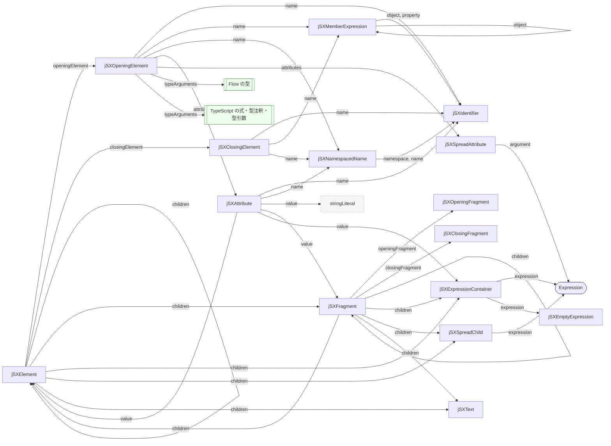

子ノードを持たないもの: `jSXClosingFragment`・`jSXOpeningFragment`・`jSXText`・`jSXEmptyExpression`・`jSXIdentifier`

| kind                     | クラス                            | ファイル                                                                                            | フィールド（型）                                                                                                                                                                                                                                                                                          | 備考                                                                                                                                                                                                        |
| ------------------------ | --------------------------------- | --------------------------------------------------------------------------------------------------- | --------------------------------------------------------------------------------------------------------------------------------------------------------------------------------------------------------------------------------------------------------------------------------------------------------- | ----------------------------------------------------------------------------------------------------------------------------------------------------------------------------------------------------------- |
| `jSXElement`             | `JSXElementTypeClass`             | [commons/jSXElement.ts](../src/analyzer/types/lwc_IR/commons/jSXElement.ts)                         | `openingElement: JSXOpeningElementTypeClass`<br>`selfClosing`（選択肢ごと）<br>`closingElement`（選択肢ごと）<br>`children`（選択肢ごと）                                                                                                                                                                 | 判別 union（`selfClosing`）2 通り<br>① `selfClosing: true`・`closingElement: null`・`children: []`<br>② `selfClosing: false`・`closingElement: JSXClosingElementTypeClass`・`children: JSXChildTypeClass[]` |
| `jSXFragment`            | `JSXFragmentTypeClass`            | [commons/jSXFragment.ts](../src/analyzer/types/lwc_IR/commons/jSXFragment.ts)                       | `openingFragment: JSXOpeningFragmentTypeClass`<br>`closingFragment: JSXClosingFragmentTypeClass`<br>`children: (JSXElementTypeClass \| JSXFragmentTypeClass \| JSXExpressionContainerTypeClass \| JSXSpreadChildTypeClass \| JSXTextTypeClass)[]`                                                         |                                                                                                                                                                                                             |
| `jSXAttribute`           | `JSXAttributeTypeClass`           | [commons/jSXAttribute.ts](../src/analyzer/types/lwc_IR/commons/jSXAttribute.ts)                     | `name: JSXIdentifierTypeClass \| JSXNamespacedNameTypeClass`<br>`value: StringLiteralTypeClass \| JSXElementTypeClass \| JSXFragmentTypeClass \| JSXExpressionContainerTypeClass \| null`                                                                                                                 |                                                                                                                                                                                                             |
| `jSXClosingElement`      | `JSXClosingElementTypeClass`      | [commons/jSXClosingElement.ts](../src/analyzer/types/lwc_IR/commons/jSXClosingElement.ts)           | `name: JSXIdentifierTypeClass \| JSXMemberExpressionTypeClass \| JSXNamespacedNameTypeClass`                                                                                                                                                                                                              |                                                                                                                                                                                                             |
| `jSXClosingFragment`     | `JSXClosingFragmentTypeClass`     | [commons/jSXClosingFragment.ts](../src/analyzer/types/lwc_IR/commons/jSXClosingFragment.ts)         | —                                                                                                                                                                                                                                                                                                         |                                                                                                                                                                                                             |
| `jSXExpressionContainer` | `JSXExpressionContainerTypeClass` | [commons/jSXExpressionContainer.ts](../src/analyzer/types/lwc_IR/commons/jSXExpressionContainer.ts) | `expression: ExpressionTypeClass \| JSXEmptyExpressionTypeClass`                                                                                                                                                                                                                                          |                                                                                                                                                                                                             |
| `jSXOpeningElement`      | `JSXOpeningElementTypeClass`      | [commons/jSXOpeningElement.ts](../src/analyzer/types/lwc_IR/commons/jSXOpeningElement.ts)           | `name: JSXIdentifierTypeClass \| JSXMemberExpressionTypeClass \| JSXNamespacedNameTypeClass`<br>`selfClosing: boolean`<br>`attributes: (JSXAttributeTypeClass \| JSXSpreadAttributeTypeClass)[]`<br>`typeArguments: TypeParameterInstantiationTypeClass \| TSTypeParameterInstantiationTypeClass \| null` |                                                                                                                                                                                                             |
| `jSXOpeningFragment`     | `JSXOpeningFragmentTypeClass`     | [commons/jSXOpeningFragment.ts](../src/analyzer/types/lwc_IR/commons/jSXOpeningFragment.ts)         | —                                                                                                                                                                                                                                                                                                         |                                                                                                                                                                                                             |
| `jSXSpreadChild`         | `JSXSpreadChildTypeClass`         | [commons/jSXSpreadChild.ts](../src/analyzer/types/lwc_IR/commons/jSXSpreadChild.ts)                 | `expression: ExpressionTypeClass`                                                                                                                                                                                                                                                                         |                                                                                                                                                                                                             |
| `jSXText`                | `JSXTextTypeClass`                | [commons/jSXText.ts](../src/analyzer/types/lwc_IR/commons/jSXText.ts)                               | `value: string`                                                                                                                                                                                                                                                                                           |                                                                                                                                                                                                             |
| `jSXEmptyExpression`     | `JSXEmptyExpressionTypeClass`     | [jsxVisitor/jSXEmptyExpression.ts](../src/analyzer/types/lwc_IR/jsxVisitor/jSXEmptyExpression.ts)   | —                                                                                                                                                                                                                                                                                                         |                                                                                                                                                                                                             |
| `jSXIdentifier`          | `JSXIdentifierTypeClass`          | [jsxVisitor/jSXIdentifier.ts](../src/analyzer/types/lwc_IR/jsxVisitor/jSXIdentifier.ts)             | `name: string`                                                                                                                                                                                                                                                                                            |                                                                                                                                                                                                             |
| `jSXMemberExpression`    | `JSXMemberExpressionTypeClass`    | [jsxVisitor/jSXMemberExpression.ts](../src/analyzer/types/lwc_IR/jsxVisitor/jSXMemberExpression.ts) | `object: JSXIdentifierTypeClass \| JSXMemberExpressionTypeClass`<br>`property: JSXIdentifierTypeClass`                                                                                                                                                                                                    |                                                                                                                                                                                                             |
| `jSXNamespacedName`      | `JSXNamespacedNameTypeClass`      | [jsxVisitor/jSXNamespacedName.ts](../src/analyzer/types/lwc_IR/jsxVisitor/jSXNamespacedName.ts)     | `namespace: JSXIdentifierTypeClass`<br>`name: JSXIdentifierTypeClass`                                                                                                                                                                                                                                     |                                                                                                                                                                                                             |
| `jSXSpreadAttribute`     | `JSXSpreadAttributeTypeClass`     | [jsxVisitor/jSXSpreadAttribute.ts](../src/analyzer/types/lwc_IR/jsxVisitor/jSXSpreadAttribute.ts)   | `argument: ExpressionTypeClass`                                                                                                                                                                                                                                                                           |                                                                                                                                                                                                             |

### 3.14 その他（Babel の Miscellaneous）（2）

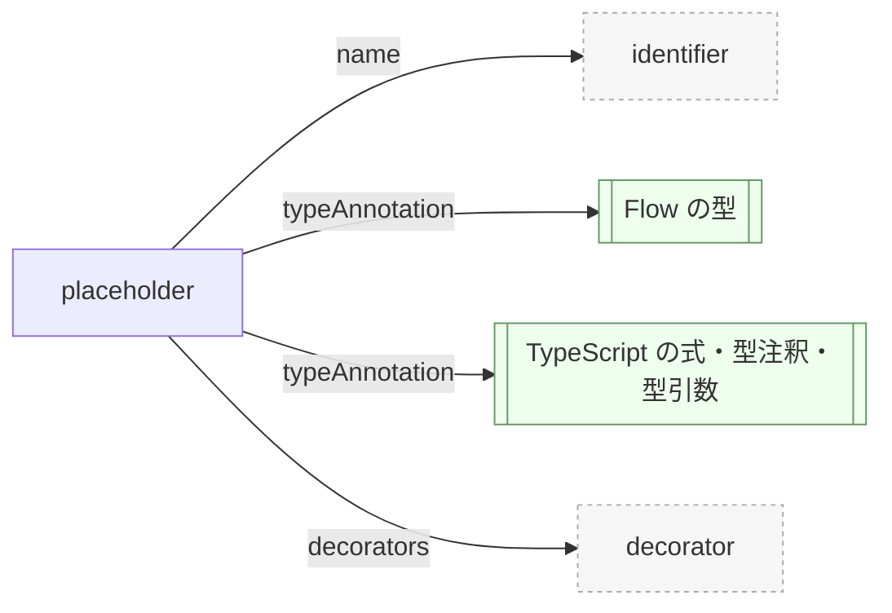

子ノードを持たないもの: `v8IntrinsicIdentifier`

| kind                    | クラス                           | ファイル                                                                                                                    | フィールド（型）                                                                                                                                                                                                                                                                                                                      | 備考 |
| ----------------------- | -------------------------------- | --------------------------------------------------------------------------------------------------------------------------- | ------------------------------------------------------------------------------------------------------------------------------------------------------------------------------------------------------------------------------------------------------------------------------------------------------------------------------------- | ---- |
| `placeholder`           | `PlaceholderTypeClass`           | [miscellaneousVisitor/placeholder.ts](../src/analyzer/types/lwc_IR/miscellaneousVisitor/placeholder.ts)                     | `name: IdentifierTypeClass`<br>`expectedNode: "Identifier" \| "StringLiteral" \| "Expression" \| "Statement" \| "Declaration" \| "BlockStatement" \| "ClassBody" \| "Pattern"`<br>`typeAnnotation: TypeAnnotationTypeClass \| TSTypeAnnotationTypeClass \| null`<br>`optional: boolean`<br>`decorators: DecoratorTypeClass[] \| null` |      |
| `v8IntrinsicIdentifier` | `V8IntrinsicIdentifierTypeClass` | [miscellaneousVisitor/v8IntrinsicIdentifier.ts](../src/analyzer/types/lwc_IR/miscellaneousVisitor/v8IntrinsicIdentifier.ts) | `name: string`                                                                                                                                                                                                                                                                                                                        |      |

### 3.15 補助の型

ノードのフィールドの型に名前で出てくる、ノードのクラスでも alias の和でもない型。型引数は宣言のまま（既定値つき）。

| 型                                            | ファイル                                                                                                            | 中身                                                                                                                                                                                                   |
| --------------------------------------------- | ------------------------------------------------------------------------------------------------------------------- | ------------------------------------------------------------------------------------------------------------------------------------------------------------------------------------------------------ |
| `ArrowFunctionBody`                           | [commons/arrowFunctionExpression.ts](../src/analyzer/types/lwc_IR/commons/arrowFunctionExpression.ts)               | `{ kind: "expression"; expression: ExpressionTypeClass } \| { kind: "block"; block: BlockStatementTypeClass }`                                                                                         |
| `CallArgumentTypeClass`                       | [commons/callExpression.ts](../src/analyzer/types/lwc_IR/commons/callExpression.ts)                                 | `ExpressionTypeClass \| ArgumentPlaceholderTypeClass \| SpreadElementTypeClass`                                                                                                                        |
| `ClassHeritage`                               | [commons/classDeclaration.ts](../src/analyzer/types/lwc_IR/commons/classDeclaration.ts)                             | `{ superClass: ExpressionTypeClass; superTypeArguments: TypeParameterInstantiationTypeClass \| TSTypeParameterInstantiationTypeClass \| null }`                                                        |
| `ClassMemberAnnotation<TTsModifiers>`         | [commons/classProperty.ts](../src/analyzer/types/lwc_IR/commons/classProperty.ts)                                   | `({ kind: "ts"; typeAnnotation: TSTypeAnnotationTypeClass \| null } & TTsModifiers) \| { kind: "flow"; typeAnnotation: TypeAnnotationTypeClass \| null; variance: VarianceTypeClass \| null } \| null` |
| `ClassPrivatePropertyInit`                    | [commons/classPrivateProperty.ts](../src/analyzer/types/lwc_IR/commons/classPrivateProperty.ts)                     | `{ kind: "value"; value: ExpressionTypeClass; optional: boolean } \| { kind: "definite" } \| { kind: "none"; optional: boolean }`                                                                      |
| `ClassPrivatePropertyTsModifiers`             | [commons/classPrivateProperty.ts](../src/analyzer/types/lwc_IR/commons/classPrivateProperty.ts)                     | `{ readonly: boolean }`                                                                                                                                                                                |
| `ClassPropertyInit`                           | [commons/classProperty.ts](../src/analyzer/types/lwc_IR/commons/classProperty.ts)                                   | `{ kind: "value"; value: ExpressionTypeClass; optional: boolean } \| { kind: "none"; optional: boolean; abstract: boolean } \| { kind: "definite" } \| { kind: "declare"; optional: boolean }`         |
| `ClassPropertyTsModifiers`                    | [commons/classProperty.ts](../src/analyzer/types/lwc_IR/commons/classProperty.ts)                                   | `{ accessibility: "public" \| "private" \| "protected" \| null; readonly: boolean; override: boolean }`                                                                                                |
| `CompoundAssignmentOperator`                  | [commons/assignmentExpression.ts](../src/analyzer/types/lwc_IR/commons/assignmentExpression.ts)                     | `"+=" \| "-=" \| "/=" \| "%=" \| "*=" \| "**=" \| "&=" \| "\|=" \| ">>=" \| ">>>=" \| "<<=" \| "^=" \| "\|\|=" \| "&&=" \| "??="`                                                                      |
| `GetterParams`                                | [commons/memberKey.ts](../src/analyzer/types/lwc_IR/commons/memberKey.ts)                                           | `[] \| [IdentifierTypeClass]`                                                                                                                                                                          |
| `JSXChildTypeClass`                           | [commons/jSXElement.ts](../src/analyzer/types/lwc_IR/commons/jSXElement.ts)                                         | `JSXElementTypeClass \| JSXFragmentTypeClass \| JSXExpressionContainerTypeClass \| JSXSpreadChildTypeClass \| JSXTextTypeClass`                                                                        |
| `RegExpFlags`                                 | [commons/regExpLiteral.ts](../src/analyzer/types/lwc_IR/commons/regExpLiteral.ts)                                   | `{ hasIndices: boolean; global: boolean; ignoreCase: boolean; multiline: boolean; dotAll: boolean; unicode: "none" \| "unicode" \| "unicodeSets"; sticky: boolean }`                                   |
| `SetterParams<TParam = SetterParamTypeClass>` | [commons/memberKey.ts](../src/analyzer/types/lwc_IR/commons/memberKey.ts)                                           | `[TParam] \| [IdentifierTypeClass, TParam]`                                                                                                                                                            |
| `SimpleAssignmentTargetTypeClass`             | [commons/assignmentExpression.ts](../src/analyzer/types/lwc_IR/commons/assignmentExpression.ts)                     | `IdentifierTypeClass \| MemberExpressionTypeClass \| TSAsExpressionTypeClass \| TSSatisfiesExpressionTypeClass \| TSTypeAssertionTypeClass \| TSNonNullExpressionTypeClass`                            |
| `StaticMemberKeyTypeClass`                    | [commons/memberKey.ts](../src/analyzer/types/lwc_IR/commons/memberKey.ts)                                           | `BigIntLiteralTypeClass \| IdentifierTypeClass \| StringLiteralTypeClass \| NumericLiteralTypeClass`                                                                                                   |
| `TemplateLiteralSpan`                         | [commons/templateLiteral.ts](../src/analyzer/types/lwc_IR/commons/templateLiteral.ts)                               | `{ expression: ExpressionTypeClass; tail: TemplateElementTypeClass }`                                                                                                                                  |
| `TSMappedTypeModifier`                        | [commons/tSMappedType.ts](../src/analyzer/types/lwc_IR/commons/tSMappedType.ts)                                     | `"+" \| "-" \| null`                                                                                                                                                                                   |
| `TSMethodSignatureSetterParam`                | [commons/tSMethodSignature.ts](../src/analyzer/types/lwc_IR/commons/tSMethodSignature.ts)                           | `ArrayPatternTypeClass \| IdentifierTypeClass \| ObjectPatternTypeClass`                                                                                                                               |
| `TSNegativeLiteral`                           | [commons/tSLiteralType.ts](../src/analyzer/types/lwc_IR/commons/tSLiteralType.ts)                                   | `{ kind: "negative"; argument: BigIntLiteralTypeClass \| NumericLiteralTypeClass }`                                                                                                                    |
| `TSTemplateLiteralTypeSpan`                   | [commons/tSTemplateLiteralType.ts](../src/analyzer/types/lwc_IR/commons/tSTemplateLiteralType.ts)                   | `{ type: TSTypeTypeClass; tail: TemplateElementTypeClass }`                                                                                                                                            |
| `TSTypeParameterVariance`                     | [typeScriptVisitor/tSTypeParameter.ts](../src/analyzer/types/lwc_IR/typeScriptVisitor/tSTypeParameter.ts)           | `"in" \| "none" \| "out" \| "inout"`                                                                                                                                                                   |
| `VariableDeclaratorId`                        | [standardizedVisitor/variableDeclarator.ts](../src/analyzer/types/lwc_IR/standardizedVisitor/variableDeclarator.ts) | `ArrayPatternTypeClass \| IdentifierTypeClass \| ObjectPatternTypeClass \| VoidPatternTypeClass`                                                                                                       |

## 4. エイリアスの和

alias ごとのディレクトリの index.ts にある和の型と、その Visitor が受け付ける kind。pair の一覧（`xxxVisitorEvaluatePairs`）と和の型は、51 ディレクトリとも kind の集合が一致する（tsTypeVisitor の `TSReturnTypeTypeClass`・`TSTupleElementTypeClass` は pair の一覧を持たない、別の和）。`commons/` は Visitor を持たない（ノードの置き場所だけ）。

| 和の型                               | ディレクトリ（Visitor）                                                                                                                          | 件数 | 入る kind                                                                                                                                                                                                                                                                                                                                                                                                                                                                                                                                                                                                                                                                                                                                                                                                                                                                                                                                                                                                                                                                                                                                                                                                                                                                                                                                                                                                                                                                                                                                                                                                                                                           |
| ------------------------------------ | ------------------------------------------------------------------------------------------------------------------------------------------------ | ---- | ------------------------------------------------------------------------------------------------------------------------------------------------------------------------------------------------------------------------------------------------------------------------------------------------------------------------------------------------------------------------------------------------------------------------------------------------------------------------------------------------------------------------------------------------------------------------------------------------------------------------------------------------------------------------------------------------------------------------------------------------------------------------------------------------------------------------------------------------------------------------------------------------------------------------------------------------------------------------------------------------------------------------------------------------------------------------------------------------------------------------------------------------------------------------------------------------------------------------------------------------------------------------------------------------------------------------------------------------------------------------------------------------------------------------------------------------------------------------------------------------------------------------------------------------------------------------------------------------------------------------------------------------------------------- |
| `AccessorTypeClass`                  | [accessorVisitor](../src/analyzer/types/lwc_IR/accessorVisitor/index.ts)（`AccessorVisitor`）                                                    | 1    | `classAccessorProperty`                                                                                                                                                                                                                                                                                                                                                                                                                                                                                                                                                                                                                                                                                                                                                                                                                                                                                                                                                                                                                                                                                                                                                                                                                                                                                                                                                                                                                                                                                                                                                                                                                                             |
| `BinaryTypeClass`                    | [binaryVisitor](../src/analyzer/types/lwc_IR/binaryVisitor/index.ts)（`BinaryVisitor`）                                                          | 2    | `binaryExpression` `logicalExpression`                                                                                                                                                                                                                                                                                                                                                                                                                                                                                                                                                                                                                                                                                                                                                                                                                                                                                                                                                                                                                                                                                                                                                                                                                                                                                                                                                                                                                                                                                                                                                                                                                              |
| `BlockParentTypeClass`               | [blockParentVisitor](../src/analyzer/types/lwc_IR/blockParentVisitor/index.ts)（`BlockParentVisitor`）                                           | 17   | `arrowFunctionExpression` `blockStatement` `catchClause` `functionExpression` `classMethod` `classPrivateMethod` `doWhileStatement` `forInStatement` `forOfStatement` `forStatement` `objectMethod` `program` `staticBlock` `switchStatement` `tSModuleBlock` `whileStatement` `functionDeclaration`                                                                                                                                                                                                                                                                                                                                                                                                                                                                                                                                                                                                                                                                                                                                                                                                                                                                                                                                                                                                                                                                                                                                                                                                                                                                                                                                                                |
| `BlockTypeClass`                     | [blockVisitor](../src/analyzer/types/lwc_IR/blockVisitor/index.ts)（`BlockVisitor`）                                                             | 3    | `blockStatement` `program` `tSModuleBlock`                                                                                                                                                                                                                                                                                                                                                                                                                                                                                                                                                                                                                                                                                                                                                                                                                                                                                                                                                                                                                                                                                                                                                                                                                                                                                                                                                                                                                                                                                                                                                                                                                          |
| `ClassTypeClass`                     | [classVisitor](../src/analyzer/types/lwc_IR/classVisitor/index.ts)（`ClassVisitor`）                                                             | 2    | `classExpression` `classDeclaration`                                                                                                                                                                                                                                                                                                                                                                                                                                                                                                                                                                                                                                                                                                                                                                                                                                                                                                                                                                                                                                                                                                                                                                                                                                                                                                                                                                                                                                                                                                                                                                                                                                |
| `CompletionStatementTypeClass`       | [completionStatementVisitor](../src/analyzer/types/lwc_IR/completionStatementVisitor/index.ts)（`CompletionStatementVisitor`）                   | 4    | `breakStatement` `continueStatement` `returnStatement` `throwStatement`                                                                                                                                                                                                                                                                                                                                                                                                                                                                                                                                                                                                                                                                                                                                                                                                                                                                                                                                                                                                                                                                                                                                                                                                                                                                                                                                                                                                                                                                                                                                                                                             |
| `ConditionalTypeClass`               | [conditionalVisitor](../src/analyzer/types/lwc_IR/conditionalVisitor/index.ts)（`ConditionalVisitor`）                                           | 2    | `conditionalExpression` `ifStatement`                                                                                                                                                                                                                                                                                                                                                                                                                                                                                                                                                                                                                                                                                                                                                                                                                                                                                                                                                                                                                                                                                                                                                                                                                                                                                                                                                                                                                                                                                                                                                                                                                               |
| `DeclarationTypeClass`               | [declarationVisitor](../src/analyzer/types/lwc_IR/declarationVisitor/index.ts)（`DeclarationVisitor`）                                           | 27   | `declareClass` `declareExportAllDeclaration` `declareExportDeclaration` `declareFunction` `declareInterface` `declareModule` `declareModuleExports` `declareOpaqueType` `declareTypeAlias` `declareVariable` `enumDeclaration` `exportAllDeclaration` `exportDefaultDeclaration` `exportNamedDeclaration` `importDeclaration` `interfaceDeclaration` `opaqueType` `tSEnumDeclaration` `tSImportEqualsDeclaration` `tSInterfaceDeclaration` `tSModuleDeclaration` `tSTypeAliasDeclaration` `typeAlias` `variableDeclaration` `functionDeclaration` `classDeclaration` `tSDeclareFunction`                                                                                                                                                                                                                                                                                                                                                                                                                                                                                                                                                                                                                                                                                                                                                                                                                                                                                                                                                                                                                                                                            |
| `EnumBodyTypeClass`                  | [enumBodyVisitor](../src/analyzer/types/lwc_IR/enumBodyVisitor/index.ts)（`EnumBodyVisitor`）                                                    | 4    | `enumBooleanBody` `enumNumberBody` `enumStringBody` `enumSymbolBody`                                                                                                                                                                                                                                                                                                                                                                                                                                                                                                                                                                                                                                                                                                                                                                                                                                                                                                                                                                                                                                                                                                                                                                                                                                                                                                                                                                                                                                                                                                                                                                                                |
| `EnumMemberTypeClass`                | [enumMemberVisitor](../src/analyzer/types/lwc_IR/enumMemberVisitor/index.ts)（`EnumMemberVisitor`）                                              | 4    | `enumBooleanMember` `enumDefaultedMember` `enumNumberMember` `enumStringMember`                                                                                                                                                                                                                                                                                                                                                                                                                                                                                                                                                                                                                                                                                                                                                                                                                                                                                                                                                                                                                                                                                                                                                                                                                                                                                                                                                                                                                                                                                                                                                                                     |
| `ExportDeclarationTypeClass`         | [exportDeclarationVisitor](../src/analyzer/types/lwc_IR/exportDeclarationVisitor/index.ts)（`ExportDeclarationVisitor`）                         | 3    | `exportAllDeclaration` `exportDefaultDeclaration` `exportNamedDeclaration`                                                                                                                                                                                                                                                                                                                                                                                                                                                                                                                                                                                                                                                                                                                                                                                                                                                                                                                                                                                                                                                                                                                                                                                                                                                                                                                                                                                                                                                                                                                                                                                          |
| `ExpressionTypeClass`                | [expressionVisitor](../src/analyzer/types/lwc_IR/expressionVisitor/index.ts)（`ExpressionVisitor`）                                              | 44   | `arrayExpression` `arrowFunctionExpression` `assignmentExpression` `awaitExpression` `bigIntLiteral` `binaryExpression` `booleanLiteral` `callExpression` `identifier` `stringLiteral` `numericLiteral` `conditionalExpression` `functionExpression` `nullLiteral` `regExpLiteral` `logicalExpression` `memberExpression` `newExpression` `objectExpression` `sequenceExpression` `parenthesizedExpression` `thisExpression` `unaryExpression` `updateExpression` `classExpression` `metaProperty` `taggedTemplateExpression` `templateLiteral` `yieldExpression` `importExpression` `optionalMemberExpression` `optionalCallExpression` `typeCastExpression` `jSXElement` `jSXFragment` `bindExpression` `doExpression` `moduleExpression` `topicReference` `tSInstantiationExpression` `tSAsExpression` `tSSatisfiesExpression` `tSTypeAssertion` `tSNonNullExpression`                                                                                                                                                                                                                                                                                                                                                                                                                                                                                                                                                                                                                                                                                                                                                                                           |
| `ExpressionWrapperTypeClass`         | [expressionWrapperVisitor](../src/analyzer/types/lwc_IR/expressionWrapperVisitor/index.ts)（`ExpressionWrapperVisitor`）                         | 3    | `parenthesizedExpression` `typeCastExpression` `expressionStatement`                                                                                                                                                                                                                                                                                                                                                                                                                                                                                                                                                                                                                                                                                                                                                                                                                                                                                                                                                                                                                                                                                                                                                                                                                                                                                                                                                                                                                                                                                                                                                                                                |
| `FlowBaseAnnotationTypeClass`        | [flowBaseAnnotationVisitor](../src/analyzer/types/lwc_IR/flowBaseAnnotationVisitor/index.ts)（`FlowBaseAnnotationVisitor`）                      | 10   | `anyTypeAnnotation` `booleanTypeAnnotation` `emptyTypeAnnotation` `mixedTypeAnnotation` `nullLiteralTypeAnnotation` `numberTypeAnnotation` `stringTypeAnnotation` `symbolTypeAnnotation` `thisTypeAnnotation` `voidTypeAnnotation`                                                                                                                                                                                                                                                                                                                                                                                                                                                                                                                                                                                                                                                                                                                                                                                                                                                                                                                                                                                                                                                                                                                                                                                                                                                                                                                                                                                                                                  |
| `FlowDeclarationTypeClass`           | [flowDeclarationVisitor](../src/analyzer/types/lwc_IR/flowDeclarationVisitor/index.ts)（`FlowDeclarationVisitor`）                               | 13   | `declareClass` `declareExportAllDeclaration` `declareExportDeclaration` `declareFunction` `declareInterface` `declareModule` `declareModuleExports` `declareOpaqueType` `declareTypeAlias` `declareVariable` `interfaceDeclaration` `opaqueType` `typeAlias`                                                                                                                                                                                                                                                                                                                                                                                                                                                                                                                                                                                                                                                                                                                                                                                                                                                                                                                                                                                                                                                                                                                                                                                                                                                                                                                                                                                                        |
| `FlowPredicateTypeClass`             | [flowPredicateVisitor](../src/analyzer/types/lwc_IR/flowPredicateVisitor/index.ts)（`FlowPredicateVisitor`）                                     | 2    | `declaredPredicate` `inferredPredicate`                                                                                                                                                                                                                                                                                                                                                                                                                                                                                                                                                                                                                                                                                                                                                                                                                                                                                                                                                                                                                                                                                                                                                                                                                                                                                                                                                                                                                                                                                                                                                                                                                             |
| `FlowTypeTypeClass`                  | [flowTypeVisitor](../src/analyzer/types/lwc_IR/flowTypeVisitor/index.ts)（`FlowTypeVisitor`）                                                    | 27   | `anyTypeAnnotation` `arrayTypeAnnotation` `bigIntLiteralTypeAnnotation` `booleanLiteralTypeAnnotation` `booleanTypeAnnotation` `emptyTypeAnnotation` `existsTypeAnnotation` `functionTypeAnnotation` `genericTypeAnnotation` `indexedAccessType` `interfaceTypeAnnotation` `intersectionTypeAnnotation` `mixedTypeAnnotation` `nullableTypeAnnotation` `nullLiteralTypeAnnotation` `numberLiteralTypeAnnotation` `numberTypeAnnotation` `objectTypeAnnotation` `optionalIndexedAccessType` `stringLiteralTypeAnnotation` `stringTypeAnnotation` `symbolTypeAnnotation` `thisTypeAnnotation` `tupleTypeAnnotation` `typeofTypeAnnotation` `unionTypeAnnotation` `voidTypeAnnotation`                                                                                                                                                                                                                                                                                                                                                                                                                                                                                                                                                                                                                                                                                                                                                                                                                                                                                                                                                                                 |
| `FlowTypeClass`                      | [flowVisitor](../src/analyzer/types/lwc_IR/flowVisitor/index.ts)（`FlowVisitor`）                                                                | 66   | `anyTypeAnnotation` `arrayTypeAnnotation` `bigIntLiteralTypeAnnotation` `booleanLiteralTypeAnnotation` `booleanTypeAnnotation` `typeCastExpression` `declareClass` `declaredPredicate` `declareExportAllDeclaration` `declareExportDeclaration` `declareFunction` `declareInterface` `declareModule` `declareModuleExports` `declareOpaqueType` `declareTypeAlias` `declareVariable` `emptyTypeAnnotation` `enumBooleanBody` `enumBooleanMember` `enumDeclaration` `enumDefaultedMember` `enumNumberBody` `enumNumberMember` `enumStringBody` `enumStringMember` `enumSymbolBody` `existsTypeAnnotation` `functionTypeAnnotation` `genericTypeAnnotation` `indexedAccessType` `inferredPredicate` `interfaceDeclaration` `interfaceTypeAnnotation` `intersectionTypeAnnotation` `mixedTypeAnnotation` `nullableTypeAnnotation` `nullLiteralTypeAnnotation` `numberLiteralTypeAnnotation` `numberTypeAnnotation` `objectTypeAnnotation` `objectTypeCallProperty` `objectTypeIndexer` `objectTypeInternalSlot` `objectTypeProperty` `objectTypeSpreadProperty` `opaqueType` `optionalIndexedAccessType` `stringLiteralTypeAnnotation` `stringTypeAnnotation` `symbolTypeAnnotation` `thisTypeAnnotation` `tupleTypeAnnotation` `typeAlias` `typeofTypeAnnotation` `unionTypeAnnotation` `voidTypeAnnotation` `classImplements` `functionTypeParam` `interfaceExtends` `qualifiedTypeIdentifier` `typeAnnotation` `typeParameter` `typeParameterDeclaration` `typeParameterInstantiation` `variance`                                                                                                                                                                   |
| `ForTypeClass`                       | [forVisitor](../src/analyzer/types/lwc_IR/forVisitor/index.ts)（`ForVisitor`）                                                                   | 3    | `forInStatement` `forOfStatement` `forStatement`                                                                                                                                                                                                                                                                                                                                                                                                                                                                                                                                                                                                                                                                                                                                                                                                                                                                                                                                                                                                                                                                                                                                                                                                                                                                                                                                                                                                                                                                                                                                                                                                                    |
| `ForXStatementTypeClass`             | [forXStatementVisitor](../src/analyzer/types/lwc_IR/forXStatementVisitor/index.ts)（`ForXStatementVisitor`）                                     | 2    | `forInStatement` `forOfStatement`                                                                                                                                                                                                                                                                                                                                                                                                                                                                                                                                                                                                                                                                                                                                                                                                                                                                                                                                                                                                                                                                                                                                                                                                                                                                                                                                                                                                                                                                                                                                                                                                                                   |
| `FunctionParameterTypeClass`         | [functionParameterVisitor](../src/analyzer/types/lwc_IR/functionParameterVisitor/index.ts)（`FunctionParameterVisitor`）                         | 6    | `arrayPattern` `assignmentPattern` `identifier` `restElement` `objectPattern` `voidPattern`                                                                                                                                                                                                                                                                                                                                                                                                                                                                                                                                                                                                                                                                                                                                                                                                                                                                                                                                                                                                                                                                                                                                                                                                                                                                                                                                                                                                                                                                                                                                                                         |
| `FunctionParentTypeClass`            | [functionParentVisitor](../src/analyzer/types/lwc_IR/functionParentVisitor/index.ts)（`FunctionParentVisitor`）                                  | 8    | `arrowFunctionExpression` `functionExpression` `classMethod` `classPrivateMethod` `objectMethod` `staticBlock` `tSModuleBlock` `functionDeclaration`                                                                                                                                                                                                                                                                                                                                                                                                                                                                                                                                                                                                                                                                                                                                                                                                                                                                                                                                                                                                                                                                                                                                                                                                                                                                                                                                                                                                                                                                                                                |
| `FunctionTypeClass`                  | [functionVisitor](../src/analyzer/types/lwc_IR/functionVisitor/index.ts)（`FunctionVisitor`）                                                    | 6    | `arrowFunctionExpression` `functionExpression` `classMethod` `classPrivateMethod` `objectMethod` `functionDeclaration`                                                                                                                                                                                                                                                                                                                                                                                                                                                                                                                                                                                                                                                                                                                                                                                                                                                                                                                                                                                                                                                                                                                                                                                                                                                                                                                                                                                                                                                                                                                                              |
| `ImmutableTypeClass`                 | [immutableVisitor](../src/analyzer/types/lwc_IR/immutableVisitor/index.ts)（`ImmutableVisitor`）                                                 | 15   | `bigIntLiteral` `booleanLiteral` `stringLiteral` `numericLiteral` `nullLiteral` `jSXElement` `jSXFragment` `jSXAttribute` `jSXClosingElement` `jSXClosingFragment` `jSXExpressionContainer` `jSXOpeningElement` `jSXOpeningFragment` `jSXSpreadChild` `jSXText`                                                                                                                                                                                                                                                                                                                                                                                                                                                                                                                                                                                                                                                                                                                                                                                                                                                                                                                                                                                                                                                                                                                                                                                                                                                                                                                                                                                                     |
| `ImportOrExportDeclarationTypeClass` | [importOrExportDeclarationVisitor](../src/analyzer/types/lwc_IR/importOrExportDeclarationVisitor/index.ts)（`ImportOrExportDeclarationVisitor`） | 4    | `exportAllDeclaration` `exportDefaultDeclaration` `exportNamedDeclaration` `importDeclaration`                                                                                                                                                                                                                                                                                                                                                                                                                                                                                                                                                                                                                                                                                                                                                                                                                                                                                                                                                                                                                                                                                                                                                                                                                                                                                                                                                                                                                                                                                                                                                                      |
| `JSXTypeClass`                       | [jsxVisitor](../src/analyzer/types/lwc_IR/jsxVisitor/index.ts)（`JSXVisitor`）                                                                   | 15   | `jSXElement` `jSXFragment` `jSXAttribute` `jSXClosingElement` `jSXClosingFragment` `jSXExpressionContainer` `jSXOpeningElement` `jSXOpeningFragment` `jSXSpreadChild` `jSXText` `jSXEmptyExpression` `jSXIdentifier` `jSXMemberExpression` `jSXNamespacedName` `jSXSpreadAttribute`                                                                                                                                                                                                                                                                                                                                                                                                                                                                                                                                                                                                                                                                                                                                                                                                                                                                                                                                                                                                                                                                                                                                                                                                                                                                                                                                                                                 |
| `LiteralTypeClass`                   | [literalVisitor](../src/analyzer/types/lwc_IR/literalVisitor/index.ts)（`LiteralVisitor`）                                                       | 7    | `bigIntLiteral` `booleanLiteral` `stringLiteral` `numericLiteral` `nullLiteral` `regExpLiteral` `templateLiteral`                                                                                                                                                                                                                                                                                                                                                                                                                                                                                                                                                                                                                                                                                                                                                                                                                                                                                                                                                                                                                                                                                                                                                                                                                                                                                                                                                                                                                                                                                                                                                   |
| `LoopTypeClass`                      | [loopVisitor](../src/analyzer/types/lwc_IR/loopVisitor/index.ts)（`LoopVisitor`）                                                                | 5    | `doWhileStatement` `forInStatement` `forOfStatement` `forStatement` `whileStatement`                                                                                                                                                                                                                                                                                                                                                                                                                                                                                                                                                                                                                                                                                                                                                                                                                                                                                                                                                                                                                                                                                                                                                                                                                                                                                                                                                                                                                                                                                                                                                                                |
| `LValTypeClass`                      | [lValVisitor](../src/analyzer/types/lwc_IR/lValVisitor/index.ts)（`LValVisitor`）                                                                | 8    | `arrayPattern` `identifier` `memberExpression` `tSAsExpression` `tSSatisfiesExpression` `tSTypeAssertion` `tSNonNullExpression` `objectPattern`                                                                                                                                                                                                                                                                                                                                                                                                                                                                                                                                                                                                                                                                                                                                                                                                                                                                                                                                                                                                                                                                                                                                                                                                                                                                                                                                                                                                                                                                                                                     |
| `MethodTypeClass`                    | [methodVisitor](../src/analyzer/types/lwc_IR/methodVisitor/index.ts)（`MethodVisitor`）                                                          | 3    | `classMethod` `classPrivateMethod` `objectMethod`                                                                                                                                                                                                                                                                                                                                                                                                                                                                                                                                                                                                                                                                                                                                                                                                                                                                                                                                                                                                                                                                                                                                                                                                                                                                                                                                                                                                                                                                                                                                                                                                                   |
| `MiscellaneousTypeClass`             | [miscellaneousVisitor](../src/analyzer/types/lwc_IR/miscellaneousVisitor/index.ts)（`MiscellaneousVisitor`）                                     | 2    | `placeholder` `v8IntrinsicIdentifier`                                                                                                                                                                                                                                                                                                                                                                                                                                                                                                                                                                                                                                                                                                                                                                                                                                                                                                                                                                                                                                                                                                                                                                                                                                                                                                                                                                                                                                                                                                                                                                                                                               |
| `ModuleDeclarationTypeClass`         | [moduleDeclarationVisitor](../src/analyzer/types/lwc_IR/moduleDeclarationVisitor/index.ts)（`ModuleDeclarationVisitor`）                         | 4    | `exportAllDeclaration` `exportDefaultDeclaration` `exportNamedDeclaration` `importDeclaration`                                                                                                                                                                                                                                                                                                                                                                                                                                                                                                                                                                                                                                                                                                                                                                                                                                                                                                                                                                                                                                                                                                                                                                                                                                                                                                                                                                                                                                                                                                                                                                      |
| `ModuleSpecifierTypeClass`           | [moduleSpecifierVisitor](../src/analyzer/types/lwc_IR/moduleSpecifierVisitor/index.ts)（`ModuleSpecifierVisitor`）                               | 6    | `exportNamespaceSpecifier` `exportSpecifier` `importDefaultSpecifier` `importNamespaceSpecifier` `importSpecifier` `exportDefaultSpecifier`                                                                                                                                                                                                                                                                                                                                                                                                                                                                                                                                                                                                                                                                                                                                                                                                                                                                                                                                                                                                                                                                                                                                                                                                                                                                                                                                                                                                                                                                                                                         |
| `ObjectMemberTypeClass`              | [objectMemberVisitor](../src/analyzer/types/lwc_IR/objectMemberVisitor/index.ts)（`ObjectMemberVisitor`）                                        | 2    | `objectMethod` `objectProperty`                                                                                                                                                                                                                                                                                                                                                                                                                                                                                                                                                                                                                                                                                                                                                                                                                                                                                                                                                                                                                                                                                                                                                                                                                                                                                                                                                                                                                                                                                                                                                                                                                                     |
| `PatternLikeTypeClass`               | [patternLikeVisitor](../src/analyzer/types/lwc_IR/patternLikeVisitor/index.ts)（`PatternLikeVisitor`）                                           | 11   | `arrayPattern` `assignmentPattern` `identifier` `memberExpression` `tSAsExpression` `tSSatisfiesExpression` `tSTypeAssertion` `tSNonNullExpression` `restElement` `objectPattern` `voidPattern`                                                                                                                                                                                                                                                                                                                                                                                                                                                                                                                                                                                                                                                                                                                                                                                                                                                                                                                                                                                                                                                                                                                                                                                                                                                                                                                                                                                                                                                                     |
| `PatternTypeClass`                   | [patternVisitor](../src/analyzer/types/lwc_IR/patternVisitor/index.ts)（`PatternVisitor`）                                                       | 4    | `arrayPattern` `assignmentPattern` `objectPattern` `voidPattern`                                                                                                                                                                                                                                                                                                                                                                                                                                                                                                                                                                                                                                                                                                                                                                                                                                                                                                                                                                                                                                                                                                                                                                                                                                                                                                                                                                                                                                                                                                                                                                                                    |
| `PrivateTypeClass`                   | [privateVisitor](../src/analyzer/types/lwc_IR/privateVisitor/index.ts)（`PrivateVisitor`）                                                       | 3    | `privateName` `classPrivateMethod` `classPrivateProperty`                                                                                                                                                                                                                                                                                                                                                                                                                                                                                                                                                                                                                                                                                                                                                                                                                                                                                                                                                                                                                                                                                                                                                                                                                                                                                                                                                                                                                                                                                                                                                                                                           |
| `PropertyTypeClass`                  | [propertyVisitor](../src/analyzer/types/lwc_IR/propertyVisitor/index.ts)（`PropertyVisitor`）                                                    | 4    | `classAccessorProperty` `classPrivateProperty` `classProperty` `objectProperty`                                                                                                                                                                                                                                                                                                                                                                                                                                                                                                                                                                                                                                                                                                                                                                                                                                                                                                                                                                                                                                                                                                                                                                                                                                                                                                                                                                                                                                                                                                                                                                                     |
| `PureishTypeClass`                   | [pureishVisitor](../src/analyzer/types/lwc_IR/pureishVisitor/index.ts)（`PureishVisitor`）                                                       | 9    | `arrowFunctionExpression` `bigIntLiteral` `booleanLiteral` `stringLiteral` `numericLiteral` `functionExpression` `nullLiteral` `regExpLiteral` `functionDeclaration`                                                                                                                                                                                                                                                                                                                                                                                                                                                                                                                                                                                                                                                                                                                                                                                                                                                                                                                                                                                                                                                                                                                                                                                                                                                                                                                                                                                                                                                                                                |
| `ScopableTypeClass`                  | [scopableVisitor](../src/analyzer/types/lwc_IR/scopableVisitor/index.ts)（`ScopableVisitor`）                                                    | 19   | `arrowFunctionExpression` `blockStatement` `catchClause` `functionExpression` `classExpression` `classMethod` `classPrivateMethod` `doWhileStatement` `forInStatement` `forOfStatement` `forStatement` `objectMethod` `program` `staticBlock` `switchStatement` `tSModuleBlock` `whileStatement` `functionDeclaration` `classDeclaration`                                                                                                                                                                                                                                                                                                                                                                                                                                                                                                                                                                                                                                                                                                                                                                                                                                                                                                                                                                                                                                                                                                                                                                                                                                                                                                                           |
| `StandardizedTypeClass`              | [standardizedVisitor](../src/analyzer/types/lwc_IR/standardizedVisitor/index.ts)（`StandardizedVisitor`）                                        | 88   | `arrayExpression` `arrayPattern` `arrowFunctionExpression` `assignmentExpression` `assignmentPattern` `awaitExpression` `bigIntLiteral` `binaryExpression` `blockStatement` `booleanLiteral` `breakStatement` `callExpression` `catchClause` `identifier` `stringLiteral` `numericLiteral` `privateName` `conditionalExpression` `functionExpression` `nullLiteral` `regExpLiteral` `logicalExpression` `memberExpression` `newExpression` `objectExpression` `sequenceExpression` `parenthesizedExpression` `thisExpression` `unaryExpression` `updateExpression` `classExpression` `metaProperty` `taggedTemplateExpression` `templateLiteral` `yieldExpression` `importExpression` `optionalMemberExpression` `optionalCallExpression` `classMethod` `classPrivateMethod` `classPrivateProperty` `classProperty` `continueStatement` `debuggerStatement` `doWhileStatement` `emptyStatement` `exportAllDeclaration` `exportDefaultDeclaration` `exportNamedDeclaration` `exportNamespaceSpecifier` `exportSpecifier` `expressionStatement` `forInStatement` `forOfStatement` `forStatement` `restElement` `objectPattern` `ifStatement` `importDeclaration` `importDefaultSpecifier` `importNamespaceSpecifier` `importSpecifier` `labeledStatement` `objectMethod` `objectProperty` `program` `returnStatement` `spreadElement` `staticBlock` `switchStatement` `throwStatement` `tryStatement` `variableDeclaration` `whileStatement` `withStatement` `classBody` `directive` `directiveLiteral` `file` `import` `importAttribute` `interpreterDirective` `super` `switchCase` `templateElement` `functionDeclaration` `variableDeclarator` `classDeclaration` |
| `StatementTypeClass`                 | [statementVisitor](../src/analyzer/types/lwc_IR/statementVisitor/index.ts)（`StatementVisitor`）                                                 | 47   | `blockStatement` `breakStatement` `continueStatement` `debuggerStatement` `declareClass` `declareExportAllDeclaration` `declareExportDeclaration` `declareFunction` `declareInterface` `declareModule` `declareModuleExports` `declareOpaqueType` `declareTypeAlias` `declareVariable` `doWhileStatement` `emptyStatement` `enumDeclaration` `exportAllDeclaration` `exportDefaultDeclaration` `exportNamedDeclaration` `expressionStatement` `forInStatement` `forOfStatement` `forStatement` `ifStatement` `importDeclaration` `interfaceDeclaration` `labeledStatement` `opaqueType` `returnStatement` `switchStatement` `throwStatement` `tryStatement` `tSEnumDeclaration` `tSExportAssignment` `tSImportEqualsDeclaration` `tSInterfaceDeclaration` `tSModuleDeclaration` `tSNamespaceExportDeclaration` `tSTypeAliasDeclaration` `typeAlias` `variableDeclaration` `whileStatement` `withStatement` `functionDeclaration` `classDeclaration` `tSDeclareFunction`                                                                                                                                                                                                                                                                                                                                                                                                                                                                                                                                                                                                                                                                                             |
| `TerminatorlessTypeClass`            | [terminatorlessVisitor](../src/analyzer/types/lwc_IR/terminatorlessVisitor/index.ts)（`TerminatorlessVisitor`）                                  | 6    | `awaitExpression` `breakStatement` `yieldExpression` `continueStatement` `returnStatement` `throwStatement`                                                                                                                                                                                                                                                                                                                                                                                                                                                                                                                                                                                                                                                                                                                                                                                                                                                                                                                                                                                                                                                                                                                                                                                                                                                                                                                                                                                                                                                                                                                                                         |
| `TSBaseTypeTypeClass`                | [tsBaseTypeVisitor](../src/analyzer/types/lwc_IR/tsBaseTypeVisitor/index.ts)（`TSBaseTypeVisitor`）                                              | 16   | `tSAnyKeyword` `tSBigIntKeyword` `tSBooleanKeyword` `tSIntrinsicKeyword` `tSLiteralType` `tSNeverKeyword` `tSNullKeyword` `tSNumberKeyword` `tSObjectKeyword` `tSStringKeyword` `tSSymbolKeyword` `tSTemplateLiteralType` `tSThisType` `tSUndefinedKeyword` `tSUnknownKeyword` `tSVoidKeyword`                                                                                                                                                                                                                                                                                                                                                                                                                                                                                                                                                                                                                                                                                                                                                                                                                                                                                                                                                                                                                                                                                                                                                                                                                                                                                                                                                                      |
| `TSEntityNameTypeClass`              | [tsEntityNameVisitor](../src/analyzer/types/lwc_IR/tsEntityNameVisitor/index.ts)（`TSEntityNameVisitor`）                                        | 3    | `identifier` `thisExpression` `tSQualifiedName`                                                                                                                                                                                                                                                                                                                                                                                                                                                                                                                                                                                                                                                                                                                                                                                                                                                                                                                                                                                                                                                                                                                                                                                                                                                                                                                                                                                                                                                                                                                                                                                                                     |
| `TSTypeElementTypeClass`             | [tsTypeElementVisitor](../src/analyzer/types/lwc_IR/tsTypeElementVisitor/index.ts)（`TSTypeElementVisitor`）                                     | 5    | `tSCallSignatureDeclaration` `tSConstructSignatureDeclaration` `tSIndexSignature` `tSMethodSignature` `tSPropertySignature`                                                                                                                                                                                                                                                                                                                                                                                                                                                                                                                                                                                                                                                                                                                                                                                                                                                                                                                                                                                                                                                                                                                                                                                                                                                                                                                                                                                                                                                                                                                                         |
| `TSTypeTypeClass`                    | [tsTypeVisitor](../src/analyzer/types/lwc_IR/tsTypeVisitor/index.ts)（`TSTypeVisitor`）                                                          | 32   | `tSAnyKeyword` `tSArrayType` `tSBigIntKeyword` `tSBooleanKeyword` `tSConditionalType` `tSConstructorType` `tSFunctionType` `tSImportType` `tSIndexedAccessType` `tSInferType` `tSIntersectionType` `tSIntrinsicKeyword` `tSLiteralType` `tSMappedType` `tSNeverKeyword` `tSNullKeyword` `tSNumberKeyword` `tSObjectKeyword` `tSParenthesizedType` `tSStringKeyword` `tSSymbolKeyword` `tSTemplateLiteralType` `tSThisType` `tSTupleType` `tSTypeLiteral` `tSTypeOperator` `tSTypeQuery` `tSTypeReference` `tSUndefinedKeyword` `tSUnionType` `tSUnknownKeyword` `tSVoidKeyword`                                                                                                                                                                                                                                                                                                                                                                                                                                                                                                                                                                                                                                                                                                                                                                                                                                                                                                                                                                                                                                                                                     |
| `TSReturnTypeTypeClass`              | [tsTypeVisitor](../src/analyzer/types/lwc_IR/tsTypeVisitor/index.ts)（`TSTypeVisitor`）                                                          | 33   | `tSAnyKeyword` `tSArrayType` `tSBigIntKeyword` `tSBooleanKeyword` `tSConditionalType` `tSConstructorType` `tSFunctionType` `tSImportType` `tSIndexedAccessType` `tSInferType` `tSIntersectionType` `tSIntrinsicKeyword` `tSLiteralType` `tSMappedType` `tSNeverKeyword` `tSNullKeyword` `tSNumberKeyword` `tSObjectKeyword` `tSParenthesizedType` `tSStringKeyword` `tSSymbolKeyword` `tSTemplateLiteralType` `tSThisType` `tSTupleType` `tSTypeLiteral` `tSTypeOperator` `tSTypePredicate` `tSTypeQuery` `tSTypeReference` `tSUndefinedKeyword` `tSUnionType` `tSUnknownKeyword` `tSVoidKeyword`                                                                                                                                                                                                                                                                                                                                                                                                                                                                                                                                                                                                                                                                                                                                                                                                                                                                                                                                                                                                                                                                   |
| `TSTupleElementTypeClass`            | [tsTypeVisitor](../src/analyzer/types/lwc_IR/tsTypeVisitor/index.ts)（`TSTypeVisitor`）                                                          | 35   | `tSAnyKeyword` `tSArrayType` `tSBigIntKeyword` `tSBooleanKeyword` `tSConditionalType` `tSConstructorType` `tSFunctionType` `tSImportType` `tSIndexedAccessType` `tSInferType` `tSIntersectionType` `tSIntrinsicKeyword` `tSLiteralType` `tSMappedType` `tSNamedTupleMember` `tSNeverKeyword` `tSNullKeyword` `tSNumberKeyword` `tSObjectKeyword` `tSOptionalType` `tSParenthesizedType` `tSRestType` `tSStringKeyword` `tSSymbolKeyword` `tSTemplateLiteralType` `tSThisType` `tSTupleType` `tSTypeLiteral` `tSTypeOperator` `tSTypeQuery` `tSTypeReference` `tSUndefinedKeyword` `tSUnionType` `tSUnknownKeyword` `tSVoidKeyword`                                                                                                                                                                                                                                                                                                                                                                                                                                                                                                                                                                                                                                                                                                                                                                                                                                                                                                                                                                                                                                  |
| `TypeScriptTypeClass`                | [typeScriptVisitor](../src/analyzer/types/lwc_IR/typeScriptVisitor/index.ts)（`TypeScriptVisitor`）                                              | 68   | `tSInstantiationExpression` `tSAsExpression` `tSSatisfiesExpression` `tSTypeAssertion` `tSNonNullExpression` `tSAnyKeyword` `tSArrayType` `tSBigIntKeyword` `tSBooleanKeyword` `tSCallSignatureDeclaration` `tSClassImplements` `tSConditionalType` `tSConstructorType` `tSConstructSignatureDeclaration` `tSEnumDeclaration` `tSExportAssignment` `tSFunctionType` `tSImportEqualsDeclaration` `tSImportType` `tSIndexedAccessType` `tSIndexSignature` `tSInferType` `tSInterfaceDeclaration` `tSInterfaceHeritage` `tSIntersectionType` `tSIntrinsicKeyword` `tSLiteralType` `tSMappedType` `tSMethodSignature` `tSModuleBlock` `tSModuleDeclaration` `tSNamedTupleMember` `tSNamespaceExportDeclaration` `tSNeverKeyword` `tSNullKeyword` `tSNumberKeyword` `tSObjectKeyword` `tSOptionalType` `tSParenthesizedType` `tSPropertySignature` `tSQualifiedName` `tSRestType` `tSStringKeyword` `tSSymbolKeyword` `tSTemplateLiteralType` `tSThisType` `tSTupleType` `tSTypeAliasDeclaration` `tSTypeLiteral` `tSTypeOperator` `tSTypePredicate` `tSTypeQuery` `tSTypeReference` `tSUndefinedKeyword` `tSUnionType` `tSUnknownKeyword` `tSVoidKeyword` `tSDeclareMethod` `tSEnumBody` `tSEnumMember` `tSExternalModuleReference` `tSInterfaceBody` `tSParameterProperty` `tSTypeAnnotation` `tSTypeParameter` `tSTypeParameterDeclaration` `tSTypeParameterInstantiation` `tSDeclareFunction`                                                                                                                                                                                                                                                                        |
| `UnaryLikeTypeClass`                 | [unaryLikeVisitor](../src/analyzer/types/lwc_IR/unaryLikeVisitor/index.ts)（`UnaryLikeVisitor`）                                                 | 2    | `unaryExpression` `spreadElement`                                                                                                                                                                                                                                                                                                                                                                                                                                                                                                                                                                                                                                                                                                                                                                                                                                                                                                                                                                                                                                                                                                                                                                                                                                                                                                                                                                                                                                                                                                                                                                                                                                   |
| `UserWhitespacableTypeClass`         | [userWhitespacableVisitor](../src/analyzer/types/lwc_IR/userWhitespacableVisitor/index.ts)（`UserWhitespacableVisitor`）                         | 7    | `objectMethod` `objectProperty` `objectTypeCallProperty` `objectTypeIndexer` `objectTypeInternalSlot` `objectTypeProperty` `objectTypeSpreadProperty`                                                                                                                                                                                                                                                                                                                                                                                                                                                                                                                                                                                                                                                                                                                                                                                                                                                                                                                                                                                                                                                                                                                                                                                                                                                                                                                                                                                                                                                                                                               |
| `WhileTypeClass`                     | [whileVisitor](../src/analyzer/types/lwc_IR/whileVisitor/index.ts)（`WhileVisitor`）                                                             | 2    | `doWhileStatement` `whileStatement`                                                                                                                                                                                                                                                                                                                                                                                                                                                                                                                                                                                                                                                                                                                                                                                                                                                                                                                                                                                                                                                                                                                                                                                                                                                                                                                                                                                                                                                                                                                                                                                                                                 |

## 5. LWC として大事なノード

LWC のコンポーネントの JS は、ほぼ次の形をしている。それぞれが IR のどこに出るか。

```js
import { LightningElement, api, wire } from 'lwc';
import getRecords from '@salesforce/apex/MyController.getRecords';
import NAME_FIELD from '@salesforce/schema/Account.Name';

export default class MyComponent extends NavigationMixin(LightningElement) {
    @api recordId;
    @track items = [];
    @wire(getRecords, { recordId: '$recordId' }) records;
    @api get label() { ... }
    handleClick() { ... }
}
```

```mermaid
flowchart LR
    program["program"] -->|body| imp["importDeclaration"]
    program -->|body| edd["exportDefaultDeclaration<br>kind: class"]
    imp -->|source| src["stringLiteral<br>value: 'lwc' / '@salesforce/...'"]
    imp -->|default| def["importDefaultSpecifier"]
    imp -->|"bindings (kind: named)"| spec["importSpecifier"]
    def -->|local| id1["identifier"]
    spec -->|local, imported| id1
    edd -->|declaration| cls["classDeclaration"]
    cls -->|heritage.superClass| sup(["Expression<br>identifier / callExpression"])
    cls -->|body| body["classBody"]
    body -->|body| prop["classProperty"]
    body -->|body| meth["classMethod<br>kind: method / get / set"]
    prop -->|decorators| dec["decorator"]
    meth -->|decorators| dec
    dec -->|"expression (kind: identifier)"| did["identifier<br>name: api / track"]
    dec -->|"expression (kind: call)"| call["callExpression<br>kind: normal"]
    call -->|callee| wid["identifier<br>name: wire"]
    call -->|arguments| args(["Expression など"])
```

| 書いたもの                                        | IR での場所                                                                                                                                                                                                                                                                                                                                                                                                |
| ------------------------------------------------- | ---------------------------------------------------------------------------------------------------------------------------------------------------------------------------------------------------------------------------------------------------------------------------------------------------------------------------------------------------------------------------------------------------------- |
| `import { LightningElement, api } from 'lwc'`     | `program.body` の `importDeclaration`。モジュール名は `source`（`stringLiteral` の `value`）。`{ ... }` は `bindings: { kind: 'named'; specifiers: importSpecifier[] }`、各 `importSpecifier` の `imported`（`identifier` か `stringLiteral`）が元の名前、`local` が手元の名前。`import type` は `importKind: 'type'`                                                                                      |
| `import x from '@salesforce/apex/...'` など       | 同じく `importDeclaration`。default は `default: importDefaultSpecifier`（`local: identifier`）、`* as ns` は `bindings: { kind: 'namespace'; specifier }`。`@salesforce/schema`・`@salesforce/label`・`@salesforce/apex` などの見分けは `source.value` の文字列で行う（IR に専用のノードはない）                                                                                                          |
| `export default class X extends LightningElement` | `exportDefaultDeclaration` の `kind: 'class'`、`declaration` は `ClassDeclarationTypeClass<IdentifierTypeClass \| null>`（名前のない `export default class {}` のときだけ `id` が `null`）。`extends` は `heritage: { superClass; superTypeArguments } \| null`。`superClass` は `ExpressionTypeClass` で、`LightningElement` なら `identifier`、`NavigationMixin(LightningElement)` なら `callExpression` |
| クラスの中身                                      | `classDeclaration.body` の `classBody`。`body` の要素は `classProperty`・`classMethod`・`classPrivateProperty`・`classPrivateMethod`・`classAccessorProperty`・`staticBlock`・`tSIndexSignature`・`tSDeclareMethod`                                                                                                                                                                                        |
| `@api` / `@track` のフィールド                    | `classProperty.decorators`（`DecoratorTypeClass[]`）の `decorator`。`kind: 'identifier'` で、`expression` が `identifier`（`name: 'api'` など）。初期値は `init`（`ClassPropertyInit`。`kind: 'value' \| 'none' \| 'definite' \| 'declare'` で、`value` があるのは `kind: 'value'` だけ）、名前は `computed: false` の `key`                                                                               |
| `@wire(adapter, config)`                          | `decorator` の `kind: 'call'`。`expression` は `callExpression`（`kind: 'normal'`）で、`callee` が `identifier`（`wire`）、`arguments` が adapter と config（`objectExpression`。`'$recordId'` は `stringLiteral`）                                                                                                                                                                                        |
| `@api get x()` / `set x(v)`・`@api` のメソッド    | `classMethod` の `kind: 'get' \| 'set' \| 'method'` の選択肢の `decorators`（`kind: 'constructor'` の選択肢には `decorators` がない）。`classPrivateMethod`・`classPrivateProperty`・`classAccessorProperty` にも `decorators` がある                                                                                                                                                                      |
| `@a.b` / `@(expr)`                                | `decorator` の `kind: 'member'`（`memberExpression`）/ `kind: 'parenthesized'`（`parenthesizedExpression`）                                                                                                                                                                                                                                                                                                |
| その他のデコレーターの置き場所                    | `classDeclaration`・`classExpression`（`decorators: DecoratorTypeClass[] \| null`）、引数の `identifier`・`arrayPattern`・`objectPattern`・`assignmentPattern`・`restElement`・`tSParameterProperty`、`placeholder`                                                                                                                                                                                        |

- IR はデコレーターの意味（`api`・`track`・`wire` か）を持たない。名前で見分けるのは読む側（[processor/Lwc/analysis.ts](../src/analyzer/processor/Lwc/analysis.ts) は JSON 層で作った `kind: 'lwcDecorator'` を見ている）。
- `this.template.querySelector(...)` などは `callExpression` → `callee: memberExpression`（`computed: false`、`object` も `memberExpression`、`property` は `identifier`）。`this` は `thisExpression`。

## 6. 取り出し方と限り

- 取り出しには、TypeScript 5.9 の型チェッカー（リポジトリの typescript 7 は従来の JS の API（createProgram など）を持たないため、別に入っているもの）を使った。ノードのクラスは「`LwcCommonTypeClass<'kind', Fields>` を extends するクラス」を構文で探し、`ReturnType<Xxx['getFields']>` を解いて、`type` を除いたプロパティを並べた。和は、各ディレクトリの index.ts の `export type XxxTypeClass` と `xxxVisitorEvaluatePairs`（pair の `instance` の戻り値の型）の両方を解いて、kind の集合が同じことを確かめた（51 ディレクトリとも一致）。スクリプトはリポジトリに置いていない。
- 件数の確かめ: クラスは 250 で kind はすべて違う。ファミリー（3 章）は 250 をちょうど 1 回ずつ含む。Babel の大分類の和（Standardized 88・TypeScript 68・Flow 66・JSX 15・Miscellaneous 2）とどれにも入らない 11 の合計も 250。
- 型の書き方は、checker が解いた型を書き直したもの（ソースの書き方そのままではない）。
    - kind の集合が alias の和と同じ部分は、ソースで列挙していても和の名前にした。置きかえに使った和は `Expression`・`Statement`・`Declaration`・`LVal`・`PatternLike`・`Pattern`・`FunctionParameter`・`TSType`・`TSEntityName`・`TSTypeElement`・`TSReturnType`・`TSTupleElement`・`FlowType`・`FlowDeclaration`・`FlowPredicate`・`EnumBody`・`EnumMember`・`ModuleDeclaration`・`ModuleSpecifier`・`Literal`・`ObjectMember`・`ExportDeclaration`（横断的な `Pureish`・`Scopable` などは使っていない）。
    - ソースの局所の別名（`MethodReturnTypeClass` など）は、和に戻せないときは中身を書いた。`null` との和になった別名（`ImportBindings | null` など）も中身になる。
    - 型引数を持つクラスは、既定の型引数で解いた（`classDeclaration` は `id: IdentifierTypeClass`。`exportDefaultDeclaration` からは `ClassDeclarationTypeClass<IdentifierTypeClass | null>`）。`variableDeclarator` の選択肢（2 通り）も既定の `VariableDeclaratorFields` のもので、`variableDeclaration` の `kind` ごとに使う型（`ConstVariableDeclaratorFields` など）は `variableDeclaration` の備考にだけ出る。
    - `true | false` は `boolean` にまとめた。
- 判別のフィールドは「すべての選択肢でリテラル（か `boolean`・`null`）の型で、選択肢によって違うもの」を機械的に選んだ。
- 図の辺は、フィールドの型に出てくるクラス・和の名前と、checker が集めた kind（補助の型・型引数の既定値の中にあるもの）から作った。ほかのファミリーの TS・Flow・JSX・その他のノードは、ファミリーの箱 1 つにまとめた。
- 取り出していないもの: どの Babel のノードがどのクラスになるか（`xxxTypePair` の `isXxx`）、ノードのファイルの中だけの pair の一覧（`memberExpressionComputedObjectPairs` など。結果はフィールドの型に出る）、型に出ない作るときの検査（`failIrBuild`・`toNonEmptyArray` など）、JSDoc のコメント。
